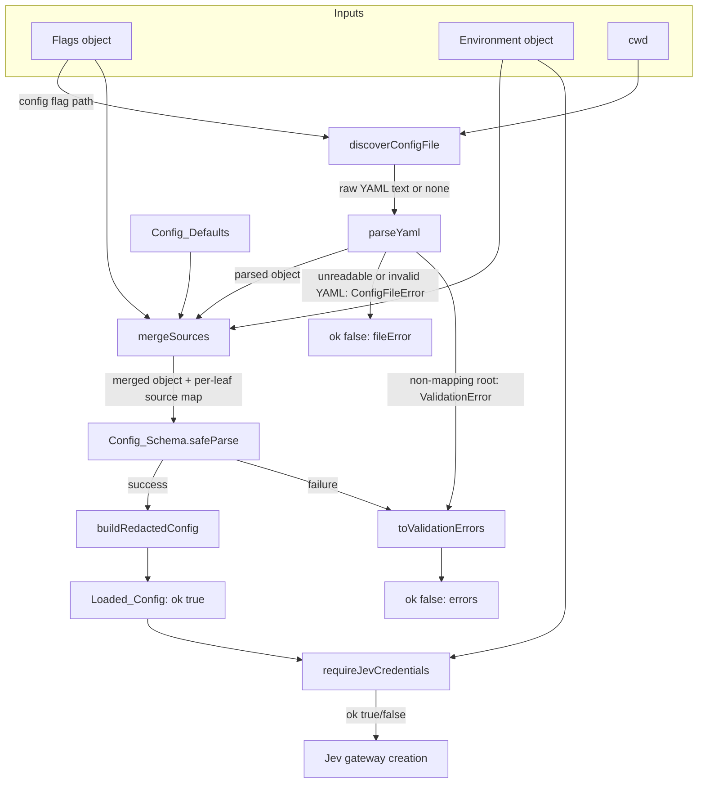
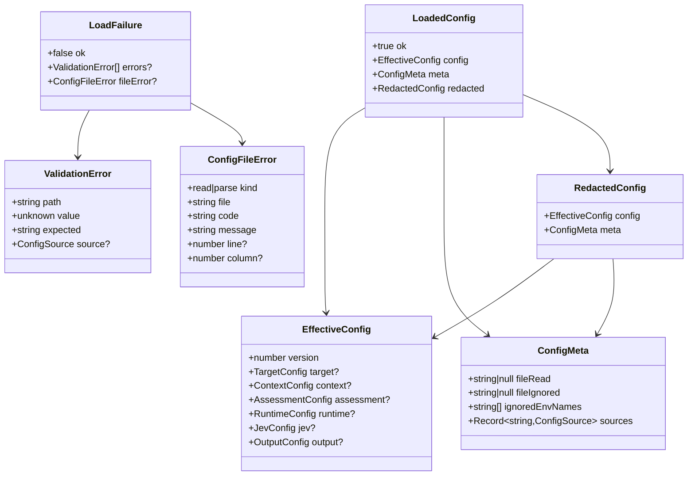

# Design Document

## Overview

This feature implements the configuration layer of Continuous Evidence: a pure, synchronous module at `packages/ce/src/config/` that defines every `ce.yml` key as a single zod schema, merges four Config_Sources (Flags, Environment, Config_File, Config_Defaults) by fixed precedence, validates the merge, and exposes an Effective_Config plus a secret-free Redacted_Config for the Evidence bundle writer (out of scope here). It also provides a separate `requireJevCredentials` check and a `schemas/ce.schema.json` generator derived from the same zod schema.

The module answers four requirements from GitHub issue #4: schema + generated JSON Schema, file loading with flags > env > file > defaults precedence, structured validation errors that resolve the run to `ERROR`, and a secret-free effective configuration for the Evidence bundle. Everything here implements R2 of `docs/journal/v0.0/requirements.md` and design section 7; `SPEC.md` and `.kiro/specs/ce-config-loader/requirements.md` win on conflict, and the journal is not edited.

Two boundaries carried over from the structure and design-rule steering apply directly to this feature:

- Config_Loader produces `Validation_Error`s only. It never decides the run `Outcome` (`SKIPPED` / `EVIDENCED` / `UNSUPPORTED` / `ERROR`). `outcome/resolve.ts` is the only place that decides the outcome; the run pipeline (out of scope for this feature) is the caller that, on seeing a Config_Loader or Credential_Check failure, invokes `outcome/resolve.ts` with an error so it resolves `ERROR`. Nothing in `config/` imports from or calls `outcome/resolve.ts`.
- No Jev question text lives here. `config/` has no dependency on `jev/catalog.ts` or any other part of `jev/`; `jev.provider` and `jev.model` are plain configuration values, not question text.

## Research summary

**zod version and JSON Schema generation.** zod `4.6.7` is current (checked via `npm view zod version`) and ships a built-in `z.toJSONSchema()` converter — no separate `zod-to-json-schema` package is needed. `zod-to-json-schema` 3.25.2's own `peerDependencies` require `zod: "^3.25.28 || ^4"`, confirming zod v4 compatibility either way, but since zod 4 includes native JSON Schema generation, the design uses that directly and avoids an extra dependency. Verified locally: a zod v4 `strictObject` with nested objects, `z.literal`, numeric ranges, `z.url`, a regex-constrained duration string and a `z.record` (for `runtime.fixtures`) converts cleanly to draft-07 JSON Schema with `additionalProperties: false` propagated from `strictObject`, matching Requirement 3 criterion 3. `z.toJSONSchema(schema, { target: "draft-7", io: "input" })` is deterministic for a fixed schema (same object in, same object out; property insertion order follows declaration order in the zod schema), satisfying Requirement 3 criterion 4 (byte-identical regeneration) when the output is serialized with a stable `JSON.stringify(..., null, 2)` and a trailing newline.

**YAML parser.** `yaml` 2.9.1 is current and is the dependency the journal design section 2 already names. Its `parse()` with `{ schema: "core" }` (the default) implements YAML 1.2 core schema, supports no custom tags by default, and never executes code, matching Requirement 4 criterion 8. `yaml`'s `YAMLParseError` carries `linePos` (line/column), used for Requirement 4 criterion 6.

**JSON Schema validation for the consistency property.** `ajv` 8.20.0 is current and is the de facto standard JSON Schema validator for Node; it is added as a dev dependency used only by the consistency property test and the schema-generator's own self-check, not by the runtime loader (the loader always validates with zod, never with the generated JSON Schema — Requirement 3 criterion 7 names zod as authoritative).

**Property-based testing.** `fast-check` 4.11.0 is current and is already the project's chosen PBT library (tech steering). `vitest` 5.1.1 is current; the repository's `packages/ce/package.json` already pins `vitest: ^5.1.1`, so no version change is needed there.

**Node compatibility.** All of the above (`zod@4`, `yaml@2.9`, `ajv@8.20`, `fast-check@4`) declare ESM/CJS dual builds compatible with Node ≥ 18, well within the project's `>=22.12` floor. No native bindings are involved.

## Architecture



`loadConfig` is the single entry point and is a pure function of its three parameters (`cwd`, `flags`, `env`); it never reads `process.env` or `process.cwd()` itself (Requirement 8 criterion 3). `requireJevCredentials` is a second, independent pure function that takes the already-computed `Loaded_Config` and an `Environment`, and performs no file I/O or re-merge (Requirement 6 criterion 11).

## Components and Interfaces

### Package layout and module responsibilities

```
packages/ce/src/config/
  schema.ts       Config_Schema (zod) — the single source for keys, types, constraints.
  defaults.ts      Config_Defaults — the default value object, validated against Config_Schema.
  duration.ts      Duration string <-> milliseconds helpers shared by schema.ts and env coercion.
  redact-pattern.ts Compilation of a Redact_Pattern string to RegExp, and the plain/delimited rule.
  env.ts           CE_* environment variable discovery, name mapping, and type coercion.
  merge.ts         Per-leaf-key precedence merge of four source objects, with meta.sources tracking.
  errors.ts        Validation_Error and ConfigFileError types, Config_Error_Report formatting (formatReport, formatFileError, reportConfigFailure), path-sorting, secret redaction of error values.
  file.ts          Config_File discovery (ce.yml / .ce.yml / --config), reading, YAML parsing.
  load.ts          loadConfig(...) — orchestrates file.ts, env.ts, merge.ts, schema.ts, errors.ts, redact.ts.
  credentials.ts   requireJevCredentials(...) — the Credential_Check.
  redact.ts        buildRedactedConfig(...) — Effective_Config + Config_Meta -> Redacted_Config.
  json-schema.ts   generateJsonSchema() — Config_Schema -> JSON Schema object (used by the generator script).
scripts/
  generate-config-schema.ts   Writes schemas/ce.schema.json from config/json-schema.ts.
schemas/
  ce.schema.json   Generated artifact, committed to the repository.
```

This is a refinement of the planned layout in `docs/journal/v0.0/design.md` section 2, which names only `schema.ts`, `load.ts` and `defaults.ts` inside `config/`. The additional files (`duration.ts`, `redact-pattern.ts`, `env.ts`, `merge.ts`, `errors.ts`, `file.ts`, `credentials.ts`, `redact.ts`, `json-schema.ts`) are internal collaborators of `load.ts` and `schema.ts`; they keep each concern (duration parsing, regex compilation, env mapping, merge precedence, error formatting, file discovery, credential checking, redaction, JSON Schema generation) independently testable, while `load.ts` remains the only module that orchestrates them and `schema.ts` remains the single source of keys and constraints, consistent with the structure steering's placement rule that `config/` "defines the `ce.yml` zod schema, loads the file, and holds the defaults" — these are all sub-parts of "loads the file."

### `schema.ts`

Exports:
- `ConfigSchema`: the zod object for the full configuration (Requirement 1 criterion 1). Built with `z.strictObject` at every nesting level so unknown keys are rejected (Requirement 1 criterion 12) without a separate pass.
- `EffectiveConfig`: `z.infer<typeof ConfigSchema>`, re-exported from `src/index.ts` (Requirement 8 criterion 4, 6).
- A module-level list `CREDENTIAL_KEY_NAME_PATTERN` (matches `api-key`, `apikey`, `secret`, `token`, `password`, case-insensitive) used by a `superRefine` step that walks the *input* object (before stripping) for key names outside `context.redact` and `runtime.fixtures`, implementing Requirement 1 criterion 13. This check must inspect raw input keys, which `strictObject`'s built-in "unrecognized key" error does not by itself distinguish from a plain typo; the `superRefine` runs after `strictObject` parsing of the flattened leaf path and classifies the specific message as "secrets belong in environment variables" versus the generic "unknown key" message.
- Per-field constraints matching Requirement 1 criteria 3–11: `version` is `z.literal(0)`; the three thresholds and `uncertainty-band` are `z.number().min(0).max(1)`; `on-uncertain` is `z.enum(['evidence', 'skip'])`; `jev.provider` is `z.enum(['openrouter', 'typesafe'])`; `output.fail-on` is `z.array(z.enum(['error', 'unsupported', 'evidenced-not-reached']))`; `runtime.max-steps`, `runtime.viewport.width`, `runtime.viewport.height` are `z.number().int().positive()`; `target.ready.timeout` and `runtime.timeout` use the shared `DurationString` schema from `duration.ts` (regex `^[1-9]\d*(ms|s|m)$`); `target.url` is `z.string().url()` further refined to require `http:`/`https:` scheme; `context.redact` items use the `RedactPattern` schema from `redact-pattern.ts`, which refines a string with `compileRedactPattern` (see below) and surfaces its failure as a zod issue carrying the `expected` text for Requirement 1 criteria 16–17.
- Every key is wrapped in `.optional()` (Requirement 1 criterion 2); nested objects are themselves optional so that, for example, an entirely absent `target` key is valid.

### `redact-pattern.ts`

`compileRedactPattern(item: string): RegExp` implements Requirement 1 criteria 14, 15, 16, 17:
1. If `item` matches `/^\/(.*)\/([a-z]*)$/s` (a leading and a matching trailing `/` with trailing flag letters), compile `new RegExp(capturedPattern, capturedFlags)`.
2. Otherwise, if `item` starts with `(?i)` or matches a general "inline flag group" pattern (`/^\(\?[a-zA-Z]+\)/`) that `new RegExp` would reject or silently misinterpret, throw a typed `InlineFlagError` carrying the `/pattern/i` guidance text.
3. Otherwise, attempt `new RegExp(item)` as a plain source; any thrown `SyntaxError` is wrapped as a typed `RegexCompileError` carrying the generic "must be a JavaScript RegExp source or the form `/pattern/flags`" text.

`schema.ts`'s `RedactPattern` zod type calls this function inside `.transform()`/`.check()` and turns a thrown `InlineFlagError` or `RegexCompileError` into the matching zod issue, so the eventual `Validation_Error.expected` text differentiates the two cases per Requirement 1 criteria 16 and 17.

### `defaults.ts`

Exports `ConfigDefaults: EffectiveConfig`, a plain object literal matching Requirement 2 criterion 1 exactly (version 0; thresholds 0.6/0.6/0.7; uncertainty-band 0.1; on-uncertain `evidence`; runtime.max-steps 12; runtime.timeout `90s`; viewport 1280×800; jev.provider `openrouter`; jev.model `typesafe/jev-1.14`; output.dir `.ce/runs`; output.fail-on `[error]`). Keys with no default (`target.*`, `context.*`, `runtime.fixtures`) are omitted from the object entirely, which `ConfigSchema.parse` accepts because every key is optional (Requirement 2 criterion 2). A unit test asserts `ConfigSchema.safeParse(ConfigDefaults).success === true` (Requirement 2 criterion 3).

### `duration.ts`

`parseDuration(text: string): number` (milliseconds) and `formatDuration(ms: number): string`, plus the exported `DURATION_PATTERN` regex used by `schema.ts`. Used by `env.ts` to coerce `CE_RUNTIME_TIMEOUT=120s` style text before validation (Requirement 5 criterion 9), and by `merge.ts`/tests for round-trip checks.

### `env.ts`

- `ENV_KEY_MAP`: a derived (not hand-maintained) map built once from `ConfigSchema`'s shape, from dotted key path to env var name, computed as `CE_` + path with `.` and `-` replaced by `_`, upper-cased (Requirement 5 criterion 7), skipping `runtime.fixtures` entirely so it can never be set from `Environment` (Requirement 5 criterion 15, 16).
- `readEnvSource(env: Record<string, string | undefined>): { values: DeepPartial<RawConfig>; ignoredNames: string[] }`: for every `env` key starting with `CE_`, look up the reverse of `ENV_KEY_MAP`; if found, coerce the text value using the target leaf's declared zod type (number → `Number()`, duration → kept as string for `schema.ts` to validate, list-valued keys → split on `,` and `.trim()` each item per Requirement 5 criterion 8, everything else → string as-is) and place it at the corresponding path; if not found (including any name starting with `CE_RUNTIME_FIXTURES`), add the name to `ignoredNames` without touching `values` (Requirement 5 criteria 11, 16). Conversion failures (e.g. `CE_RUNTIME_MAX_STEPS=abc`) are not swallowed here — the raw text is kept as-is when it cannot be coerced, so the downstream zod validation step produces the Requirement 5 criterion 10 `Validation_Error` with the *original* text as `value`, tagged with `source: 'env'`.

### `merge.ts`

`mergeSources({ flags, envValues, fileValues, defaults }): { merged: RawConfig; sources: Record<string, ConfigSource> }`. Performs a **recursive leaf-level merge**: for every leaf path reachable in any of the four source objects, the first source (in the order flags, env, file, defaults) that defines that exact leaf path wins; the `sources` map records which one. List-valued keys (`target.routes`, `context.include`, `context.exclude`, `context.redact`, `output.fail-on`) are treated as leaves themselves — the entire array from the highest-precedence source that defines that key wins, with no concatenation (Requirement 5 criterion 6) — because a list is merged as a whole value, not element-by-element. This single recursive function is what gives Requirement 5 criterion 5 (nested objects keep untouched sibling leaves from a lower-precedence source) and criterion 13 (the precedence property) for free: a non-leaf key is never "set" by a source unless that source actually supplies a value at that exact leaf path.

Before merging, `load.ts` validates each of the four source fragments independently against a **partial view** of `ConfigSchema` (`ConfigSchema.partial()`, deep) so a bad value already carries the correct `source` tag (Requirement 5 criterion 12) — this happens in `load.ts`, not `merge.ts`, because only `load.ts` knows which fragment came from which named source.

### `errors.ts`

- `ValidationError` type: `{ path: string; value: unknown; expected: string; source?: ConfigSource }`.
- `fromZodError(error: ZodError, source?: ConfigSource): ValidationError[]`: maps zod issues to `ValidationError`s, dotted-path-joining `issue.path`, and filling `expected` from a lookup table of human-readable shape text keyed by issue code/zod type (e.g. `number between 0 and 1`, `one of "evidence", "skip"`, `positive integer`, `duration string like "90s"`, `absolute http or https URL`, `JavaScript RegExp source or the form /pattern/flags`, `mapping`).
- `formatReport(errors: ValidationError[], secrets: string[]): string`: sorts by `path` (stable, Requirement 6 criterion 4), renders one line per error with path/value/expected (criterion 3), and replaces any `value` (and any substring of `value`) that matches an entry of `secrets` with `[REDACTED]` (criterion 7) before rendering — never before storing on the `ValidationError` object itself, so the in-memory error always carries the true value for programmatic callers, matching Requirement 6 criterion 2's literal field definition, while *only the printed report* is redacted. (`value` is also redacted when it equals the Config_Flag's own string for secrets accidentally pasted into `--config`, though in practice `path === 'config'` never matches a credential-named key.)
- `sortByPath(errors)`: exported separately for Requirement 6 criterion 4's test.
- `ConfigFileError` type (Requirement 4 criterion 6, Requirement 6 criteria 9, 19, 20): `{ kind: 'read' | 'parse'; file: string; code: string; message: string; line?: number; column?: number }`. `file` is the file name or path as read. `code` is the system error code for `kind: 'read'` (for example `EACCES`) or the `yaml` parse error code for `kind: 'parse'` (for example `BAD_INDENT`). `message` is the system or parser message. `line` and `column` are set only for `kind: 'parse'` and only when the parser supplies them. The type has **no** `path`, `value`, `expected` or `source` field, so it cannot be mistaken for, or converted into, a `Validation_Error`.
- `formatFileError(error: ConfigFileError): string`: renders one entry of the form `<file>: cannot read config file (<code>): <message>` for `kind: 'read'`, and `<file>:<line>:<column>: invalid YAML (<code>): <message>` for `kind: 'parse'` (line and column omitted when absent). It prints no value, path or expected-shape text, and it never prints file contents, so no Secret in the file can reach the report.
- `reportConfigFailure(failure: LoadFailure, secrets: string[]): string`: the single entry point that the run pipeline calls to print any `loadConfig` failure to standard error. It branches on the failure shape: `errors` present → `formatReport(failure.errors, secrets)`; `fileError` present → `formatFileError(failure.fileError)`. Credential_Check failures (`{ ok: false, errors }`) take the first branch. Both branches produce text for standard error, and the pipeline exits with code `1` for either (Requirement 6 criterion 18).

### `file.ts`

- `discoverConfigFile({ cwd, configFlag }): { path: string | null; ignoredPath: string | null } | { flagError: ValidationError }`: implements Requirement 4 criteria 1–4, 10–16. When `configFlag` is given: trims it; if empty/whitespace, returns `flagError` (criterion 15); otherwise resolves it with `path.resolve(cwd, configFlag)` if relative or uses it as-is if absolute (criterion 13); checks existence/readability with `fs.accessSync`, returning `flagError` if it fails (criterion 14); on success, that path is the only Config_File, discovery of `ce.yml`/`.ce.yml` is skipped entirely, and neither is recorded as ignored (criterion 12). When `configFlag` is absent: checks `path.join(cwd, 'ce.yml')` then `path.join(cwd, '.ce.yml')` (criteria 1, 2); if both exist, returns `ce.yml` as `path` and `.ce.yml` as `ignoredPath` (criterion 3); if neither exists, returns `{ path: null, ignoredPath: null }` (criterion 4). All file access here is restricted to `cwd` plus the exact `configFlag` path (criterion 10) — no directory walk upward, no `$HOME` lookup.
- `readAndParseConfigFile(path: string | null): { ok: true; value: unknown } | { ok: false; fileError: ConfigFileError } | { ok: false; errors: ValidationError[] }`: returns `{ ok: true, value: {} }` when `path` is `null` (criterion 4 continuation). Otherwise reads the file with `fs.readFileSync(path, 'utf8')`; wraps `YAML.parse(text, { schema: 'core' })` (criterion 8). Outcomes:
  - An empty file or a file of only comments parses to `null`/`undefined` under `yaml`, which is treated as `{}` (criterion 5).
  - A `fs` error on read (for example `EACCES`) returns `{ ok: false, fileError }` with `kind: 'read'`, `file: path`, `code: error.code` and `message: error.message` (Requirement 6 criterion 9).
  - A `YAMLParseError` returns `{ ok: false, fileError }` with `kind: 'parse'`, `file: path`, `code: error.code`, `message: error.message` and `line`/`column` from `error.linePos?.[0]` (criterion 6, Requirement 6 criteria 19 and 20). The result is not a `ValidationError`: it has no `path`, `value` or `expected` field.
  - A parsed non-mapping root (a scalar or array) returns `{ ok: false, errors: [ValidationError] }` with `path: '(root)'`, the parsed value, `expected: 'mapping'` and `source: 'file'` (criterion 7). This is valid YAML with a wrong shape, so it stays a `ValidationError`.
  - `readAndParseConfigFile` never throws for any of these cases.
  - The Config_Flag precheck in `discoverConfigFile` (criterion 14) still produces a `ValidationError` with `path: 'config'` when the flag path is missing or unreadable at discovery time. A read failure after a successful precheck is a `ConfigFileError` of `kind: 'read'`.

### `load.ts`

```ts
export interface LoadConfigOptions {
  cwd: string;
  flags: Record<string, unknown>; // includes optional `config` (Config_Flag)
  env: Record<string, string | undefined>;
}
export type LoadFailure =
  | { ok: false; errors: ValidationError[] }      // invalid configuration content
  | { ok: false; fileError: ConfigFileError };    // unreadable file or invalid YAML syntax
export type LoadConfigResult =
  | { ok: true; config: EffectiveConfig; meta: ConfigMeta; redacted: RedactedConfig }
  | LoadFailure;

export function loadConfig(options: LoadConfigOptions): LoadConfigResult;
```

Orchestration, in order:
1. `discoverConfigFile` — on a flag error, return `{ ok: false, errors: [flagError] }` immediately (Requirement 4 criterion 14 takes precedence over Requirement 6 criterion 9, since this short-circuits before any other source is read).
2. `readAndParseConfigFile` — on an unreadable file or invalid YAML, return `{ ok: false, fileError }` immediately (no `errors` field, no Validation_Error). On a non-mapping root, return `{ ok: false, errors: [rootError] }` immediately. Because these failures stop the load before steps 5 to 8, a `fileError` result never carries other errors.
3. Split `flags` into `{ config: configFlagValue, ...schemaFlags }` — `config` is consumed in step 1 and is never passed into `merge.ts` or validated against `ConfigSchema` (Requirement 8 criterion 7; it is "not a key of the Config_Schema" per the Config_Flag glossary entry).
4. If `schemaFlags` contains a `runtime.fixtures` key (checked structurally, both dotted-string and nested-object spellings), return `{ ok: false, errors: [thatOneError] }` for Requirement 5 criterion 17 — checked before generic schema validation so the message is the specific one the requirement names.
5. `readEnvSource(env)` → `{ values: envValues, ignoredNames }`.
6. Validate each of `schemaFlags`, `envValues`, `fileValues` independently against `ConfigSchema.partial()` (deep partial), tagging any resulting errors with `source: 'flag' | 'env' | 'file'` respectively; collect all such errors. If any exist, return `{ ok: false, errors }` (sorted) without proceeding to merge (Requirement 5 criterion 12).
7. `mergeSources({ flags: schemaFlags, envValues, fileValues, defaults: ConfigDefaults })` → `{ merged, sources }`.
8. `ConfigSchema.safeParse(merged)`. On failure, map with `fromZodError(result.error)` (no single `source` — the merge already resolved per-leaf source, so a residual error after merge, e.g. a cross-field or `superRefine` rule, is tagged using `sources[issue.path]` looked up from step 7's map). Return `{ ok: false, errors }`.
9. On success, build `meta: ConfigMeta` from: the file path read / ignored (step 1), `ignoredNames` (step 5), and `sources` (step 7).
10. `buildRedactedConfig(config, meta, env)` → `redacted`.
11. Return `{ ok: true, config, meta, redacted }`.

`ConfigMeta` type (`load.ts`, re-exported from `src/index.ts`):

```ts
export interface ConfigMeta {
  fileRead: string | null;
  fileIgnored: string | null;
  ignoredEnvNames: string[];
  sources: Record<string, 'flag' | 'env' | 'file' | 'default'>;
}
```

### `credentials.ts`

```ts
export function requireJevCredentials(
  loaded: { ok: true; config: EffectiveConfig; meta: ConfigMeta; redacted: RedactedConfig },
  env: Record<string, string | undefined>,
): { ok: true } | { ok: false; errors: ValidationError[] };
```

Reads `loaded.config.jev?.provider ?? ConfigDefaults.jev.provider` and the matching `loaded.meta.sources['jev.provider'] ?? 'default'`. If provider is `openrouter`, checks `env.OPENROUTER_API_KEY` is set and non-empty after trimming; if `typesafe`, checks `env.TYPESAFE_API_KEY`. On failure builds one `ValidationError` with `path: 'jev.provider'`, `value` equal to the provider string, `source` equal to the looked-up source, and `expected` naming the missing env var (`OPENROUTER_API_KEY` or `TYPESAFE_API_KEY`) — never the key's value, since the key is never read into the error object, only its *presence* is checked (Requirement 6 criteria 12–14). This function performs no file I/O, no re-parsing of `env`, and does not call `loadConfig` again (criterion 11).

### `redact.ts`

```ts
export interface RedactedConfig {
  config: EffectiveConfig; // with Secret substrings replaced by '[REDACTED]'
  meta: ConfigMeta;
}
export function buildRedactedConfig(
  config: EffectiveConfig,
  meta: ConfigMeta,
  env: Record<string, string | undefined>,
): RedactedConfig;
```

Collects the Secret set: the trimmed, non-empty values of `env.OPENROUTER_API_KEY` and `env.TYPESAFE_API_KEY`, plus the compiled matches (if any) of `config.context?.redact` patterns applied against every string leaf of `config` (a value matching a *redact pattern* is itself redacted, consistent with the glossary's definition of Secret as "a value matching a configured redaction secret"). Deep-clones `config`, and for every string leaf, replaces any substring equal to a collected Secret value with `[REDACTED]` (Requirement 7 criterion 6). Since `ConfigSchema` defines no key that stores a credential (criterion 4) the clone step never needs to special-case a field by name; redaction is purely substring-based over the two known Secret values from `env`, which is also why `jev.provider` and the credential env var *name* can be recorded in `meta` safely (criterion 5) — only the *value*, never present as a config leaf, is what gets redacted. Returns `{ config: redactedClone, meta }` (criteria 12, 14 — `meta` is not re-merged, just attached under its own key, and `config` here is the key name under the Redacted_Config, distinct from the unredacted `Loaded_Config.config`).

Running `buildRedactedConfig` again on an already-redacted config leaves it unchanged (Requirement 7 criterion 9), because `[REDACTED]` never matches a collected Secret's exact text.

### `json-schema.ts` and `scripts/generate-config-schema.ts`

`generateJsonSchema(): object` calls `z.toJSONSchema(ConfigSchema, { target: 'draft-7', io: 'input' })`, then applies two fixed post-processing edits for the two documented exceptions (Requirement 3 criteria 7, 8):
- `context.redact` items: the generated `items: { type: 'string' }` gets a `description` appended stating that this schema does not check that each item compiles as a RegExp, and that `ConfigSchema` in `config/schema.ts` is authoritative.
- `target.url`: the generated `{ type: 'string', format: 'uri' }` gets a `description` appended stating that this schema does not restrict the URL scheme to `http`/`https`, and that `ConfigSchema` is authoritative.

The script `scripts/generate-config-schema.ts` (run via `tsx` or the compiled `dist` output) calls `generateJsonSchema()`, serializes with `JSON.stringify(schema, null, 2) + '\n'`, and writes it to `schemas/ce.schema.json` at the repository root, relative to the package's own location (`path.resolve(import.meta.dirname, '../../../../schemas/ce.schema.json')` from `packages/ce/src/`, i.e. the repository root `schemas/` directory named in the structure steering's target layout — not inside `packages/ce`). Because `z.toJSONSchema` is a pure function of the schema object and the post-processing is deterministic string concatenation, two runs on an unchanged `ConfigSchema` produce byte-identical output (Requirement 3 criterion 4).

**Stale-file detection** (Requirement 3 criterion 5): a vitest test (`config/json-schema.staleness.test.ts`) calls `generateJsonSchema()`, serializes it the same way the script does, reads the committed `schemas/ce.schema.json` from disk, and asserts the two strings are equal; on mismatch the assertion failure message is customized to read `schemas/ce.schema.json is stale — run "npm run generate:config-schema" and commit the result`, which names the stale file as required. This test has no network or filesystem write side effect; it only reads.

## npm scripts

Added to `packages/ce/package.json`:

```json
{
  "scripts": {
    "build": "tsc",
    "typecheck": "tsc --noEmit",
    "test": "vitest run --passWithNoTests",
    "generate:config-schema": "tsx src/scripts/generate-config-schema.ts"
  }
}
```

`generate:config-schema` is a package-level script, run with `npm run generate:config-schema --workspace continuous-evidence` or from inside `packages/ce`. It is **not** wired into `build` or `test`, by design: regeneration is a developer action after a schema change, and the staleness test (above) is what *enforces* that the developer ran it and committed the result, matching Requirement 3 criterion 5's "test suite SHALL fail" wording rather than silently regenerating during `npm test`. `tsx` (or an equivalent "run TypeScript directly" dev dependency) is added to `packages/ce/package.json` `devDependencies` so the script does not require a prior `npm run build`.

## Data Models



`LoadFailure` has exactly one of `errors` (invalid configuration content, including a non-mapping root and the Config_Flag path errors) or `fileError` (unreadable Config_File, invalid YAML syntax). `ConfigFileError` deliberately has no `path`, `value`, `expected` or `source` field. A failure from `requireJevCredentials` always has the `errors` shape.

`ConfigSource = 'flag' | 'env' | 'file' | 'default'`. `EffectiveConfig` never contains a `meta` field (Requirement 7 criterion 14) — `ConfigMeta` only ever appears as a sibling of `config`, inside `LoadedConfig` or inside `RedactedConfig`, never merged into `EffectiveConfig` itself.

## Correctness Properties

*A property is a characteristic or behavior that should hold true across all valid executions of a system — essentially, a formal statement about what the system should do. Properties serve as the bridge between human-readable specifications and machine-verifiable correctness guarantees.*

### Property 1: Unknown and credential-named keys are always rejected

For any valid configuration object and any extra key injected at any object level, if the injected key's name is not a key the Config_Schema defines at that path, validating the object produces a `Validation_Error` whose `path` includes that key; and if the injected key's name matches a credential-name pattern (`api-key`, `apikey`, `secret`, `token`, `password`, case-insensitive) and its path is not `context.redact` or under `runtime.fixtures`, the `Validation_Error`'s message states that secrets belong in environment variables.

**Validates: Requirements 1.12, 1.13**

### Property 2: Redact-pattern compilation is total and classified

For any string, compiling it as a Redact_Pattern either succeeds (when the string is a plain RegExp source, or has the form `/pattern/flags` with a pattern `new RegExp` accepts) or fails with an `expected` field naming `/pattern/i` (when the string begins with an unsupported inline-flag group such as `(?i)`) or a generic RegExp-source message (for any other compile failure); exactly one of these three outcomes occurs, and when it succeeds with the delimited form, the resulting RegExp's `flags` property equals the captured flags and it matches strings the pattern+flags combination is constructed to match (e.g. a case-insensitive flag makes an upper-case occurrence of the pattern match).

**Validates: Requirements 1.11, 1.14, 1.15, 1.16, 1.17**

### Property 3: JSON Schema and Config_Schema agree, within the two documented exceptions

For all configuration objects generated so that every `context.redact` item compiles as a RegExp and every `target.url` uses only the `http` or `https` scheme, validating the object against the generated `schemas/ce.schema.json` (via ajv) and against `ConfigSchema` (via zod) gives the same accept-or-reject result.

**Validates: Requirements 3.6, 3.9**

### Property 4: Non-existent or blank `--config` paths are always rejected the same way

For any string that does not name an existing readable file relative to a given `cwd`, calling `loadConfig` with that string as the Config_Flag returns a failure result whose single `Validation_Error` has `path: 'config'`, `source: 'flag'`, and a message containing the given string; and for any string composed only of whitespace (including the empty string), the same call returns a failure result whose `Validation_Error` has `path: 'config'` and `source: 'flag'`.

**Validates: Requirements 4.14, 4.15**

### Property 5: Precedence and source attribution hold per leaf key

For any four configuration fragments (flags, env-derived values, file values, defaults) that are each individually valid, merging them with `loadConfig`'s precedence (flags > env > file > defaults) yields an Effective_Config in which, for every leaf key path present in a higher-precedence fragment, the merged value equals that fragment's value, and `meta.sources` records that leaf's actual supplying source; leaf keys absent from all higher-precedence fragments but present in a lower-precedence one keep the lower-precedence fragment's value and recorded source, independent of what else is set elsewhere in the same nested object.

**Validates: Requirements 5.1, 5.2, 5.3, 5.4, 5.5, 5.13, 5.14**

### Property 6: List-valued keys replace rather than concatenate

For any two configuration fragments at different precedence levels that both define the same list-valued key (`target.routes`, `context.include`, `context.exclude`, `context.redact`, `output.fail-on`) with different array contents, the merged result's value at that key equals the higher-precedence fragment's array exactly, with no element from the lower-precedence fragment's array present unless it also appears in the higher-precedence array.

**Validates: Requirements 5.6**

### Property 7: Environment variable mapping and type coercion round-trip

For any key path the Config_Schema defines (other than `runtime.fixtures`) and any valid value for that key's declared type, formatting the value as the text an environment variable would hold (numbers and durations as their string form, lists as a comma-joined string with arbitrary surrounding whitespace per item) under the env var name `CE_` + the path in upper snake case, then running that single environment variable through `loadConfig`, yields an Effective_Config whose value at that path equals the original value.

**Validates: Requirements 5.7, 5.8, 5.9**

### Property 8: Untypeable environment or flag text is always rejected with the offending text preserved

For any key path with a numeric, duration, or enum-typed leaf, and any string that is not a valid representation of that type, supplying that string through an environment variable or a flag at that path causes `loadConfig` to return a failure result containing a `Validation_Error` whose `path` equals the key path and whose `value` equals the original string unmodified.

**Validates: Requirements 5.10**

### Property 9: Unknown and fixtures-prefixed `CE_` variables are always ignored and recorded, never applied

For any environment variable name that starts with `CE_` and either does not map to any Config_Schema key or starts with `CE_RUNTIME_FIXTURES`, including that variable in `env` never changes the resulting Effective_Config's value at any path, and the variable's name appears in `meta.ignoredEnvNames`.

**Validates: Requirements 5.11, 5.16**

### Property 10: `runtime.fixtures` is never accepted from flags

For any value (of any shape) placed under the key `runtime.fixtures` in the `flags` object passed to `loadConfig`, the call returns a failure result containing a `Validation_Error` with `path: 'runtime.fixtures'`, `source: 'flag'`, and `value` equal to the given value, regardless of what `runtime.fixtures` is set to in the Config_File or Config_Defaults.

**Validates: Requirements 5.15, 5.17**

### Property 11: Every violation is reported, sorted, and never thrown

For any syntactically valid configuration object containing one or more independent schema violations, `loadConfig` returns a failure result (never throwing) whose `errors` array contains at least one `Validation_Error` per distinct violation, each with non-empty `path`, `value`, and `expected` fields, sorted in non-decreasing order by `path`, and the result contains no `config` field.

**Validates: Requirements 6.1, 6.2, 6.3, 6.4, 6.8, 6.17**

### Property 12: Secret-matching values are always redacted in the printed report

For any `Validation_Error` whose `value` contains a Secret (an `OPENROUTER_API_KEY`-or-`TYPESAFE_API_KEY`-shaped string supplied through `env`, or a string matching a configured `context.redact` pattern) as a substring, the text produced by `formatReport` for that error contains `[REDACTED]` in place of that substring and does not contain the Secret value itself anywhere in the output.

**Validates: Requirements 6.7**

### Property 13: Config_Loader never fails on a missing provider API key

For any valid configuration object and any `env` object in which `OPENROUTER_API_KEY` and `TYPESAFE_API_KEY` are both absent or empty, `loadConfig` still returns a success result (`ok: true`).

**Validates: Requirements 6.10**

### Property 14: `output.fail-on` is irrelevant to a failed configuration's outcome signal

For any invalid configuration object and any value of `output.fail-on` (including `[]`, `[error]`, or `[unsupported]`) supplied through any single source, `loadConfig` returns the same kind of failure result (`ok: false`, with at least one `Validation_Error` in `errors`); the content of `output.fail-on` never changes whether `loadConfig` succeeds or fails. The same holds when the Config_File is unreadable or has invalid YAML: the failure is `ok: false` with a `fileError`, independent of `output.fail-on` in Flags or the Environment.

**Validates: Requirements 6.18, 6.19, 6.20**

### Property 15: Credential_Check outcome depends only on provider and key presence, and never leaks the key value

For any provider (`openrouter` or `typesafe`) and any `env` in which the matching API key (`OPENROUTER_API_KEY` or `TYPESAFE_API_KEY`) is present and non-empty, `requireJevCredentials` returns `{ ok: true }`; for any `env` in which it is absent, empty, or whitespace-only, it returns a failure result whose single `Validation_Error` has `path: 'jev.provider'`, `value` equal to the provider, `source` equal to the Loaded_Config's recorded source for `jev.provider`, and whose serialized failure result never contains the configured key's value (when one happens to be set in `env` under a different, non-matching key) as a substring.

**Validates: Requirements 6.12, 6.13, 6.14**

### Property 16: Redaction removes every Secret and is idempotent

For any Effective_Config and any Secret value appearing as a substring of one of its string leaves (or supplied through `env`, including Secret_Variables selected by name pattern such as `STRIPE_API_KEY`, as collected by `collectSecretValues` in `config/secrets.ts`), where `buildRedactedConfig` removes secrets with the Secret_Value_Function (`redactSecretValues`), `JSON.stringify(buildRedactedConfig(config, meta, env))` does not contain that Secret value as a substring; and applying `buildRedactedConfig`'s redaction a second time to its own output leaves the result unchanged (deep-equal to the first redacted result).

**Validates: Requirements 7.6, 7.8, 7.9**

### Property 17: Redacted_Config round-trips through JSON

For any `RedactedConfig` produced by `buildRedactedConfig`, `JSON.parse(JSON.stringify(redacted))` is deep-equal to `redacted`.

**Validates: Requirements 7.7, 7.11**

### Property 18: Invalid YAML syntax is always a file error, never a Validation_Error

For any text that is not valid YAML 1.2 (core schema) and any Config_File name, `loadConfig` on a directory containing that file returns `{ ok: false, fileError }` where `fileError.kind` is `parse`, `fileError.file` contains the file name, `fileError.code` and `fileError.message` are non-empty, and the result has no `errors` field and no `config` field. `reportConfigFailure` on that result prints a text that contains the file name and the code, and contains no `path`, `value` or `expected` entry. The same holds for an unreadable file with `kind: 'read'`.

**Validates: Requirements 4.6, 6.9, 6.19, 6.20, 9.16**

### Redundancy review

The prework identified several properties whose generalized form already subsumes a more specific or structural one:

- Requirement 5 criteria 1–4 (the three concrete precedence pairs) and criterion 5 (nested-object leaf preservation) are all instances of Property 5's general per-leaf precedence statement; a single property with a rich generator (fragments that sometimes overlap at a leaf, sometimes don't, sometimes nest) covers all four without four separate properties. Dedicated unit examples for the three pairs remain in the Testing Strategy per Requirement 9 criterion 1, since the requirements explicitly ask for them, but they are examples, not additional properties.
- Requirement 5 criterion 14 (`meta.sources` correctness) is folded into Property 5 rather than stated separately, because the same generator and the same merge call can assert both the value and its recorded source in one property, avoiding a duplicate generator.
- Requirement 7 criteria 2, 3, 4, 6 (Redacted_Config contains no credential value, in any form) are all restatements of the general redaction property and are folded into Property 16; criterion 5 (recording provider and env-var name) is a structural, non-input-varying assertion and is covered by a unit example instead.
- Requirement 7 criterion 7 (plain JSON-serializability) is folded into Property 17, since "serializes without throwing and round-trips" is a strictly stronger statement that implies serializability.
- Requirement 6 criterion 11 (Credential_Check does not reload or re-merge) is an implementation-boundary constraint, not an input/output property; it is verified with a unit test that spies on the file-system/env-reading functions and asserts they are not called inside `requireJevCredentials`.

## Error Handling

All errors the Config_Loader and Credential_Check can produce are represented as data, never thrown, and fall into two error shapes plus one report:

1. **`Validation_Error`** (`{ path, value, expected, source? }`): produced for every schema violation, for a non-mapping YAML root (Requirement 4 criterion 7), for the Config_Flag failures (Requirement 4 criteria 14, 15), for the `runtime.fixtures`-in-flags rejection (Requirement 5 criterion 17), and for Credential_Check failures (Requirement 6 criteria 12, 13). These are collected into `LoadFailure.errors` or the Credential_Check's `errors`.
2. **`ConfigFileError`** (`{ kind: 'read' | 'parse', file, code, message, line?, column? }`): produced when the Config_File exists but cannot be read (Requirement 6 criterion 9) or contains invalid YAML syntax (Requirement 4 criterion 6, Requirement 6 criteria 19 and 20). It names the file and carries a code and message. It has no `path`, `value` or `expected` field, and it is never wrapped in or converted to a `Validation_Error`. It is returned as `LoadFailure.fileError`, alone, because the load stops at that point.
3. **Config_Error_Report** (a formatted string, via `reportConfigFailure`): `reportConfigFailure` renders a `LoadFailure` by branching on its shape. `errors` goes through `formatReport` (one entry per `Validation_Error`, Requirement 6 criterion 3). `fileError` goes through `formatFileError` (one entry that names the file, the code and the message). There is no shared code path that forces a file error into the path/value/expected format.

Both failure shapes resolve to the same run result: the run pipeline resolves the Outcome to `ERROR` and exits with code `1` (Requirement 6 criterion 18), regardless of `output.fail-on`.

The Config_Loader's own module boundary (`load.ts`, `credentials.ts`) never throws for any input that represents invalid configuration or a missing/unreadable file (Requirement 6 criterion 8); a thrown exception from `loadConfig` or `requireJevCredentials` would only indicate a programming bug in the module itself (e.g. a logic error unrelated to the shape of the input), never a case the requirements describe.

**Who decides the Outcome.** Neither `loadConfig` nor `requireJevCredentials` sets or returns an `Outcome`. The run pipeline (outside this feature's scope) is responsible for calling `outcome/resolve.ts` with an error whenever either function returns `ok: false`, which — per the existing outcome table in `docs/journal/v0.0/design.md` section 6 ("Any uncaught error before a bundle could be meaningful → `ERROR`") — resolves to `ERROR`. The same pipeline is responsible for printing `reportConfigFailure(...)` to `stderr` and exiting the process with code `1` (Requirement 6 criteria 6, 15, 18). This design does not add an `Outcome` field anywhere in `config/`'s types, keeping the single-source-of-truth rule in the structure steering intact: `outcome/resolve.ts` is still the only place a run's `Outcome` is decided, and this feature only ever produces the error signal that feeds it.

## Testing Strategy

**Unit tests (vitest).** One test per enumerated scenario that the requirements name concretely rather than universally:

- One test per Config_Schema type/range/enum rule (Requirement 1 criteria 1, 3–11).
- Defaults: value-by-value assertion against Requirement 2 criterion 1's table; `ConfigSchema.safeParse(ConfigDefaults).success`; omitted-key keys stay `undefined`.
- JSON Schema generation: the generated object matches the Config_Schema's declared shape structurally (criteria 2, 3); two consecutive generator runs byte-equal (criterion 4); the committed `schemas/ce.schema.json` matches a freshly generated one (criterion 5, the staleness test); the two documented exception `description` fields are present on the right subschemas (criteria 7, 8).
- File discovery scenarios: `ce.yml` only, `.ce.yml` only, both present (with the ignored one recorded), neither present, non-mapping root (a `Validation_Error` with `path: '(root)'`), malformed YAML (a `ConfigFileError` with `kind: 'parse'`, asserting the file name, a non-empty code and message, and that the result has no `errors` field and the object has no `path`, `value` or `expected` property; `reportConfigFailure` prints the file name and code, and the run resolves to `ERROR` with exit code `1`, Requirement 9 criterion 16), `--config` with an existing different file (ce.yml untouched and unrecorded), `--config` with a missing file, relative `--config` resolved against a given `cwd` and not `process.cwd()`, empty-string and whitespace `--config`.
- Credential_Check per-source test: four cases with `jev.provider` supplied by flag, env, file, and default respectively (key value itself always missing), asserting `source` in the failure matches the supplying source and the formatted report names that source (Requirement 9 criterion 6).
- `requireJevCredentials` behavioral boundary: a spy/mock on `fs` and on `loadConfig` asserting neither is invoked from inside `requireJevCredentials`.
- Permission-denied file read (`EACCES` simulated via a mocked `fs`) resolves to a `ConfigFileError` with `kind: 'read'`, `code: 'EACCES'` and the file name, not a `Validation_Error` (Requirement 6 criterion 9).
- Malformed YAML is not listed among the `Validation_Error` category tests of Requirement 9 criterion 2 (wrong type, out-of-range number, invalid enumeration value, malformed duration, invalid URL, invalid regular expression, unknown key, credential-named key, non-mapping root). It has its own test above.
- `loadConfig({ env: {}, flags: {}, cwd })` with no Config_File present returns a success result equal to `ConfigDefaults`, independent of whatever real API keys happen to be set in the *real* `process.env` (not passed in) — this is naturally true since the function never reads `process.env` itself.
- Public API/boundary checks (Requirement 8): `src/index.ts` re-exports `loadConfig`, `requireJevCredentials`, `EffectiveConfig`, `ConfigMeta`, `LoadedConfig`; a test asserts `loadConfig`/`requireJevCredentials` do not touch `process.env`/`process.cwd` by spying on their getters during a call that supplies both explicitly.
- Integration-style wiring tests for exit code and stream: a small test invokes the CLI entry (or a thin wrapper function around `loadConfig` + `process.exit`) with an invalid config and asserts stderr contains the report text and the process (or wrapper) signals exit code `1`.

**Property tests (fast-check, vitest).** Property 18 generates invalid YAML from a small set of known-bad constructs (unclosed flow collection, bad indentation, duplicate mapping key, tab indentation) combined with arbitrary key names, written into a temporary directory. Each property in the Correctness Properties section becomes exactly one `fc.assert(fc.property(...))` test, configured with `{ numRuns: 100 }` at minimum, tagged with a comment in the form `// Feature: ce-config-loader, Property N: <property text>` directly above the test body. Generators are built from small composable fast-check arbitraries: a `validLeafValue` arbitrary per schema field type (bounded numbers, the three enums, duration strings built from `fc.integer({min:1}).map(n => n + fc.constantFrom('ms','s','m'))`-style composition, URLs restricted to `http`/`https` origins, RegExp-source strings built from a safe character-class alphabet to guarantee compilability per Requirement 3 criterion 9), and a `configFragment` arbitrary that produces a `DeepPartial<EffectiveConfig>` by picking a random subset of leaf paths and filling each with its `validLeafValue`.

**Fake Jev / no API key.** None of these tests require `OPENROUTER_API_KEY` or `TYPESAFE_API_KEY` to be set in the real environment, consistent with the tech steering's CI test policy; every test supplies `env` explicitly, including the handful that supply a fake key string to exercise the Credential_Check success path.

**Out of scope for this feature's tests:** the `jev/fake.ts` gateway, the Playwright runtime loop, and `outcome/resolve.ts`'s own test suite — this feature's tests stop at asserting that `loadConfig`/`requireJevCredentials` return the correctly-shaped failure; they do not assert what the run pipeline does with that failure, since that behavior belongs to the run pipeline's own future test suite.

## Closing the issue (Requirement 10)

**Gates (Requirement 10 criteria 3, 7, 9, 10).** Opening the pull request requires two conditions, and each is checked on its own:

- `all_tasks_complete`: every implementation task in `tasks.md` is complete. This is a hard gate, independent of `verification_1_and_2_passed`.
- `verification_1_and_2_passed`: the verification of criteria 1 and 2 below passed.

The implementer opens the pull request only when both are true. A passing `verification_1_and_2_passed` never substitutes for `all_tasks_complete`: if any implementation task is incomplete, the pull request is not opened, even when verification 1 and 2 and every other step have passed. If `verification_1_and_2_passed` is false, the failure is fixed first (criterion 7). The implementer evaluates `all_tasks_complete` by reading the task list, not by inferring it from test results.

Before opening a pull request:

0. Confirm `all_tasks_complete`. If any task is not complete, stop; do not continue to open the pull request.
1. Verify each of the four acceptance criteria of issue #4 against the delivered code, recording evidence (a test name, file path, or command output) for each:
   - Zod schema + generated `schemas/ce.schema.json`: evidence is `packages/ce/src/config/schema.ts`, `packages/ce/src/config/json-schema.ts`, the committed `schemas/ce.schema.json`, and the passing staleness test name.
   - File loading with flags > env > file > defaults: evidence is the passing Property 5 test name and the three dedicated precedence-pair unit test names.
   - Validation errors with path/value/expected resolving to `ERROR`: evidence is the passing Property 11 test name and the CLI wiring integration test name (exit code 1, stderr content).
   - Effective configuration with secrets removed: evidence is the passing Property 16 and Property 17 test names and `buildRedactedConfig`'s location (`packages/ce/src/config/redact.ts`).
2. Verify the issue's "Done when" condition — unit tests cover precedence and invalid configs — by naming the test files that do so (`merge.test.ts`, `load.test.ts`, `errors.test.ts`).
3. Run `npm install`, `npm run build`, `npm run typecheck`, and `npm test` from the repository root; all must pass (Requirement 9 criteria 14, 15).
4. Open a pull request against `main` of `rfxlamia/ce` whose body:
   - Contains the line `Closes #4`.
   - Lists the four acceptance criteria above, each with its recorded evidence.
   - Contains no API key or other secret value.
5. Do not merge the pull request and do not close issue #4 by hand; closing happens automatically on merge via the `Closes #4` line.

If any verification in steps 1–2 fails, fix the failure and re-run step 3 before opening the pull request. Step 4 runs only when step 0 (`all_tasks_complete`) and steps 1–3 (`verification_1_and_2_passed`) both hold.
