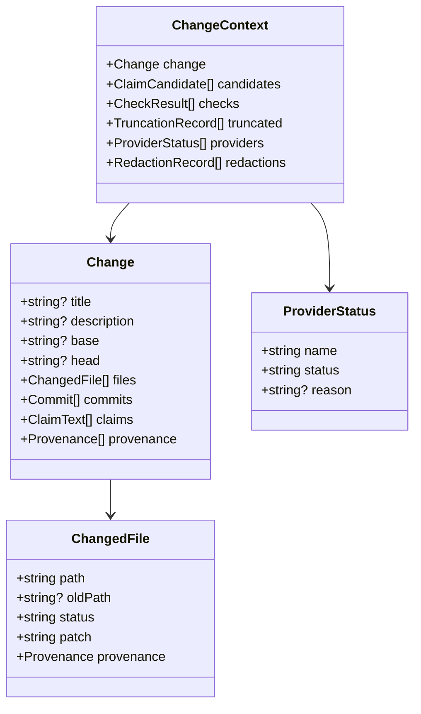

# Design Document

## Overview

This feature implements the Context Resolver, the first stage of the CE pipeline: `packages/ce/src/context/` plus one shared module, `packages/ce/src/config/secrets.ts`. Given the Effective_Config, the CLI options and the environment, `resolveContext` runs four Providers (Git, GitHub event, CLI, JUnit), applies the Redactor, applies the Budgeter, extracts Claim_Candidates, and returns one `ChangeContext` that later stages (Assessment, Evidence) consume without knowing which Providers ran or what they returned (SPEC section 3.5, 3.6).

This implements issue #6 in `rfxlamia/ce` ("[M1] Context resolver: providers, redaction, budget, candidates"), R3 and R4.1 of `docs/journal/v0.0/requirements.md`, and the `ChangeContext` shape of `docs/journal/v0.0/design.md` section 3, extended as E1–E7 of `requirements.md`. `SPEC.md` is normative and wins on conflict; `requirements.md` in this directory is the operative contract for this design, and this design does not alter it.

Two structural boundaries carried over from steering apply directly:

- Nothing in `context/` imports from `jev/`. The Context Resolver hands redacted, budgeted text to the Assessment stage; it never calls Jev and never decides an outcome. `outcome/resolve.ts` is untouched by this feature.
- `config/secrets.ts` is new and is shared by `context/redact.ts` and `config/redact.ts` (Requirement 13). It is the single definition of what a Secret_Variable is and the single string function that removes secret values from text, so the config section and the context section of `run.json` cannot disagree about secrets (Decision D23).

## Research summary

**Two-stage git without `--pathspec-from-file` on `diff`.** Verified locally against git 2.54 (per Decision D25): `--pathspec-from-file` is accepted by `add`, `commit`, `reset`, `restore`, `rm` and `checkout`, and rejected by `diff`. This forces Patch_Batches built from positional pathspec arguments rather than a file list, which in turn forces the batch-size and byte-length caps of Decision D25 to avoid `E2BIG` from `execFile`.

**Pathspec case sensitivity.** Verified locally: `git diff ... -- :(exclude,glob)**/.env` still shows `.Env`, while `:(exclude,glob,icase)**/.env` excludes it. This confirms Decision D24's choice of the `icase` pathspec magic for Stage 2 excludes, and the need for a separate case-insensitive comparison in the Stage 1 classification step (pathspec magic only affects what git matches on disk; the resolver's own in-memory classification of a Stage_1_Listing entry as a Sensitive_File must lower-case the base name itself).

**Node's `fs.glob`.** `fs.glob`/`fs.promises.glob` became non-experimental only in Node 22.17/24.0 (per Decision D20); the project's `engines.node` floor is `>=22.12`. A hand-written matcher in `context/glob.ts` avoids depending on a version range narrower than `engines.node`, and avoids a third-party glob dependency for a feature set this small (`*` and `**` only, per Decision D20).

**fast-check for the "done when" properties.** The issue's two acceptance properties (redaction removes generated secrets and is idempotent; every candidate is a substring of its source) map directly onto `fast-check`'s string generators (`fc.string()`, `fc.stringMatching`, custom generators built with `fc.record`/`fc.array`) with no new library needed beyond the project's existing `fast-check` dependency (tech steering).

## Architecture

```mermaid
flowchart TD
    subgraph Providers injected or default
        GP[Git_Provider git.ts]
        GHP[GitHub_Event_Provider github-event.ts]
        CP[CLI_Provider cli-args.ts]
        JP[JUnit_Provider junit.ts]
    end
    CFG[Effective_Config] --> GP
    CFG --> JP
    OPTS[CLI options] --> CP
    ENV[environment] --> GHP
    ENV --> SECDEF[config/secrets.ts collectSecretValues]

    GP --> ASM[assemble raw ChangeContext]
    GHP --> ASM
    CP --> ASM
    JP --> ASM

    ASM --> RED[redact.ts Redactor]
    SECDEF --> RED
    CFG -->|context.redact patterns| RED

    RED --> BUD[budget.ts Budgeter]
    BUD --> CAND[candidates.ts Candidate_Extractor]
    CAND --> OUT[ChangeContext]

    RED -.->|StageError on bad pattern| ERR[StageError context]
```

`resolve.ts` is the only orchestrator. It calls the four Providers (each independently, so one Provider's failure never touches another's data — Requirement 10.3), merges their results into the raw shape of `ChangeContext`, then runs the Redactor over every text field, then the Budgeter, then the Candidate_Extractor, in that fixed order (Requirement 10.1). Running the Redactor before the Budgeter means a secret is never left in text purely because it was truncated away from the Redactor's view; running the Budgeter before the Candidate_Extractor means a candidate is never built from text the Budgeter already dropped (Requirement 9.11).

### Why the Redactor runs per-field, not once over the whole context

Every text field (`title`, `description`, each commit message, each claim text, each Changed_File's `path`/`oldPath`/`patch`, each Check_Result `name`) is redacted independently (Requirement 5.8). Redacting per field, rather than concatenating the whole `ChangeContext` into one string and redacting once, keeps the Redaction_Summary's per-file counts exact (Requirement 5.9) and keeps a Private_Key_Block (Decision D22) from being misattributed to the wrong file when two unrelated fields happen to sit next to each other in a concatenated string.

## Components and Interfaces

### Package layout

```
packages/ce/src/
  config/
    secrets.ts          NEW — Secret_Definition (collectSecretValues) + Secret_Value_Function (redactSecretValues); re-exports REDACTED.
    redact.ts            CHANGED — buildRedactedConfig takes secrets from config/secrets.ts and applies them with redactSecretValues; re-exports REDACTED from secrets.ts.
  context/
    glob.ts              NEW — shared `*`/`**` matcher (Decision D20), used for context.include/exclude/checks.
    providers/
      git.ts             Git_Provider: two-stage diff, commits, Sensitive_File exclusion.
      github-event.ts    GitHub_Event_Provider: PR/push payload from GITHUB_EVENT_PATH.
      cli-args.ts         CLI_Provider: --claim, --base.
      junit.ts            JUnit_Provider: JUnit XML Check_Results.
    redact.ts             Redactor: built-in patterns, key rule, Secret_Variable values, configured patterns, Private_Key_Block, fixpoint.
    budget.ts             Budgeter: ranking, two-phase fit, Token_Estimate, truncation.
    candidates.ts         Candidate_Extractor: sentence/list-item/comment-line splitting, substring property, dedup, cap.
    resolve.ts            resolveContext(...) — the orchestrator; the module's only export used by the pipeline.
```

This matches the structure steering's planned layout and extends it only with `glob.ts` (needed by three different filters: `context.include`, `context.exclude`, `context.checks`) and `config/secrets.ts` (needed by two different consumers: `context/redact.ts` and `config/redact.ts`).

### Shared types (`context/types.ts`)

A small internal module (not separately required by the steering layout, grouped here for clarity; may live at the top of `resolve.ts` instead) defines the shapes every other `context/` module imports:

```ts
export type Provenance = {
  provider: 'git' | 'github' | 'cli' | 'junit' | 'config' | 'runtime';
  ref?: string;
  location?: string;
};

export type ReasonCode =
  | 'not-a-repository' | 'base-unresolved' | 'merge-base-missing' | 'git-failed'
  | 'head-missing' | 'source-absent' | 'source-unreadable' | 'source-malformed'
  | 'no-input' | 'not-configured';

export type TruncationReason =
  | 'dropped' | 'truncated' | 'env-file' | 'sensitive-file' | 'binary'
  | 'candidate-cap' | 'check-cap';

export interface ChangedFile {
  path: string;
  oldPath?: string;
  status: 'added' | 'modified' | 'deleted' | 'renamed';
  patch: string;
  provenance: Provenance;
}

export interface ChangeContext {
  change: {
    title?: string;
    description?: string;
    base?: string;
    head?: string;
    files: ChangedFile[];
    commits: { sha: string; message: string; provenance: Provenance }[]; // E1
    claims: { text: string; provenance: Provenance }[];                  // E2
    provenance: Provenance[];
  };
  candidates: { id: string; text: string; provenance: Provenance }[];
  checks: {
    name: string;
    status: 'passed' | 'failed' | 'skipped';
    covers?: string[];
    provenance: Provenance;
  }[];
  truncated: { file: string; reason: TruncationReason }[];                // E6
  providers: {
    name: 'git' | 'github' | 'cli' | 'junit';                            // E5
    status: 'used' | 'unavailable';
    reason?: ReasonCode;
  }[];
  redactions: { file: string; count: number }[];                         // E4
}
```

`ChangedFile.status` and `TruncationReason`/`ReasonCode` are the fixed enums of E3/E5/E6. `providers[].name` is narrowed to the four real Provider names (E5); `providers[].status === 'used'` may still carry `reason: 'head-missing'` (Decision D29), the one case where `used` and `reason` coexist.

### `config/secrets.ts` (new, shared)

```ts
export { REDACTED } from './redact.ts'; // see note below on re-export direction
export function collectSecretValues(env: Record<string, string | undefined>): string[];
export function redactSecretValues(text: string, secrets: string[]): string;
```

- `collectSecretValues(env)` (Secret_Definition) returns the trimmed, non-empty values of `OPENROUTER_API_KEY` and `TYPESAFE_API_KEY` unconditionally (Decision D13), without deduplication requirements beyond what callers need — callers that also fold in pattern-named variables (Requirement 5.3's Secret_Variable, which additionally covers `CREDENTIAL_KEY_NAME_PATTERN`/`/api[-_]key/i` names with the length/content rules of Decision D13) do so by passing the wider `env` object; `collectSecretValues` itself implements both: it is *the* function that returns Secret_Variable values, for every variable whose name is `OPENROUTER_API_KEY`/`TYPESAFE_API_KEY` or matches `CREDENTIAL_KEY_NAME_PATTERN`/`/api[-_]key/i`, applying the minimum-length/content rules only to the pattern-matched names (Decision D13). It returns values with no duplicates, longest first, matching the existing `collectSecrets` ordering in `config/redact.ts` today (so sorting by length-descending stays the tie-break rule for overlapping values).
- `redactSecretValues(text, secrets)` (Secret_Value_Function) implements the fixpoint of Decision D23: split `text` at every existing `[REDACTED]` marker, replace every secret in each marker-free segment with `[REDACTED]` (longest-first, so a shorter secret that is a substring of a longer one never partially eats it), rejoin with the marker, and repeat until the output stops changing. It is a pure function with no file, network or environment access (mirrors Requirement 5.10 for the Redactor, and is why `config/redact.ts`'s `buildRedactedConfig` can reuse it without becoming impure itself).

**Note on `REDACTED`'s home.** `requirements.md`'s Introduction states the constant "moves to `config/secrets.ts` and `config/redact.ts` re-exports it, so the import path `config/redact.ts` stays valid." This design follows that: `REDACTED = '[REDACTED]'` is defined in `config/secrets.ts`, and `config/redact.ts` does `export { REDACTED } from './secrets.ts';` (not the reverse shown in the snippet above, which was simplified for the interface listing). Every existing importer of `REDACTED` from `config/redact.ts` keeps working unchanged.

`context/redact.ts` imports `collectSecretValues` and `redactSecretValues` from `config/secrets.ts` — the only import `context/` takes from `config/`, alongside `compileRedactPattern` (Requirement 5.4) and `StageError` from `errors.ts` (Requirement 5.11). No other file in `context/` imports from `config/` or `jev/`.

### `context/glob.ts`

```ts
export function compileGlob(pattern: string): RegExp;
export function matchesGlob(pattern: string, path: string): boolean;
export function matchesAny(patterns: string[], path: string): boolean;
```

Implements Decision D20: only `*` (matches any run of characters except `/`) and `**` (matches across `/`, including zero segments) are wildcards; every other character, including `?`, `[`, `{`, is matched literally (escaped when compiled to a `RegExp`). Used by:
- `context.include`/`context.exclude` against a Changed_File's `path` (Requirement 1.8).
- `context.checks` wildcard detection and directory listing (Requirement 1.16).

`compileGlob` anchors the compiled pattern to the full string (`^...$`) so a partial match never passes.

### `context/providers/cli-args.ts`

```ts
export interface CliArgsInput { claim?: string[]; base?: string };
export interface CliProviderResult {
  claims: { text: string; provenance: Provenance }[];
  base?: { ref: string; provenance: Provenance };
  status: { name: 'cli'; status: 'used' | 'unavailable'; reason?: ReasonCode };
}
export function resolveCliArgs(input: CliArgsInput): CliProviderResult;
```

Pure and synchronous. Each `--claim` value becomes one entry of `claims`, in argument order, each with `provenance: { provider: 'cli', location: '--claim[n]' }` (Requirement 1.4, 4.4; `n` is 1-based). `--base` becomes `base.ref` with `provenance.location: '--base'` (Requirement 1.5, 2.3). `status` is `used` when either is present, `unavailable` with reason `no-input` when neither is given (Requirement 3.7).

### `context/providers/github-event.ts`

```ts
export interface GithubEventInput { eventPath?: string; readFile: (p: string) => string | undefined };
export interface GithubEventResult {
  pullRequest?: { title?: string; body?: string; baseSha?: string; baseRef?: string; headSha?: string };
  push?: { before?: string };
  status: { name: 'github'; status: 'used' | 'unavailable'; reason?: ReasonCode };
}
export function resolveGithubEvent(input: GithubEventInput): GithubEventResult;
```

`readFile` is injected (defaults to a thin `fs.readFileSync` wrapper in `resolve.ts`'s default wiring) so tests supply fixture payload text without touching the real filesystem, consistent with Requirement 10.2's injectable-provider intent applied uniformly. Reads `GITHUB_EVENT_PATH` (from `eventPath`, itself read from `env.GITHUB_EVENT_PATH` by the caller — this module never reads `process.env` directly, keeping it as pure as `resolveCliArgs`); parses JSON; extracts `pull_request.title`, `.body`, `.base.sha`, `.base.ref`, `.head.sha` when the payload has a `pull_request` key, or `before` when it has a `push`-shaped `before` field. Returns `status: unavailable, reason: source-absent` when `eventPath` is unset, the file is unreadable, or the payload has neither shape (Requirement 3.9). This provider does no Base_Ref priority resolution and no commit-existence check itself — Requirement 2.10/2.11/2.13's "resolves to a commit in the repository" tests belong to `resolve.ts`'s base-ref selection step (next section), which is the only place with access to the Git_Provider's repository handle.

### `context/providers/git.ts`

```ts
export interface GitProviderInput {
  cwd: string;
  baseRef?: { ref: string; provenance: Provenance };   // from resolve.ts's priority selection
  include?: string[]; exclude?: string[];
  exec: (args: string[], options: { maxBuffer: number }) => { stdout: string; stderr: string } | { error: NodeJS.ErrnoException };
}
export interface GitProviderResult {
  files: ChangedFile[];
  commits: { sha: string; message: string; provenance: Provenance }[];
  head?: { sha: string; provenance: Provenance };
  truncated: { file: string; reason: TruncationReason }[];
  status: { name: 'git'; status: 'used' | 'unavailable'; reason?: ReasonCode };
}
export function resolveGit(input: GitProviderInput): GitProviderResult;
```

`exec` is injected (`resolve.ts`'s default wiring binds it to `child_process.execFileSync('git', ...)`) so tests can run against a real temporary git repository (Requirement 11.9, 11.15, 11.21) without `resolveGit` itself knowing about `child_process`. All git invocations use the fixed options of Decision D16 plus `--no-optional-locks` and `GIT_OPTIONAL_LOCKS=0` (Requirement 10.7), `-z` for paths (Requirement 1.14), and `maxBuffer: 16 * 1024 * 1024` (Decision D26).

**Resolution sequence inside `resolveGit`:**

1. Confirm `cwd` is inside a git work tree (`git rev-parse --is-inside-work-tree`); on failure, `status: unavailable, reason: not-a-repository` (Requirement 3.4) and return early with empty arrays.
2. Resolve `input.baseRef.ref` to a commit hash (`git rev-parse --verify --quiet <ref>^{commit}`); on failure, `reason: base-unresolved` (Requirement 3.5) and return early.
3. Resolve the Head_Commit per Decision D9 (the caller in `resolve.ts` already decided whether to prefer `pull_request.head.sha`; `resolveGit` is handed the chosen head ref the same way it is handed `baseRef`, through a second optional field `headRef` omitted from the sketch above for brevity, defaulting to `HEAD` when absent).
4. `git merge-base <base> <head>`; on failure (no common ancestor — shallow clone), `reason: merge-base-missing` (Requirement 2.8) and return early.
5. **Stage 1**: `git diff --name-status -z -M <merge-base> <head>` with no pathspec, parsed into Stage_1_Listing entries `{ path, oldPath?, status }` (Decision D10).
6. Classify each Stage_1_Listing entry as a Sensitive_File by lower-casing its (and its `oldPath`'s) base name against the fixed list of Decision D24; classify binary files separately (see step 8).
7. Apply `context.include`/`context.exclude` (via `glob.ts`) to the non-Sensitive entries, independent of the Sensitive_File exclusion (Requirement 6.4 — Sensitive_File exclusion is never configurable away).
8. **Stage 2**: build Patch_Batches (Decision D25) from the entries that are neither Sensitive nor excluded, at most 50 entries and 65 536 bytes of pathspec arguments per batch, pathspecs built positively from each entry's `path` and `oldPath` (not from an exclude list); run `git diff -p <merge-base> <head> -- <pathspecs>` per batch. A patch block is matched back to its Stage_1_Listing entry by the `(path, oldPath)` pair parsed from the patch's own `diff --git a/... b/...` and rename headers; an unmatched block is discarded (Requirement 1.18).
9. On a batch exceeding `maxBuffer`, retry that batch's entries one at a time (Requirement 1.20). A single entry whose raw patch exceeds the Raw_Patch_Limit (1 MiB) or whose single-entry command still exceeds `maxBuffer` gets `patch: ''`, is recorded as `dropped`, and the Git_Provider status stays `used` (Requirement 1.21).
10. Binary files (detected from the `Binary files a/... and b/... differ` patch marker, or absence of any patch for a path git reports as changed with no textual diff) get `patch: ''` and are recorded as `binary` (Requirement 1.10).
11. Sensitive_File entries get `patch: ''` and are recorded as `env-file` (for an `Env_File`) or `sensitive-file` (for any other Sensitive_File) (Requirement 6.2).
12. An entry with none of the above that still has no matched Stage 2 patch block gets `patch: ''` and is recorded as `dropped` (Requirement 1.19).
13. The commit list uses `git log --no-merges --format=%H%x00%B%x03 <merge-base>..<head>` (a NUL/ETX-delimited format to tolerate multi-line messages), oldest first (`--reverse`), each `sha`/`message` pair wrapped with `provenance: { provider: 'git', ref: sha, location: 'message' }` (Requirement 4.4).
14. On success, `status: used` (plus `reason: 'head-missing'` when the caller signaled that the payload-named head did not exist and `resolveGit` fell back to `HEAD` — Requirement 2.13, Decision D29); on any other git command failure (nonzero exit outside the specific cases above), `status: unavailable, reason: git-failed` (Requirement 3.6), and `resolveGit` never forwards `stderr` text into `reason` (Requirement 3.11).

Binary detection, Sensitive_File classification and the include/exclude filter all run on the Stage_1_Listing before any Stage 2 command is issued, so a Sensitive_File's or excluded file's `path`/`oldPath` is structurally incapable of appearing in a Patch_Batch pathspec (Requirement 6.1, 6.8, 6.9) — the implementation does not filter Stage 2 *output*, it restricts Stage 2 *input*.

### `context/resolve.ts` — Base_Ref and Head_Commit selection

Base_Ref and Head_Commit selection (Requirement 2) is pure decision logic over already-available facts (CLI flag, parsed GitHub payload, Effective_Config, and — only for the push `before`/pull-request `head.sha` existence checks of Decision D18/D28/D9 — a commit-exists probe delegated to the Git_Provider's `exec`). It lives in `resolve.ts`, not in `git.ts` or `github-event.ts`, because it is the one piece of logic that reads output from two Providers (`cli-args.ts` and `github-event.ts`) plus `Effective_Config.context.base` before the Git_Provider runs at all:

```ts
function selectBaseRef(sources: {
  cliBase?: { ref: string; provenance: Provenance };
  githubPrBase?: { sha?: string; ref?: string };
  githubPushBefore?: string;
  configBase?: string;
  commitExists: (ref: string) => boolean;
}): { ref: string; provenance: Provenance };

function selectHeadRef(sources: {
  githubHeadSha?: string;
  commitExists: (ref: string) => boolean;
}): { ref: string; provenance: Provenance; headMissing: boolean };
```

`selectBaseRef` walks the priority order of Decision D4 (`--base`, then the GitHub payload, then `context.base`, then `origin/main`), applying the push `before` rule (Decision D18: ignore 40 zeros or a non-existent commit, fall through without recording `base-unresolved`) and Decision D28 (the existence check uses `commitExists`, itself `git rev-parse --verify --quiet <ref>^{commit}`, which never contacts a remote). `selectHeadRef` applies Decision D9: use `pull_request.head.sha` when `commitExists` confirms it, otherwise fall back to `HEAD` and set `headMissing: true` (consumed by `resolveGit`'s step 14 above to set the Reason_Code `head-missing`). Both functions are pure given their inputs (including the injected `commitExists`), which is what makes them directly property-testable (Correctness Property 3 below) without a real git repository.

### `context/providers/junit.ts`

```ts
export interface JunitProviderInput {
  cwd: string;
  checksPattern?: string;              // context.checks
  listFiles: (dir: string, pattern: string) => string[];   // glob.ts-backed, no symlink follow
  lstat: (path: string) => { isSymbolicLink(): boolean } | undefined;
  readFile: (path: string) => { size: number; text: () => string } | undefined;
}
export function resolveJunit(input: JunitProviderInput): JunitProviderResult;
```

- `checksPattern` unset → `status: unavailable, reason: not-configured` (Requirement 3.8).
- Absolute path or a `..` segment → `status: unavailable, reason: source-malformed`, no file read (Requirement 1.17, D30).
- No wildcard: `lstat` the path; a symlink → `source-malformed`, no read (Requirement 1.22); otherwise read directly.
- Wildcard (`*`/`**`): list files under the longest wildcard-free prefix with `glob.ts`'s matcher, never following symlinks (Requirement 1.16).
- No file matches → `status: unavailable, reason: source-absent` (Requirement 3.12).
- A file over 10 MiB → treated as a failing file with `source-malformed`, not parsed (Requirement 1.23, D30).
- XML parsing uses an XML parser configured with DTD processing disabled and external entities not resolved (Requirement 1.13) — implemented with the `strict`/no-DTD mode of the project's chosen fast XML parser (a lightweight dependency added for this feature, since no existing dependency parses XML); the parser choice and exact option name are confirmed against the installed package's README during implementation and recorded in a code comment, not re-litigated here.
- Each `<testcase>` becomes one Check_Result named `<classname>.<name>` or `<name>` (Requirement 1.12), status `failed` (has `<failure>`/`<error>`), `skipped` (has `<skipped>`), else `passed`, in ascending path order of matched files and document order within a file (Requirement 1.6).
- `status: used` when at least one matched file parses; `unavailable` with the first failing file's Reason_Code (`source-unreadable` for a read/IO failure, `source-malformed` for a parse failure or oversize file) in ascending path order when none parses (Requirement 3.13).

### `context/redact.ts`

```ts
export function redact(text: string, opts: {
  secrets: string[];              // from collectSecretValues(env)
  configuredPatterns: RegExp[];   // from context.redact, via compileRedactPattern
  textKind: 'patch' | 'text';     // Private_Key_Block line handling (Requirement 5.15)
}): { text: string; count: number };
```

`count` is the total number of replacements over all Redaction_Passes (for the Redaction_Summary, Requirement 5.9); callers add a `redactions` entry only when `count > 0`.

**Pass structure** (Decision D11, D22):

1. Apply the Private_Key_Block rule to the *whole* input text (not per segment, so an existing marker inside a block never truncates it — Requirement 5.16): scan for `-----BEGIN...PRIVATE KEY-----`/`-----END...PRIVATE KEY-----` line pairs per Patch_Hunk (for `textKind: 'patch'`, a hunk starts after an `@@` line; for `textKind: 'text'`, the whole text is one hunk), and redact every covered line's content, preserving the diff prefix and line count for `'patch'` (Requirement 5.15).
2. Split the result at every existing `[REDACTED]` marker.
3. In each marker-free segment, apply in sequence: the built-in Secret_Pattern list (Requirement 5.1, with the Token_Boundary and per-prefix minimums of Decision D12), the Strict_Credential_Key rule (Requirement 5.2, skipping Identifier_Shaped_Values per Decision D27, and skipped entirely when `textKind` is `'patch'` and the file extension is `.css`/`.scss`/`.less` — a flag threaded from the caller, Requirement 5.14), `redactSecretValues(segment, secrets)` from `config/secrets.ts` (Requirement 5.3), and each compiled configured pattern from `context.redact`, ignoring zero-length matches (Requirement 5.4).
4. Rejoin segments with `[REDACTED]`.
5. Repeat steps 1–4 on the rejoined output until it equals its input (the fixpoint); return the final text and the total count.

Because step 1 only ever shrinks or redacts text that contains a literal `BEGIN`/`END` key-marker line (which lies outside any `[REDACTED]` marker the first time it is seen) and step 3's replacements only ever consume non-empty marker-free text and emit one marker, each changing pass strictly reduces the count of UTF-16 code units lying outside `[REDACTED]` markers (Requirement 5.12); termination follows (Decision D11).

The built-in Secret_Pattern list, the Strict_Credential_Key regular expression, and the Private_Key_Block scanner are private constants/functions inside `redact.ts`; `resolve.ts` calls only the `redact` function above, once per text field, passing that field's `textKind` and (for a Changed_File patch) its file extension for the `.css`/`.scss`/`.less` exception.

### `context/budget.ts`

```ts
export const STATE_BUDGET_TOKENS = 32_000;
export const CONTEXT_BUDGET_TOKENS = 24_000;
export const REQUEST_HEADROOM_TOKENS = 8_000; // STATE_BUDGET_TOKENS - CONTEXT_BUDGET_TOKENS

export function estimateTokens(text: string): number;              // ceil(length / 3), D2
export function estimateTokensOf(texts: string[]): number;         // sum of per-field ceil
export function truncateToTokens(text: string, maxTokens: number): { text: string; truncated: boolean };
export function fitCheckResults(
  checks: { name: string; status: 'passed' | 'failed' | 'skipped' }[],
  maxTokens: number,
): { kept: typeof checks; droppedCount: number };

export function budget(context: RawChangeContext): {
  context: RawChangeContext;
  truncated: { file: string; reason: TruncationReason }[];
};
```

`estimateTokens`/`estimateTokensOf` and `truncateToTokens` are exported standalone (Requirement 7.13) so the Assessment stage (out of scope here) can apply the same Token_Estimate and the same line/code-point-safe truncation to each Jev request's Request_Headroom; `fitCheckResults` is the exported function of Decision D17/Requirement 7.15 that the Assessment stage uses per request, implemented here because it shares `estimateTokens` and the failed-before-skipped-before-passed ordering with the Context_Resolver's own 200-result cap (Requirement 7.14, applied in `resolve.ts` before `budget()` runs, using the same ordering rule as `fitCheckResults` but with a fixed count of 200 rather than a token budget).

`budget(context)` implements Requirement 7 end to end:

1. **Fixed-field reduction** (Requirement 7.5): compute the combined Token_Estimate of title, claims, description and commit messages. While it exceeds `CONTEXT_BUDGET_TOKENS`, reduce in this order — oldest commit message first (drop it from `change.commits` if its own estimate is ≤ the current excess, else truncate it by the excess with `truncateToTokens`), then the description from its end, then claims from the last (dropping a claim that would become empty), then the title from its end — recording one Truncation_Record per affected item (`dropped` for a removed/emptied item, `truncated` for a shortened one) with the matching Pseudo_Path (`commit:<sha>`, `<description>`, `claim:<n>`, `<title>`).
2. **Rank Changed_Files** (Requirement 7.2, 7.3): classify each by the first matching class in order Low_Priority_File, Test_File, User_Facing_File, other (the rules of Requirement 7.2's three bullet lists), then sort by (rank, path ascending byte order).
3. **Phase 1** (Decision D15): walk the ranked list, reserving `estimateTokens(path) + estimateTokens(oldPath ?? '')` for each file against the budget remaining after step 1. A file whose `path`/`oldPath` do not fit is removed from `change.files` with `dropped` (Requirement 7.9).
4. **Phase 2**: walk the same ranked, phase-1-surviving list again, filling the still-remaining budget with each file's `patch`. A patch that fits whole is kept as-is. A patch that does not fit whole but has at least one full line that fits is cut at the last line boundary that fits, recorded `truncated`, and every later-ranked file's `patch` is set to `''` with `dropped` while the file itself stays in `change.files` (Requirement 7.7). A patch with not even one full line fitting is set to `''` and recorded `dropped`, and phase 2 continues to the next file (Requirement 7.8) — this is the one case where a later file can still receive budget after an earlier one received none.
5. When step 1 already leaves the fixed fields within budget and every file's `path`/`oldPath`/`patch` fits, no Truncation_Record is added (Requirement 7.12).

Phase 1 and phase 2 share one running `remaining` counter seeded from `CONTEXT_BUDGET_TOKENS - estimateTokensOf(fixedFieldsAfterStep1)`; nothing about the algorithm depends on the order Providers returned files in, because step 2 re-sorts deterministically before phases 1 and 2 run (Requirement 7.11).

`truncateToTokens` cuts at a UTF-16 code point boundary that never splits a surrogate pair (Requirement 7.16): it first cuts at the estimated code-unit length (`maxTokens * 3`), then, if the cut lands between a high and low surrogate, backs off one code unit.

### `context/candidates.ts`

```ts
export function extractCandidates(context: BudgetedChangeContext): {
  candidates: { id: string; text: string; provenance: Provenance }[];
  truncated?: { file: '<candidates>'; reason: 'candidate-cap' };
};
```

Builds the ordered Candidate_Source_Text of Decision D14/the Introduction glossary: `--claim` texts (each becomes one candidate unsplit, Requirement 9.10), title, description, commit messages (oldest first), then Comment_Lines of each Changed_File's patch in Change_Context order and ascending line number within a file.

- **Sentence/list splitting** (title, description, commit messages only — not `--claim` texts, not Comment_Lines): a Sentence ends at terminal punctuation followed by whitespace or field end, at a blank line, or immediately before a list item (Decision D6, the Introduction's Sentence assumption); a list item starts with `-`, `*`, `+` or `<digits>.` plus a space, continuing over following non-blank non-list-item lines. Candidates inside fenced code blocks, Markdown headings, HTML comments, or table rows are skipped for these three field kinds only (Requirement 9.9). Unchecked task-list items (`- [ ] …`) and their continuation lines are skipped too, for the same three field kinds; checked items stay (Decision D32, Requirement 9.16).
- **Comment_Line extraction** (patches only): reads only `+`-prefixed lines (never `+++` headers) of a Changed_File's patch, strips the `+`, leading whitespace, and the comment syntax for the file's extension (the table of Requirement 9.8: `//`/`/* */`/`*`-continuation for C-like languages and `.css`/`.scss`; `#` for Python/Ruby/shell/YAML/TOML; `--` for SQL/Lua; `<!-- -->` for HTML-like/Markdown; `"""` docstrings for Python that open and close within one hunk's added lines). A Comment_Line is never further split into list items, headings or table rows (Requirement 9.14) and is dropped entirely when it is a Directive_Comment (Decision D31: a listed lint/tool directive, a line-1 shebang, or a case-insensitive license-header opener) (Requirement 9.15).
- Each candidate's `text` is produced by trimming only leading/trailing whitespace (and the list marker, for a list item) from an exact substring slice of its Candidate_Source_Field — the implementation never constructs candidate text by any other means (concatenation, template strings over separate pieces, case changes), which is what makes the substring property (Requirement 9.3, Correctness Property 9 below) hold by construction rather than by incidental correctness.
- **De-duplication**: candidates are deduplicated by exact text match in Candidate_Source_Text order; a repeated text keeps the Provenance of its first occurrence (Requirement 9.7) — since `--claim` texts are first in the Candidate_Source_Text, a claim's text always keeps `provenance.provider: 'cli'` even if the same words also appear in, say, the PR description.
- **Cap**: after de-duplication, if more than 50 remain, keep the first 50 in extraction order and emit the `<candidates>`/`candidate-cap` Truncation_Record (Requirement 9.12).
- **IDs**: assigned `c1, c2, ...` in final (deduplicated, capped) order (Requirement 9.6).
- Reads only the already-redacted, already-budgeted `BudgetedChangeContext` (Requirement 9.11) and calls nothing in `jev/` (Requirement 9.13).

### `context/resolve.ts`

```ts
export interface ResolveContextOptions {
  config: EffectiveConfig;       // context.base/.include/.exclude/.redact/.checks
  cliOptions: { claim?: string[]; base?: string };
  env: Record<string, string | undefined>;
  cwd: string;
  providers?: {                                  // Requirement 10.2 — injectable, defaults below
    cli?: typeof resolveCliArgs;
    github?: typeof resolveGithubEvent;
    git?: typeof resolveGit;
    junit?: typeof resolveJunit;
  };
}

export function resolveContext(options: ResolveContextOptions): ChangeContext;
```

Default providers are the four real modules wired to real `fs`/`child_process` access; a test supplies fakes directly (not a fake "gateway" layer — these are plain functions, so the injection point is a plain options object) (Requirement 10.2, 10.3). Steps, matching the Architecture diagram:

1. Run `resolveCliArgs`, `resolveGithubEvent` and `resolveJunit`. Each runs independently of the others and of `resolveGit` (Requirement 10.3).
2. Run `selectBaseRef`/`selectHeadRef` (above) using the CLI/GitHub/config outputs, `env`, and a `commitExists` probe bound to `resolveGit`'s injected `exec`.
3. Run `resolveGit` with the selected base/head refs and `context.include`/`.exclude`.
4. Assemble the raw `ChangeContext`: `change.title`/`.description`/`.base`/`.head`/`.provenance` from the GitHub/CLI/config/git results per Requirement 4.2–4.4; `change.files`/`.commits` from `resolveGit`; `change.claims` from `resolveCliArgs`; `checks` from `resolveJunit`, capped at 200 per Requirement 7.14 (ordering `failed` > `skipped` > `passed`, stable, with the `check:<n>`/`check-cap` record); `providers` in the fixed order `git`, `github`, `cli`, `junit` (Requirement 3.1); `truncated` seeded with the Provider-level records (binary, env-file, sensitive-file, dropped-by-stage-2) in ascending path order (Requirement 8.2).
5. Read `env` once, call `collectSecretValues(env)`, compile `context.redact` with `compileRedactPattern` (catching a compile failure and throwing `StageError('context', cause)` before anything is returned — Requirement 5.11), and call `redact(...)` on every text field listed in Requirement 5.8, accumulating the Redaction_Summary.
6. Call `budget(...)` on the redacted raw context; append its Truncation_Records after the Provider-level ones (Requirement 8.2).
7. Call `extractCandidates(...)` on the budgeted context; append its Truncation_Record (if any) last (Requirement 8.2).
8. Return the assembled `ChangeContext`. `resolveContext` performs no write to the working tree, Git, or network (Requirement 10.6) — every Provider that touches Git or the filesystem only reads.

`resolveContext` throws `StageError('context', cause)` only for the compile failure above and for any other unexpected (non-Provider) error (Requirement 10.5); a Provider's own failure to find its source is represented as `status: unavailable`, never as a thrown error (Requirement 3.10 — even if all four Providers are unavailable, `resolveContext` returns a valid, mostly-empty `ChangeContext`).

## Data Models

The data model is the `ChangeContext` interface in the Shared Types section above, which is design section 3's `ChangeContext` extended exactly as E1–E6 of `requirements.md` describe. No other shape in design section 3 (`Claim`, `Assessment`, `Observation`, `Action`, `Outcome`) is touched by this feature; `ChangeContext` is the one type this stage produces and the Assessment stage consumes.



## Correctness Properties

*A property is a characteristic or behavior that should hold true across all valid executions of a system — essentially, a formal statement about what the system should do. Properties serve as the bridge between human-readable specifications and machine-verifiable correctness guarantees.*

### Property 1: Redaction removes every embedded secret

*For any* generated secret string that matches a built-in Secret_Pattern, equals a generated Secret_Variable value, or matches a generated configured pattern, and *for any* generated surrounding text the secret is embedded in, the Redactor's output does not contain that secret string as a substring.

**Validates: Requirements 5.1, 5.3, 5.4, 5.7, 5.13, 11.1**

### Property 2: Redaction is idempotent

*For all* generated texts — including texts containing a generated Secret_Variable value, a configured pattern that matches part of the `[REDACTED]` marker itself, and a configured pattern with an anchor, a lookaround or `\b` — applying the Redactor twice gives the same result as applying it once: `redact(redact(x)) = redact(x)`.

**Validates: Requirements 5.5, 5.6, 5.12, 11.2**

### Property 3: Base_Ref and Head_Commit selection follows priority order

*For all* combinations of present/absent `--base`, GitHub payload base, `context.base`, present/absent push `before` (including the all-zeros value and a value for which `commitExists` returns false), and present/absent `pull_request.head.sha` (including one for which `commitExists` returns false), `selectBaseRef` returns the ref of the highest-priority source that is actually usable (`--base` > GitHub payload > `context.base` > `origin/main`, with an unusable push `before` falling through without being treated as present), and `selectHeadRef` returns `pull_request.head.sha` exactly when `commitExists` confirms it and otherwise falls back to `HEAD` with `headMissing: true`.

**Validates: Requirements 2.1, 2.2, 2.10, 2.11, 2.13, 11.9**

### Property 4: Provider status reason is always a fixed code, never raw text

*For all* generated error/stderr/payload/file-content strings fed into a Provider's failure path, the resulting Provider_Status's `reason` is always one of the ten fixed Reason_Codes and never contains any substring of the generated text.

**Validates: Requirements 3.11, 11.6**

### Property 5: Provenance survives redaction and budgeting unchanged

*For all* generated `ChangeContext` text fields with attached Provenance, after the field's text is passed through the Redactor and the Budgeter (whether or not the text is changed, truncated, or dropped), the Provenance object attached to that field in the result is unchanged from the Provenance attached before.

**Validates: Requirements 4.6, 4.7**

### Property 6: Sensitive file content never reaches the Change_Context

*For all* generated sets of Changed_Files that include at least one Sensitive_File (an Env_File or another Sensitive_File name of Decision D24, in a generated mixed case), under any generated `context.include`/`context.exclude`, no text equal to or containing the Sensitive_File's generated patch content appears anywhere in the resulting `ChangeContext` (not in any `patch`, `title`, `description`, candidate, or check name), and the Sensitive_File's Changed_File entry (if present at all) has an empty `patch`.

**Validates: Requirements 6.1, 6.2, 6.3, 6.4, 6.5, 11.7**

### Property 7: Budgeted text never exceeds the Context_Budget, and budgeting is deterministic

*For all* generated `ChangeContext` inputs (including one field alone exceeding the budget, and a file set with a single very long line), the Token_Estimate of the Budgeted_Text of `budget(context)`'s output never exceeds `CONTEXT_BUDGET_TOKENS`, and calling `budget` twice on the same input, or on the same files supplied in a different order, yields the same output.

**Validates: Requirements 7.1, 7.4, 7.5, 7.11, 11.4**

### Property 8: A file that fits phase 1 stays in `change.files`

*For all* generated Changed_File sets and budget sizes, every Changed_File whose `path` and `oldPath` fit within the phase-1 reservation remains present in `change.files` in the output of `budget`, whether or not its `patch` ultimately fits.

**Validates: Requirements 7.6, 7.9, 11.4, 11.16**

### Property 9: Truncation never splits a UTF-16 surrogate pair

*For all* generated texts containing surrogate pairs positioned at or near the estimated cut point, and *for all* target token budgets, `truncateToTokens` never returns a string ending in an unpaired high surrogate.

**Validates: Requirements 7.16**

### Property 10: Check_Result capping keeps failed results first

*For all* generated lists of more than 200 Check_Results with a generated mix of `passed`/`failed`/`skipped`, both the Context_Resolver's 200-item cap (Requirement 7.14) and `fitCheckResults`'s token-budget cap (Requirement 7.15) keep every `failed` result before dropping any `skipped` or `passed` result, preserve the original relative order among kept results, and record the exact number of removed results.

**Validates: Requirements 7.14, 7.15, 11.16**

### Property 11: Every Claim_Candidate is a substring of its named source field

*For any* generated Candidate_Source_Field — including generated titles, descriptions, commit messages, `--claim` texts, and generated Comment_Lines of every comment syntax of Requirement 9.8 — every Claim_Candidate extracted from it has a `text` that is an exact substring of the Candidate_Source_Field its own Provenance names.

**Validates: Requirements 9.2, 9.3, 9.4, 11.3**

### Property 12: De-duplication keeps first occurrence; ids are sequential

*For all* generated Candidate_Source_Text containing repeated text (including a repetition between a `--claim` value and another field), the Candidate_Extractor returns each distinct text once, with the Provenance of its first occurrence in Candidate_Source_Text order, and assigns ids `c1, c2, ...` in that same deduplicated order.

**Validates: Requirements 9.6, 9.7**

### Property 13: Candidate cap keeps the first 50 in extraction order

*For all* generated candidate sets of more than 50 distinct texts, the Candidate_Extractor keeps exactly the first 50 in extraction order and records one Truncation_Record with file `<candidates>` and reason `candidate-cap`.

**Validates: Requirements 9.12**

### Property 14: `resolveContext` is independent of Provider arrival order

*For all* generated sets of injected Provider results, `resolveContext` produces the same `ChangeContext` (including the order of every array field) regardless of the order in which the injected Providers' results are supplied or resolved.

**Validates: Requirements 10.4, 11.5**

### Property 15: Private_Key_Block redaction covers every partial and full form

*For any* generated private key body embedded in generated hunk or plain-text context, in each of the three forms of Requirement 5.15 (BEGIN with no later END in the hunk, END with no earlier BEGIN in the hunk, and a full BEGIN…END pair), the Redactor's output contains no line of the key body, the output is idempotent under a further redaction pass, and for the `patch` text kind the number of lines and each line's diff prefix are unchanged.

**Validates: Requirements 5.15, 5.16, 11.19, 11.20**

### Property 16: `config/secrets.ts` gives `buildRedactedConfig` and the Redactor the same secret set

*For all* generated environments (including `OPENROUTER_API_KEY`/`TYPESAFE_API_KEY` values and pattern-named variable values, including values that overlap the `[REDACTED]` marker such as `REDACTED` and `RED`), `collectSecretValues(env)` returns the same set whether called from `config/redact.ts`'s `buildRedactedConfig` or from `context/redact.ts`'s Redactor, and `redactSecretValues(text, collectSecretValues(env))` is idempotent for text generated to contain those values.

**Validates: Requirements 13.1, 13.2, 13.4, 11.11**

## Property Reflection

Before finalizing the list above, the prework's testable items were reviewed for redundancy:

- A separate "Changed_File ranking order" property (Requirement 7.2/7.3) was folded into Property 7/Property 8: determinism (Property 7) already requires the same ranked order regardless of input order, and the phase-1 survival property (Property 8) already exercises the ranking to pick which files survive; a standalone ranking-order property would assert the same underlying sort function a third time.
- A separate "Token_Estimate is the sum of per-field estimates" property (Decision D2) was folded into Property 7 rather than stated alone: it is an implementation detail of the single exported `estimateTokensOf`, and Property 7's budget-never-exceeded assertion already depends on, and therefore exercises, that summing rule on every run.
- A separate "glob matcher `*` vs `**` semantics" property (Requirement 1.8, D20) was considered and dropped from the top-level property list in favor of direct unit/example tests on `glob.ts` (`matchesGlob('a/*.ts', 'a/b.ts')` true, `matchesGlob('a/*.ts', 'a/b/c.ts')` false, `matchesGlob('a/**.ts', 'a/b/c.ts')` true): the matcher has a small, finite rule set (two wildcard tokens, everything else literal) better pinned down by a short table of examples than by a generated-property test, and its behavior is already exercised indirectly wherever Property 6 and Property 7 generate `context.include`/`context.exclude` values.
- A separate "redaction never produces a false positive on the fixed benign list" property (Requirement 5.13) stays an example test, not a property: the list (`task-list-item-container`, etc.) is a fixed regression set tied to specific historical near-misses in the built-in patterns, not a universally quantified statement over an input space.
- Property 1 and Property 15 (private key redaction) were kept separate rather than merged: Property 1 is about the Secret_Pattern/Secret_Variable/configured-pattern class of rules, which operate per matched substring; Property 15 is about the structural, line-spanning Private_Key_Block rule, which the Introduction (Decision D22) explains must run differently (whole-text, not per-segment) because it tracks line pairs rather than single matches. Collapsing them would hide that the two rule classes have different termination arguments.
- Property 6 (sensitive files) subsumes what could have been two narrower properties ("Sensitive_File content never in `change.files`" and "Sensitive_File content never in a Claim_Candidate") because the Candidate_Extractor only ever reads already-redacted, already-Sensitive_File-free text (Requirement 9.11) — if Property 6 holds for the `ChangeContext` as a whole, candidate text is covered for free, so no separate candidate-specific sensitive-file property is needed.

## Error Handling

| Condition | Handling |
| --- | --- |
| `context.redact` item fails to compile | `StageError('context', cause)` thrown by `resolve.ts` before any Provider or text processing runs for that call (Requirement 5.11). |
| Any other unexpected failure inside `resolveContext` (not a Provider's own absence/malformed-source outcome) | `StageError('context', cause)` (Requirement 10.5). |
| A Provider's source is absent, unreadable or malformed | Never thrown; recorded as `{ status: 'unavailable', reason: <code> }` on that Provider's entry in `providers`, and the stage continues (Requirement 3.3). |
| git command fails for a reason other than a modeled case (not-a-repository, base-unresolved, merge-base-missing) | `{ status: 'unavailable', reason: 'git-failed' }`; no stderr text is carried into `reason` (Requirement 3.6, 3.11). |
| All four Providers unavailable | `resolveContext` still returns a structurally valid `ChangeContext` with empty arrays; no throw (Requirement 3.10). |
| A raw patch exceeds the Raw_Patch_Limit or a single-entry git command exceeds `maxBuffer` | The Changed_File is kept with an empty `patch`, recorded `dropped`; Git_Provider status stays `used` (Requirement 1.21). |
| A JUnit file exceeds 10 MiB, is a symlink, or `context.checks` is absolute or contains `..` | Treated as `source-malformed` (or the JUnit provider's own Reason_Code per criterion), never read (Requirement 1.17, 1.22, 1.23). |
| `GITHUB_EVENT_PATH` payload present but shaped as neither a pull request nor a push | GitHub_Event_Provider `unavailable`, `reason: source-absent` (Requirement 3.9). |

No error path in this stage ever places free-form text (git stderr, file contents, payload contents, secret values) into a `ChangeContext` field that is not itself redacted text (Requirement 3.11, 5.9's "without recording the replaced text").

## Testing Strategy

**Property tests** (`fast-check`, minimum 100 runs each, tagged `Feature: ce-context-resolver, Property N: <text>` per the Correctness Properties above) cover the 16 properties listed, implemented as:

- Pure-function properties (Property 2, 3, 4, 7, 8, 9, 10, 12, 13, 14, 16) run entirely in memory against `redact.ts`, `budget.ts`, `candidates.ts`, `resolve.ts`'s `selectBaseRef`/`selectHeadRef`, and `config/secrets.ts`, with injected fakes for any I/O-shaped dependency (`commitExists`, `exec`, `readFile`) — no real filesystem or git process involved, so these run fast and need no network or API key (tech steering's test policy, extended here: this stage needs no Jev gateway at all, fake or real).
- Property 1, 11, 15 generate secret/comment/key-body content embedded in generated surrounding text and call `redact`/`extractCandidates` directly; these are also pure-function properties, since `redact.ts` and `candidates.ts` take plain text/objects, not file paths.
- Property 6 generates a `ChangeContext`-shaped structure directly (bypassing `git.ts`'s subprocess layer) to exercise the redaction/exclusion *data flow* as a property; the git-subprocess-specific mechanics of excluding a Sensitive_File from a Patch_Batch (Requirement 6.1, 6.3, 6.7–6.9) are covered by the example tests below, since they depend on real `git diff` pathspec behavior that a pure in-memory generator cannot stand in for.

**Unit and example tests** cover the git-subprocess-dependent and payload-shaped requirements that are not meaningfully properties (per the Property Reflection above and the workflow's PBT-applicability guidance), using a real temporary git repository created per test (no network, no remote):

- One example test per Provider's `unavailable` path and Reason_Code (Requirement 3, including a `context.checks` glob matching no file, Requirement 11.6).
- Env_File/Sensitive_File fixtures: deleted `.env`, `.env` renamed to `config.txt` with identical content, `.env.production` renamed to `.env.staging`, and the full Decision D24 name list, each on a case-sensitive and a case-insensitive file system fixture (Requirement 11.7).
- Base_Ref priority examples (Requirement 2.1, 2.2), the push `before` rule including 40-zeros and a nonexistent commit (Requirement 2.10), `head-missing` for a `pull_request_target`-shaped payload (Requirement 2.13), the merge-base diff, a shallow clone (`merge-base-missing`), and a synthetic merge commit from an advanced base branch (Requirement 11.9).
- The false-positive list of Requirement 5.2/5.13 (`max_tokens: 4000`, `tokenizer=cl100k_base`, the CSS custom-property example, `showPassword=false`, `secretary: abcdefghijkl`, `SKIP_TOKEN_CHECK=true`, the three Identifier_Shaped_Value examples, and the fixed benign-text list) as concrete example assertions (Requirement 11.8).
- `buildRedactedConfig`/Redactor agreement examples for `OPENROUTER_API_KEY: 'k'`, `TYPESAFE_API_KEY: 'ts-bbb'`, a pattern-named variable, and the `REDACTED`/`RED` overlap cases (Requirement 11.11, 13.4 — this complements Property 16 with the exact values the issue and Decision D23 call out by name).
- Reproducible-git-output example comparing two repository configurations with a path containing a space and a non-ASCII character (Requirement 11.15).
- A 120-plus-file repository with `context.exclude` removing 100 files, asserting no command exceeds one pathspec argument per requested path and the run does not end `git-failed` (Requirement 11.21); the rename-then-exclude orphan-patch scenario of Decision D25 (Requirement 11.22); the oversized-patch and `maxBuffer`-retry scenarios of Requirement 1.20/1.21 with an injected lowered `maxBuffer` (Requirement 11.23).
- JUnit fixtures: a DTD-with-external-entity file that must not read the referenced file (Requirement 11.10); a symlink, an absolute path, and an oversized file for `context.checks` (Requirement 11.24).
- Comment_Line fixtures: a `/** ... */` block with `*` continuations yielding the exact `<path>:<line>` location and no list items; an HTML comment inside a Markdown diff yielding a candidate, versus the same comment text in the PR description not being treated as a comment (Requirement 11.17); the Directive_Comment fixtures of Requirement 9.15/11.25 (`eslint-disable-next-line`, `# noqa`, `@ts-expect-error`, `@ts-ignore`, a line-1 shebang, a `Copyright` line — each dropped — next to an ordinary comment that is kept).
- A wrapped 72-column commit message yielding one candidate per sentence, not per line (Requirement 11.12).
- `context.checks` matched by `glob.ts` and not by `fs.glob`, asserted by substituting a `fs.glob`-shaped stub that would behave differently and confirming it is never called (Requirement 11.18).

All tests (property and example) run with `vitest --run`, need no network, no Jev API key, and no Git remote (Requirement 11.13); they do not import anything from `jev/`.
