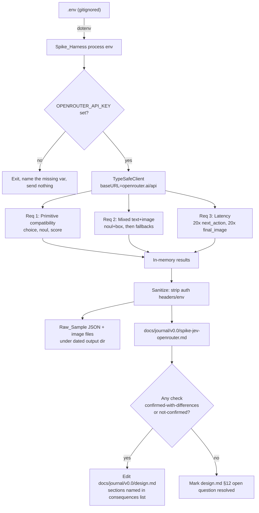

# Design Document

Implements [`requirements.md`](./requirements.md). Normative source: [`SPEC.md`](../../../SPEC.md). Derived design: [`docs/journal/v0.0/design.md`](../../../docs/journal/v0.0/design.md) section 12 (open question) and section 4 (Jev question catalog). `SPEC.md` wins on any conflict.

## Overview

This is a measurement spike, not a feature. It answers GitHub issue #3 by sending real requests to Jev through the `@typesafe-ai/sdk`, pointed at OpenRouter, and recording what comes back: response shapes, a mixed text+image request, latency distributions, and the model id actually used. The output is a committed findings document plus a small set of redacted fixture samples, and — only where a check reveals a difference — targeted edits to `docs/journal/v0.0/design.md`.

The Spike_Harness is throwaway investigation tooling, not CE. It lives outside `packages/ce/src/`, is excluded from `npm test`, and is deleted or left dormant once the findings are committed; nothing it writes becomes a dependency of the production CE code path. Consistent with workspace steering, the harness's own question text (its `instructions`/`criteria` strings for `choice`, `noul`, `score`, and the mixed-state `noul`+`box` request) stays local to the harness. It does **not** go into `jev/catalog.ts` — that file is reserved for CE's production question catalog, which this spike does not build. Where the spike's probe questions happen to resemble catalog questions from `docs/journal/v0.0/design.md` §4 (e.g. a `next_action`-shaped request), that resemblance is coincidental scaffolding for measurement, not a contribution to the catalog.

Confirmed from the TypeSafe JavaScript SDK and API docs (read live during this design, see citations below), ahead of running the spike:

- The request body is `{ model, state, questions, assets? }`; the response body is `{ model, answers, usage: { input_tokens, output_tokens } }`. [SDK](https://docs.typesafe.ai/sdk/javascript.md), [API](https://docs.typesafe.ai/api.md)
- Four question types exist: `noul`, `choice`, `score`, `box`. `score` answers include `score`, `confidence`, `legend`, `probabilities` — richer than the `noul`-only vocabulary the journal's design doc assumes in its decision-combination pseudocode (§4, "Decision combination"). [API](https://docs.typesafe.ai/api.md)
- Images require the `TypeSafe-Danger-Zone-Images: true` request header (the SDK calls this "experimental") and must be PNG or JPEG. `box` questions additionally require the `jev-preview` model, not the pinned `typesafe/jev-1.14` the journal names in design.md §4 and §12. This is a candidate finding of type "confirmed with differences" that Requirement 6 anticipates. [SDK](https://docs.typesafe.ai/sdk/javascript.md), [API](https://docs.typesafe.ai/api.md)
- `box` coordinates are fractions of image height/width, top/left-origin (`top`, `bottom`, `left`, `right`, each 0–1); `confidence` is `null` when the API has none. [API](https://docs.typesafe.ai/api.md)
- The response's `model` field "may differ from the alias supplied in the request" — this is the exact field Requirement 4 asks the harness to record. [API](https://docs.typesafe.ai/api.md)
- A separate `TypeSafe-Danger-Zone-Long-Context` header exists for long-context mode; the journal's design.md §4 asserts image requests always use "Jev's slower, less accurate long-context mode" implicitly — the spike should check whether this header is in fact what's being toggled, or whether it's automatic.

These are documentation-stated facts, not yet measured facts. The Findings_Document (Requirement 5) records what the live run actually returns, which is authoritative over this section if they differ.

## Architecture

The harness is a standalone TypeScript script (or small set of scripts) run with `tsx`/`ts-node` or compiled ad hoc, invoked manually from the repository root. It is not part of any npm workspace package and does not import from or export to `packages/ce/src/`.



Directory layout for the harness (outside `packages/ce/src/`, per R8.6):

```
spike/jev-openrouter/
  run.ts                 entry point, loads dotenv, runs checks in sequence
  checks/
    primitives.ts        Requirement 1: choice/noul/score through OpenRouter
    mixed-state.ts        Requirement 2: noul+box, image-removed variant, fallbacks
    latency.ts             Requirement 3: next_action + final_image samples
  lib/
    client.ts             constructs TypeSafeClient against OpenRouter/TypeSafe
    sanitize.ts            strips credentials/headers before any write
    samples.ts              writes Raw_Sample JSON + referenced image files
    stats.ts                 p50/p95/min/max over a Latency_Sample array
  fixtures/
    demo-app-screenshot.png  captured once from examples/demo-app for Req 2.2
  package.json            private, not a workspace member (or a devDependency-only script list)
  README.md               the one documented run command (R8.5)
.env.example               committed, OPENROUTER_API_KEY= / TYPESAFE_API_KEY= (R8.14)
docs/journal/v0.0/
  spike-jev-openrouter.md  Findings_Document (R5.1)
  samples/<dated-dir>/      Raw_Sample JSON + images (R7.3), one per rerun (R8.8)
```

Placing the harness under `spike/` (not `packages/*` or `examples/*`) keeps it outside the npm workspaces glob in the root `package.json`, so `npm run build` / `npm run typecheck` / `npm test` never touch it (R8.7) and it is not mistaken for a workspace package. The harness has its own minimal `package.json` so `dotenv` and `@typesafe-ai/sdk` can be installed without touching `packages/ce`'s dependency list (R8.12); it is invoked directly (e.g. `npx tsx spike/jev-openrouter/run.ts`) rather than wired into root scripts.

### Execution order

The harness runs the four checks (primitive compatibility, mixed state, latency, model id is observed as a byproduct of every call, not a separate pass) sequentially in one process, in the order Requirement 5.2 fixes for the Findings_Document: primitive compatibility, mixed text+image, latency, model identification. Sequential, not parallel, execution is required anyway by Requirement 3.1/3.2 ("sent sequentially") so that each Latency_Sample reflects one in-flight request.

## Components and Interfaces

### `lib/client.ts`

```ts
interface SpikeClientOptions {
  provider: 'openrouter' | 'typesafe';
}

function buildClient(options: SpikeClientOptions): TypeSafeClient;
// openrouter: new TypeSafeClient({ apiKey: process.env.OPENROUTER_API_KEY, baseURL: 'https://openrouter.ai/api' })
// typesafe:   new TypeSafeClient({ apiKey: process.env.TYPESAFE_API_KEY })
```

Reads only from `process.env`, never logs the key, and is the sole place that constructs a client (so sanitize.ts has one call site to audit).

### `lib/sanitize.ts`

```ts
function sanitizeRequest(raw: unknown): unknown;   // drops Authorization/headers, drops nothing else
function sanitizeResponse(raw: unknown): unknown;  // passthrough today; seam for future redaction
function assertNoEnvLeak(value: unknown): void;    // throws if OPENROUTER_API_KEY/TYPESAFE_API_KEY substring found
```

Every write path (`samples.ts`, the Findings_Document writer) calls `assertNoEnvLeak` before touching disk, satisfying R8.2 and R7.2 with a single enforced choke point rather than per-call-site discipline.

### `lib/samples.ts`

```ts
interface RawSample {
  requestType: 'choice' | 'noul' | 'score' | 'mixed_state' | 'next_action' | 'final_image';
  request: unknown;       // sanitized
  response: unknown;      // sanitized
  modelId: string;        // response.model
  latencyMs: number;
  imageRef?: string;      // relative path, when requestType carries an image
}

function writeSample(dir: string, name: string, sample: RawSample): void;
function newDatedOutputDir(base: string): string; // e.g. docs/journal/v0.0/samples/2025-06-01T120000Z
```

`newDatedOutputDir` is what satisfies R8.8 ("new, dated location", never overwrite earlier Raw_Samples).

### `lib/stats.ts`

```ts
interface LatencyStats { p50: number; p95: number; min: number; max: number; count: number; failures: number }
function computeStats(samples: number[], failureCount: number): LatencyStats;
```

Pure function; this is the one unit in the harness worth a property-based test (see Testing Strategy).

### `checks/primitives.ts` — Requirement 1

Sends one `choice`, one `noul`, one `score` request to the Pinned_Model through the OpenRouter route, each with a question invented locally for the probe (e.g. `noul("Is this message about billing?")` on a synthetic one-line state — the harness does not reuse or write to `jev/catalog.ts`). For each: record the full response, diff it field-by-field against the SDK's declared answer shape (`NoulAnswer`/`ChoiceAnswer`/`ScoreAnswer` per the API schema), and record any differing field by name with expected type vs. observed value (R1.4). Wrap each call so a thrown/rejected request is caught, classified (error class, HTTP status if present, message), and does not stop the remaining checks (R1.5).

### `checks/mixed-state.ts` — Requirement 2

1. Captures or reuses `fixtures/demo-app-screenshot.png` (a Playwright screenshot of `examples/demo-app`, taken once, committed as a small fixture or regenerated by a documented one-line command — R2.2).
2. Sends one request with `state` containing the image plus a `noul` question and a `box` question (both require `TypeSafe-Danger-Zone-Images: true`; `box` additionally requires `model: jev-preview` per the API docs above, overriding the Pinned_Model for this one call — the harness records this override explicitly rather than silently substituting it).
3. Records whether both answers are present, the `box` coordinates, the stated coordinate convention (top/left origin, 0–1 fractions, per API docs), and a manual/visual judgment of whether the box encloses the intended subject in the screenshot (R2.3).
4. Repeats the same question set with the image part removed, and records whether the response shape changes (R2.4).
5. On failure or an absent `box` answer: tries (a) `noul` and `box` as two separate requests, (b) the same mixed request against the `typesafe` provider with `TYPESAFE_API_KEY` if that key is set, and records both attempts and their results (R2.5). If `TYPESAFE_API_KEY` is absent, records that the `typesafe`-provider alternative was skipped (R8.4) without failing the check.

### `checks/latency.ts` — Requirement 3

Builds a `Next_Action_Request`: one text-only request shaped like `runtime.next_action` (journal design.md §4) with ~100 locally-invented options (e.g. `e0..e99: button "Option N"`), sent to the Pinned_Model, 20+ times sequentially. Builds a `Final_Image_Request`: one request with a screenshot and `runtime.state_reached`-shaped `noul` + `runtime.locate_subject`-shaped `box` questions (model forced to `jev-preview` for the `box` part, same override as above), sent 20+ times sequentially. For each set: records latency per call, excludes failed calls from percentile math but reports them separately (R3.5), records `retry-after`/rate-limit occurrences verbatim (R3.6), and records option count / reported input tokens / failure count alongside the stats (R3.4). The Findings_Document states the measured p95 against a stated per-step budget (R3.7) — this spike proposes comparing against the `runtime.max-steps`/`timeout` budget in `ce.yml` (journal design.md §7: 12 steps / 90s timeout ⇒ ~7.5s/step budget), stated explicitly so a future reader can re-derive or revise it.

### `run.ts`

Sequences the above, loads `.env` via `dotenv` before reading `process.env` (R8.1), exits immediately with a named-variable message and sends no request if `OPENROUTER_API_KEY` is absent after that load (R8.3), and writes the Findings_Document and dated sample directory at the end from the in-memory results of whichever checks ran.

## Data Models

```ts
// One row per Jev request the harness makes, before sanitization.
interface HarnessCallResult {
  requestType: 'choice' | 'noul' | 'score' | 'mixed_state' | 'mixed_state_no_image'
             | 'mixed_state_split_noul' | 'mixed_state_split_box' | 'mixed_state_typesafe_provider'
             | 'next_action' | 'final_image';
  provider: 'openrouter' | 'typesafe';
  modelRequested: string;
  modelReturned: string | null;   // null on failure before a body was parsed
  ok: boolean;
  httpStatus?: number;
  errorClass?: string;
  errorMessage?: string;
  retryAfter?: string;
  latencyMs: number;
  inputTokens?: number;
  outputTokens?: number;
  optionCount?: number;           // for next_action-shaped requests
  raw: { request: unknown; response: unknown };
}

interface CheckOutcome {
  requirement: 1 | 2 | 3 | 4;
  status: 'confirmed' | 'confirmed with differences' | 'not confirmed';
  method: string;
  result: string;
  differingFields?: { field: string; expectedType: string; observedValue: unknown }[];
}

interface FindingsConsequence {
  affectedSection: string;   // e.g. "design.md §4" or "journal requirement R7.2"
  change: string | 'no change needed';
}
```

`HarnessCallResult` is the harness-internal record everything else derives from: `RawSample` (sanitized subset written to disk), `LatencyStats` (computed from the `latencyMs` of same-`requestType` rows), and the Findings_Document's four `CheckOutcome` sections plus its consequences list (`FindingsConsequence[]`) are all projections of the collected `HarnessCallResult[]`.

## Prework (PBT applicability assessment)

This spike is a one-shot measurement script against a live external API (Jev via OpenRouter/TypeSafe). Nearly every acceptance criterion is of the form "when the harness does X, it SHALL record Y" — these are integration/example checks against an external service's actual behavior, not properties of a pure function CE owns. Per the workflow's own guidance ("Testing AWS service behavior... Testing external API responses... Instead: Use integration tests with 1-3 representative examples"), PBT does not apply to the bulk of this spec.

The one piece of harness logic that is a pure function over an unbounded input space is `computeStats` (p50/p95/min/max over a list of numbers, Requirement 3.3) — a small, self-contained candidate for a property test. Everything else (R1, R2, R4–R9) is integration, smoke, or documentation-shape work with no meaningful "for all X" to state.

## Correctness Properties

*A property is a characteristic or behavior that should hold true across all valid executions of a system — essentially, a formal statement about what the system should do. Properties serve as the bridge between human-readable specifications and machine-verifiable correctness guarantees.*

The prework above found exactly one acceptance-criteria cluster (3.3 and 3.5) that is a pure function over a large input space, suitable for property-based testing. Every other criterion is integration, smoke, or documentation work against a live external service or a fixed one-shot document, and is covered by unit and integration tests in the Testing Strategy instead.

### Property 1: Latency statistics separate successes from failures and are internally consistent

For all arrays of non-negative latency samples (including empty) and any non-negative failure count, `computeStats` SHALL compute `min`, `max`, `p50`, and `p95` using only the successful samples (never the failure count), SHALL report `count` equal to the number of successful samples and `failures` equal to the given failure count unchanged, and SHALL satisfy `min <= p50 <= p95 <= max` whenever at least one successful sample exists.

**Validates: Requirements 3.3, 3.5**

### Why only one property

3.3 and 3.5 were considered separately in the prework but describe one function's single contract: 3.3 is "compute these four numbers correctly" and 3.5 is "do it while excluding failures and reporting them separately" — the same computation, not two behaviors. No other criterion in this spec produces a second property: everything else is a one-shot interaction with a live external service (R1–R2, part of R3, R4) or document/filesystem shape-checking (R5–R9), neither of which has a meaningful universal quantification independent of this one function.

## Error Handling

The harness treats every Jev call as independently failable and never lets one failed check abort the others (R1.5, R2.5):

- **Per-call try/catch.** Each call in `checks/*.ts` is wrapped individually. A caught error is normalized into a `HarnessCallResult` with `ok: false`, `errorClass` (the thrown value's constructor name, or `"NonError"` if a non-`Error` value was thrown), `httpStatus` (read from the SDK error's `status`/`statusCode` field when present), and `errorMessage` (the error's `message`, truncated defensively since the API itself truncates long detail strings). Execution continues to the next call/check.
- **Rate limiting.** A `retry-after` response header or a 429-shaped error is detected in the same catch path and recorded on the `HarnessCallResult` (`retryAfter`) rather than retried automatically — the spike measures raw behavior, so it does not mask rate limiting with retry logic that would distort the Latency_Samples (R3.6).
- **Missing credentials.** `OPENROUTER_API_KEY` absent after `dotenv` loads is a hard stop: `run.ts` prints the missing variable name and exits before constructing any client or sending any request (R8.3). `TYPESAFE_API_KEY` absent is a soft stop local to the Requirement 2 fallback: that one alternative is recorded as skipped and the rest of the spike proceeds (R8.4).
- **Sanitization failures are fatal to the write, not the measurement.** `assertNoEnvLeak` throwing during `writeSample` or Findings_Document generation aborts that write with a clear message; it does not retroactively invalidate calls already made, since the in-memory `HarnessCallResult[]` holds the raw credentials-free request/response shape separately from the serialized env itself (the SDK never echoes the API key back in a response body).
- **Partial runs still produce output.** If the process is interrupted after some checks complete, whatever `HarnessCallResult[]` were collected are still written as Raw_Samples and folded into the Findings_Document; Requirement 9.3 requires marking an unrun check `not confirmed` with its cause rather than omitting it or inferring a result.
- **Design reconciliation is a manual, reviewed edit.** When a check's status is `confirmed with differences` or `not confirmed`, the harness does not auto-edit `docs/journal/v0.0/design.md` — Requirement 6 is executed by a person (or an agent under direct supervision) reading the Findings_Document and editing the named sections, so that `SPEC.md` is never touched without the explicit maintainer decision R6.5 requires.

## Testing Strategy

**PBT applicability:** mostly not applicable. This spec is a live-API measurement spike; nearly all of its acceptance criteria describe one-shot interactions with an external service (Jev via OpenRouter) or fixed document/filesystem shape checks, which the workflow's own guidance places outside PBT's scope ("Testing external API responses... Instead: Use integration tests with 1-3 representative examples"). The exception is `computeStats` (Property 1 above), a small pure function with a large input space, which gets a property-based test. Everything else uses unit and integration tests.

**Unit tests** (`vitest`, no API key, run under `npm test` from the harness's own `package.json` script — explicitly *not* wired into the root `npm test` so CI for `packages/ce` stays unaffected, per R8.7):

- `lib/stats.ts` — concrete examples in addition to the property test: empty array, single sample, all-equal samples, already-sorted vs. reverse-sorted input, a mix of successes and a non-zero failure count.
- `lib/sanitize.ts` — `assertNoEnvLeak` throws when a fabricated string contains a current env var value; passes on an unrelated string. `sanitizeRequest`/`sanitizeResponse` strip an `Authorization` header from a crafted object and leave other fields untouched.
- Error normalization — feed the per-call wrapper a thrown `TypeError`, a thrown plain object, a fetch-style error with `status`, and a rate-limit-shaped error with a `retry-after` header; assert the resulting `HarnessCallResult` fields (R1.5, R3.6).
- Model-id aggregation (R4.3) — three concrete groupings: all requests of a type return the same model id, two distinct ids split evenly, and one failed call mixed with successes (failed calls contribute no model id).
- Env precedence and output directory naming (R8.8, R8.9, R8.10) — a variable already set in `process.env` is not overridden by `.env`; a missing `.env` file does not throw during load; two successive dated output directories never collide or overwrite.
- SDK type conformance diffing (R1.4) — a crafted response object missing a required field, or with a field of the wrong type, produces a diff entry naming the field, the expected type, and the observed value.

**Property test** (`fast-check`, ≥100 iterations, tagged with the design property it validates):

```ts
// Feature: ce-testing-spike, Property 1: Latency statistics separate successes
// from failures and are internally consistent
fc.assert(
  fc.property(
    fc.array(fc.float({ min: 0, max: 60000, noNaN: true })),
    fc.nat(1000),
    (samples, failures) => {
      const stats = computeStats(samples, failures);
      expect(stats.count).toBe(samples.length);
      expect(stats.failures).toBe(failures);
      if (samples.length > 0) {
        expect(stats.min).toBeLessThanOrEqual(stats.p50);
        expect(stats.p50).toBeLessThanOrEqual(stats.p95);
        expect(stats.p95).toBeLessThanOrEqual(stats.max);
        expect(stats.min).toBe(Math.min(...samples));
        expect(stats.max).toBe(Math.max(...samples));
      }
    }
  ),
  { numRuns: 100 }
);
```

**Integration checks** (require `OPENROUTER_API_KEY`, run manually via the harness's own documented command, never under `npm test`): Requirements 1, 2, 3 (live calls and latency sampling), and the model-identification observations of Requirement 4, executed as one run of `run.ts` that produces the Findings_Document and Raw_Samples. These are not repeated 100 times — one real run per check is what Requirements 1–4 ask for; the value of repetition here is already captured by the 20-sample latency loops the requirements themselves specify (R3.1, R3.2), not by a PBT harness.

**Document/filesystem checks** (manual review, optionally scripted as non-`npm test` assertions): the Findings_Document contains the four required sections in order (R5.2), states date/SDK version/Node version/Pinned_Model (R5.4), ends with a consequences list (R5.5), states measurement limits (R5.6), and — checked by grep rather than a test runner — contains no substring matching a loaded credential value (R5.7, R8.2). Raw_Sample JSON files are similarly grepped for the same credential substrings before being considered committable (R7.2).


<invoke name="prework">
<parameter name="featureName">ce-testing-spike