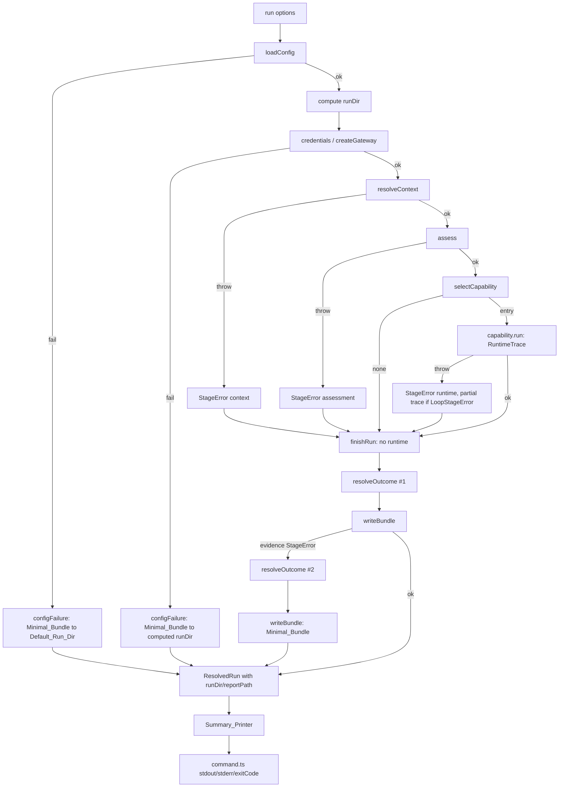

# Design Document

## Overview

This design implements issue rfxlamia/ce#11, "[M3] Evidence bundle, run.json schema, terminal summary". It follows `requirements.md` in this directory. The facts (F1 to F18), decisions (D1 to D12), open questions (Q1 to Q5), implications (I1 to I6) and hand-off notes (N1 to N3) cited below are defined there. `SPEC.md` wins on any conflict.

The feature adds three things.

1. **Evidence_Bundle writer** (`evidence/bundle.ts`). It turns the data of a finished run into a `run.json`, validates it against a zod schema, and writes it atomically into the run directory next to the screenshots, `target.log` and `jev-calls.jsonl` that already exist there.
2. **Run_Schema** (`evidence/schema.ts`). One zod discriminated union with one strict variant per Outcome. The committed `schemas/run.schema.json` is generated from it with `z.toJSONSchema`, in the same way `schemas/ce.schema.json` is generated.
3. **Terminal_Summary** (`evidence/summary.ts`). A pure function from a `SummaryInput` to at most 10 lines of text, outcome first.

It also changes the pipeline so that `run()` never throws and every returned run passes through one finalization step that writes the bundle. The outcome stays decided only in `outcome/resolve.ts`. `evidence/` reads the `Resolution` and never computes one.

### Design decisions at a glance

| Topic | Decision | Reason |
| --- | --- | --- |
| Where the Outcome is decided | Only `resolveOutcome`, reached only through `finishRun` in `run/pipeline.ts` | Steering rule and F11. The writer receives a `Resolution` as data. |
| How runtime detail reaches the writer | Optional `trace` on `RuntimeResult` (D1) | Keeps `RuntimeHook` and every test double valid. |
| Schema shape | `z.discriminatedUnion('outcome', [...])`, four strict variants (D10) | The presence table is enforced by the schema and by the generated JSON Schema. |
| Atomic write | `run.json.tmp` then `rename` | A reader never sees a partial file (R4.5). |
| `report.html` | Not written. Summary points to `run.json` unless `report.html` exists | Out of scope for this issue (I4). |
| Last-resort catch in `command.ts` | Unchanged, print only (D9) | Building a bundle there needs an Outcome literal (F11). |

### Research summary

- `z.toJSONSchema(schema, { target: 'draft-7', ... })` is already used by `config/json-schema.ts` (F9). F17 verifies that a `z.discriminatedUnion` of strict objects renders as `oneOf` of closed objects with `const` discriminators. Refinements (`.refine`, `.superRefine`) are not representable in JSON Schema and are dropped from the generated file. The design therefore keeps every shape rule in the structural schema and uses refinements only for cross-field rules that the JSON Schema may omit (see "Schema refinements").
- `ajv` 8 is already a dev dependency of `packages/ce`, so the "JSON Schema accepts what the writer writes" test needs no new dependency.
- `fast-check` 4 is a dev dependency. Existing property tests (for example `outcome/resolve.*.property.test.ts`) use shared arbitraries in `outcome/arbitraries.ts`. This design adds `evidence/arbitraries.ts` for Run_Record generators, following that pattern, rather than growing `outcome/arbitraries.ts` (which the architecture test pins to `outcome/`).
- Reading the current pipeline confirms I1: `ResolvedRun` (`run/types.ts`) carries only `claims`, `assessment`, `error`, `capability` next to the `Resolution`. It holds neither the `RuntimeResult`, the `ChangeContext`, the redacted config nor the run directory. The design threads these through a new internal `FinishRunInput` shape (Requirement 9.3) rather than widening `ResolvedRun` itself, because `ResolvedRun` is public API (`index.ts`) and SPEC 7.1 only promises the four Outcomes and the fields already documented there.
- `runtime/loop.ts` already collects almost everything Requirement 10 needs on `LoopResult`: `steps` (with `observation`, `action`, `probabilities`, `executed`), `eventLog`, `finalScreenshot`, `finalImageModel`, `finalImageError`, `stopReason`. The one gap is per-call `modelIds`: the loop today discards the `Jev_Response.model` of each decide call and of the final image call once the decision is made (Q1).

## Architecture



The outermost `catch` of `run()` (Requirement 11) wraps this whole flow. It is reached only when a stage wrapper itself fails to catch (a defensive net, not the normal path): it builds a `StageError` for the last-entered stage, resolves it through `resolveOutcome` only if no resolution exists yet (D12), and attempts one Minimal_Bundle write before returning. `runRunCommand`'s own `try/catch` (F10, D9) stays the final backstop for a throw that even this net does not catch; it writes no bundle.

### Module layout

Per `structure` steering, the files below live in `packages/ce/src/evidence/`, mirroring `config/json-schema.ts` + `scripts/generate-config-schema.ts`:

```
packages/ce/src/evidence/
  schema.ts         Run_Schema (zod), RunRecord type, SCHEMA_VERSION
  json-schema.ts     generateRunJsonSchema(), serializeRunSchema()  (mirrors config/json-schema.ts)
  redact.ts          redactRunRecord(record, secrets) -> RunRecord
  trace.ts           RuntimeTrace type (type-only, re-exported from outcome/types.ts) and helpers
  build.ts           buildRunRecord(input) -> RunRecord | ValidationFailure-shaped minimal input
  bundle.ts          writeBundle(...), writeMinimalBundle(...): file I/O, atomic rename
  summary.ts         SummaryInput, buildSummary(input) -> string (pure, no I/O)
  arbitraries.ts     fast-check arbitraries for RunRecord and its parts (test-only, like outcome/arbitraries.ts)
  report/            reserved, empty except for a .gitkeep (Requirement 9.6, issue #11 does not write report.html)
packages/ce/src/scripts/
  generate-run-schema.ts   mirrors generate-config-schema.ts; writes schemas/run.schema.json
schemas/
  run.schema.json    generated, committed
```

`evidence/trace.ts` holds the `RuntimeTrace` type only; the field itself is declared on `RuntimeResult` in `outcome/types.ts` per Requirement 10.1, with `RuntimeTrace` imported type-only there. This keeps `outcome/` as the sole owner of `RuntimeResult` (steering: outcome decided nowhere else, and the architecture test's rule (c) requires type-only imports into `outcome/`), while the trace's own type can live in `evidence/` without creating a value dependency from `outcome/` into `evidence/`. `outcome/resolve.ts` and `satisfiesMinimumEvidence` do not read `trace` (Requirement 10.5).

### Architecture-test impact

- Rule (a) on `outcome/` (no import of `fs`, `playwright`, `jev/`, `runtime/`, SDK) stays satisfied: `outcome/types.ts` gains a type-only import of `RuntimeTrace` from `../evidence/trace.js`, which itself imports nothing forbidden (it is types only, no `runtime/*` value import, satisfying Requirement 10.3).
- Rule (b) (`outcome/` reads no clock, no `process.env`) is unaffected; `evidence/` is not scoped by rule (b).
- `evidence/` is new and is scoped by the *general* rule (d) that requirements.md's F11 describes (no file outside `outcome/resolve.ts` assigns, returns or casts an Outcome literal). The design keeps every `evidence/*.ts` file reading `resolution.outcome`/`resolution.reason` only through comparisons (`===`), never writing an Outcome literal, so Requirement 9.2 holds without changing `outcome/architecture.test.ts`'s existing rule (d) (already described as scanning "all non-test files under `packages/ce/src/`" in F11).
- `run/types.ts`, `run/pipeline.ts` stay inside the existing `run/` architecture-test scope (import boundary tests already check `run/*` does not import the SDK or call `fetch`; `evidence/bundle.ts` also must not, per Requirement 9.4, and is added to that boundary test).

## Components and Interfaces

### `outcome/types.ts` changes (Requirement 10)

```ts
import type { RuntimeTrace } from '../evidence/trace.js'; // type-only

export interface RuntimeResult {
  finalState: FinalState;
  evidence: EvidenceSummary;
  /** Present when the capability populated it (Requirement 10.1). Ignored by resolveOutcome (10.5). */
  trace?: RuntimeTrace;
}
```

`Outcome`, `OUTCOMES`, `Resolution` and `ResolveInput` are untouched (Requirement 10.7).

### `evidence/trace.ts`

```ts
export interface RuntimeTraceStep {
  step: number;
  url: string;
  title: string;
  screenshot: string; // Bundle_Relative_Path
  action: { kind: string; description: string };
  executed: boolean;
  probabilities: Record<string, number>;
}

export interface RuntimeTraceEvent {
  step: number;
  kind: 'dialog' | 'download' | 'popup' | 'settle' | 'refusal';
  detail: string;
}

export type StopReason = 'done' | 'reached' | 'give_up' | 'max-steps' | 'time-budget' | 'aborted'; // mirrors runtime/loop.ts StopReason (F16)

export interface RuntimeTrace {
  steps: RuntimeTraceStep[];
  eventLog: RuntimeTraceEvent[];
  finalScreenshot?: string;
  finalImageModel?: string;
  finalImageError?: string;
  stopReason: StopReason;
  /** Distinct Returned_Model_Ids of the decide-step calls and the final image request, in order of first appearance (Q1). */
  modelIds: string[];
}
```

`RuntimeTrace` holds no `elements`, `domDigest`, `navigation`, state text or Jev request payload (Requirement 10.3): it is built only from `StepLogEntry.observation.{url,title}`, `StepLogEntry.action.{kind,description}` (already redacted by `createRedactor`/`mapLoopResultToRuntimeResult`'s pattern), `StepLogEntry.probabilities`, `StepLogEntry.executed`, `LoopResult.eventLog` (already `Redactor` output per `capture.ts`'s `EventLogEntry.detail` doc comment), and the loop's final-image fields.

### `runtime/capability.ts` changes (Requirement 10.4)

`mapLoopResultToRuntimeResult` gains the `trace` field, built from the same `LoopResult` it already maps. This resolves **Q1**: the design does *not* add a gateway method. Instead, `runLoop` (`runtime/loop.ts`) already has access to each `Jev_Response.model` at the two call sites that matter:

- the decide-step call at `response = await guard(gateway.ask(request, ...))` (line ~457 today), and
- the final image call at `const response = await guard(pending)` inside `finalImageRequest` (~line 364-370).

`LoopResult` gains one field, `modelIds: string[]`, collected the same way `HybridJevGateway` already collects its own `#modelIds` (`jev/gateway.ts` line ~436, "distinct Returned_Model_Ids seen so far, in order of first appearance"): the loop pushes `response.model` into a local ordered de-duplicated array whenever a call succeeds, for both the decide calls and the final image call. `mapLoopResultToRuntimeResult` copies `loopResult.modelIds` into `trace.modelIds` unchanged. No `JevGateway` interface method is added, and no architecture-test boundary is touched, because `runtime/loop.ts` already imports `jev/gateway.ts` types.

```ts
// runtime/loop.ts (additive)
export interface LoopResult {
  // ...unchanged fields...
  modelIds: string[]; // NEW
}
```

```ts
// runtime/capability.ts, inside mapLoopResultToRuntimeResult
const trace: RuntimeTrace = {
  steps: loopResult.steps.map((s) => ({
    step: s.observation.step,
    url: s.observation.url,
    title: s.observation.title,
    screenshot: s.observation.screenshot,
    action: describeAction(s.action, s.observation, redact), // same redaction as `actions` above
    executed: s.executed === true,
    probabilities: s.probabilities,
  })),
  eventLog: loopResult.eventLog.map((e) => ({ step: e.step, kind: e.kind, detail: e.detail })),
  stopReason: loopResult.stopReason,
  modelIds: loopResult.modelIds,
};
if (loopResult.finalScreenshot !== undefined) trace.finalScreenshot = loopResult.finalScreenshot;
if (loopResult.finalImageModel !== undefined) trace.finalImageModel = loopResult.finalImageModel;
if (loopResult.finalImageError !== undefined) trace.finalImageError = loopResult.finalImageError;
result.evidence = { /* unchanged */ };
result.trace = trace;
```

`describeAction` factors out the existing per-kind description logic already in `mapLoopResultToRuntimeResult`'s `actions` loop (click/fill/goto), so steps whose action was not executed (refused, timed out) still get a `description` built the same way, with `executed: false`.

### `run/types.ts` changes (N1)

The stale comment on `RuntimeHookInput.runDir` is corrected: `run()` computes the run directory in every case (F1), also with an injected gateway. `runDir` becomes required (`runDir: string`, not `runDir?: string`) on `RuntimeHookInput`, matching F1's finding that `runDir` is always known by the time a capability's hook runs. `createBrowserCapability`'s `RunDirMissingError` guard (`if (runDir === undefined) throw ...`) is removed as dead code once the type is tightened; the design keeps the class exported (now unused in the default capability) only if another capability still wants it, otherwise it is deleted — this issue deletes it, since no other capability exists yet and dead exports fail nothing but add confusion.

### `run/pipeline.ts` changes (Requirement 11, 9.8, 9.13, D12)

`run()` gets:

1. **Stage tracking.** A local `let lastStage: Stage = 'config'` updated right before each stage's work begins, read only by the outermost catch (Requirement 11.3).
2. **An outermost `try { ... } catch`** around the full body (Requirement 11.1, 11.2). Every stage call already has its own `try/catch` that wraps the thrown value in a `StageError` and calls `finishRunWithBundle` (the renamed/extended `finishRun`, see below); the outermost catch exists only for a throw that escapes *those* (for example a synchronous throw between stages, or a throw from `finishRunWithBundle` itself before it produces a `ResolvedRun`). It:
   - builds `const error = wrapStage(lastStage, thrown)`,
   - resolves through `resolveAfterAssessment` **only if no `ResolvedRun` was already produced** (D12) — tracked with a `let finalResolution: Resolution | undefined` set by every normal path,
   - attempts `writeMinimalBundle(...)` with whatever of `{config, context, claims, assessment, runtime}` is in scope,
   - returns the resulting `ResolvedRun` (never rethrows).
3. **Stage timings** (Requirement 9.13, 2.14): `now()` is read at the start of `run()` and before/after each of the four stages (`config`, `context`, `assessment`, `runtime`); a `StageTimings` object (`{ startedAt: string; stages: { config, context, assessment, runtime: number | null } }`) is threaded alongside the existing variables and passed into the bundle build. A stage that throws still records its partial duration (measured up to the throw) before the `catch` re-raises into `finishRunWithBundle`.
4. **`finishRun` becomes `finishRunWithBundle`**, wrapping the existing `finishRun` body: it resolves once (Requirement 9.8's "first call"), computes `runDir`/`reportPath` presence, calls `writeBundle(...)`, and on an `evidence`-stage `StageError` from that write, resolves a **second** time (D2, Requirement 4.6, 9.8) and attempts `writeMinimalBundle(...)`, discarding the first resolution (Q5, detailed below). It returns the final `ResolvedRun`, now additionally carrying `runDir` and either `reportPath` or a `bundleWritten: false` flag (Requirement 9.14).
5. **`configFailure()` becomes `configFailureWithBundle(kind, context)`**, parametrized by which of the three F1 failures occurred, so it can call `writeMinimalBundle` at the `Default_Run_Dir` (`loadConfig` failure, I2) or at the computed `runDir` with the redacted config (credentials/gateway failure, I2, Requirement 5.6-5.7). `EMPTY_REGISTRY` and the value-free `StageError('config', ...)` stay as today.

```ts
// run/pipeline.ts (shape, not full implementation)
export interface ResolvedRunWithBundle extends ResolvedRun {
  runDir: string;
  /** Absent (bundleWritten: false) iff no run.json could be written (Requirement 9.14, 5.16). */
  reportPath?: string;
  bundleWritten: boolean;
}

async function finishRunWithBundle(input: FinishRunInput & { runDir: string; config: EffectiveConfig | null; timings: StageTimings; secrets: string[] }): Promise<ResolvedRunWithBundle> {
  const first = finishRun(input); // existing pure resolve + exitCode
  const writeResult = await writeBundle({ resolution: first, ...input });
  if (writeResult.ok) return { ...first, runDir: input.runDir, reportPath: writeResult.reportPath, bundleWritten: true };
  // writeResult.error is a StageError('evidence', ...)
  const second = finishRun({ ...input, error: writeResult.error }); // D2: second and last resolveOutcome call
  const minimal = await writeMinimalBundle({ resolution: second, validationFailure: writeResult.validationFailure, ...input });
  return minimal.ok
    ? { ...second, runDir: input.runDir, reportPath: minimal.reportPath, bundleWritten: true }
    : { ...second, runDir: input.runDir, bundleWritten: false };
}
```

**Resolving Q5** (how the first Resolution is discarded cleanly): `finishRunWithBundle` is a single local function with ordinary variable scope. The "first" `Resolution` (`first`, inside `first`'s `ResolvedRun`) is a local `const` that goes out of scope as soon as the function returns the object built from `second`. No partial `ResolvedRun` is ever returned from `run()` itself — `run()`'s every call site (`finishRunWithBundle`, `configFailureWithBundle`, the outermost catch) returns exactly one object, and TypeScript's control flow (every branch ends in a `return`) prevents a half-built value from leaking. No mutable "current resolution" field is needed; discarding is just allowing `first` to be unreferenced after its one use for the bundle-write attempt.

### `run/resolve.ts`

Unchanged in behavior. `resolveAfterAssessment` and `wrapStage` stay the only way `run/pipeline.ts` reaches `resolveOutcome`, preserving "outcome decided only in `outcome/resolve.ts`".

### `evidence/schema.ts`

```ts
export const SCHEMA_VERSION = '1' as const; // D5

const BundleRelativePath = z.string().regex(/^(?!\/)(?!.*\.\.(\/|$))[^\n]+$/); // Bundle_Relative_Path (glossary)

const ArtifactKind = z.enum(['screenshot', 'log', 'jev-calls']);
const Artifact = z.strictObject({ path: BundleRelativePath, kind: ArtifactKind });

const StageName = z.enum(['config', 'context', 'assessment', 'runtime', 'evidence']);
const ErrorField = z.strictObject({
  stage: StageName,
  reason: ResolveReasonSchema, // mirrors outcome ResolveReason literal union
  causeName: z.string().nullable(),
  fields: z.array(z.string()),
});

const Timings = z.strictObject({
  startedAt: z.iso.datetime(),
  durationMs: z.number().nonnegative(),
  stages: z.strictObject({
    config: z.number().nonnegative().nullable(),
    context: z.number().nonnegative().nullable(),
    assessment: z.number().nonnegative().nullable(),
    runtime: z.number().nonnegative().nullable(),
  }),
});

const ClaimRecord = z.strictObject({
  id: z.string(),
  text: z.string(),
  probability: z.number().min(0).max(1).nullable(), // D6
  provenance: ProvenanceSchema,
});

const AssessmentRecord = z.strictObject({
  required: z.boolean(),
  decidedBy: z.enum(['classifier', 'policy']),
  surface: SurfaceSchema,
  claimStatus: z.enum(['identified', 'not_identified']),
  perClaimProbabilities: z.array(z.strictObject({ claimId: z.string(), runtimeObservable: z.number(), checksAdequate: z.number() })),
  questions: z.array(z.strictObject({ idVersion: z.string(), subjectId: z.string(), probability: z.number().nullable(), probabilities: z.record(z.string(), z.number()).nullable() })),
  settings: AssessmentSettingsSchema,
});

const StepRecord = z.strictObject({
  step: z.number().int().nonnegative(),
  url: z.string(),
  title: z.string(),
  action: z.strictObject({ kind: z.string(), description: z.string() }),
  executed: z.boolean(),
  screenshot: BundleRelativePath,
  probabilities: z.record(z.string(), z.number()),
});

const EventLogRecord = z.strictObject({
  step: z.number().int().nonnegative(),
  kind: z.enum(['dialog', 'download', 'popup', 'settle', 'refusal']),
  detail: z.string(),
});

const FinalImage = z.strictObject({
  model: z.string().nullable(),
  error: z.string().nullable(),
  screenshot: BundleRelativePath.nullable(),
});

const RuntimeRecord = z.strictObject({ stopReason: StopReasonSchema });

const ContextRecord = z.strictObject({ /* change, candidates, checks, providers, truncated, redactions — Requirement 2.17 */ });

const CommonFields = {
  schemaVersion: z.literal(SCHEMA_VERSION),
  ceVersion: z.string(),
  outcome: OutcomeLiteral, // bound per-variant below
  outcomeReason: ResolveReasonSchema,
  timings: Timings,
  jevModels: z.array(z.string()),
  artifacts: z.array(Artifact),
};

const SkippedVariant = z.strictObject({
  ...CommonFields, outcome: z.literal('SKIPPED'),
  config: ConfigRecord, context: ContextRecord, claims: z.array(ClaimRecord), assessment: AssessmentRecord,
  subject: z.null(), steps: z.tuple([]), eventLog: z.tuple([]), finalImage: z.null(), runtime: z.null(),
  finalState: z.null(), error: z.null(),
});

const UnsupportedVariant = z.strictObject({
  ...CommonFields, outcome: z.literal('UNSUPPORTED'),
  config: ConfigRecord, context: ContextRecord, claims: z.array(ClaimRecord), assessment: AssessmentRecord,
  subject: z.null(), steps: z.tuple([]), eventLog: z.tuple([]), finalImage: z.null(), runtime: z.null(),
  finalState: z.null(), error: z.null(),
});

const EvidencedVariant = z.strictObject({
  ...CommonFields, outcome: z.literal('EVIDENCED'),
  config: ConfigRecord, context: ContextRecord, claims: z.array(ClaimRecord), assessment: AssessmentRecord,
  subject: z.string(), steps: z.array(StepRecord).min(1), eventLog: z.array(EventLogRecord),
  finalImage: FinalImage.nullable(), runtime: RuntimeRecord.nullable(),
  finalState: z.enum(['reached', 'not_reached']), error: z.null(),
});

const ErrorVariant = z.strictObject({
  ...CommonFields, outcome: z.literal('ERROR'),
  config: ConfigRecord.nullable(), context: ContextRecord.nullable(),
  claims: z.array(ClaimRecord), assessment: AssessmentRecord.nullable(),
  subject: z.string().nullable(), steps: z.array(StepRecord), eventLog: z.array(EventLogRecord),
  finalImage: FinalImage.nullable(), runtime: RuntimeRecord.nullable(),
  finalState: z.null(), error: ErrorField,
});

export const RunRecordSchema = z.discriminatedUnion('outcome', [
  SkippedVariant, UnsupportedVariant, EvidencedVariant, ErrorVariant,
]);
export type RunRecord = z.infer<typeof RunRecordSchema>;
```

This is the structural shape; the Validation_Failure case (Requirement 5.13-5.14, the last row of the Requirement 2.16 table) is a *value* of the `ErrorVariant` with `config`, `context`, `assessment`, `subject`, `finalImage`, `runtime` all `null` and `claims`, `steps`, `eventLog`, `jevModels`, `artifacts` all `[]` — it is not a fifth schema variant, because `error.stage === 'evidence'` plus `error.reason` distinguishes it, and the `ErrorVariant`'s nullable cells already permit this shape (Requirement 3.10).

**Schema refinements** (handles what `z.toJSONSchema` cannot represent, scoped narrowly so the generated JSON Schema stays close to the zod source):
- None are required for the presence table itself — `z.discriminatedUnion` with four strict variants is exactly representable in draft-7 JSON Schema (F17), so no `.refine` is needed there.
- One `.check()`-free design choice: `Artifact.kind === 'jev-calls'` implies at most one such artifact per bundle (Requirement 1.5, "a run with an injected gateway creates no Call_Log"). This is a *build-time* invariant the writer enforces (Requirement 9.1 "evidence code reads, never computes"), not a schema rule, because JSON Schema cannot cheaply express "at most one array element with field X=Y"; `evidence/build.ts` is responsible, and a unit test checks it directly.

### `evidence/json-schema.ts` and `scripts/generate-run-schema.ts`

Mirrors `config/json-schema.ts` / `scripts/generate-config-schema.ts` exactly (steering: "schemas generated from zod into schemas/ via z.toJSONSchema"):

```ts
export function generateRunJsonSchema(): object {
  return z.toJSONSchema(RunRecordSchema, { target: 'draft-7', io: 'input', unrepresentable: 'any' });
}
export function serializeRunSchema(): string {
  return JSON.stringify(generateRunJsonSchema(), null, 2) + '\n';
}
```

`scripts/generate-run-schema.ts` writes `schemas/run.schema.json` the same way `generate-config-schema.ts` writes `schemas/ce.schema.json`, and `package.json` gets a new script `generate:run-schema` (Requirement 3.6), following the pattern of `generate:config-schema`. A staleness test (`evidence/json-schema.staleness.test.ts`, mirroring the existing `config/json-schema` staleness test) fails when the committed file differs from the generated text (Requirement 3.5).

### `evidence/build.ts`

```ts
export interface BuildRunRecordInput {
  resolution: Resolution;             // from outcome/resolve.ts, read-only
  config: RedactedConfig | null;      // null iff loadConfig failed (I2)
  context: ChangeContext | null;
  claims: Claim[];
  assessment: Assessment | null;
  runtime: RuntimeResult | null;      // may carry .trace
  partialTrace?: Pick<LoopResult, 'observations' | 'steps' | 'eventLog'>; // LoopStageError.partial (Requirement 5.9)
  error: StageError | null;
  runDir: string;
  artifacts: { path: string; kind: 'screenshot' | 'log' | 'jev-calls' }[]; // discovered by bundle.ts via fs
  timings: StageTimings;
  ceVersion: string;
}

export function buildRunRecord(input: BuildRunRecordInput): RunRecord; // throws nothing; may build a shape the schema later rejects (caller validates)
export function buildMinimalRunRecord(input: BuildRunRecordInput): RunRecord; // Requirement 5
export function buildValidationFailureRunRecord(input: Pick<BuildRunRecordInput, 'resolution' | 'timings' | 'ceVersion'> & { fields: string[] }): RunRecord; // Requirement 5.13-5.14
```

`buildRunRecord` is a pure function: given the same inputs it returns the same `RunRecord` object (needed for the round-trip property, Requirement 3.8, and for determinism tests). It:
- reads `resolution.outcome`/`resolution.reason` only through field access and puts them straight into `outcome`/`outcomeReason` (Requirement 2.2, 9.1) — never computes an Outcome;
- sets `finalState` from `resolution.finalState` when the outcome is `EVIDENCED`, else `null` (Requirement 2.3-2.4);
- builds `jevModels` by concatenating `assessment.record.modelIds`, then `runtime.trace?.modelIds`, then (if not already present) `runtime.trace?.finalImageModel`, de-duplicated in order of first appearance (Requirement 2.12) — this is the same ordered-dedup rule `jev/gateway.ts`'s `#modelIds` already implements, reused as a small shared helper `dedupInOrder(...)` in `evidence/build.ts` to avoid duplicating the logic;
- when `runtime.trace` is absent but `runtime.evidence` is present (an older/simple capability, Requirement 10.6), falls back to `evidence.subject.url` for `subject`, `evidence.observations` for `steps` (with only the fields that exist: `step`, `screenshot`; `url`, `title`, `action`, `executed`, `probabilities` are omitted — the design fills those with `''`, `''`, `{kind: 'unknown', description: ''}`, `false`, `{}` respectively, so the schema's required fields are still satisfied without fabricating meaning), and sets `finalImage` to `null`;
- builds `error.fields` only when `error.stage === 'evidence'` and the cause carries a `ValidationFailure` (Requirement 2.19);
- never includes a field value inside `error.fields` (Requirement 5.14, 5.5) — it is a list of dot-paths (e.g. `"assessment.surface"`), produced from the zod `ZodError.issues[].path`.

### `evidence/bundle.ts`

```ts
export interface WriteBundleInput extends BuildRunRecordInput {
  secrets: readonly string[]; // collectSecretValues(env) result, passed in (Requirement 9.3: no env read here)
  now: () => Date;            // for determinism in tests
  fs?: Pick<typeof import('node:fs/promises'), 'writeFile' | 'rename' | 'rm' | 'readdir' | 'stat'>; // injected (Requirement 9.5)
}

export type WriteBundleResult =
  | { ok: true; reportPath: string }
  | { ok: false; error: StageError; validationFailure?: { fields: string[] } };

export async function writeBundle(input: WriteBundleInput): Promise<WriteBundleResult>;
export async function writeMinimalBundle(input: WriteBundleInput & { validationFailure?: { fields: string[] } }): Promise<WriteBundleResult>;
```

`writeBundle`:
1. Discovers artifacts (Requirement 1.6) by listing the run directory (screenshots `*.png`, `target.log` if present, `jev-calls.jsonl` if present) through the injected `fs.readdir`/`fs.stat` — no hidden knowledge of capability internals, just a directory scan plus the known file-name conventions (`step-*.png`, `step-*-final.png`, `target.log`, `jev-calls.jsonl`) documented in F4/F5.
2. Calls `buildRunRecord(...)`.
3. Applies `redactRunRecord(record, secrets)` (Requirement 7.2, 7.8) — a deep string-walk that runs `redactSecretValues` (reused from `config/secrets.ts`, Requirement 7.1) over every string field.
4. Validates with `RunRecordSchema.safeParse`. On failure: returns `{ ok: false, error: new StageError('evidence', zodError), validationFailure: { fields: issuePaths } }` (Requirement 4.3) and writes nothing (Requirement 4.2).
5. On success: `JSON.stringify(parsed.data, null, 2) + '\n'` written to `<runDir>/run.json.tmp`, then `fs.rename` to `<runDir>/run.json` (Requirement 4.5). A rename failure triggers a best-effort `fs.rm(tmpPath)` whose own failure is swallowed and does not replace the original `StageError` (Requirement 4.8); the write failure itself becomes `StageError('evidence', cause)` (Requirement 4.4).
6. Returns `{ ok: true, reportPath }`, where `reportPath` is `<runDir>/report.html` only if that file is found on disk (it never will be in this issue, since nothing writes it — I4), otherwise `<runDir>/run.json` (Requirement 8.11-8.12, Glossary **Report_Path**).

`writeMinimalBundle` is `writeBundle` called with `buildMinimalRunRecord` (or `buildValidationFailureRunRecord` when `input.validationFailure` is set, Requirement 5.13) instead of `buildRunRecord`, and the same validate-then-atomic-write steps (Requirement 5.15). If the Minimal_Bundle also fails validation or the write, `writeMinimalBundle` returns `{ ok: false, ... }` and the caller (`finishRunWithBundle`) reports to stderr (Requirement 5.11) without raising — `run()`'s no-throw guarantee (Requirement 11.1) extends to this path by construction, since `writeMinimalBundle` itself never throws (every step is `try`/`safeParse`-guarded internally).

Both functions write **only inside `runDir`** (Requirement 1.9, 9.7): the file names are fixed string literals (`run.json.tmp`, `run.json`) joined with `path.join(runDir, ...)`, never built from user-controlled text.

### `evidence/redact.ts`

```ts
export function redactRunRecord(record: RunRecord, secrets: readonly string[]): RunRecord;
```

Walks every string-valued field of the record and calls `redactSecretValues(value, secrets)` from `config/secrets.ts` (reusing that function directly, not reimplementing it — Requirement 7.1/7.2 point at the same mechanism `config/redact.ts` already uses for `RedactedConfig`). The walk is generic over `RunRecord`'s JSON shape (arrays, plain objects, strings; numbers/booleans/null pass through), so it needs no per-field list and stays correct as fields are added. This also satisfies Requirement 7.8 ("apply the Secret_Value replacement again on top of" the redaction the runtime already applied to actions/event-log details) — it is literally a second pass of the same function.

### `evidence/summary.ts`

```ts
export type SummaryInput =
  | { kind: 'bundle'; record: RunRecord; reportPath: string }
  | {
      kind: 'no_bundle';
      outcome: Outcome; reason: ResolveReason; errorStage?: Stage; surface?: Surface;
      claimTexts?: string[]; finalState?: FinalState; stepCount?: number;
      failureFields?: string[];
    };

export function buildSummary(input: SummaryInput): string; // pure, no I/O (Requirement 8.14)
```

Builds the four lines (Outcome, Claim, rationale, Report_Path/"no bundle was written") per Requirement 8.2-8.13, truncates the Claim line to 200 characters ending in `…` plus the `(+N more)` suffix if needed (Requirement 8.15), and never emits `verified`, `passed` or `correct` (Requirement 8.10). `run/command.ts` calls `buildSummary` and writes the result to `stdout` instead of (or in addition to, during a transition — see Testing Strategy) its current ad hoc `Outcome:`/`Reason:`/`Surface:` lines.

### `run/command.ts` changes

`runRunCommand` is changed minimally:
- it now receives a `ResolvedRunWithBundle` from `run()`;
- it builds the `SummaryInput` from that result (`bundle` input when `bundleWritten`, `no_bundle` input built from the final `Resolution` fields otherwise — Requirement 8.14, D8) and writes `buildSummary(...)` to stdout, replacing the current manual `Outcome:`/`Reason:`/`Surface:` lines (the `error.message`/`TargetUnreachableError` stderr diagnostics stay, unchanged, since they are diagnostics and not part of the Terminal_Summary contract);
- the top-level `try { result = await run(...) } catch (thrown)` block (F10, Requirement 11.4) is **unchanged**: it still prints only `Outcome: ERROR\n`, writes the constructor name to stderr, returns exit code 1, and writes no bundle. This stays the single documented exception (D9) and needs no Outcome literal (`'Outcome: ERROR\n'` is a string literal, not an Outcome type literal, so F11's scan still does not match it, exactly as today);
- `result.exitCode` is still returned unchanged (Requirement 8.17).

## Data Models

### Run_Record field reference

This elaborates the table already given in Requirements 2.16 and 2.1, with the TypeScript/zod types used above:

| Field | Type | Outcome presence |
| --- | --- | --- |
| `schemaVersion` | `"1"` | always |
| `ceVersion` | `string` | always |
| `outcome` | `Outcome` | always (discriminant) |
| `outcomeReason` | `ResolveReason` | always |
| `jevModels` | `string[]` | always (`[]` allowed) |
| `config` | `ConfigRecord \| null` | `null` only for `ERROR` after a `loadConfig` failure |
| `context` | `ContextRecord \| null` | `null` unless the context stage completed |
| `claims` | `ClaimRecord[]` | `[]` unless the assessment stage completed |
| `assessment` | `AssessmentRecord \| null` | `null` unless the assessment stage completed |
| `subject` | `string \| null` | `null` unless a trace/partial trace has an observation |
| `steps` | `StepRecord[]` | `[]` allowed; `EVIDENCED` requires at least one |
| `eventLog` | `EventLogRecord[]` | `[]` allowed |
| `finalImage` | `FinalImage \| null` | `null` unless a (complete) trace is present |
| `runtime` | `{ stopReason } \| null` | `null` unless a (complete) trace is present |
| `finalState` | `'reached' \| 'not_reached' \| null` | non-null only for `EVIDENCED` |
| `error` | `ErrorField \| null` | non-null only for `ERROR` |
| `artifacts` | `Artifact[]` | always (`[]` allowed) |
| `timings` | `Timings` | always |

### `ConfigRecord`

Derived directly from `RedactedConfig.config` (`EffectiveConfig`, already the redacted/public view used elsewhere) — the design does not re-specify every config leaf; `ConfigRecord` is `z.looseObject`-free, built with `z.toJSONSchema`-compatible mirrors of `config/schema.ts`'s existing zod shapes reused by reference (`ConfigSchema` itself, imported type-only, with the same structural shape asserted via a thin re-export) so the two schemas do not drift. Concretely, `evidence/schema.ts` imports `ConfigSchema` from `config/schema.ts` and nests it under `config: ConfigSchema.nullable()` rather than redeclaring it — this keeps the config shape as a single source of truth (reinforcing the "config/schema.ts is authoritative" note already in `config/json-schema.ts`).

### `ContextRecord`

Mirrors `ChangeContext` from `context/types.ts` exactly for the members Requirement 2.17 names (`change`, `candidates`, `checks`, `providers`, `truncated`, `redactions`), omitting `ChangedFile.patch` and `commits[].message` (Requirement 2.17's prohibition on patch text and commit messages) and the `change.commits[]` count only (`commits` becomes a `number`, Requirement 2.10's "the number of commits"). The schema for `ContextRecord` is hand-written (not imported from `context/types.ts`, which is a TS `interface`, not a zod schema) but kept field-for-field aligned by a unit test that asserts every key of a sample `ChangeContext` (minus `files[].patch`, `commits[].message`) has a matching `ContextRecord` key.

### `Claim`/`Assessment` records

`ClaimRecord` mirrors `Claim` from `assessment/types.ts` with `probability: number | null` (D6, already the type of `Claim.probability`, so no narrowing is needed — the source type already matches). `AssessmentRecord` is a projection of `Assessment` (`assessment/types.ts`) plus `Assessment.record` (`AssessmentRecord` in that file, confusingly same name as our new type in `evidence/schema.ts` — the design keeps the existing name in `assessment/types.ts` and names ours `AssessmentReportRecord` internally to avoid the collision, exported as the `assessment` field's type): it carries `required`, `decidedBy`, `surface`, `claimStatus`, the per-claim probabilities (from `assessment.perClaim`), the question ids with their returned probabilities (from `assessment.record.questions`), and `assessment.record.settings` — explicitly **excluding** `assessment.record.modelIds` as its own exposed field (it still feeds `jevModels` at the top level, Requirement 2.12) and excluding `cuts`, `subjectSkipped`, `surfaceSuppressed`, `policyDecision` (not named by Requirement 2.8; omitted to keep the Run_Record to what the requirement lists — a future issue can add them if needed, since the schema is versioned by `schemaVersion`).

### Byte-level form of `run.json` (resolves Q3)

- UTF-8, no BOM.
- `JSON.stringify(data, null, 2)` (2-space indent) plus a single trailing `\n`.
- Key order is the object's own insertion order as built by `buildRunRecord`, which always constructs keys in the order listed in Requirement 2.1 (`schemaVersion`, `ceVersion`, `jevModels`, `outcome`, `outcomeReason`, `config`, `context`, `claims`, `assessment`, `subject`, `steps`, `eventLog`, `finalImage`, `runtime`, `finalState`, `error`, `artifacts`, `timings`) — stable and diffable across runs with the same content. This ordering is a presentation choice; nothing depends on it, and the round-trip property (Requirement 3.8) is defined on parsed values, not byte order, so changing it later is not a schema break.

### `ceVersion` source (resolves Q4)

`ceVersion` is read from `packages/ce/package.json`'s `"version"` field (currently `"0.1.0"`) at **build time**, not from an environment variable (steering: secrets live in env vars only; `ceVersion` is not a secret, but the design still avoids a new env var for a value that is already static per published package). Concretely: `packages/ce/src/version.ts` is generated by a small `tsc`-independent step — the simplest option that fits "no build orchestration framework" (steering) is a checked-in constant kept in sync by the existing `VERSION` export already in `src/index.ts` (`export const VERSION = '0.1.0';`, visible in the current `index.ts`). The design reuses that existing constant directly (`import { VERSION } from '../index.js'` would create a cycle, so `evidence/` imports it from a new leaf module `version.ts` that both `index.ts` and `evidence/build.ts` import from, with `index.ts`'s `VERSION` becoming a re-export of `version.ts`'s constant). A follow-up issue may automate keeping `version.ts` equal to `package.json`'s `version` (a staleness test, mirroring the schema staleness tests) — this issue adds that staleness test now, since it is cheap and prevents silent drift: `ceVersion` must equal `package.json`'s `version` field, checked by reading `package.json` in a test (test-only `fs` read, not production code reading `package.json` at runtime).

## Correctness Properties

*A property is a characteristic or behavior that should hold true across all valid executions of a system—essentially, a formal statement about what the system should do. Properties serve as the bridge between human-readable specifications and machine-verifiable correctness guarantees.*

The prework above found many acceptance criteria that restate the same underlying transformation (for example, nearly every row of the Requirement 2.16 presence table is one instance of "the record matches the schema variant for its outcome"). The properties below consolidate those into the smallest set that still gives each requirement independent coverage: the presence-table property (Property 3) subsumes 2.1, 2.8, 2.16, 5.10, 6.1-6.4; the outcome-copy property (Property 2) subsumes 2.2, 6.6 and half of 9.1; the secret-absence property (Property 11) subsumes 7.1-7.4 and 7.9 as one generator over every secret-bearing source; and the schema/ajv-agreement property (Property 5) subsumes 3.4, 3.7, 3.9, 3.10 and 3.13 as mutation testing over one generator.

### Property 1: Artifact listing reflects the run directory exactly

*For any* set of files present in a run directory (zero or more screenshots matching `step-*.png`, `target.log` present or absent, `jev-calls.jsonl` present or absent), the `artifacts` field the Bundle_Writer produces SHALL list exactly those files, each as a Bundle_Relative_Path with the kind `screenshot`, `log` or `jev-calls`, and SHALL list `jev-calls` at most once, and every such path SHALL exist under the Run_Dir when the Bundle_Writer returns.

**Validates: Requirements 1.3, 1.4, 1.5, 1.6, 1.8**

### Property 2: Outcome and reason are copied, never computed

*For any* `Resolution` value, the Run_Record the Bundle_Writer produces SHALL have `outcome` equal to `resolution.outcome` and `outcomeReason` equal to `resolution.reason`, and `finalState` SHALL be non-null if and only if `resolution.outcome === 'EVIDENCED'`, in which case it equals `resolution.finalState`.

**Validates: Requirements 2.2, 2.3, 2.4, 6.6, 9.1**

### Property 3: Field presence matches the outcome's schema variant

*For any* combination of outcome and how far the pipeline reached before producing that outcome (which of `config`, `context`, `claims`, `assessment`, `runtime`/`trace` are present), the built and redacted Run_Record SHALL validate against `RunRecordSchema`, and each field SHALL be `null`/`[]`/populated exactly as the Requirement 2.16 presence table states for that outcome.

**Validates: Requirements 2.1, 2.8, 2.16, 5.10, 6.1, 6.2, 6.3, 6.4**

### Property 4: Round-trip through the Run_Schema is lossless

*For any* valid `RunRecord` value `r`, parsing `r` with `RunRecordSchema`, serializing the parsed result to JSON text, and parsing that text again with `RunRecordSchema` SHALL produce a value deep-equal to `r`.

**Validates: Requirements 3.8**

### Property 5: The zod schema and the generated JSON Schema agree, including on mutated records

*For any* valid `RunRecord` and any single-field mutation of it that violates the Requirement 2.16 presence table for its outcome (wrong nullability, extra key, wrong `outcome` literal, or an `outcome` value outside the four `OUTCOMES`), `RunRecordSchema.safeParse` and an `ajv` validator compiled from the generated `schemas/run.schema.json` SHALL agree: both accept the unmutated record and both reject the mutation.

**Validates: Requirements 3.4, 3.7, 3.9, 3.10, 3.13**

### Property 6: Invalid records are never written, and their error names only paths

*For any* `RunRecord`-shaped value that fails `RunRecordSchema` validation, the Bundle_Writer SHALL NOT create or modify `run.json`, and SHALL raise a `StageError` for the `evidence` stage whose associated field list contains the dot-path of every failing field and no field value.

**Validates: Requirements 4.1, 4.2, 4.3**

### Property 7: A second resolution replaces the first and the stale one does not leak

*For any* first `Resolution` produced before a bundle write and any `StageError('evidence', ...)` raised by that write, the `ResolvedRun` that `finishRunWithBundle` ultimately returns SHALL equal the result of calling `resolveOutcome` a second time with that `StageError` (same `outcome`, `reason`, `errorStage`), and SHALL contain no field value that came only from the discarded first `Resolution` (for example, a first `EVIDENCED` `finalState` SHALL NOT survive into a final `ERROR` result).

**Validates: Requirements 4.6, 9.8**

### Property 8: Minimal_Bundle error.stage follows the documented mapping

*For any* `Resolution` with an `errorStage`, the Minimal_Bundle's `error.stage` SHALL equal that `errorStage`. *For any* `Resolution` without an `errorStage` whose `reason` is `assessment-missing`, `no-observation` or `evidence-incomplete`, `error.stage` SHALL equal `assessment`, `runtime` and `runtime` respectively, and `error.causeName` SHALL be `null`.

**Validates: Requirements 5.2, 5.3, 5.4**

### Property 9: A partial runtime trace is carried into the Minimal_Bundle unchanged

*For any* `LoopStageError.partial` value (any combination of `observations`, `steps`, `eventLog`), the Minimal_Bundle's `steps` and `eventLog` SHALL equal the corresponding `partial` data, and `finalImage` SHALL be `null`.

**Validates: Requirements 5.8, 5.9**

### Property 10: A Validation_Failure bundle carries only top-level fields and path-only errors

*For any* set of schema-violating mutations applied to an otherwise valid Run_Record, the Minimal_Bundle built after that validation failure SHALL contain only `schemaVersion`, `ceVersion`, `outcome`, `outcomeReason`, `timings`, an empty `jevModels`, an empty `artifacts`, and `error`; every stage-derived field (`config`, `context`, `claims`, `assessment`, `subject`, `steps`, `eventLog`, `finalImage`, `runtime`) SHALL be `null` or `[]`; and `error.fields` SHALL equal exactly the dot-paths of the mutations, with no mutated value present anywhere in the bundle.

**Validates: Requirements 5.13, 5.14**

### Property 11: No secret value and no raw Jev payload ever reaches an output file or the terminal

*For any* set of generated secret-like strings placed in the run environment, the config, the Change title or description, an action description, an event log detail, a `StageError` cause's message, or a fixture value, and *for any* `RuntimeTrace` built from a `LoopResult` containing `elements`, `domDigest`, `navigation` or state text reachable only through the Observation layer, the text of every file the Bundle_Writer writes and the text of the Terminal_Summary SHALL NOT contain any of those secret strings, SHALL NOT contain a fixture value, and the Run_Record SHALL NOT contain `elements`, `domDigest`, `navigation` or any Jev request payload field.

**Validates: Requirements 7.2, 7.3, 7.4, 7.5, 7.9, 8.16, 10.3**

### Property 12: Config in the record is always the redacted view

*For any* `EffectiveConfig`/`RedactedConfig` pair that differ in at least one field (a value the redactor replaced), the Run_Record's `config` field SHALL equal the redacted config and SHALL NOT equal the raw effective config at that field.

**Validates: Requirements 7.1**

### Property 13: The Call_Log file is never modified

*For any* run, the bytes of `jev-calls.jsonl` immediately before the Bundle_Writer runs SHALL equal its bytes immediately after, when the file existed beforehand.

**Validates: Requirements 7.6**

### Property 14: Context record omits patch text and commit messages but keeps every other member

*For any* `ChangeContext` whose changed files carry non-empty `patch` text and whose commits carry non-empty `message` text, the built `context` record SHALL NOT contain any of that patch text or any commit message, and SHALL contain every other member of `change`, `candidates`, `checks`, `providers`, `truncated` and `redactions` that Requirement 2.17 names, unchanged.

**Validates: Requirements 2.5, 2.17**

### Property 15: jevModels is the ordered de-duplication of every model source

*For any* three lists of Returned_Model_Ids (from `assessment.record.modelIds`, from `runtime.trace.modelIds`, and an optional `finalImageModel`), possibly overlapping or empty, the Run_Record's `jevModels` SHALL equal the concatenation of those three sources with duplicates removed, keeping only the first occurrence of each id in that order, and SHALL be `[]` when all three sources are empty.

**Validates: Requirements 2.12**

### Property 16: finalImage is present only with a trace and mirrors it exactly

*For any* `RuntimeResult`, the Run_Record's `finalImage` SHALL be `null` if and only if `runtime.trace` is absent; when present, `finalImage.model`, `finalImage.error` and `finalImage.screenshot` SHALL equal `trace.finalImageModel`, `trace.finalImageError` and `trace.finalScreenshot` respectively (or `null` for any of the three that `trace` omits), and the Resolution produced by `resolveOutcome` for that `RuntimeResult` SHALL be unaffected by whether `finalImageError` is set.

**Validates: Requirements 2.13**

### Property 17: Stage timings reflect exactly how far the run got

*For any* sequence describing which of the `config`, `context`, `assessment`, `runtime` stages completed, threw, or never started, the Run_Record's `timings.stages` SHALL record a non-negative duration for each stage that completed or threw (up to the throw), and `null` for each stage that never started, and `timings.durationMs` SHALL equal the wall time from `timings.startedAt` to the resolution.

**Validates: Requirements 2.14, 9.13**

### Property 18: error.fields is non-empty only for an evidence-stage validation failure

*For any* `StageError`, `error.fields` SHALL be `[]` unless `error.stage === 'evidence'` and the cause is a validation failure, in which case it SHALL equal the failing field paths and SHALL NOT contain any field value.

**Validates: Requirements 2.19, 5.5**

### Property 19: Exactly one run.json exists after any run

*For any* run outcome, including one that required a second resolution and a Minimal_Bundle after an evidence-stage write failure, the Run_Dir SHALL contain exactly one `run.json` file once the Bundle_Writer path finishes, or zero if every write attempt failed.

**Validates: Requirements 6.7**

### Property 20: resolveOutcome is unaffected by the presence of a trace

*For any* `ResolveInput` whose `runtime` is present, `resolveOutcome(input)` SHALL equal `resolveOutcome({ ...input, runtime: { ...input.runtime, trace: undefined } })`.

**Validates: Requirements 10.5**

### Property 21: The capability's trace mirrors its LoopResult field-for-field

*For any* `LoopResult`, the `RuntimeTrace` that `mapLoopResultToRuntimeResult` attaches SHALL have one `steps` entry per `LoopResult.steps` entry with the same `url`, `title`, `executed` and `probabilities`, one `eventLog` entry per `LoopResult.eventLog` entry with the same `step`, `kind` and `detail`, the same `stopReason`, the same `modelIds`, and the same `finalScreenshot`/`finalImageModel`/`finalImageError` (present if and only if `LoopResult` has them).

**Validates: Requirements 10.2, 10.4**

### Property 22: A trace-less RuntimeResult falls back to EvidenceSummary with safe placeholders

*For any* `RuntimeResult` with no `trace`, the built `subject` SHALL equal `evidence.subject.url`, `steps` SHALL have one entry per `evidence.observations` entry carrying that entry's `step` and `screenshot` with placeholder `url`, `title`, `action` and `probabilities`, `executed: false`, and `finalImage` SHALL be `null`.

**Validates: Requirements 10.6**

### Property 23: run() never throws, and the caught stage names where it failed

*For any* stage among `config`, `context`, `assessment`, `runtime` and the bundle write (`evidence`) at which a thrown value is injected, `run()` SHALL return a `ResolvedRun` rather than throw, and when that `ResolvedRun`'s `error` is present, its `stage` SHALL equal the stage at which the value was thrown.

**Validates: Requirements 11.1, 11.2, 11.3**

### Property 24: The command's last-resort catch is independent of the thrown value's shape

*For any* value thrown by a stubbed `run()` (an `Error`, a plain object, a string, a number, `null` or `undefined`), `runRunCommand` SHALL print `Outcome: ERROR` as the first stdout line, SHALL write that value's constructor name (or the documented fallback) to stderr, SHALL return exit code `1` regardless of any `fail-on` configuration, and SHALL write no bundle.

**Validates: Requirements 11.4, 11.6**

### Property 25: Terminal_Summary structure, ordering and claim-line truncation

*For any* `SummaryInput`, the text `buildSummary` returns SHALL have at most 10 lines, SHALL start with `Outcome: <outcome>`, SHALL present the Claim line, the rationale line and the Report_Path line in that order, the Outcome/Claim/rationale lines SHALL each be at most 200 characters, and *for any* claim text whose natural claim line would exceed 200 characters, the line SHALL be truncated to exactly 200 characters ending in `…` (including any `(+N more)` suffix).

**Validates: Requirements 8.1, 8.2, 8.3, 8.15**

### Property 26: Claim line content matches claim count exactly

*For any* list of zero, one, or many identified claims, the Claim line SHALL state that no claim was identified when the list is empty, SHALL show only the first claim's text when the list has one entry, and SHALL show the first claim's text followed by ` (+N more)` where `N` is `list.length - 1` when the list has more than one entry.

**Validates: Requirements 8.4, 8.5**

### Property 27: Rationale line matches the outcome's required content

*For any* `SummaryInput` of kind `bundle`, the rationale line SHALL state the Assessment `decidedBy` value when `outcome === 'SKIPPED'`, SHALL name the unsupported surface when `outcome === 'UNSUPPORTED'`, SHALL state `finalState` and the step count when `outcome === 'EVIDENCED'`, and SHALL state the Failed_Stage and `reason` when `outcome === 'ERROR'`, and SHALL NOT contain the words `verified`, `passed` or `correct` in any case.

**Validates: Requirements 8.6, 8.7, 8.8, 8.9, 8.10**

### Property 28: Report_Path line reflects bundle and report-file state

*For any* `SummaryInput` of kind `bundle`, the Report_Path line SHALL be the path of `report.html` when that file exists in the Run_Dir and the path of `run.json` otherwise; *for any* `SummaryInput` of kind `no_bundle`, the Report_Path line SHALL state that no bundle was written.

**Validates: Requirements 8.11, 8.12, 8.13**

### Property 29: Printing the summary never changes the exit code

*For any* `ResolvedRunWithBundle`, the value `runRunCommand` returns SHALL equal that run's `exitCode`, independent of which `SummaryInput` was built or printed from it.

**Validates: Requirements 8.17**

### Property 30: An injected gateway still produces a bundle in the computed run directory

*For any* run invoked with `options.gateway` set, and for any resulting `Resolution`, the Bundle_Writer SHALL write (or attempt to write, per the Minimal_Bundle rules) a Run_Record into the `runDir` that `run()` computed for that invocation.

**Validates: Requirements 9.9**

### Property 31: resolveOutcome is called at most twice, and never redundantly after a final resolution exists

*For any* run scenario (clean success, an evidence-stage write failure followed by a Minimal_Bundle, or a throw caught by the outermost handler), the number of calls to `resolveOutcome` across that run SHALL be at most two, and the outermost catch handler SHALL make no such call when a final resolution was already produced earlier in the same run.

**Validates: Requirements 9.8**

## Error Handling

### Stage model

The feature introduces no new `Stage` value; `evidence` already exists in `errors.ts`'s `Stage` union. Every failure this feature can produce is a `StageError('evidence', cause)`, raised from exactly two places: a schema validation failure (`cause` is the zod `ZodError`) and a file-system failure (`cause` is the underlying `fs` error). `StageError`'s message still states only the stage and the cause's constructor name (unchanged contract, Requirement 5.5).

### Failure matrix

| Failure point | Who raises it | What happens next |
| --- | --- | --- |
| `loadConfig` fails (F1) | `config/load.ts` (unchanged) | `configFailureWithBundle('load-config', ...)`: `Default_Run_Dir`, `config`/`context` null (Requirement 5.6) |
| credentials or `createGateway` fails | `config/credentials.ts` / `createGateway` (unchanged) | `configFailureWithBundle('credentials-or-gateway', redacted, runDir)`: computed `runDir`, `config` set, `context` null (Requirement 5.7) |
| `resolveContext` throws | `run/pipeline.ts`'s existing `try` | `StageError('context', e)` → `finishRunWithBundle` |
| `assess` throws | `run/pipeline.ts`'s existing `try` | `StageError('assessment', e)` → `finishRunWithBundle` |
| capability `run` throws, not a `LoopStageError` | `run/pipeline.ts`'s existing `try` | `StageError('runtime', e)` → `finishRunWithBundle`, no partial trace |
| capability `run` throws a `LoopStageError` | same | `StageError('runtime', e)` with `e.partial` → Minimal_Bundle carries `partial` (Requirement 5.9) |
| first bundle write fails validation | `evidence/bundle.ts` | second `resolveOutcome` call, `error.stage === 'evidence'`, Minimal_Bundle with validation-failure shape (Requirement 4.6, 5.13) |
| first bundle write fails on fs error | `evidence/bundle.ts` | same as above, but Minimal_Bundle keeps the completed-stage fields (Requirement 5.8), since the record itself was valid |
| Minimal_Bundle also fails | `evidence/bundle.ts` | reported to stderr (Requirement 5.11), no throw, `bundleWritten: false`, `no_bundle` Summary_Input (Requirement 5.16) |
| a throw escapes every `try` above | `run/pipeline.ts`'s outermost `catch` | `StageError(lastStage, thrown)`, resolved only if no final resolution exists (D12), Minimal_Bundle attempted |
| `run()` itself throws despite the above | `run/command.ts`'s existing `catch` | `Outcome: ERROR`, constructor name to stderr, exit 1, no bundle (D9, unchanged) |

### Invariants the error handling preserves

- At most two `resolveOutcome` calls per run (D2, Property 31).
- `run()` never throws (Requirement 11.1, Property 23); the one documented exception is a throw that even the outermost handler cannot catch cleanly, handled by the pre-existing `command.ts` safety net (D9).
- A bundle write failure never discards already-gathered evidence: the Minimal_Bundle reuses every completed-stage field from the same build inputs, re-running only `buildMinimalRunRecord`/`buildValidationFailureRunRecord` instead of `buildRunRecord` (Requirement 5.8).
- A cause's message is never read into the record (Requirement 5.5); only `cause.constructor.name` is used, exactly as `StageError`'s existing `causeName()` helper already does.

## Testing Strategy

### Unit and integration tests

- `evidence/build.test.ts`: example tests for each outcome's happy path, the trace-less fallback (Requirement 10.6), and the context-record omission of `patch`/`message` (one worked example per case, since Property 3/14 cover the general space).
- `evidence/bundle.test.ts`: atomic-write behavior under an injected `fs` that fails between the temp-file write and the rename (Requirement 4.5, 4.8) — an edge case better covered by 2-3 crafted examples than open-ended generation, per the prework classification.
- `evidence/bundle.minimal.test.ts`: the narrow double-failure case where the Minimal_Bundle itself fails validation or write (Requirement 5.15-5.16) — one or two crafted examples.
- `evidence/schema.test.ts`: the static schema-shape facts that are not meaningfully property-testable (no correctness-verdict field, Requirement 2.9; no per-call Jev fields, Requirement 7.7; `config` nested from the authoritative `ConfigSchema`).
- `evidence/json-schema.staleness.test.ts`: mirrors the existing `config/json-schema` staleness test (Requirement 3.5).
- `evidence/version.staleness.test.ts`: `ceVersion`'s source constant matches `packages/ce/package.json`'s `version` field (resolves Q4; test-only read of `package.json`).
- `outcome/architecture.test.ts` extended: add `evidence/` and `evidence/bundle.ts` to the "no `@typesafe-ai/sdk`, no `fetch`" import-boundary rule already applied to `run/` (Requirement 9.4), and confirm the general "no Outcome literal outside `outcome/resolve.ts`" rule (already scanning all of `src/`, per F11) continues to pass with `evidence/` added.
- `run/command.summary.test.ts`: a handful of examples wiring `buildSummary` into `runRunCommand`'s stdout, confirming the pre-existing `error.message`/`TargetUnreachableError` stderr diagnostics are untouched.
- One integration test against `examples/demo-app`, skipped when Chromium is not installed, exercising the full pipeline end to end with `FakeJevGateway` and asserting the written `run.json` validates against both the zod schema and `ajv` (Requirement 9.10).

### Property-based tests

All property tests use `fast-check` (already a dev dependency) with a minimum of 100 iterations, generators defined in `evidence/arbitraries.ts` (mirroring `outcome/arbitraries.ts`'s existing pattern), and the `FakeJevGateway` (`jev/fake.ts`) wherever a gateway is needed — no API key, no network, no browser, per steering and Requirement 9.10. Each test is tagged:

**Feature: evidence-bundle, Property N: <property text>**

| Test file | Properties |
| --- | --- |
| `evidence/build.artifacts.property.test.ts` | 1 |
| `evidence/build.outcome-copy.property.test.ts` | 2 |
| `evidence/build.presence.property.test.ts` | 3 |
| `evidence/schema.roundtrip.property.test.ts` | 4 |
| `evidence/schema.ajv-agreement.property.test.ts` | 5 |
| `evidence/bundle.invalid-write.property.test.ts` | 6 |
| `run/pipeline.second-resolution.property.test.ts` | 7 |
| `evidence/build.minimal-error-stage.property.test.ts` | 8 |
| `evidence/build.partial-trace.property.test.ts` | 9 |
| `evidence/build.validation-failure-shape.property.test.ts` | 10 |
| `evidence/redact.no-secrets.property.test.ts` | 11 |
| `evidence/build.config-redacted.property.test.ts` | 12 |
| `evidence/bundle.call-log-untouched.property.test.ts` | 13 |
| `evidence/build.context-omission.property.test.ts` | 14 |
| `evidence/build.jev-models.property.test.ts` | 15 |
| `evidence/build.final-image.property.test.ts` | 16 |
| `evidence/build.timings.property.test.ts` | 17 |
| `evidence/build.error-fields.property.test.ts` | 18 |
| `run/pipeline.single-bundle.property.test.ts` | 19 |
| `outcome/resolve.trace-independence.property.test.ts` | 20 |
| `runtime/capability.trace-mapping.property.test.ts` | 21 |
| `evidence/build.trace-fallback.property.test.ts` | 22 |
| `run/pipeline.no-throw.property.test.ts` | 23 |
| `run/command.catch-any-value.property.test.ts` | 24 |
| `evidence/summary.structure.property.test.ts` | 25 |
| `evidence/summary.claim-line.property.test.ts` | 26 |
| `evidence/summary.rationale.property.test.ts` | 27 |
| `evidence/summary.report-path.property.test.ts` | 28 |
| `run/command.exit-code.property.test.ts` | 29 |
| `run/pipeline.injected-gateway.property.test.ts` | 30 |
| `run/pipeline.resolve-call-count.property.test.ts` | 31 |

Property 20 lands in `outcome/` (not `evidence/`) because it tests `resolveOutcome` itself and must respect the architecture test's rule that `outcome/` imports nothing from `evidence/` except the type-only `RuntimeTrace`; the test constructs `RuntimeTrace`-shaped plain objects inline rather than importing a builder from `evidence/`.

### Non-goals for testing

- `satisfiesMinimumEvidence` and the seven-branch `resolveOutcome` logic already have property coverage in `outcome/*.property.test.ts` (F11's architecture test lists them) and are not re-tested here; this feature only adds the one new property (20) that the `trace` field specifically requires.
- AWS/CI infrastructure, `report.html` rendering, and the GitHub Action runtime are out of scope (not touched by this issue).

## Traceability to the issue checklist and the Done condition

| Issue checklist item | Covered by |
| --- | --- |
| `.ce/runs/<id>/` contains `run.json`, screenshots, logs, `jev-calls.jsonl` | `evidence/bundle.ts` artifact discovery; Property 1; Requirement 1 |
| `schemas/run.schema.json`; bundle validated on write | `evidence/schema.ts`, `evidence/json-schema.ts`, `scripts/generate-run-schema.ts`; Properties 4, 5, 6; Requirements 3, 4 |
| Minimal bundle on `ERROR` with the failed stage | `evidence/build.ts`'s `buildMinimalRunRecord`/`buildValidationFailureRunRecord`; Properties 8, 9, 10; Requirement 5 |
| Terminal summary: outcome first, then claim, rationale, path to report | `evidence/summary.ts`; Properties 25-28; Requirement 8 |
| Done when: every outcome writes a schema-valid bundle | `run/pipeline.ts`'s `finishRunWithBundle` + outermost `catch` (Requirement 11); Properties 2, 3, 19, 23; the one documented exception is D9/`command.ts`'s pre-existing catch, unchanged |
| Steering rules (secrets, no state contents, outcome placement) | `evidence/redact.ts`; Property 11; Requirement 7; outcome stays decided only in `outcome/resolve.ts` (Requirement 9.1-9.2, Property 2) |

## Open design questions: resolutions

- **Q1 (model id collection)**: resolved above under "`runtime/capability.ts` changes" — `runtime/loop.ts`'s `LoopResult` gains a `modelIds: string[]` field collected from `Jev_Response.model` at the existing decide-call and final-image call sites, following the same ordered-dedup pattern `HybridJevGateway` already uses. No new `JevGateway` method.
- **Q2 (fail-on for config-stage failures)**: the design does not change `configFailureWithBundle`'s exit-code behavior from today's `configFailure()` — it keeps calling `exitCodeFor(resolution, undefined)` (the default `fail-on` list), because no loaded config is available for a `loadConfig` failure, and because changing this is explicitly out of scope ("this feature does not change the exit code of any existing path unless the design decides so explicitly"). The pre-existing inconsistency with `command.ts`'s unconditional-1 catch branch (F18) is left as is.
- **Q3 (byte-level form of run.json)**: resolved above under "Byte-level form of `run.json`" — UTF-8, no BOM, 2-space indent, trailing newline, fixed key order matching Requirement 2.1's field list.
- **Q4 (ceVersion source)**: resolved above under "`ceVersion` source" — a build-time constant in a new `evidence`-independent `version.ts` leaf module, re-exported by `index.ts`'s existing `VERSION`, with a staleness test against `package.json`.
- **Q5 (discarding the first Resolution cleanly)**: resolved above under "`run/pipeline.ts` changes" — ordinary lexical scoping inside `finishRunWithBundle`; every code path returns exactly one fully-built object, so no half-built `ResolvedRun` can leak, and no mutable shared "current resolution" state is introduced.