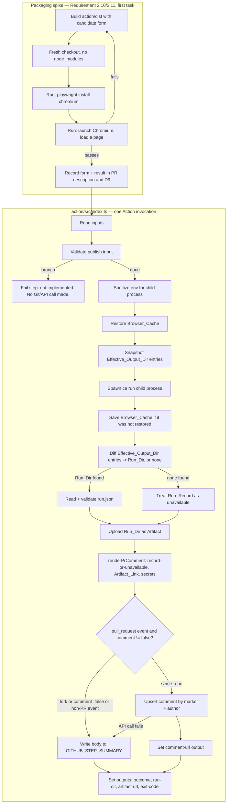

# Design Document

## Overview

This design implements issue rfxlamia/ce#12, "[M3] GitHub Action + PR comment". It follows `requirements.md` in this directory. The facts (F1 to F17), decisions (D1 to D11), implications (I1 to I7) cited below are defined there. `SPEC.md` wins on any conflict.

The feature adds two things that did not exist before.

1. **A GitHub Action** (`action.yml` at the repository root, source and tests under `action/`, a committed build under `action/dist/`). It wraps the CE CLI, restores/saves the Chromium cache, locates the Run_Dir the CLI just wrote, uploads it as a workflow artifact, and upserts one pull request comment.
2. **A Comment_Renderer** (`packages/ce/src/evidence/comment.ts`), a pure function that turns a `RunRecord` (or its absence) and an `Artifact_Link` into the PR_Comment body, sharing its per-Outcome wording with the existing Terminal_Summary (`evidence/summary.ts`).

Everything that decides the Outcome, assesses Claims, or runs the browser is untouched: the Action is a presentation and transport layer around one child-process invocation of `ce run` (D3). The riskiest unknown — whether a committed Action bundle can run Playwright's Chromium installer and launch a browser with no `node_modules/` in the Action's own checkout — is resolved first, before any other part of this design is built on top of it (D9, Requirement 2.10/2.11). That is why the Architecture section below opens with the packaging spike rather than with the Action's control flow.

### Design decisions at a glance

| Topic | Decision | Reason |
| --- | --- | --- |
| Packaging form | Single-file esbuild bundle with `playwright` and `playwright-core` external in `action/dist/node_modules/`. Chosen by the spike (both forms passed on Linux); see "Packaging spike result" below | D9; F17 says bundling Playwright is unproven |
| Where Outcome wording lives | `evidence/summary.ts` exports the per-Outcome text; `evidence/comment.ts` imports it | D2, I4; one wording, two renderers |
| How the Action finds its own Run_Dir | Snapshot the Effective_Output_Dir's entries before and after the child process, diff | F5, I3; the CLI never prints the Run_Dir |
| Child environment of `ce run` | Copy the Action's `process.env`, delete `INPUT_*`/`ACTIONS_*`/token names, then add the mirror `CE_*` variables | F16, I6, D11; `target.start` will not do this for us |
| Comment identity | Marker + author-login match, oldest match wins, others never touched | D7, Requirement 11 |
| `publish: branch` | Validated and failed before any Git/API write, before the cache step even runs | D4, D8, Requirement 12.4 |
| Secret handling in the Action | `collectSecretValues`/`redactSecretValues` reused unchanged from `config/secrets.ts`, applied twice (renderer input, then final body) | Requirement 10.5; reuse, not reimplementation |

### Packaging spike result

**Decision (D9): single-file bundle** (esbuild, `playwright` and `playwright-core` external, pruned `action/dist/node_modules/`). Both forms passed on Linux. Full text, also used for the pull request description: `packaging-spike-result.md` in this directory.

**Commands:** `node scripts/verify-action-bundle.mjs --form=bundle` and `--form=compiled`. Each builds `action/dist`, copies the repo without `node_modules/` (except `action/dist/node_modules/`), and runs `action/dist/index.js` in a `node:24` Docker container.

**Result:**

| Form | Chromium install | Headless launch and page load | dist size | dist files |
| --- | --- | --- | --- | --- |
| bundle | passed | passed | 15.7 MiB | 133 |
| compiled | passed | passed | 15.7 MiB | 133 |

**Why the bundle:** sizes are equal with the stub entry. The bundle keeps `node_modules` at two packages and puts all other code in one file. The compiled form commits one file per module plus every runtime dependency's files.

**Limits:** verified on an aarch64 Linux container, not x64. `install-deps` ran first because `node:24` is minimal (ubuntu runners have those libraries). The entry is a stub, so bundling `packages/ce` is untested.

Original description of the two forms under test:

- **Single-file bundle** (esbuild or rollup, both already present in the workspace's root `node_modules/.bin`): bundles `action/src/index.ts` and the CE CLI's non-Playwright dependencies into `action/dist/index.js`. Playwright itself (`playwright`, `playwright-core`) is marked external and shipped as a pruned `node_modules/playwright*` tree next to the bundle, because F17 shows `playwright-core` reads its own `package.json`, `browsers.json` and installer script from its package directory at runtime — those files cannot survive being inlined into a single JS file.
- **Pruned `node_modules`**: no bundler; `action/dist/` holds the compiled TypeScript output (`tsc`) plus a `node_modules` produced by `npm ci --omit=dev` and then pruned to only the packages `action/dist/index.js` and the CE CLI actually import (dropping `vitest`, `fast-check`, `tsx`, type packages).

Both forms keep Playwright's own files untouched on disk, so both satisfy F17's constraint; the spike chooses between them on bundle size and `git` diff noise, not on correctness. The spike's acceptance check is Requirement 2.10 verbatim: on a Linux runner, with the Action's own repository checkout and no `node_modules/` beyond what `action/dist/` carries, running the packaged entry point runs `playwright install chromium` and then launches Chromium headless and loads a page (`about:blank` is sufficient; the check is "does Chromium start", not "does CE's full loop work").

## Architecture



The Action never touches `outcome/resolve.ts` and holds no Outcome literal of its own; every box above that mentions an Outcome reads `run.json`'s `outcome` field as data (D3, Requirement 9.4).

### Module layout

Per `structure` steering, the new code splits the same way `evidence-bundle` split renderer logic from file I/O: a pure renderer inside `packages/ce/src/evidence/` (reusable, tested with the fake Jev gateway's test doubles even though it calls no Jev), and the GitHub-specific transport code outside `packages/ce/` entirely, under `action/` at the repository root (steering `structure.md` already names `action/` as the home for "the Action entry source + committed bundle"; this design keeps `action.yml` itself at the root per D1, with a documented steering follow-up the orchestrator will apply, not this spec).

```
action.yml                        Action_Manifest, repository root (D1, Requirement 1)
action/
  src/
    index.ts                      Entry point: reads inputs, orchestrates the flow above
    inputs.ts                     Input_Map: Action input -> CE_* variable or CLI flag (Requirement 3)
    env.ts                        sanitizeChildEnv(env) -> child environment (Requirement 5.10, F16)
    cache.ts                      buildCacheKey(...), restore/save Browser_Cache (Requirement 4)
    run-dir.ts                    locateRunDir(before, after) -> Run_Dir | undefined (Requirement 6)
    artifact.ts                   uploadArtifact(...) -> Artifact_Link | '' (Requirement 7)
    upsert.ts                     upsertComment(...) (Requirement 11)
    github.ts                     thin wrapper over @actions/* and the REST calls this feature needs
    publish.ts                    validatePublishMode(input) -> 'none' | fail-fast (Requirement 12)
  dist/                           Action_Bundle, committed (Requirement 2)
  *.test.ts, *.property.test.ts   co-located with the source they test
packages/ce/src/evidence/
  summary.ts                      unchanged export surface, now also exports the per-Outcome wording (D2)
  comment.ts                      renderPrComment(input) -> string (Requirement 8, 9, 10)
  comment.*.test.ts
  comment.*.property.test.ts
```

`action/` depends on `packages/ce` as an npm workspace dependency (reading `RunRecordSchema`, `renderPrComment`, `envNameForPath`/`ENV_KEY_MAP`, `collectSecretValues`/`redactSecretValues` from its published `index.ts` surface), the same way `examples/demo-app` would consume the package if it needed to. `packages/ce` depends on nothing in `action/`, so the dependency is one-directional and the existing `packages/ce` architecture tests are untouched.

### Architecture-test impact

- Requirement 9.4 and 15.10 add a new architecture test, `action/architecture.test.ts`, mirroring the existing import-boundary tests in `packages/ce/src/outcome/architecture.test.ts`: no file under `action/src/` or `packages/ce/src/evidence/comment.ts` may import `jev/`, call `fetch` with a Jev-looking URL, or assign/return/cast an `Outcome` literal (`'SKIPPED' | 'EVIDENCED' | 'UNSUPPORTED' | 'ERROR'`). The scan is the same AST-grep approach the existing `outcome/architecture.test.ts` rule (d) already uses, widened to this new directory set.
- `evidence/comment.ts` lives inside `packages/ce/src/evidence/`, so the existing "no `fetch`, no SDK import" boundary test for that directory (described in `evidence-bundle/design.md`'s "Architecture-test impact") already covers it once `comment.ts` is added to the same glob `evidence/*.ts` the test walks.
- No existing architecture test changes shape; one glob is widened and one new test file is added.

## Components and Interfaces

### `action.yml` (Requirement 1)

```yaml
name: 'Continuous Evidence'
description: 'Runs CE and posts an inspectable evidence comment on the pull request.'
branding:
  icon: 'eye'
  color: 'blue'
runs:
  using: 'node24'
  main: 'action/dist/index.js'
inputs:
  # Mirror inputs (Requirement 3.1), one per ConfigSchema leaf with a CE_* variable.
  # Names are the dotted key with '.' replaced by '-'.
  target-url: { required: false, default: '' }
  target-start: { required: false, default: '' }
  target-ready-path: { required: false, default: '' }
  target-ready-timeout: { required: false, default: '' }
  target-routes: { required: false, default: '' }
  context-base: { required: false, default: '' }
  context-include: { required: false, default: '' }
  context-exclude: { required: false, default: '' }
  context-redact: { required: false, default: '' }
  context-checks: { required: false, default: '' }
  assessment-thresholds-claim: { required: false, default: '' }
  assessment-thresholds-observable: { required: false, default: '' }
  assessment-thresholds-adequate: { required: false, default: '' }
  assessment-uncertainty-band: { required: false, default: '' }
  assessment-on-uncertain: { required: false, default: '' }
  runtime-max-steps: { required: false, default: '' }
  runtime-timeout: { required: false, default: '' }
  runtime-viewport-width: { required: false, default: '' }
  runtime-viewport-height: { required: false, default: '' }
  jev-provider: { required: false, default: '' }
  jev-model: { required: false, default: '' }
  output-fail-on: { required: false, default: '' }
  # Non-mirror inputs (Requirement 3.2)
  config: { required: false, default: '' }
  base: { required: false, default: '' }
  claim: { required: false, default: '' }
  working-directory: { required: false, default: '' }
  github-token: { required: false, default: '${{ github.token }}' }
  comment: { required: false, default: 'true' }
  comment-author: { required: false, default: 'github-actions[bot]' }
  artifact-name: { required: false, default: '' }
  publish: { required: false, default: 'none' }
outputs:
  outcome: { description: 'SKIPPED | EVIDENCED | UNSUPPORTED | ERROR, or empty if unknown.' }
  run-dir: { description: 'Absolute path of the Run_Dir, or empty.' }
  artifact-url: { description: 'URL of the uploaded Evidence_Bundle artifact, or empty.' }
  comment-url: { description: 'URL of the PR comment, or empty.' }
  exit-code: { description: 'Exit code of the CE CLI child process.' }
```

A unit test (`action/action-yml.test.ts`) parses this file with `yaml` (already a dependency) and checks criteria 1 to 5 of Requirement 1 structurally: `runs.using === 'node24'`, `runs.main` resolves to a file that `existsSync` finds relative to the repository root, `name`/`description`/`branding` are present, and the five outputs are declared. `output-dir` has **no** mirror input: it is deliberately absent from the list above, because Requirement 6.1 forbids deriving the Run_Dir from an `output-dir` input — if one existed, a workflow author could point the Action and the config loader at different values. Not declaring it removes that trap entirely; `output.dir` can still be set through `ce.yml` or `CE_OUTPUT_DIR` in `env:`, and the Action's own `run-dir.ts` finds whatever directory the effective config (loaded the same way) resolves to (Requirement 6.1).

### `action/src/inputs.ts` — Input_Map (Requirement 3)

```ts
import { ENV_KEY_MAP, envNameForPath } from 'continuous-evidence';

/** One row of the Input_Map: an Action input name and where its value goes. */
interface MirrorEntry {
  inputName: string;   // e.g. 'runtime-max-steps'
  envName: string;     // e.g. 'CE_RUNTIME_MAX_STEPS'
}

/** Built once from ENV_KEY_MAP, so a new ConfigSchema leaf with a CE_* variable
 *  is caught by the staleness test (Requirement 3.8) rather than silently unmapped. */
export function buildMirrorEntries(envKeyMap: ReadonlyMap<string, string>): MirrorEntry[];

export interface ActionInputs {
  getInput(name: string): string; // Action's core.getInput, trimmed, '' when unset
}

/** Returns the CE_* variables to add to the child env, and the --config/--base/--claim
 *  argv entries, from the current Action inputs. Never shells out, never joins into a
 *  command line string (Requirement 3.12). */
export function buildChildInvocation(inputs: ActionInputs): {
  env: Record<string, string>;
  argv: string[];
  warnings: string[]; // e.g. "claim line 3 starts with '--', skipped" (Requirement 3.5)
};
```

`buildMirrorEntries` derives the dotted-key -> input-name mapping by replacing `.` with `-` in each `ENV_KEY_MAP` value (the dotted key), and the reverse direction (input name -> `CE_*` variable) by calling `envNameForPath` on that same dotted key — both directions come from the one source of truth already in `packages/ce`, so Requirement 3.1's naming rule and Requirement 3.8's staleness check are the same code path, not two independently maintained lists. `buildChildInvocation` reads each mirror input; an empty string (the default for every mirror input above) means "do not set the `CE_*` variable at all" (`delete`, not `= ''`), which is Requirement 3.4 and also what keeps `ce.yml` values and defaults alive.

The `claim` input is one input holding multiple lines (Requirement 3.2). `buildChildInvocation` splits it on `\n`, trims each line, drops empty lines, and for each remaining line either appends `--claim`, `<line>` to `argv` or — when the trimmed line starts with `--` — pushes a warning naming the 1-based line number (never the text, since the text could carry a secret-looking string) and drops that line, continuing with the rest (Requirement 3.5). This mirrors `parseRunArgs`'s own rule (`run/command.ts` lines 43-71) without calling it, because `parseRunArgs` parses a flat `argv`, not a newline-delimited input value.

### `action/src/env.ts` — child environment sanitizing (Requirement 5.10, F16, D11)

```ts
const FORBIDDEN_PREFIXES = ['INPUT_', 'ACTIONS_'] as const;
const FORBIDDEN_NAMES = ['GITHUB_TOKEN', 'GH_TOKEN'] as const;

/** Removes every variable the Subject must never see (F16), then adds the
 *  CE_* mirror variables. Returns a fresh object; never mutates `env`. */
export function sanitizeChildEnv(
  env: Readonly<Record<string, string | undefined>>,
  runToken: string,
  mirrorEnv: Readonly<Record<string, string>>,
): Record<string, string> {
  const result: Record<string, string> = {};
  for (const [name, value] of Object.entries(env)) {
    if (value === undefined) continue;
    if (FORBIDDEN_PREFIXES.some((p) => name.startsWith(p))) continue;
    if ((FORBIDDEN_NAMES as readonly string[]).includes(name)) continue;
    if (runToken.length > 0 && value === runToken) continue; // catches a differently-named token var
    result[name] = value;
  }
  return { ...result, ...mirrorEnv };
}
```

This runs in the Action's own process, on the Action's own `process.env`, before the `ce run` child process is spawned — it is the only place in this feature that removes `INPUT_*`/`ACTIONS_*`/token variables, matching F16's finding that `target.start` (inside the CE_CLI) removes only `CE_SECRET_NAMES` and nothing else. The function is pure (input environment in, new environment out) so Requirement 15.3's property test can generate arbitrary environments, including ones where the Run_Token's value happens to also be the value of an unrelated variable (caught by the value check, not just the name check, since F16's risk is the *value* reaching the Subject, under any name). `GITHUB_EVENT_PATH` and every other `GITHUB_*` variable pass through unchanged (Requirement 5.10's "keep the other `GITHUB_*` variables").

### `action/src/run-dir.ts` — locating the Run_Dir (Requirement 6, F5, I3)

```ts
import { loadConfig } from 'continuous-evidence';
import { readdirSync, statSync } from 'node:fs';
import { readFile } from 'node:fs/promises';

/** Resolves the Effective_Output_Dir the same way the CE_CLI will, using the
 *  identical cwd, flags and env this invocation is about to use. Returns
 *  undefined when loadConfig fails — the caller still runs the CLI and treats
 *  the run as having no Evidence_Bundle (Requirement 6.2). */
export function resolveEffectiveOutputDir(options: {
  cwd: string;
  flags: Record<string, unknown>;
  env: Record<string, string | undefined>;
}): string | undefined;

/** Lists immediate entries of `dir`, or [] if `dir` does not exist yet
 *  (a first run in a fresh workspace has no output.dir at all). */
function listEntries(dir: string): string[];

/** Picks the Run_Dir created by this invocation: the new entry, or the most
 *  recently modified of several new entries, or undefined (Requirement 6.3, 6.4). */
export function pickNewRunDir(dir: string, before: readonly string[], after: readonly string[]): string | undefined;
```

`index.ts` calls `resolveEffectiveOutputDir` once, before spawning the child process, with the exact `cwd` (the `working-directory` input or `GITHUB_WORKSPACE`), `flags` (`{ config: <config input> }` if non-empty) and `env` (the *unsanitized* Action environment plus the mirror `CE_*` variables — the same inputs the child process is about to receive, so the loader resolves the identical `output.dir`) that `buildChildInvocation` already computed. It calls `listEntries` before the child process starts and again after it ends, and `pickNewRunDir` diffs the two lists. This reuses `loadConfig` exactly as published from `packages/ce`, so a future `ce.yml` key or precedence change needs no corresponding change in `action/` (Requirement 6.1's "SHALL NOT assume `.ce/runs`" is satisfied because `defaultRunDir`'s hardcoded fallback, `run/pipeline.ts` line 167, is internal to `loadConfig`'s *caller* in the CLI, not something `action/` re-implements — `resolveEffectiveOutputDir` reads `loaded.config.output?.dir ?? '.ce/runs'` the same way `run/pipeline.ts` line 341 does, from the config `loadConfig` already returned).

Once a Run_Dir is picked, `index.ts` reads `run.json` from it with `readFile` + `RunRecordSchema.safeParse` (imported from `continuous-evidence`), exactly as `run/command.ts`'s own `readWrittenRecord` helper already does (Requirement 6.5). A missing, unparsable or schema-invalid `run.json` is the same "Run_Record unavailable" case as no Run_Dir at all (Requirement 6.6) — `index.ts` does not distinguish the two downstream.

### `action/src/cache.ts` — Browser_Cache (Requirement 4)

```ts
/** Cache_Key: stable across restores, distinct across OS/arch/playwright version
 *  (Requirement 4.2, 4.9). */
export function buildCacheKey(os: string, arch: string, playwrightVersion: string): string {
  return `ce-playwright-chromium-${os}-${arch}-${playwrightVersion}`;
}

/** Resolves Browsers_Path the same way Playwright does: PLAYWRIGHT_BROWSERS_PATH
 *  if set, else the OS-specific default (Requirement 4.10). */
export function resolveBrowsersPath(env: Readonly<Record<string, string | undefined>>, platform: NodeJS.Platform, home: string): string;
```

`index.ts`'s cache step: resolve `Browsers_Path` and the `Cache_Key`, call `@actions/cache`'s `restoreCache([browsersPath], cacheKey)`; on Linux (`WHILE the runner operating system is Linux`, Requirement 4.5) always run `npx playwright install-deps chromium` regardless of restore outcome, since OS packages are not part of the cached directory; on a cache miss run `npx playwright install chromium` and then `saveCache`; on any cache API failure (restore or save), write a `core.warning` and continue without failing the step (Requirement 4.6); on an install failure, fail the step and do not spawn the `ce run` child process (Requirement 4.7). `PLAYWRIGHT_BROWSERS_PATH` is set to the resolved `Browsers_Path` in both the installer's environment and the `ce run` child environment (Requirement 4.10), added by `sanitizeChildEnv`'s `mirrorEnv` argument.

### `action/src/artifact.ts` — Artifact upload (Requirement 7)

```ts
const FORBIDDEN_NAME_CHARS = /["\u003A<>|*?\\/\r\n]/g; // " : < > | * ? \ / CR LF

/** Replaces every character GitHub forbids in an artifact name with '-'
 *  (Requirement 7.2). Applied to every name part before joining. */
export function sanitizeArtifactNamePart(part: string): string {
  return part.replace(FORBIDDEN_NAME_CHARS, '-');
}

export function buildArtifactName(input: {
  explicitName: string; // artifact-name input, '' if unset
  runId: string; runAttempt: string; job: string; runDirName: string;
}): string;
```

`buildArtifactName` returns the sanitized `explicitName` unchanged (as one part) when it is non-empty, otherwise joins the sanitized parts `ce-evidence`, `runId`, `runAttempt`, `job`, `runDirName` with `-` (Requirement 7.2). `index.ts` calls `@actions/artifact`'s uploader with the Run_Dir's files at their Run_Dir-relative paths (Requirement 7.3), builds the `Artifact_Link` from `${GITHUB_SERVER_URL}/${repo}/actions/runs/${runId}` plus the artifact id when the upload returns one, falls back to the run URL without an id (Requirement 7.4, 7.5), and on an upload failure writes a `core.warning`, sets the link to `''`, and continues (Requirement 7.6) — never throwing out of this step, since Requirement 7.8 requires the Action to tolerate an empty or partial Run_Dir (an `ERROR` run's bundle).

### `evidence/comment.ts` — the Comment_Renderer (Requirement 8, 9, 10)

```ts
import { rationaleLine } from './summary.js'; // newly exported (D2), same text as the Terminal_Summary
import { redactSecretValues } from '../config/secrets.js';
import type { RunRecord } from './schema.js';

export interface UnavailableRecord {
  kind: 'unavailable';
  exitCode: number;
}

export interface CommentInput {
  record: RunRecord | UnavailableRecord;
  artifactLink: string; // '' means unavailable (Requirement 8.7)
  secrets: readonly string[]; // Secret_Values to strip (Requirement 10.5)
}

export const COMMENT_MARKER = '<!-- ce:report -->';

/** Pure: no I/O, no process.env, no clock, decides no Outcome (reads
 *  record.outcome as data only — Requirement 9.4). */
export function renderPrComment(input: CommentInput): string;

/** Removes the marker from the job summary write (Requirement 10.6). */
export function stripCommentMarker(body: string): string;
```

`renderPrComment`'s body:

1. First line: `COMMENT_MARKER` (Requirement 8.2).
2. Second line: the Outcome line — `Outcome: ${record.outcome}` when `record` is a `RunRecord`, or the fixed string `Outcome: unknown (no run record)` plus the exit code when `record.kind === 'unavailable'` (Requirement 8.3, 8.8). This is the only place the Comment_Renderer reads an `outcome` value, and it reads it, never assigns it (Requirement 9.4) — the literal `'unknown (no run record)'` is a string describing the *absence* of an Outcome, not one of the four `Outcome` values, so it does not need to appear in the `Outcome` union and the architecture test's literal scan does not need an exception for it.
3. A Claims section built from `record.claims` (empty when unavailable): each Claim's `text`, after sanitizing (step 6 below), on its own line; a Claim with a non-null `probability` is labeled "signal" (Requirement 8.4, 8.12); no Claims listed states "no claim was identified" (Requirement 8.4).
4. A Rationale_Line, produced by the now-exported `rationaleLine` from `summary.ts` (Requirement 9.1, 9.2) — identical text to what the Terminal_Summary would print for the same Run_Record, clamped to 200 code points by the same helper `summary.ts` already uses internally.
5. Outcome-specific detail: `decidedBy`/`outcomeReason` for `SKIPPED` (Requirement 8.6), `surface` for `UNSUPPORTED` (Requirement 8.9), `stage`/`outcomeReason` without the underlying error message or stack for `ERROR` (Requirement 8.10), `finalState`/step count plus the fixed sentence "this evidence is for inspection; it is not a verdict on correctness" for `EVIDENCED` (Requirement 8.11, SPEC 3.5).
6. Untrusted-text handling, applied to every Claim text and every string pulled from the Run_Record before it is placed in the body (Requirement 10.1): Markdown/HTML escaping of `` ` *_[]()#<>! `` and raw `<` (Requirement 10.2); removal of every `<!--` sequence, which also removes `COMMENT_MARKER` wherever it appears in untrusted text (Requirement 10.3); neutralizing `@name` to `` `@name` `` (inline code, so no mention fires) and `#123` to `` `#123` `` the same way (Requirement 10.4).
7. `redactSecretValues(body, input.secrets)` applied once at the end over the whole assembled body, catching any Secret_Value that leaked through from an unexpected field (Requirement 10.5) — `index.ts` additionally calls `redactSecretValues` a second time, as required by Requirement 10.5's last sentence, right before any write (comment API call or job summary file), so a Secret_Value introduced between rendering and writing (there is none in the current design, but the requirement is explicit) is still caught.
8. The Artifact_Link line, or "the evidence artifact is unavailable" when `artifactLink === ''` (Requirement 8.7).
9. A length check: if the assembled body exceeds 60000 characters, Claims are dropped from the end of the list (keeping the Comment_Marker, Outcome line, Rationale_Line and Artifact_Link, which are built first and never dropped) and a `(+N more claims)` line is appended, repeating until the body fits (Requirement 8.13). Before that check, the Claims list itself is capped at 10 entries, each cut to 200 code points with `…` (Requirement 8.14), using the same `fit`/`clamp` helpers `summary.ts` already has (exported alongside `rationaleLine`, not duplicated).

`index.ts` is the only caller that constructs `CommentInput.secrets`, from `collectSecretValues(process.env)` (Requirement 10.5's "the Action SHALL pass `collectSecretValues` of its environment as that parameter"). `evidence/comment.ts` never reads `process.env` itself (Requirement 9/the general "pure function" constraint of 8.1).

### `evidence/summary.ts` changes (Requirement 9)

`rationaleLine`, `oneLine`, `fit` and `clamp` — today module-private (F7) — become named exports. `buildSummary`'s own body is unchanged; it now simply calls the exported functions instead of the module-private ones, so `summary.*.property.test.ts` needs no change (Requirement 9.3) and the Terminal_Summary's byte output is identical before and after this refactor. No new parameter is added to `rationaleLine`; `evidence/comment.ts` builds the same `Facts` shape `summary.ts` already builds internally, from the `RunRecord` it has, and that `Facts` type is exported too so both call sites share one definition.

### `action/src/upsert.ts` — Comment_Upserter (Requirement 11)

```ts
export interface CommentApi {
  listComments(pr: number): Promise<Array<{ id: number; body: string; user: { login: string } }>>;
  createComment(pr: number, body: string): Promise<{ id: number; html_url: string }>;
  updateComment(id: number, body: string): Promise<{ id: number; html_url: string }>;
}

export async function upsertComment(
  api: CommentApi,
  pr: number,
  commentAuthor: string,
  body: string,
): Promise<{ url: string } | { failed: true; warning: string }>;
```

`upsertComment` pages through `listComments` fully (Requirement 11.10 — the fake test double in tests paginates in fixed-size pages to exercise this), filters to comments whose body contains `COMMENT_MARKER` **and** whose `user.login === commentAuthor`, picks the one with the lowest `id` among those (oldest, Requirement 11.2), and either calls `updateComment` on it or `createComment` when none match (Requirement 11.3). It never calls `updateComment` or any delete on a comment whose `user.login !== commentAuthor`, even if that comment's body contains the marker (Requirement 11.4) — the login filter is applied before the marker filter is even consulted for selection purposes, so a comment from a different bot is invisible to this function, not merely "not chosen". A thrown error from any of the three API calls (modeled as a rejected promise in the real `@octokit`-backed `CommentApi`) is caught by `index.ts`, not by `upsertComment` itself, which lets `index.ts` build one warning message carrying the HTTP status and, for 403, a sentence naming the missing `pull-requests: write` permission, with no token value in that message (Requirement 11.6).

`index.ts` decides *whether* to call `upsertComment` at all: it is skipped (Requirement 11.5) when the head repository's full name differs from the base repository's full name (both read from the Event_Payload, F13), when the `comment` input is `false` (Requirement 11.8), or when the triggering event is not a pull request event (Requirement 5.5). In every skip case and in the caught-failure case, the rendered body (with the marker stripped, via `stripCommentMarker`) is appended to the file at `GITHUB_STEP_SUMMARY` (Requirement 10.6, 11.5, 11.6, 11.8).

### `action/src/publish.ts` — `publish` validation (Requirement 12)

```ts
export type PublishMode = 'none';

/** Throws a descriptive Error for 'branch' and for any other invalid value.
 *  Called before any cache, Git or GitHub API operation (Requirement 12.3, 12.4). */
export function validatePublishMode(raw: string): PublishMode;
```

`index.ts` calls `validatePublishMode` as its very first step after reading inputs, before the cache restore (Requirement 12.4's "before the Browser_Cache restore"). An empty string maps to `'none'` (Requirement 12.2). The value `'branch'` throws with the fixed message `publish: branch is not implemented in this release` plus the follow-up issue reference (D8); any other value throws listing the two allowed values (Requirement 12.3). `index.ts` lets this exception fail the step immediately via its own top-level `try/catch`, which — for this specific path only — makes no cache call, spawns no child process, and calls no GitHub API, satisfying Requirement 12.6's "no write operation at all" for this case specifically (the general no-push invariant for `publish: none` is Property 10 below, verified structurally rather than by this function, since `'none'` is the mode under which the rest of the Action's normal flow runs).

### `.github/workflows/ce.yml` (Requirement 14)

A new workflow, separate from `ci.yml` (Requirement 14.8), dogfooding the Action from the checkout (`uses: ./`):

```yaml
name: CE
on:
  pull_request:
permissions:
  contents: read
  pull-requests: write
concurrency:
  group: ce-${{ github.event.pull_request.number }}
  cancel-in-progress: true
jobs:
  evidence:
    if: github.event.pull_request.head.repo.full_name == github.event.pull_request.base.repo.full_name
    runs-on: ubuntu-latest
    timeout-minutes: 15
    steps:
      - uses: actions/checkout@3d3c42e5aac5ba805825da76410c181273ba90b1 # v7.0.1
        with:
          fetch-depth: 0
      - uses: ./
        with:
          target-start: 'npm run dev --workspace @ce/demo-app'
          target-url: 'http://localhost:5173'
        env:
          OPENROUTER_API_KEY: ${{ secrets.OPENROUTER_API_KEY }}
```

The `if:` condition is Requirement 14.3's Same_Repo_PR gate, checked with the same Event_Payload fields `resolveGithubEvent` already reads (`head.repo.full_name`, `base.repo.full_name`), evaluated by GitHub's own expression engine before the job starts (not inside `action/`), so a fork PR run never starts the job at all — a stronger guarantee than the Action's own `upsertComment` skip in Requirement 11.5, which exists for the case this workflow-level gate is absent in a *consumer's* workflow. `target-start`'s exact command and `demo-app`'s dev-server readiness path are finalized during implementation against the actual `examples/demo-app/package.json` scripts; the values above are illustrative of the shape required by Requirement 14.2, not a verified final command.

## Data Models

### `UnavailableRecord` (new, `evidence/comment.ts`)

```ts
interface UnavailableRecord {
  kind: 'unavailable';
  exitCode: number;
}
```

The only new persisted-adjacent shape this feature introduces. It is never written to disk and never validated against a schema; it exists purely as the Comment_Renderer's second input variant (Requirement 8.8) and is constructed only in `action/src/index.ts` when `run-dir.ts` found no Run_Dir or `run.json` failed to parse.

### `CommentInput` / `renderPrComment` contract

See "`evidence/comment.ts`" above for the full shape. `RunRecord` itself (`evidence/schema.ts`, `RunRecordSchema`) is unchanged by this feature — Requirement 8.15's "no diff text, no commit message, no file content, no `patch` text" already holds for every `RunRecord` the evidence-bundle feature produces (F8), so the Comment_Renderer inherits that guarantee from its input type rather than needing to filter anything itself.

### Input_Map table (Requirement 3.1, 3.2 — data, not prose)

| Action input | Destination | Note |
| --- | --- | --- |
| `target-url` … `output-fail-on` (22 mirror inputs) | `CE_*` variable via `envNameForPath` | empty = unset, never `''` passed through |
| `config` | `--config <value>` flag | |
| `base` | `--base <value>` flag | wins over `context-base`'s `CE_CONTEXT_BASE` (Requirement 3.10) |
| `claim` | one `--claim <text>` per non-empty, non-`--`-prefixed line | invalid lines skipped with a line-number warning |
| `working-directory` | child process `cwd` | default `GITHUB_WORKSPACE` |
| `github-token` | used by `action/` itself for API calls; **not** passed to the child | never a `CE_*` variable, never a CLI flag |
| `comment`, `comment-author`, `artifact-name`, `publish` | consumed by `action/` logic only | never reach the CE_CLI |

### Artifact name parts (Requirement 7.2 — data)

`ce-evidence-<run-id>-<run-attempt>-<job>-<run-dir-name>`, each part passed through `sanitizeArtifactNamePart` independently before joining with `-`, so a forbidden character inside, say, the job name cannot merge two parts into one or shift the positions of the others.

## Correctness Properties

*A property is a characteristic or behavior that should hold true across all valid executions of a system—essentially, a formal statement about what the system should do. Properties serve as the bridge between human-readable specifications and machine-verifiable correctness guarantees.*

The prework found that most of this feature's acceptance criteria describe one of: a pure rendering function (the Comment_Renderer), a pure data-mapping function (Input_Map, env sanitizing, Cache_Key, artifact naming, Run_Dir selection), or an interaction protocol against a fake external API (the Comment_Upserter, the artifact/cache calls). The properties below cover the pure functions; the protocol-level requirements (pagination, 403 degradation, fork skip) are EXAMPLE/INTEGRATION cases against the fake GitHub API, listed in the Testing Strategy instead, because their behavior is a fixed protocol rather than a property that varies meaningfully with generated input. Properties 7 and 9 each subsume several individually-listed acceptance criteria that are instances of one underlying invariant (full reasoning in the prework analysis used to derive them).

### Property 1: The Comment_Marker appears exactly once, on the first line

*For any* `CommentInput` — any `RunRecord` accepted by `RunRecordSchema`, or any `UnavailableRecord`, any `artifactLink` string, and any `secrets` list — the string `renderPrComment` returns SHALL contain `COMMENT_MARKER` exactly once, as its first line.

**Validates: Requirements 8.2, 10.3**

### Property 2: Hostile Claim text cannot forge a marker, a mention, an issue link, or a second active HTML/Markdown construct

*For any* generated Claim text drawn from a set that includes `<!-- ce:report -->`, `@someone`, `#12`, `[x](http://e)`, `<script>alert(1)</script>`, and random combinations of `<!--`, `@`, `#`, and Markdown control characters, embedded into an otherwise-valid `RunRecord`, the body `renderPrComment` returns SHALL contain `COMMENT_MARKER` exactly once (only the one the renderer itself inserts) and SHALL contain none of the embedded strings in a form that an `@`-mention, `#`-reference, active link, active HTML tag, or second HTML comment would be recognized from by GitHub's renderer.

**Validates: Requirements 8.2, 10.1, 10.2, 10.3, 10.4**

### Property 3: Every Secret_Value is absent from the rendered and the written body

*For any* `CommentInput` whose `secrets` list is non-empty and whose `record` (directly, inside a Claim text, or inside any other `RunRecord` string field) contains one or more of those values verbatim, the string `renderPrComment` returns, and that same string after a second `redactSecretValues` pass with the same list, SHALL contain none of the `secrets` values; every occurrence SHALL be replaced by `[REDACTED]`.

**Validates: Requirements 10.5, 15.1**

### Property 4: The rendered body never uses a verdict word, and never states an Outcome the input did not carry

*For any* `CommentInput`, the body `renderPrComment` returns SHALL NOT contain the words "passed", "failed", "verified" or "correct" describing the Change, SHALL contain the literal Outcome value from `record.outcome` when `record` is a `RunRecord` (and no other Outcome value), and SHALL contain the fixed unavailable-outcome line, never a value from the `Outcome` union, when `record.kind === 'unavailable'`.

**Validates: Requirements 8.3, 8.8, 8.12, 9.4**

### Property 5: The body respects the length and Claim-count ceilings without losing the required lines

*For any* `RunRecord` with an arbitrary number of Claims of arbitrary length (including Claims individually longer than 200 code points and Run_Records whose naive rendering would exceed 60000 characters), the body `renderPrComment` returns SHALL be at most 60000 characters, SHALL list at most 10 Claims each at most 200 code points (ending in `…` when cut), and SHALL still contain the Comment_Marker, the Outcome line, a Rationale_Line and either the Artifact_Link or the "artifact unavailable" statement.

**Validates: Requirements 8.13, 8.14**

### Property 6: Rendering is deterministic

*For any* `CommentInput`, calling `renderPrComment` twice with the same (deep-equal) argument SHALL return byte-identical strings.

**Validates: Requirements 8.17**

### Property 7: Child-environment sanitizing removes every forbidden variable and preserves every other one, under any name collision

*For any* environment object containing an arbitrary mix of variable names — including names starting with `INPUT_` or `ACTIONS_`, the names `GITHUB_TOKEN` and `GH_TOKEN`, an arbitrary Run_Token value possibly repeated under an unrelated variable name, and arbitrary other `GITHUB_*`, `CE_*` and unrelated variables — `sanitizeChildEnv(env, runToken, mirrorEnv)` SHALL return an object containing no key with a forbidden prefix, no `GITHUB_TOKEN` or `GH_TOKEN` key, no value equal to a non-empty `runToken` under any key, and SHALL contain every key of `env` that violates none of those rules with its original value, plus every key of `mirrorEnv`.

**Validates: Requirements 5.10, 5.11**

### Property 8: The Input_Map sends each non-empty input to exactly one destination, and each empty input to none

*For any* generated set of Action input values (one value or empty per input declared in `action.yml`, including boundary values for `claim` with lines that start with `--`), `buildChildInvocation` SHALL place every non-empty mirror input's value in exactly one `CE_*` environment variable (never as an argv flag) and every non-empty `config`/`base` input's value as exactly one argv flag pair (never as an environment variable), and SHALL place no empty input's value anywhere, and `claim` lines that start with `--` SHALL appear in `warnings` and SHALL NOT appear in `argv`.

**Validates: Requirements 3.3, 3.4, 3.5, 15.3**

### Property 9: The Cache_Key is a pure function that distinguishes every input dimension

*For any* two triples of (operating system, architecture, Playwright version) that differ in at least one component, `buildCacheKey` SHALL return different strings; *for any* one triple, calling it twice SHALL return the same string.

**Validates: Requirements 4.2, 4.9**

### Property 10: Artifact name sanitizing is total and position-preserving

*For any* string used as the `artifact-name` input or as any one of the generated-name parts, including strings containing every character in the forbidden set (`" : < > | * ? \ / CR LF`), `sanitizeArtifactNamePart` SHALL return a string containing none of those characters, of the same length as its input, and `buildArtifactName` applied to any set of parts SHALL return a name containing none of those characters anywhere, including at the position where a forbidden character would otherwise have produced an extra or missing `-` separator.

**Validates: Requirements 7.2**

### Property 11: Run_Dir selection picks the one new entry, or the newest of several, or none

*For any* `before` and `after` directory-entry-name lists where `after` is `before` plus zero or more new names (including a name that collides with a pre-existing stale entry, which is therefore not "new"), `pickNewRunDir` SHALL return `undefined` when `after` added no name relative to `before`, SHALL return that one name when exactly one was added, and SHALL return the name with the most recent modification time on disk when more than one was added.

**Validates: Requirements 6.3, 6.4**

## Error Handling

- **Packaging spike fails both candidate forms** (Requirement 2.10): this blocks every other task; the design records whichever partial failure mode is found (install succeeds, launch fails; or install itself fails to locate its own installer script) in the PR description per Requirement 2.11, and a third packaging form is considered only if both documented forms fail — not speculatively designed here.
- **`loadConfig` fails inside `resolveEffectiveOutputDir`** (Requirement 6.2): `index.ts` still spawns the `ce run` child process (which reports the identical config error itself, since it calls the same `loadConfig`), and treats the run as having no Evidence_Bundle — no Run_Dir listing is attempted, `renderPrComment` receives `UnavailableRecord` with the child's exit code.
- **Child process cannot be spawned, or exits via a signal** (Requirement 5.9): `index.ts` fails the step, logs the failure with `redactSecretValues` already applied (no Secret_Value in the log), and still attempts the Run_Dir-selection-and-upload path in case a partial Run_Dir exists from a previous CE internal error path that still wrote one before the process died — most such deaths leave no new Run_Dir, in which case this degrades to the no-bundle case above.
- **Cache restore/save/install failures** (Requirement 4.6, 4.7): restore/save failures are warnings and the run continues without the cache; an install failure stops the Action before the child process runs, since a browserless run cannot produce runtime Evidence.
- **Artifact upload failure** (Requirement 7.6): warning, empty Artifact_Link, run continues; the comment still posts, stating the artifact is unavailable.
- **Comment API failures** — fork PR, `comment: false`, non-PR event, any HTTP failure including 403 (Requirements 11.5, 11.6, 11.8, 5.5): none of these fail the step. Each writes the rendered body (marker stripped) to `GITHUB_STEP_SUMMARY` instead. The step's exit code is governed solely by the CE_CLI's own exit code (D6, Requirement 5.8), never by any of these conditions.
- **Invalid `publish` value, including `branch`** (Requirement 12.3, 12.4): fails the step immediately, before any other side effect in the Action, with a message naming the allowed values or the "not implemented in this release" sentence and the follow-up issue.
- **`run.json` present but fails schema validation** (Requirement 6.6): treated identically to "no Run_Dir found" for the Comment_Renderer's purposes; the Run_Dir itself is still uploaded as the Artifact (Requirement 7.1's "whatever the Outcome and the exit code are" — this is true even when there is no readable Outcome at all).

## Testing Strategy

**Property tests** (fast-check, minimum 100 iterations, each tagged `Feature: github-action-pr-comment, Property {n}: {text}`) cover Properties 1 to 11 above, implemented as:

- `evidence/comment.marker.property.test.ts` (Property 1)
- `evidence/comment.hostile-input.property.test.ts` (Property 2) — the generator for Claim text draws from both the fixed hostile strings Requirement 8.17/10.7 names verbatim and randomly assembled combinations of their component characters, per Requirement 10.7's own property-test instruction.
- `evidence/comment.secrets.property.test.ts` (Property 3) — reuses the existing `config/secrets.ts` test's approach to generating secret-looking values, feeding them into every string-valued field of a generated `RunRecord` (via the same generic-walk technique `evidence/redact.ts` already uses in the evidence-bundle feature, applied here as a test helper rather than production code, since `renderPrComment` does its own escaping rather than calling `redactRunRecord`).
- `evidence/comment.wording.property.test.ts` (Property 4)
- `evidence/comment.length.property.test.ts` (Property 5)
- `evidence/comment.determinism.property.test.ts` (Property 6)
- `action/env.property.test.ts` (Property 7)
- `action/inputs.property.test.ts` (Property 8)
- `action/cache.property.test.ts` (Property 9)
- `action/artifact.property.test.ts` (Property 10)
- `action/run-dir.property.test.ts` (Property 11)

Each test imports its arbitraries from a shared `evidence/comment.arbitraries.ts` or `action/arbitraries.ts` (mirroring the `outcome/arbitraries.ts` / `evidence/arbitraries.ts` pattern already established by the evidence-bundle feature), reusing the `RunRecord` arbitrary that feature already built rather than writing a second one.

**Unit and integration tests** cover the protocol-shaped requirements that a property test would not add value to (per the workflow's own decision guide: fixed protocol, not input-varying logic):

- `action.yml` structural checks (Requirement 1.7) — one example-based test parsing the real file.
- Bundle staleness (Requirement 2.5) — a test that rebuilds via the npm script into a temp directory and diffs against the committed `action/dist/`.
- Bundle secret-absence scan (Requirement 2.7) — a test environment with fixture `OPENROUTER_API_KEY`/`TYPESAFE_API_KEY` values, grepped against the bundle text.
- `.gitignore`/`git check-ignore` checks (Requirement 2.8, 2.9) — shell out to `git check-ignore` from the test, as the requirement specifies.
- Packaging-form verification itself (Requirement 2.10) — a dedicated integration test/script that runs on a real Linux runner (CI), not mocked, since it is exactly the thing being verified.
- Run_Dir selection examples (Requirement 15.5): zero, one, several new entries; a pre-existing stale entry; `output.dir` set only via `ce.yml`.
- Comment_Upserter idempotence (Requirement 11.9) — fake `CommentApi`, three sequential `upsertComment` calls, once with the default author and once with a human login, asserting exactly one marker-bearing comment from that author afterward.
- Comment_Upserter non-bot-comment and pagination cases (Requirement 11.4, 11.10) — fake `CommentApi` seeded with a marker-bearing comment from a different `user.login`, and a fake that returns results across two pages.
- Fork/403/other-failure degradation (Requirement 11.5, 11.6) — fake Event_Payload with differing head/base repos; fake `CommentApi` that rejects with a 403-shaped error.
- Unique artifact names for two invocations in one job (Requirement 7.2) — two calls to `buildArtifactName` with the same `runId`/`runAttempt`/`job` but different `runDirName`.
- `publish: branch` and invalid-value fail-fast, and the no-write check (Requirement 12.3, 12.4, 12.6) — a test harness recording every Git command and every GitHub API request the Action issues during a full run, asserting the recorded list is empty for `branch` and contains only the artifact/cache/comment operations for `none`.
- Renderer example-per-Outcome tests (Requirement 15.9): one fixture `RunRecord` per `SKIPPED`/`EVIDENCED`/`UNSUPPORTED`/`ERROR`, plus the `UnavailableRecord` case, each asserting the specific prose Requirement 8.6/8.9/8.10/8.11 names.
- README's embedded workflow YAML (Requirement 13.8) — parse the fenced block, check every `with:` key against `action.yml`'s declared inputs.
- Architecture test (Requirement 15.10, 9.4) — extends the import-boundary scan to `action/src/` and `evidence/comment.ts`, as described in "Architecture-test impact" above.

All tests in this feature use `FakeJevGateway` wherever a `RunRecord` fixture needs to resemble output from an assessed run (Requirement 15.1), set no real provider API key, and make no network call (Requirement 15.2) — the GitHub API is always a fake `CommentApi`/cache/artifact double, never `@octokit` or `@actions/*` hitting a real endpoint.
