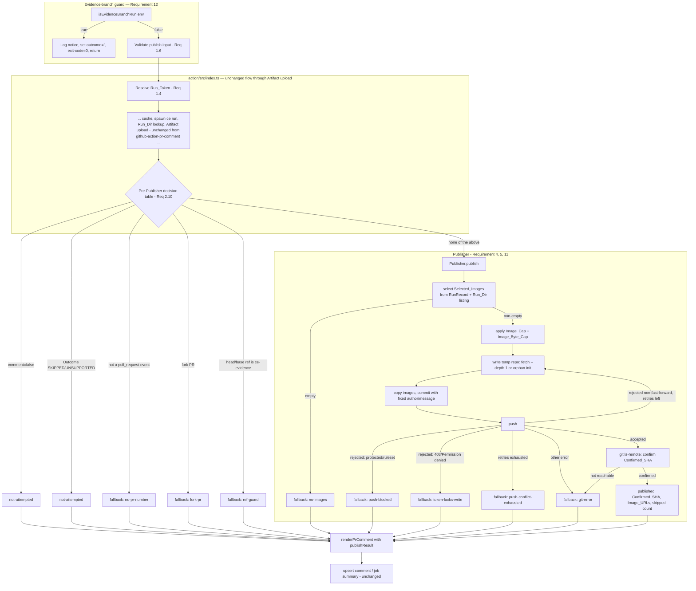

# Design Document

## Overview

This design implements GitHub issue #47, "[M4] Inline screenshots in the PR comment (`publish: branch`)", per `requirements.md` in this directory. It builds on `.kiro/specs/github-action-pr-comment/` (issue #12), replacing that spec's D8/Requirement 12.4 fail-fast for `publish: branch` with a working implementation, and R10.4 of `docs/journal/v0.0/requirements.md` / design.md §8. `SPEC.md` is normative and wins on any conflict.

The feature adds three things that did not exist before, all new code, with no change to any Claim, Check, Assessment, runtime loop, or `outcome/resolve.ts` logic:

1. **A Publisher** (`action/src/publish/`), which selects PNG files from a `RunRecord`, writes them to an orphan Git branch (`ce-evidence`) using the system `git` binary through an injectable `Git_Runner`, and returns a `Publish_Result`.
2. **An extended Comment_Renderer** (`packages/ce/src/evidence/comment.ts`), which gains a `publishResult` input and, when it is `published`, renders the final screenshot inline and step thumbnails in a `<details>` block, using an Image_URL builder that is new, pure, and schema-validated at the renderer boundary.
3. **New Action inputs and a `ce.yml` key** (`publish`, `publish-max-images`, `publish-max-image-bytes`, `token`, `github-token`, `default-token`), an evidence-branch guard (`isEvidenceBranchRun`), and documentation/workflow changes for dogfooding.

Everything that decided the Outcome, the Assessment, or ran the browser loop is untouched. The Publisher is deliberately the most protocol-heavy, least input-varying part of this feature (Git plumbing against a real remote), so its correctness rests on integration tests against a `Fake_Remote` (a bare repository) rather than property tests; the parts of this feature that are pure functions of generated input — image selection, URL building, Run_Token resolution, the pre-Publisher decision table, the evidence-branch guard, and comment rendering — get correctness properties below.

### Design decisions at a glance

| Topic | Decision | Reason |
| --- | --- | --- |
| Where the Publisher lives | New `action/src/publish/` directory: `select.ts` (image selection), `git-runner.ts` (the `execFile` seam), `publisher.ts` (orchestration: branch create/append, retry, confirm), `url.ts` (Image_URL build/parse), `fallback.ts` (`fallbackNote`) | Mirrors the existing `action/src/*.ts` one-module-per-concern layout; keeps the Git-plumbing-heavy orchestration separate from the two pure, property-tested modules (`select.ts`, `url.ts`) |
| Credential transport | `GIT_CONFIG_COUNT`/`GIT_CONFIG_KEY_0`/`GIT_CONFIG_VALUE_0` env vars carrying `http.extraheader`, never argv, never a URL (D8) | Requirement 5.6; an argv is visible in `/proc/*/cmdline` and process listings |
| Git transport | System `git` via `execFile`, one injectable `GitRunner` function, no library, no shell (D9) | Requirement 5.14; keeps the Action bundle free of a Git library and gives tests a seam to advance the Fake_Remote mid-sequence (D10) |
| Retry mechanism | Re-create the Evidence_Commit (same tree, same message) on the new tip rather than a real `git rebase`, since there is exactly one commit to move | Requirement 5.7; simpler and does not depend on `git rebase`'s interactive machinery |
| Push-success confirmation | `git ls-remote` of the Evidence_Branch after push; the returned SHA, not the pre-push local SHA, is the Confirmed_SHA and the only SHA the Image_URL builder ever receives | Requirement 5.12; the local SHA could be stale after a rebase-and-retry |
| Comment_Renderer's new input | One added field, `publishResult: PublishResult`, with a `not-attempted` variant as the default so the existing `publish: none` call sites need no change | Keeps the Requirement 9 behavior additive rather than replacing `CommentInput`'s existing shape |
| Image_URL validation at the render boundary | The renderer re-derives the expected URL from `repository`/`serverUrl`/`prNumber` and the `Publish_Result`'s own fields and only emits a URL that matches exactly; it never trusts a URL string handed to it from elsewhere | Requirement 9.5; closes the same hostile-input door Property 2 of the earlier spec closed for Claim text |
| `publish` precedence | Reuse `loadConfig`'s existing precedence (input/env, then `ce.yml`, then default) unchanged; `publish` is simply added as one more mirrored key via `CE_PUBLISH` | Requirement 1.2; no new precedence engine, `buildMirrorEntries`/`envNameForPath` already generalize over any dotted key |
| Evidence-branch guard | One pure function, `isEvidenceBranchRun(env)`, called at the very top of `main()`, before the cache step | Requirement 12.1, 12.3, 12.7 |

## Architecture



The Publisher never touches `outcome/resolve.ts`, never assigns an `Outcome` literal, and never modifies `run.json` (Requirement 2.6) — every box in the `publisher` subgraph above reads `record.outcome` and `record` fields as data only, the same discipline `evidence/comment.ts` already follows.

### Module layout

```
action/src/
  publish/
    select.ts        selectImages(record, listing) -> SelectedImage[] (Requirement 4)
    select.property.test.ts
    cap.ts            applyCaps(images, imageCap, byteCap) -> { kept, skippedCount } (Requirement 8)
    cap.property.test.ts
    url.ts            buildImageUrl(...) / parseImageUrl(...) (Requirement 6)
    url.property.test.ts
    fallback.ts       fallbackNote(reason) -> string (Requirement 11.4-11.7)
    fallback.property.test.ts
    git-runner.ts      createGitRunner(): GitRunner — execFile seam (Requirement 5.14, D9, D10)
    publisher.ts       publish(options): Promise<PublishResult> — orchestration (Requirement 5)
    publisher.test.ts
    publisher.integration.test.ts   Fake_Remote (bare repo) tests (Requirement 16.6, 16.7)
    decision.ts        decidePrePublisher(context) -> PrePublisherDecision (Requirement 2.10)
    decision.property.test.ts
  evidence-branch-guard.ts   isEvidenceBranchRun(env) (Requirement 12)
  evidence-branch-guard.property.test.ts
  token.ts            resolveRunToken(token, githubToken, defaultToken) (Requirement 1.4)
  token.property.test.ts
packages/ce/src/evidence/
  comment.ts           extended CommentInput.publishResult (Requirement 9)
  comment.*.property.test.ts (existing files extended; new ones added for Requirement 9 cases)
  publish-types.ts      PublishResult / FallbackReason types shared by action/ and comment.ts
```

`publish-types.ts` lives under `packages/ce/src/evidence/` (not `action/`) because `comment.ts` needs the `PublishResult` type and `packages/ce` must not depend on anything in `action/` (the existing one-directional dependency rule from the earlier spec's design is preserved). `action/src/publish/publisher.ts` imports `PublishResult` from `continuous-evidence` the same way it already imports `RunRecordSchema`.

### Architecture-test impact

- The existing `action/architecture.test.ts` import-boundary glob (no `jev/` import, no Jev `fetch`, no `Outcome` literal) widens to include `action/src/publish/**` and `action/src/evidence-branch-guard.ts` (Requirement 2.7, 16.11).
- `packages/ce/src/evidence/publish-types.ts` and the extended `comment.ts` stay inside the existing `evidence/*.ts` glob already covered by that directory's "no `fetch`, no SDK import" boundary test; no new glob needed there.
- A new `action/traceability.test.ts` (Requirement 17.5) parses this document's "Issue checklist traceability" table and fails when a cited requirement number does not exist in `requirements.md`.

## Components and Interfaces

### `action/src/token.ts` — Run_Token resolution (Requirement 1)

```ts
/** Resolves the Run_Token: `token` if non-empty, else `githubToken` if
 *  non-empty, else `defaultToken`. All three are already-trimmed strings. */
export function resolveRunToken(token: string, githubToken: string, defaultToken: string): string {
  if (token !== '') return token;
  if (githubToken !== '') return githubToken;
  return defaultToken;
}
```

`action.yml` gains `token` (default `''`), keeps `github-token` (default changes from `${{ github.token }}` to `''`, D7), and adds the internal input `default-token` (default `${{ github.token }}`). `index.ts` calls `resolveRunToken` immediately after reading these three inputs and masks the result with `log.mask` before any other side effect (Requirement 7.2) — this happens before `validatePublishMode`'s result is acted on, but validation itself (Requirement 1.6) still runs first since it requires no token.

### `action/src/publish.ts` — `publish` validation (Requirement 1, 2)

```ts
export type PublishMode = 'none' | 'branch';

/** Throws for any value other than '' (-> 'none'), 'none', or 'branch'. */
export function validatePublishMode(raw: string): PublishMode {
  if (raw === '' || raw === 'none') return 'none';
  if (raw === 'branch') return 'branch';
  throw new Error('publish: invalid value. Allowed values are "none" and "branch".');
}
```

This replaces the existing function of the same name (which threw for `'branch'`); the "not implemented" message is deleted. `ce.yml`'s `ConfigSchema` gains an optional top-level key `publish: z.enum(['none', 'branch'])`, mirrored through `CE_PUBLISH` via the existing `ENV_KEY_MAP`/`envNameForPath` machinery — `publish` is simply added to that map, so `buildMirrorEntries` (unchanged) picks it up automatically and `index.ts` resolves the effective Publish_Mode by reading it from the already-loaded config the same way every other mirrored key is resolved (`loadConfig`'s existing precedence: input/env, then `ce.yml`, then default `'none'` — Requirement 1.2). No new precedence code is written.

`publish-max-images` and `publish-max-image-bytes` are added the same way: `ConfigSchema` keys `z.number().int().min(1).max(50)` and `z.number().int().min(1).max(20971520)` respectively, each with a mirrored `CE_*` variable and Action input, defaults `6` and `5242880`.

### `action/src/publish/decision.ts` — pre-Publisher decision table (Requirement 2.10)

```ts
export interface PrePublisherContext {
  publishMode: PublishMode;
  commentEnabled: boolean;
  outcome: 'SKIPPED' | 'EVIDENCED' | 'UNSUPPORTED' | 'ERROR' | undefined; // undefined = Run_Record unavailable
  isPullRequestEvent: boolean;
  isForkPr: boolean; // from readPullRequestContext, already computed
  isEvidenceBranchRef: boolean; // head or base ref names ce-evidence
}

export type PrePublisherDecision =
  | { kind: 'not-attempted' }
  | { kind: 'fallback'; reason: 'no-pr-number' | 'fork-pr' | 'ref-guard' }
  | { kind: 'proceed' };

/**
 * Pure decision table, evaluated in this fixed order (Requirement 2.10):
 * publishMode !== 'branch' is the caller's concern (not called at all);
 * this function assumes publishMode === 'branch'.
 */
export function decidePrePublisher(ctx: PrePublisherContext): PrePublisherDecision {
  if (!ctx.commentEnabled) return { kind: 'not-attempted' };
  if (ctx.outcome === 'SKIPPED' || ctx.outcome === 'UNSUPPORTED') return { kind: 'not-attempted' };
  if (!ctx.isPullRequestEvent) return { kind: 'fallback', reason: 'no-pr-number' };
  if (ctx.isForkPr) return { kind: 'fallback', reason: 'fork-pr' };
  if (ctx.isEvidenceBranchRef) return { kind: 'fallback', reason: 'ref-guard' };
  return { kind: 'proceed' };
}
```

`index.ts` calls this once, after the Run_Dir/Run_Record lookup and the Artifact upload attempt (Requirement 2.2), with `ctx.outcome` read from `record?.outcome` (undefined when `record` is the `UnavailableRecord` case — treated as "continue", matching Requirement 2.9's "or the Run_Record is unavailable"). Only on `{ kind: 'proceed' }` does it call the Publisher; the Publisher itself still re-checks `no-images` internally (Requirement 2.10's last sentence) and re-checks the ref guard before its first Git call (Requirement 12.5, defense in depth — a second, independent call to the same evidence-branch-guard logic, not a shared mutable flag).

### `action/src/evidence-branch-guard.ts` (Requirement 12)

```ts
const EVIDENCE_BRANCH = 'ce-evidence';
const EVIDENCE_REF = `refs/heads/${EVIDENCE_BRANCH}`;

/** True iff GITHUB_REF, GITHUB_HEAD_REF, or GITHUB_BASE_REF equals the
 *  Evidence_Branch name or its full ref, exactly (no substring match). */
export function isEvidenceBranchRun(env: Readonly<Record<string, string | undefined>>): boolean {
  const names = [env['GITHUB_REF'], env['GITHUB_HEAD_REF'], env['GITHUB_BASE_REF']];
  return names.some((v) => v === EVIDENCE_BRANCH || v === EVIDENCE_REF);
}

/** Same equality rule, applied to a single ref string (PR head/base ref) —
 *  used by the Requirement 12.5 ref-guard row of the decision table, and
 *  re-checked inside the Publisher before its first Git call. */
export function isEvidenceBranchRef(ref: string | undefined): boolean {
  return ref === EVIDENCE_BRANCH || ref === EVIDENCE_REF;
}
```

`main()` calls `isEvidenceBranchRun(process.env)` as its very first statement, before any input is read, before the cache step, and before `createGithubAdapters()` is even constructed (Requirement 12.3). On `true` it logs one notice, sets `outcome` to `''` and `exit-code` to `0` via the same `OutputSetter` used elsewhere, and returns — no CLI spawn, no Publisher call, no Artifact upload, no comment (Requirement 12.1, 12.2). The dogfood workflow (`.github/workflows/ce.yml`) additionally excludes the branch at the trigger level (`branches-ignore` is not applicable to `pull_request`, so this is a job-level `if:` condition instead — Requirement 12.6), making the in-Action guard the second line of defense as the requirement specifies.

### `action/src/publish/select.ts` — image selection (Requirement 4)

```ts
export interface SelectedImage {
  /** Bundle-relative path, exactly as it appeared in the Run_Record. */
  relativePath: string;
  /** 'final' or the Step's 0-based index, used by cap.ts and naming. */
  origin: { kind: 'final' } | { kind: 'step'; index: number };
}

export interface DirectoryEntry {
  relativePath: string;
  isFile: boolean;
  sizeBytes: number;
}

/**
 * Pure function: RunRecord + a directory listing of the Run_Dir -> ordered,
 * deduplicated, filtered Selected_Images (Requirement 4.1-4.4, 4.7, 4.8).
 * Returns [] when `record` is undefined (Run_Record unavailable, Requirement 4.5).
 */
export function selectImages(
  record: RunRecord | undefined,
  listing: readonly DirectoryEntry[],
): SelectedImage[] {
  if (record === undefined) return [];
  const byPath = new Map(listing.map((e) => [e.relativePath, e]));
  const isValidPng = (path: string): boolean => {
    const entry = byPath.get(path);
    return (
      entry !== undefined &&
      entry.isFile &&
      /\.png$/i.test(path) &&
      isBundleRelativePath(path) // same traversal/escape check as run-dir.ts (Requirement 2.5, 4.3, 4.7)
    );
  };
  const candidates: SelectedImage[] = [];
  const finalPath = record.outcome === 'EVIDENCED' ? record.finalImage?.screenshot ?? undefined : undefined;
  if (finalPath !== undefined && finalPath !== null) candidates.push({ relativePath: finalPath, origin: { kind: 'final' } });
  if (record.outcome === 'EVIDENCED') {
    record.steps.forEach((step, index) => {
      if (step.executed) candidates.push({ relativePath: step.screenshot, origin: { kind: 'step', index } });
    });
  }
  const seen = new Set<string>();
  const result: SelectedImage[] = [];
  for (const candidate of candidates) {
    if (!isValidPng(candidate.relativePath)) continue;
    if (seen.has(candidate.relativePath)) continue;
    seen.add(candidate.relativePath);
    result.push(candidate);
  }
  return result;
}
```

A candidate path that resolves outside the Run_Dir fails `isBundleRelativePath` and is silently dropped from `selectImages`'s return value; `publisher.ts` is the caller that turns that drop into the warning naming the step number, not the path text (Requirement 4.7) — `select.ts` itself stays a pure function with no logging side effect, matching Requirement 4.8's "pure function of the Run_Record and a directory listing" verbatim. `cap.ts` (below) reuses `SelectedImage.origin` to know which images are "steps" versus "the final screenshot" when applying the keep-the-last-N rule, and `publisher.ts` uses `origin` to build the per-image published file name (base name of `relativePath`, with `${index}-` prefix on a later same-base-name collision, as the safeguard Requirement 4.9 describes; the code comment there notes `step-N.png`/`step-N-final.png` are already unique and the prefix is a defense).

### `action/src/publish/cap.ts` — Image_Cap and Image_Byte_Cap (Requirement 8)

```ts
export interface SizedImage extends SelectedImage {
  sizeBytes: number;
}

export interface CapResult {
  kept: SizedImage[];
  skippedCount: number;
}

/**
 * Applies the Image_Byte_Cap first (drop oversize images, they never use a
 * cap slot), then the Image_Cap (keep the final screenshot, if present, plus
 * the last `imageCap - (final ? 1 : 0)` step images by origin.index, Requirement 8.1).
 * Output preserves Requirement 4.1's ordering: final first, then steps in order.
 */
export function applyCaps(images: readonly SizedImage[], imageCap: number, byteCapBytes: number): CapResult;
```

`publisher.ts` builds `SizedImage[]` by stat-ing each `SelectedImage.relativePath` inside the Run_Dir (the same `DirectoryEntry.sizeBytes` `select.ts` already read), then calls `applyCaps`. The returned `skippedCount` becomes the `PublishResult.published.skippedCount` field the Comment_Renderer reads for its `(+N more screenshots in the artifact)` line (Requirement 8.5, 9.8).

### `action/src/publish/url.ts` — Image_URL build and parse (Requirement 6)

```ts
export interface ImageUrlParts {
  serverUrl: string; // e.g. 'https://github.com'
  owner: string;
  repo: string;
  sha: string; // 40 lowercase hex
  prNumber: number; // positive integer
  runId: string; // the Run_Id directory name
  file: string; // e.g. 'final.png'
}

/** Throws when sha/prNumber/runId/file are invalid (Requirement 6.3). */
export function buildImageUrl(parts: ImageUrlParts): string;

/** Returns undefined when `url` does not match the exact pattern for the
 *  given serverUrl/owner/repo/prNumber (Requirement 9.5), otherwise the parts. */
export function parseImageUrl(
  url: string,
  expected: { serverUrl: string; owner: string; repo: string; prNumber: number },
): Omit<ImageUrlParts, 'serverUrl' | 'owner' | 'repo' | 'prNumber'> | undefined;
```

The URL shape is `${serverUrl}/${owner}/${repo}/raw/${sha}/pr-${prNumber}/${runId}/${file}`, each of `runId` and `file` percent-encoded with `encodeURIComponent` on build and decoded on parse (Requirement 6.1, 6.3). `buildImageUrl` rejects a `sha` that is not exactly 40 lowercase hex characters, a `prNumber` that is not a positive integer, and a `runId`/`file` that is empty, contains `/`, contains `..`, or contains a control character (Requirement 6.3). `parseImageUrl` is the function `comment.ts` uses to validate a `Publish_Result`'s own Image_URLs before trusting them (Requirement 9.5) — it never trusts a URL constructed anywhere except by `buildImageUrl` inside the Publisher, so in practice the parse always succeeds for a well-formed `Publish_Result`, and the validation exists specifically to make the "untrusted text cannot introduce an image" property checkable and to guard against a future caller that builds `CommentInput` by hand.

### `action/src/publish/fallback.ts` — `fallbackNote` (Requirement 11)

```ts
export type FallbackReason =
  | 'fork-pr' | 'no-pr-number' | 'no-images' | 'token-lacks-write'
  | 'push-blocked' | 'push-conflict-exhausted' | 'ref-guard' | 'git-error';

/** Pure, total function: one fixed note per reason, each a non-empty single
 *  line of at most 200 code points, each distinct from every other reason's
 *  note, containing no raw error text, token, or URL (Requirement 11.4-11.7). */
export function fallbackNote(reason: FallbackReason): string {
  switch (reason) {
    case 'fork-pr': return 'publish skipped: fork PR';
    case 'no-pr-number': return 'publish skipped: not a pull request event';
    case 'no-images': return 'publish skipped: no screenshots in this run';
    case 'token-lacks-write': return 'publish skipped: the token cannot push (needs contents: write)';
    case 'push-blocked': return 'publish skipped: push to the ce-evidence branch was blocked by branch protection or a ruleset';
    case 'push-conflict-exhausted': return 'publish skipped: the ce-evidence branch kept changing, gave up after 3 retries';
    case 'ref-guard': return 'publish skipped: CE does not publish for the ce-evidence branch';
    case 'git-error': return 'publish skipped: a Git error occurred (see the workflow log)';
  }
}
```

A separate classifier inside `publisher.ts`, `classifyGitError(error: unknown): FallbackReason`, maps a thrown/rejected Git or network error to one of `token-lacks-write` (HTTP 403 or a `Permission denied` message), `push-blocked` (a protected-branch, ruleset, or hook-declined message), or `git-error` (anything else) — the non-fast-forward case is handled by the retry loop in `publisher.ts` directly and only becomes `push-conflict-exhausted` after the third retry, never passing through `classifyGitError`. `classifyGitError` never throws (Requirement 11.3): an unrecognized error shape falls through to `git-error`.

### `action/src/publish/git-runner.ts` — the `execFile` seam (Requirement 5.14, D9, D10)

```ts
export interface GitInvocation {
  args: string[];
  cwd: string;
  env: Record<string, string>;
}

export interface GitResult {
  exitCode: number;
  stdout: string;
  stderr: string;
}

/** Runs `git <args>` via execFile, argument vector, no shell. Rejects on a
 *  non-zero exit with a GitResult attached to the error for classification. */
export type GitRunner = (invocation: GitInvocation) => Promise<GitResult>;

export function createGitRunner(): GitRunner;

/** Every git command the Publisher issues gets this environment merged in,
 *  on top of the credential vars built per-call (Requirement 5.15). */
export function fixedGitEnv(): Record<string, string> {
  return {
    LC_ALL: 'C',
    GIT_TERMINAL_PROMPT: '0',
    GIT_CONFIG_GLOBAL: '/dev/null',
    GIT_CONFIG_NOSYSTEM: '1',
  };
}

/** Builds the three credential env vars carrying the Authorization header,
 *  never the token itself in any other form (Requirement 5.6). */
export function credentialEnv(runToken: string, host: string): Record<string, string> {
  const header = `AUTHORIZATION: basic ${Buffer.from(`x-access-token:${runToken}`).toString('base64')}`;
  return { GIT_CONFIG_COUNT: '1', GIT_CONFIG_KEY_0: `http.${host}.extraheader`, GIT_CONFIG_VALUE_0: header };
}
```

Tests inject a fake `GitRunner` that records every `GitInvocation` (argv and env, for the token-absence property and for asserting `--depth 1`/no `--force`) and that can be told, between a fetch and a push call, to advance the `Fake_Remote`'s tip out from under the Publisher — the seam D10 describes, producing a genuine non-fast-forward rejection rather than a simulated one.

### `action/src/publish/publisher.ts` — orchestration (Requirement 5)

```ts
export type PublishResult =
  | { kind: 'published'; sha: string; imageUrls: string[]; skippedCount: number }
  | { kind: 'fallback'; reason: FallbackReason }
  | { kind: 'not-attempted' };

export interface PublishOptions {
  runner: GitRunner;
  runToken: string;
  record: RunRecord | undefined;
  runDir: string;
  listing: readonly DirectoryEntry[];
  prNumber: number;
  runId: string;
  owner: string; repo: string; serverUrl: string;
  imageCap: number; byteCapBytes: number;
  tmpBase: string; // RUNNER_TEMP, falling back to os.tmpdir()
}

/** Orchestrates select -> cap -> temp repo -> commit -> push (with retry) ->
 *  confirm -> build Image_URLs. Never throws (Requirement 11.3): every
 *  failure path returns a `fallback` PublishResult. */
export async function publish(options: PublishOptions): Promise<PublishResult>;
```

The sequence inside `publish`, each step wrapped so a thrown error from any Git call reaches `classifyGitError` rather than propagating:

1. `selectImages` then `applyCaps`. Empty `kept` list → `{ kind: 'fallback', reason: 'no-images' }`, no Git call made (Requirement 4.6).
2. `isEvidenceBranchRef` re-check on the PR's head/base ref (Requirement 12.5's defense in depth) → `{ kind: 'fallback', reason: 'ref-guard' }` if somehow reached despite the decision table.
3. `mkdtemp` under `tmpBase` with mode `0700` (Requirement 5.4). A `try/finally` removes it on every exit path, success or failure.
4. `git init` the temp directory (a separate repository, never the working tree under test, Requirement 5.4). `git fetch --depth 1 <remote-url> ce-evidence` the Evidence_Branch; a fetch failure because the branch does not exist yet is expected and means "create the orphan branch" (Requirement 5.1), not an error.
5. Build the commit: an orphan root commit (no parent) when the branch did not exist, or a new commit on top of the fetched tip otherwise (Requirement 5.2) — author/email fixed (not read from any Git config), message `ce: evidence for PR #<n> (<run-id>)` with no Claim, diff, or secret text (Requirement 5.5). Copy each kept image to `pr-<n>/<run-id>/<published-name>.png`.
6. Push with the credential env vars from `credentialEnv` and `fixedGitEnv()` merged in, argv carrying no token (Requirement 5.6). On a non-fast-forward rejection: fetch again, re-create the commit on the new tip (same tree, same message, new parent), push again; repeat up to 3 times after the first attempt (Requirement 5.7). After the 3rd retry still rejected → `{ kind: 'fallback', reason: 'push-conflict-exhausted' }` (Requirement 5.8). Any other rejection → `classifyGitError` → `token-lacks-write`, `push-blocked`, or `git-error`.
7. On a successful push: `git ls-remote <remote-url> refs/heads/ce-evidence`, confirm the pushed commit's SHA is the tip (or reachable from it); on failure to confirm → `{ kind: 'fallback', reason: 'git-error' }` (Requirement 5.12). On success, that SHA is the Confirmed_SHA.
8. Build one `buildImageUrl` per kept image from the Confirmed_SHA, `owner`/`repo`/`serverUrl`/`prNumber`/`runId`/published file name → `{ kind: 'published', sha, imageUrls, skippedCount }`.

`index.ts` calls `publish` only on `decidePrePublisher`'s `{ kind: 'proceed' }` result; every other decision (`not-attempted`, or a `fallback` reason already known without touching Git) is returned directly as the `PublishResult` without calling `publish` at all (Requirement 2.8, 2.9, 2.3, 10.1).

### `evidence/comment.ts` extension (Requirement 9)

```ts
export type PublishResult =
  | { kind: 'published'; sha: string; imageUrls: string[]; skippedCount: number }
  | { kind: 'fallback'; reason: FallbackReason }
  | { kind: 'not-attempted' };

export interface CommentInput {
  record: RunRecord | UnavailableRecord;
  artifactLink: string;
  secrets: readonly string[];
  /** Added by this feature. Defaults to `{ kind: 'not-attempted' }` at every
   *  existing `publish: none` call site, so Requirement 3.3's byte-identical
   *  behavior holds without a call-site change. */
  publishResult: PublishResult;
  repository: string; // '<owner>/<repo>', for Image_URL re-validation (Requirement 9.5)
  serverUrl: string;
  prNumber: number | undefined;
}
```

`renderPrComment`'s new behavior, inserted between the existing Rationale_Line and the existing Artifact_Link line:

- `publishResult.kind === 'published'`: re-validate each `imageUrls[0]` (the final screenshot, always first per the Publisher's own ordering) with `parseImageUrl` against `repository`/`serverUrl`/`prNumber`; drop any URL that does not match. Render the surviving final-screenshot URL as an inline Markdown image. Render the remaining `imageUrls` (step thumbnails) inside one `<details><summary>...</summary>...</details>` block, each as an `` with every attribute value HTML-escaped (`&`, `<`, `>`, `"`, `'`) and `alt` drawn only from the fixed vocabulary `final screenshot` / `step <k> screenshot` (Requirement 9.2, 9.4). If `skippedCount > 0` or a URL was dropped by re-validation, append `(+N more screenshots in the artifact)` after the `<details>` block (or after the final image when there is no `<details>` block), with `N` = `skippedCount` plus the dropped-URL count (Requirement 9.8).
- `publishResult.kind === 'fallback'`: no image markup, no `<details>` block; append the fixed `fallbackNote(reason)` line; keep the Artifact_Link (Requirement 9.6).
- `publishResult.kind === 'not-attempted'`: render exactly as the existing (pre-feature) renderer did — no image reference, no note (Requirement 9.11, 3.2).

The existing length-ceiling logic (Requirement 8.13 of the earlier spec) extends: when the assembled body exceeds 60000 characters, step thumbnails are dropped first (each dropped thumbnail increments the `(+N more...)` count), then Claims are dropped as before; the final screenshot, Comment_Marker, Outcome line, Rationale_Line, and Artifact_Link are never dropped (Requirement 9.10).

### `.github/workflows/ce.yml` changes (Requirement 13)

```yaml
permissions:
  contents: write
  pull-requests: write
jobs:
  evidence:
    if: >-
      github.event.pull_request.head.repo.full_name == github.event.pull_request.base.repo.full_name &&
      github.head_ref != 'ce-evidence' && github.base_ref != 'ce-evidence'
    steps:
      - uses: actions/checkout@<pinned-sha>
        with: { fetch-depth: 0 }
      - uses: ./
        with:
          target-start: 'npm run dev --workspace @ce/demo-app'
          target-url: 'http://localhost:5173'
          publish: branch
        env:
          OPENROUTER_API_KEY: ${{ secrets.OPENROUTER_API_KEY }}
```

`permissions` changes from `contents: read` to `contents: write` (Requirement 13.1), and the job condition gains the `ce-evidence` exclusion (Requirement 12.6, 13.3) on top of the existing Same_Repo_PR check.

## Data Models

### `PublishResult` and `FallbackReason` (new, `packages/ce/src/evidence/publish-types.ts`)

Shown under "Components and Interfaces" above (`publisher.ts`/`comment.ts`). This is the only new type shared across the `action/` and `packages/ce` boundary; it is never persisted to `run.json` and never validated against `RunRecordSchema` — it exists purely as the handoff between the Publisher and the Comment_Renderer within one Action invocation.

### `SelectedImage` / `DirectoryEntry` / `SizedImage` (new, `action/src/publish/select.ts`, `cap.ts`)

Shown above. `DirectoryEntry` is the Publisher's own minimal directory-listing shape (`relativePath`, `isFile`, `sizeBytes`), built once per run by walking the Run_Dir with the same symlink-safety discipline `action/src/github.ts`'s `listFilesRecursive` already uses for the Artifact uploader (no new walking logic; `publisher.ts` reuses that function and adds `statSync` for `sizeBytes`).

### `ImageUrlParts` (new, `action/src/publish/url.ts`)

Shown above. Round-trips through `buildImageUrl`/`parseImageUrl`.

### Input_Map additions (Requirement 1, 8 — data)

| Action input | `ce.yml` key | `CE_*` variable | Default | Destination |
| --- | --- | --- | --- | --- |
| `publish` | `publish` | `CE_PUBLISH` | `none` | Effective Publish_Mode, read via `loadConfig` |
| `publish-max-images` | `publish-max-images` | `CE_PUBLISH_MAX_IMAGES` | `6` | `Image_Cap` |
| `publish-max-image-bytes` | `publish-max-image-bytes` | `CE_PUBLISH_MAX_IMAGE_BYTES` | `5242880` | `Image_Byte_Cap` |
| `token` | — (ConfigSchema rejects credential-shaped keys) | — | `''` | `resolveRunToken` input 1 |
| `github-token` | — | — | `''` (changed from `${{ github.token }}`) | `resolveRunToken` input 2 (alias) |
| `default-token` (internal) | — | — | `${{ github.token }}` | `resolveRunToken` input 3 |

## Correctness Properties

*A property is a characteristic or behavior that should hold true across all valid executions of a system—essentially, a formal statement about what the system should do. Properties serve as the bridge between human-readable specifications and machine-verifiable correctness guarantees.*

The prework found that this feature splits cleanly into pure, input-varying functions (image selection and capping, URL build/parse, Run_Token resolution, the pre-Publisher decision table, the evidence-branch guard, comment rendering, `fallbackNote`, and the Git-invocation env/argv builders) and Git-protocol behavior against a real remote (orphan creation, append, retry-on-rejection, concurrent pushes), which is integration-tested instead per the workflow's own decision guide (fixed protocol, high cost, not meaningfully varying with generated input). Several individually-listed acceptance criteria are folded into one property where they are instances of the same underlying function; the prework notes which.

### Property 1: Selected_Images is ordered, deduplicated, and filtered to real, path-safe PNGs

*For any* `RunRecord` (including an `undefined` record) and *any* directory listing — generated to include duplicate paths, non-PNG paths, paths naming directories or missing files, and paths that escape the Run_Dir via a `..` segment — `selectImages` SHALL return a list with no duplicate `relativePath`, whose first element (when present) has `origin.kind === 'final'`, whose remaining elements have `origin.kind === 'step'` in ascending `index` order, and which contains no path that is not a `Bundle_Relative_Path`, does not end in `.png` (case-insensitive), or does not name an existing regular file in the listing. An `undefined` record SHALL yield `[]`.

**Validates: Requirements 4.1, 4.2, 4.3, 4.4, 4.5, 4.7, 4.8**

### Property 2: Capping preserves the arithmetic invariant and the ordering, regardless of cap size

*For any* list of `SizedImage` (arbitrary count, arbitrary sizes, with or without a `final`-origin element) and *any* `imageCap ≥ 1` and `byteCapBytes ≥ 1`, `applyCaps` SHALL return a `kept` list of length `min(count of images at or under byteCapBytes, imageCap)`, SHALL set `skippedCount` such that `kept.length + skippedCount` equals the input length, SHALL include the final-origin image in `kept` whenever it is at or under `byteCapBytes` (it is never evicted by the Image_Cap ahead of a step image), and SHALL keep `kept`'s step images as the highest-`index` survivors, in ascending order.

**Validates: Requirements 8.1, 8.4, 8.6, 8.9**

### Property 3: Image_URL build and parse round-trip, and distinguish every input dimension

*For any* valid `ImageUrlParts` (40-lowercase-hex `sha`, positive integer `prNumber`, `runId` and `file` containing no `/`, `..`, control character, or empty string), `buildImageUrl` SHALL succeed and `parseImageUrl` of its result, given the same `serverUrl`/`owner`/`repo`/`prNumber`, SHALL return parts equal to the original `sha`, `runId`, and `file`. *For any* invalid `sha` (not 40 lowercase hex), invalid `prNumber` (not a positive integer), or invalid `runId`/`file` (containing `/`, `..`, a control character, or empty), `buildImageUrl` SHALL throw. *For any* two valid parts differing only in `sha`, the built URLs SHALL differ.

**Validates: Requirements 6.1, 6.2, 6.3, 6.4, 6.5**

### Property 4: `parseImageUrl` accepts only a URL matching the expected repository context, and rejects adversarial strings

*For any* string — including a well-formed `buildImageUrl` output for a *different* `owner`, `repo`, `serverUrl`, or `prNumber`, and including strings assembled from `javascript:`, `data:`, extra path segments, or characters outside `A-Z a-z 0-9 . _ ~ % / : -` — `parseImageUrl(url, expected)` SHALL return `undefined` unless `url` exactly matches the pattern built from `expected`'s own fields.

**Validates: Requirements 9.5**

### Property 5: Run_Token resolution follows the fixed priority regardless of which inputs are empty

*For any* three strings `token`, `githubToken`, `defaultToken`, `resolveRunToken` SHALL return `token` when it is non-empty, otherwise `githubToken` when it is non-empty, otherwise `defaultToken`, with no other case.

**Validates: Requirements 1.4**

### Property 6: The pre-Publisher decision table is total and respects its fixed priority order

*For any* `PrePublisherContext` — every combination of `commentEnabled`, `outcome` (including `undefined`), `isPullRequestEvent`, `isForkPr`, and `isEvidenceBranchRef` — `decidePrePublisher` SHALL return exactly one decision, and that decision SHALL equal the result of evaluating the checks in the fixed order comment-disabled, Outcome-not-required, not-a-PR-event, fork-PR, evidence-branch-ref, proceed; in particular, when two conditions both apply (for example `commentEnabled = false` and `isForkPr = true`), the earlier check in that order SHALL determine the result.

**Validates: Requirements 2.3, 2.8, 2.9, 2.10, 10.1**

### Property 7: The evidence-branch guard matches the branch name exactly, never a substring

*For any* environment object with arbitrary string or `undefined` values for `GITHUB_REF`, `GITHUB_HEAD_REF`, and `GITHUB_BASE_REF` — including values that contain `ce-evidence` as a substring without equalling it, such as `feature/ce-evidence-docs` or `refs/heads/ce-evidence-old` — `isEvidenceBranchRun` SHALL return `true` if and only if at least one of the three variables is exactly `ce-evidence` or exactly `refs/heads/ce-evidence`.

**Validates: Requirements 12.1, 12.4, 12.7**

### Property 8: `fallbackNote` is total, each note is short, single-line, and unique

*For all* eight `FallbackReason` values, `fallbackNote` SHALL return a non-empty string of at most 200 code points containing no newline character, and the eight returned strings SHALL be pairwise distinct.

**Validates: Requirements 11.4, 11.5, 11.7**

### Property 9: A log warning is written for every `fallback` result except the two silent reasons

*For any* `FallbackReason`, the Action SHALL write exactly one workflow-log warning when the reason is not `no-images` and not `no-pr-number`, and SHALL write none when it is one of those two.

**Validates: Requirements 11.6**

### Property 10: Git invocations never carry the Run_Token in argv, and always carry the four fixed environment entries

*For any* Run_Token string (including one equal to an unrelated environment variable's value) and *any* sequence of retry attempts, every `GitInvocation` the Publisher builds (initial attempt and every retry) SHALL contain `LC_ALL=C`, `GIT_TERMINAL_PROMPT=0`, `GIT_CONFIG_GLOBAL=/dev/null`, and `GIT_CONFIG_NOSYSTEM=1` in its `env`, SHALL contain the Run_Token only under the keys `GIT_CONFIG_VALUE_0` (as part of the Authorization header) and nowhere else in `env`, and SHALL NOT contain the Run_Token or its base64 form anywhere in `args`.

**Validates: Requirements 5.6, 5.15, 7.8**

### Property 11: The commit message is a fixed template containing no Claim, diff, or secret text

*For any* pull request number, Run_Id, and arbitrary "forbidden-looking" string standing in for a Claim text, diff fragment, or secret value, the Publisher's commit-message builder SHALL return exactly `ce: evidence for PR #<n> (<run-id>)` for that `n` and `run-id`, and SHALL NOT contain the forbidden-looking string regardless of what it is.

**Validates: Requirements 5.5**

### Property 12: Published file names are always unique, and collision-free names are left unchanged

*For any* ordered list of `SelectedImage` (including ones whose base file names collide, such as two steps both named `step-3.png` from different candidate paths), the published-name assignment function SHALL return a list of the same length with no duplicate name, and SHALL leave a name unchanged for any `SelectedImage` whose base name does not collide with an earlier one in the list.

**Validates: Requirements 4.9**

### Property 13: Comment rendering by `publishResult.kind` always produces the required structural anchors and never a forged marker, verdict word, or mismatched URL

*For any* `CommentInput` with a generated `publishResult` (`published` with arbitrary `imageUrls`/`skippedCount`, `fallback` with an arbitrary `FallbackReason`, or `not-attempted`) and arbitrary hostile Claim text (reusing the existing hostile-input generator from `github-action-pr-comment`):

- the rendered body SHALL contain `COMMENT_MARKER` exactly once, on the first line;
- SHALL contain image markup if and only if `publishResult.kind === 'published'` and at least one `imageUrls` entry survives re-validation against `repository`/`serverUrl`/`prNumber`;
- every `` attribute value in that markup SHALL be present in escaped form only, and `alt` SHALL always be one of the fixed vocabulary strings;
- SHALL contain the `fallbackNote` for the given reason, verbatim, if and only if `publishResult.kind === 'fallback'`;
- SHALL contain none of "passed", "failed", "verified", or "correct" describing the Change;
- and two calls with the same (deep-equal) `CommentInput` SHALL return byte-identical strings.

**Validates: Requirements 9.1, 9.2, 9.4, 9.6, 9.9, 9.11, 9.14, 9.15, 10.2**

### Property 14: Length and count ceilings drop step thumbnails before Claims, and never drop a required anchor

*For any* `RunRecord` with an arbitrary number of Claims and an arbitrary number of published step thumbnails such that the naive rendering exceeds 60000 characters, the body `renderPrComment` returns SHALL be at most 60000 characters, SHALL have dropped step thumbnails (incrementing the reported `N`) before dropping any Claim, and SHALL still contain the Comment_Marker, the Outcome line, the Rationale_Line, the final screenshot (when `publishResult.kind === 'published'`), and either the Artifact_Link or the "artifact unavailable" statement.

**Validates: Requirements 9.8, 9.10**

## Error Handling

- **Publisher step fails to start (e.g. `git` binary missing)**: `createGitRunner`'s `execFile` rejects; `classifyGitError` maps it to `git-error`; the Action logs a warning and proceeds to render the comment with `publishResult: { kind: 'fallback', reason: 'git-error' }` (D6 — the step never fails because of publishing).
- **`run.json` unavailable or invalid when `publish: branch`**: `decidePrePublisher` receives `outcome: undefined`; per Requirement 2.9 this is treated as "continue" (not `not-attempted`), but `selectImages(undefined, ...)` then returns `[]`, so the Publisher reaches `no-images` without any Git call — the same degrade-gracefully path as a Run_Record that parses but has no screenshots.
- **Temp directory cleanup fails**: logged as a warning only; does not change the `PublishResult` or the step's exit code, since the workflow runner cleans `RUNNER_TEMP` itself at job end.
- **Push confirmation (`git ls-remote`) itself fails or times out**: treated identically to a failed push for classification purposes — `{ kind: 'fallback', reason: 'git-error' }` (Requirement 5.12's last sentence).
- **Fork PR with the secret present (same-repo trigger misconfigured)**: the fork check (Requirement 10.5) is decided from the Event_Payload alone, before any token is used, so a fork PR never reaches a Git call regardless of what the Run_Token resolves to.
- **Evidence-branch guard false positive on a legitimately named feature branch** (e.g. `ce-evidence-docs`): prevented by construction — Property 7 requires exact equality, and `feature/ce-evidence-docs` is neither `ce-evidence` nor `refs/heads/ce-evidence`.
- **Comment body assembly throws** (should not happen for a pure function, but defensively): `index.ts`'s existing top-level handling for the renderer already catches and falls back to the job summary with the Run_Record's raw outcome; this feature adds no new throwing path to `renderPrComment` beyond what Requirement 9's additive fields introduce, and those fields are exercised by Property 13/14 before release.

## Testing Strategy

**Property tests** (fast-check, minimum 100 iterations, each tagged `Feature: inline-screenshot-in-pr, Property {n}: {text}`), one test file per property as named in "Module layout" above, implementing Properties 1 to 14. `select.property.test.ts`, `cap.property.test.ts`, `url.property.test.ts`, and `token.property.test.ts` need no fake Jev gateway (pure data functions); `comment.*.property.test.ts` reuses the existing `RunRecord` and hostile-Claim-text arbitraries from the `github-action-pr-comment` feature, extended with a `publishResult` arbitrary.

**Unit and integration tests** cover the protocol-shaped and structural requirements a property test would not add value to:

- `action.yml` structural checks for the new inputs (Requirement 1.1, 1.3) and outputs — extends the existing `action-yml.test.ts`.
- Input_Map staleness extended to `publish`, `publish-max-images`, `publish-max-image-bytes`, with `default-token` as an explicit exemption (Requirement 1.8) — extends the existing `inputs.property.test.ts`'s companion staleness unit test.
- `publish-max-images`/`publish-max-image-bytes` schema validation boundaries (Requirement 1's config schema, 8.3, 8.8) — example tests at 0, 1, 50, 51, 20971520, 20971521 and non-integer values.
- `publisher.integration.test.ts` against a `Fake_Remote` (bare repository in a temp dir) and the real `git-runner.ts` seam: orphan branch creation (one root commit, Requirement 5.1), append on an existing branch (old files untouched, new commit's parent is the old tip, Requirement 5.2), a rejected push via the Git_Runner seam advancing the tip between fetch and push followed by a successful retry (Requirement 5.7), retry exhaustion after 3 retries → `push-conflict-exhausted` (Requirement 5.8), a remote `pre-receive` hook rejection → `push-blocked` (Requirement 11.1), overwrite of an existing `Evidence_Path` on a re-run with the same Run_Id (Requirement 5.10), two concurrent publishes for different Evidence_Paths both surviving (Requirement 5.9), cleanup of the temp directory on both success and failure paths (Requirement 5.4), and a `git fetch` invocation naming only the Evidence_Branch with `--depth 1` (Requirement 5.4's other clause).
- Confirmed_SHA assertion: the Image_URLs' SHA equals the Fake_Remote's actual tip for that commit, and the old tip stays an ancestor of the new tip after every push (no force-push) (Requirement 5.11, 5.12, 6.6).
- Fork-path, ref-guard, and `comment: false`/`SKIPPED`/`UNSUPPORTED` → `not-attempted` cases, run end-to-end through `index.ts` with fakes (Requirement 2.8, 2.9, 10.1, 10.3, 10.4, 16.9).
- `publish: none` no-write regression: the existing no-write test from `github-action-pr-comment` re-run unchanged, asserting byte-identical behavior apart from the new inputs (Requirement 3.1, 3.3, 3.4).
- Token test with a known random Run_Token value, asserting it and its base64 form never appear in any captured log line, recorded `GitInvocation.args`, any file inside the temp directory after the Publisher ends, or the PR_Comment body, including on a simulated push failure (Requirement 7.8) — this specific test complements Property 10's generated-argv check by also scanning log output and on-disk temp files, which the pure property test does not touch.
- Renderer example-per-`Publish_Result`-kind tests (`published`, each `FallbackReason`, `not-attempted`) — one fixture per case, asserting the exact prose Requirement 9.1/9.6/9.11 names.
- README embedded workflow YAML and content checks (Requirement 14.1-14.13) — extends the existing README test.
- `action/traceability.test.ts` (Requirement 17.5) — parses this document's traceability table (carried over from `requirements.md`) and fails on a requirement number absent from `requirements.md`.
- Architecture test extension (Requirement 2.7, 16.11) — widens the existing import-boundary scan to `action/src/publish/**` and `evidence-branch-guard.ts`.
- `npm run typecheck`, `npm test`, `npm run build` exit 0 from the repository root, and the committed `action/dist/` bundle matches a fresh rebuild (Requirement 16.12).

All tests in this feature use `FakeJevGateway` wherever a `RunRecord` fixture needs to resemble assessed-run output, set no real provider API key, and make no network call (Requirement 16.1) — the GitHub API, the Git remote, and the cache/artifact services are always fakes (`CommentApi`, `Fake_Remote`, the existing cache/artifact test doubles), never a live endpoint.

### Private repository rendering check (Requirement 15), DEFERRED

Status: DEFERRED (requirements D13). The check is a tracked follow-up and does not block merging the implementing pull request or closing issue #47. It is a one-time manual check, not a property or an automated test. When it is performed, the result is recorded in `.kiro/specs/inline-screenshot-in-pr/private-repo-image-verification.md` (date, repository visibility, the exact URL form tested with names redacted, what each viewer saw, whether it rendered inline), and the README paragraph (Requirement 14.5) is replaced with that result. Until then the README states that private-repository inline rendering is unverified and that users can fall back to `publish: none`. If the later check shows the image does not render for readers with access, the follow-up decides the private-repository behavior; this design ships no behavior that depends on the outcome.

## Issue #47 traceability

| Issue checklist item | Design coverage |
| --- | --- |
| Input `publish: none \| branch`, default `none`, mirrored in `ce.yml` | `publish.ts`, Requirement 1, "Input_Map additions" table |
| Copy final screenshot and steps to `ce-evidence` at `pr-<n>/<run-id>/`, commit, push | `publisher.ts` steps 3-6, Property 1, 11, `publisher.integration.test.ts` |
| Immutable Image_URLs from the evidence commit SHA | `url.ts`, Property 3, 4 |
| Upsert `<!-- ce:report -->` with final screenshot inline and step thumbnails in `<details>` | `comment.ts` extension, Property 13, 14 |
| Input `token` (default `github.token` via `default-token`) for push and comment | `token.ts`, Property 5 |
| Fork PR: skip publish, artifact link + note, never fail the job | `decision.ts`, Property 6, 13; integration tests |
| Concurrent runs: rejected push, fetch-and-rebase, retry up to 3 | `publisher.ts` step 6, integration tests |
| Push blocked by branch protection/ruleset: catch, fall back, say why | `fallback.ts`'s `classifyGitError`, Property 8; integration tests |
| Size cap: max N images per run (default 6), skip the rest with a count | `cap.ts`, Property 2 |
| CE never runs on `ce-evidence` (guard on `GITHUB_REF`) | `evidence-branch-guard.ts`, Property 7 |
| Unit tests: URL builder, image selection, fallback reasons | Properties 1-4, 8; Testing Strategy |
| Integration tests with a fake Git remote: orphan create, append, rebase-retry | `publisher.integration.test.ts` |
| Workflow permissions `contents: write`, `pull-requests: write` | `.github/workflows/ce.yml` changes |
| Done when: a PR on this repo shows the final screenshot inline | Requirement 13.4, manual acceptance check |
| Done when: a fork PR degrades without failing | Integration test (Requirement 13.5) |
| Private repository rendering check | DEFERRED follow-up (Requirement 15, D13); not a "Done when" condition |

