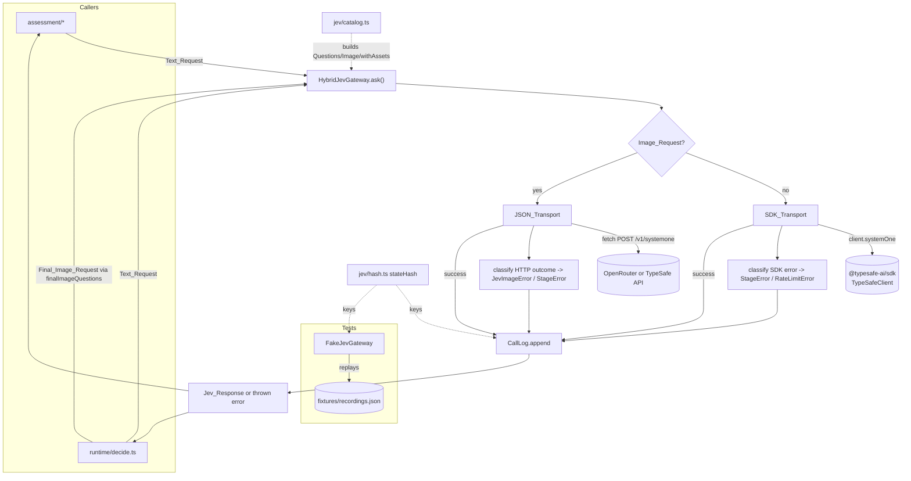
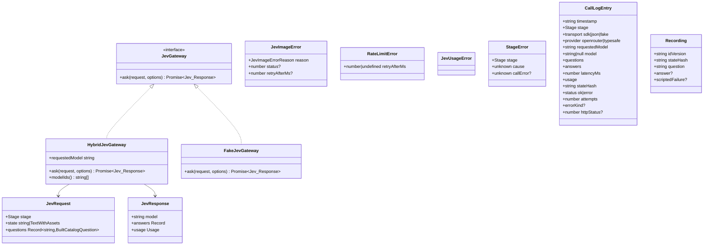

# Design Document

## Overview

This feature implements `packages/ce/src/jev/`: the `JevGateway` interface, the `HybridJevGateway` that routes each request to one of two transports (the TypeSafe SDK for text, a raw JSON `fetch` for images), the versioned question catalog, the state hash, the fake gateway used by every other test suite, the call log, and the error taxonomy that lets a failed image request fail over to text signals without failing the run. It also implements the manual verification tooling (`jev/probe.ts` and `scripts/verify-jev-image.ts`) that answers the three items the spike left open, and the `docs/journal/v0.0/jev-gateway-verification.md` findings document those tools produce.

This implements GitHub issue #5, R11 of `docs/journal/v0.0/requirements.md`, design sections 4, 10 and 12, and the decision in `.kiro/steering/jev-gateway-decision.md`. `SPEC.md` is normative; `.kiro/specs/jev-gateway/requirements.md` wins over this design on any conflict.

Two boundaries carried over from steering apply directly:

- `jev/` decides no `Outcome`. `outcome/resolve.ts` (out of scope, not yet written) is the only place an `Outcome` is decided; this feature only raises `StageError`, `JevImageError`, `RateLimitError` or `JevUsageError` for the future run pipeline to feed into it.
- All Jev question text lives in `jev/catalog.ts`. No other file — including both transports, the runtime, and the Probe_Library — calls the SDK question-building helpers (`noul`, `choice`, `score`, `box`, `image`, `withAssets`).

## Research summary

**SDK shape (`@typesafe-ai/sdk` 0.7.0`, `node_modules/@typesafe-ai/sdk/dist/index.d.mts`).** `TypeSafeClient.systemOne(request, options)` returns `{ model, answers, usage }`; `model` is the dated Returned_Model_Id, not the requested name. `TypeSafeClientConfig` accepts `logLevel`, `retry: Partial<RetryPolicy>`, `compression: "zstd" | false`, and a custom `fetch`; explicit options always win over `TYPESAFE_*` environment variables and over SDK defaults. The default `RetryPolicy` retries HTTP 408, 429, 500–599, connection errors and timeouts up to twice, honouring `Retry-After`/`retry-after-ms` up to 60 000 ms. `RateLimitError extends APIError` and carries `retryAfterMs: number | undefined`. `TypeSafeError` is the SDK's own base class (thrown for local misuse, e.g. empty questions); `APIConnectionError`/`APITimeoutError` cover connection and timeout failures. `image(data)` and `Image.fromBase64(text)` build an `Image` whose `toString()`/`toJSON()` is its reference, and `withAssets` tags a template literal so interpolated assets are sent with the text. Confirmed by reading the `.d.mts` file directly (no spike question needed, the shape is in the installed package): the image reference format used in the spike samples and the SDK source is `<image:` + 32 lowercase hex digits + `>`; Requirement 10 criterion 9 pins a test to this exact string.

**OpenAPI shape of `/v1/systemone`** (fetched from `https://docs.typesafe.ai/api.md`). The JSON body is `{ model, state, questions, assets }`. `assets` is `Record<placeholder, Asset>` where `Asset = { type: 'image', format: 'png'|'jpg'|'jpeg', data_base64 }`; every placeholder referenced inside `state`, question `instructions`, or `criteria` is substituted with the asset, matching the hybrid decision's `data_base64` transport. The `state` field's declared type (`anyOf: string | object | array`) **does include a general JSON-object/array form**, but the fetched OpenAPI document has no `image_url` field or example anywhere in `Asset`, `SystemOneRequest`, or any schema — only `data_base64` and, in a multipart body only, `part` (a reference to a named multipart part, not a URL). There is no `image_url` array form documented at this URL. This directly affects Requirement 16: the design cannot assume a specific `image_url` shape exists on the server side. The Verification_Script (Requirement 16) sends the best-effort shape described in the pre-existing journal text — a `state` array with one text element and one `{ type: 'image_url', image_url: { url: 'data:image/png;base64,<...>' } }`-shaped element, the closest analogue to the common `image_url` convention used by other vision APIs — and records whatever HTTP status comes back. Given the OpenAPI schema has no such field, the most likely and acceptable recorded outcome is `not supported` (HTTP 422, "extra fields not permitted" or similar), and the Findings_Document states plainly that the fetched API reference documents no `image_url` shape, so the probe's shape is a best-effort guess rather than a documented one. This satisfies Requirement 16 criterion 2's instruction to record the shape used; it does not change the `JSON_Transport`'s own request shape, which continues to use `assets`/`data_base64` only (Requirement 16 criterion 6).

**Existing `config/` module to match conventions against (`packages/ce/src/config/`).** `errors.ts` defines `ValidationError { path, value, expected, source? }` and `ConfigFileError` as deliberately disjoint shapes; this spec's `StageError`, `JevImageError`, `RateLimitError`, `JevUsageError` follow the same "represented as typed data/classes, never a generic `Error`, and documented as mutually exclusive" style. `credentials.ts`'s `requireJevCredentials(loaded, env)` takes the already-validated config and env and performs no I/O; this spec's `createJevGateway(loaded, env, options)` follows the same shape, calling the existing `requireJevCredentials` before constructing any transport, so credential checking is not duplicated. `index.ts` re-exports types and functions by name, not transports or internals; this spec's export list (Requirement 13 criterion 7) follows that pattern. No code in `config/` imports `@typesafe-ai/sdk` or calls `fetch`, consistent with the module-boundary rule this spec enforces for `jev/`.

**Spike evidence** (`docs/journal/v0.0/spike-jev-openrouter.md`, `spike/jev-openrouter/`). Confirmed: `choice`/`noul`/`score` work unmodified through the SDK on OpenRouter; every SDK request carrying an image fails with `400 invalid content-type: multipart/form-data`; the same request succeeds as raw JSON with a `data_base64` asset (sample `014`, `015`); the model name `jev-preview` is rejected on this route but `typesafe/jev-1.14` returns a dated id `typesafe/jev-1.14-20261014`; a single raw JSON request combining `noul` and `box` on one image works, with the `TypeSafe-Danger-Zone-Images` header both on and off (spike Addendum); `next_action`-style text loop requests measured p50 767–785 ms, p95 864–957 ms over 20 samples (well under the stated 7.5 s per-step budget), with no rate limiting observed. The spike's `lib/stats.ts` (`computeStats`, nearest-rank `percentile`) and `lib/raw.ts` (`RawHttpError`, `rawJsonSystemOne`) are the direct ancestors of this design's `Probe_Library` statistics and `JSON_Transport`; this design reuses their logic rather than re-deriving it, adapted to the production `jev/errors.ts` taxonomy instead of the spike's single `RawHttpError`.

## Architecture



`createJevGateway` (the Gateway_Factory) is the only place that turns a `LoadedConfig` plus an `env` into a working `HybridJevGateway`: it calls the existing `requireJevCredentials`, resolves the `Provider`, resolves the requested model from `PINNED_MODELS` or the configured value, and constructs the two transports with that provider's base URL and API key. `Jev_Gateway` callers never see the transports, never see the SDK, and never call `fetch`.

## Components and Interfaces

### Package layout

```
packages/ce/src/
  errors.ts                 StageError(stage, cause)  — shared by all four pipeline stages
  jev/
    gateway.ts               JevGateway interface, HybridJevGateway, createJevGateway, PINNED_MODELS
    transport-sdk.ts          SdkTransport — wraps client.systemOne
    transport-json.ts         JsonTransport — raw fetch POST, image format detection
    catalog.ts                Question_Catalog: 8 Catalog_Entries, finalImageQuestions()
    catalog.snapshot.json     committed id@version -> SHA-256(built question) table
    fake.ts                   FakeJevGateway, FakeRecordingMissingError
    fixtures/
      recordings.json         Recordings derived from the spike samples
    log.ts                    CallLog interface, createJsonlCallLog, CallLogEntrySchema
    hash.ts                   stateHash(state)
    errors.ts                 JevImageError, RateLimitError, JevUsageError
    probe.ts                  Probe_Library: statistics, request shapes, Probe_Functions
    *.test.ts
    properties/               fast-check property tests (one file per property)
  scripts/
    verify-jev-image.ts        Verification_Script (imports only jev/probe and Node built-ins)
  index.ts                     public exports (extended, see below)
packages/ce/fixtures/jev/
  demo-app-screenshot.png      Fixture_Image, copied from the spike fixtures
```

This refines the planned layout in `docs/journal/v0.0/design.md` section 2 (`jev/gateway.ts`, `jev/catalog.ts`, `jev/fake.ts`, `jev/log.ts`) by splitting the two transports, the error taxonomy, the hash, and the verification tooling into their own files, following the same "one file per concern, one orchestrator" shape `config/` already uses for `load.ts`.

### `errors.ts` (package root)

```ts
export type Stage = 'context' | 'assessment' | 'runtime' | 'evidence';

export class StageError extends Error {
  readonly stage: Stage;
  readonly cause: unknown;
  /** Set only when a Call_Log write failure superseded the original call error (Req 12.7). */
  readonly callError?: unknown;
  constructor(stage: Stage, cause: unknown, options?: { callError?: unknown });
}
```

`StageError`'s `message` never includes `cause`'s message verbatim when `cause` could carry a secret (an API key, an Authorization header, state text, or image bytes); it states only the stage and the cause's constructor name, and callers that need detail read `error.cause`. This mirrors `config/errors.ts`'s own rule that a `ValidationError`'s *printed report* is redacted while the in-memory object carries the full value — here, since `StageError` is thrown (not formatted and printed by this module), the message itself must already be sanitized, because the pipeline's own top-level catch (`docs/journal/v0.0/design.md` section 10) may log `error.message` directly.

### `jev/errors.ts`

```ts
export type JevImageErrorReason =
  | 'bad_request' | 'rate_limited' | 'timeout' | 'connection'
  | 'server' | 'invalid_image' | 'invalid_response' | 'client';

export class JevImageError extends Error {
  readonly reason: JevImageErrorReason;
  readonly status?: number;            // present iff an HTTP status exists
  readonly retryAfterMs?: number;      // only when reason === 'rate_limited'
  constructor(reason: JevImageErrorReason, options?: { status?: number; retryAfterMs?: number; message?: string });
}

export class RateLimitError extends Error {
  readonly retryAfterMs: number | undefined;
  constructor(retryAfterMs: number | undefined);
}

export class JevUsageError extends Error {
  constructor(message: string);
}
```

None of the three extends another (Requirement 6 criterion 2, criterion 19). `RateLimitError` here is the gateway's own class, distinct from the SDK's `RateLimitError` of the same name; `transport-sdk.ts` catches the SDK's `RateLimitError` (an `APIError` subclass with `retryAfterMs`) and re-raises the gateway's own `RateLimitError` wrapped in a `StageError`, so no module outside `jev/` ever sees an SDK class (Requirement 13 criterion 1).

### `jev/transport-sdk.ts` — `SdkTransport`

```ts
export interface SdkTransport {
  send(request: BuiltJevRequest, attemptOptions: { signal?: AbortSignal; timeoutMs: number }): Promise<RawSystemOneResult>;
}
export function createSdkTransport(config: { baseURL: string; apiKey: string; requestedModel: string; fetch?: Fetch }): SdkTransport;
```

Constructs one `TypeSafeClient` per `SdkTransport` instance with `retry: { maxRetries: 0 }`, `logLevel: 'off'`, `compression: false`, and the given `baseURL`/`apiKey`/`fetch` passed explicitly (never left to `TYPESAFE_*` env lookup, Requirement 4 criterion 3). `send` calls `client.systemOne({ model: requestedModel, state, questions }, { signal, timeout: timeoutMs })` and maps the SDK's thrown error classes to the gateway's own taxonomy:

| SDK class | Mapped to |
| --- | --- |
| `RateLimitError` (429) | gateway `RateLimitError` (retry/backoff owned by `gateway.ts`, see Requirement 7) |
| `AuthenticationError` (401) / `PermissionDeniedError` (403) | passed through for `gateway.ts` to wrap in `StageError` directly |
| `APITimeoutError`, `APIConnectionError` | treated as `Transient_Failure` for retry counting |
| any other `APIError` (400, 404, 422, 5xx) or `TypeSafeError` | passed through; `gateway.ts` wraps as `StageError` unless retried into exhaustion |

`SdkTransport` itself does not retry (`maxRetries: 0` on the client) and does not decide the final error class; `gateway.ts` owns all retry counting and final classification, so the same decision logic in Requirement 6 and 7 is exercised identically whether the SDK or JSON transport was used.

### `jev/transport-json.ts` — `JsonTransport`

```ts
export interface JsonTransport {
  send(request: BuiltJevRequest, options: { dangerZoneHeader?: boolean; signal?: AbortSignal; timeoutMs: number }): Promise<RawSystemOneResult>;
}
export function createJsonTransport(config: { baseURL: string; apiKey: string; requestedModel: string; fetch?: Fetch }): JsonTransport;
```

`send` detects each asset's format from its magic bytes (`89 50 4E 47` → `png`, `FF D8 FF` → `jpeg`; neither → throws `JevImageError('invalid_image')` without a network call, Requirement 2 criterion 6), serializes `{ model, state, questions, assets }`, and `POST`s to `` `${baseURL}/v1/systemone` `` with `Content-Type: application/json` and `Authorization: Bearer ${apiKey}`, adding `TypeSafe-Danger-Zone-Images: true` only when `options.dangerZoneHeader` is explicitly true (used only by the direct-provider probe of Requirement 17; the production gateway never sets it for `openrouter`, Requirement 3 criterion 5). A non-2xx response raises a sanitized error (status + truncated body text, no key/Authorization/body-with-secrets) that `gateway.ts` classifies into a `JevImageError` reason using the status-to-reason table of Requirement 6 criteria 4–9 and 17. `JsonTransport` is the only module permitted to call `fetch` for Jev (Requirement 13 criterion 2); it uses the global `fetch` unless a `fetch` function is injected for tests.

### `jev/gateway.ts` — `JevGateway`, `HybridJevGateway`, `createJevGateway`

```ts
export interface Jev_Request {
  stage: Stage;
  state: string | TextWithAssets;              // built by catalog.ts only
  questions: Record<string, BuiltCatalogQuestion>;
}
export interface AskOptions { signal?: AbortSignal }

export interface Jev_Response {
  model: string;                                // Returned_Model_Id
  answers: Record<string, NoulResponse | ChoiceResponse | ScoreResponse | BoxResponse>;
  usage: { input_tokens: number | null; output_tokens: number | null };
}

export interface JevGateway {
  ask(request: Jev_Request, options?: AskOptions): Promise<Jev_Response>;
}

export interface HybridJevGatewayOptions {
  sdkTransport: SdkTransport;
  jsonTransport: JsonTransport;
  callLog: CallLog;
  provider: 'openrouter' | 'typesafe';
  requestedModel: string;
  maxConcurrent?: number;        // default 4
  maxRateLimitRetries?: number;  // default 2
  maxTransientRetries?: number;  // default 2
  sleep?: (ms: number) => Promise<void>;  // default real timers
}

export class HybridJevGateway implements JevGateway {
  constructor(options: HybridJevGatewayOptions);
  ask(request: Jev_Request, options?: AskOptions): Promise<Jev_Response>;
  modelIds(): string[];
  readonly requestedModel: string;
}

export const PINNED_MODELS: { openrouter: 'typesafe/jev-1.14'; typesafe: string /* unverified, see Req 17 */ };

export function createJevGateway(
  loaded: LoadedConfig,
  env: Record<string, string | undefined>,
  options?: { callLog?: CallLog; fetch?: Fetch },
): { ok: true; gateway: HybridJevGateway } | { ok: false; errors: ValidationError[] };
```

`HybridJevGateway.ask` is the single place that: (a) decides which transport to call, purely from whether `request.questions` or `request.state` carries an image (an `Image`/`TextWithAssets` built by `catalog.ts`); (b) enforces the concurrency gate (a FIFO queue bounded by `maxConcurrent`); (c) sends exactly one HTTP request per attempt, retrying per Requirement 7's rules, using the injected `sleep`; (d) classifies the final outcome into the Requirement 6 taxonomy; (e) appends exactly one `CallLogEntry`, success or failure, before returning or throwing; (f) enforces "at most one Image_Request per gateway instance", rejecting a second with `JevUsageError` before any network call. A header comment at the top of this file states the exit plan from the jev-gateway-decision steering note verbatim (delete `transport-json.ts`, route everything through `SdkTransport`, keep this interface, re-check on every SDK release).

`createJevGateway` calls `requireJevCredentials(loaded, env)` first (Requirement 5 criterion 1) and returns its failure result unchanged on failure, performing no transport construction and no network call. On success it resolves the `Provider` (`loaded.config.jev?.provider ?? 'openrouter'`), the base URL and API key from `env`, and the requested model (`PINNED_MODELS[provider]` when `loaded.meta.sources['jev.model']` is `'default'`, else the configured `jev.model`), validates the OpenRouter model-form rule (Requirement 4 criterion 8), constructs both transports and a `HybridJevGateway`, and returns `{ ok: true, gateway }`.

### `jev/catalog.ts` — Question_Catalog

```ts
export interface CatalogEntry<Q extends Question> {
  id: string;            // e.g. "claim.is_behavior"
  version: number;
  idVersion: string;     // `${id}@${version}`
  type: Q['type'];
  requiresImage: boolean;
  labelsFixed: boolean;
  build(...args: unknown[]): Q;  // entry-specific signature, see table
}

export const CATALOG: {
  claimIsBehavior: CatalogEntry<NoulQuestion>;
  assessRuntimeObservable: CatalogEntry<NoulQuestion>;
  assessChecksAdequate: CatalogEntry<NoulQuestion>;
  assessSurface: CatalogEntry<ChoiceQuestion>;
  runtimeNextAction: CatalogEntry<ChoiceQuestion>;   // build(options: string[]): ChoiceQuestion — throws RangeError over 240
  runtimeStateReachedDom: CatalogEntry<NoulQuestion>;
  runtimeStateReached: CatalogEntry<NoulQuestion>;    // requiresImage: true
  runtimeLocateSubject: CatalogEntry<BoxQuestion>;    // requiresImage: true
};

export function finalImageQuestions(claim: string, pngBytes: Uint8Array): Jev_Request;
```

`assessSurface` fixes its six labels (`browser_ui`, `http_api`, `cli`, `backend_internal`, `native_app`, `non_runtime`) as module constants, `labelsFixed: true`. `runtimeNextAction.build(options)` appends `done` and `give_up` to the given labels and throws `RangeError('runtime.next_action: option list exceeds 240 items')` when `options.length > 240`; `labelsFixed: false` because the base labels come from the observed page. `finalImageQuestions` is the only place that calls `image()`/`withAssets` for the final step, builds the single request carrying both `runtime.state_reached` and `runtime.locate_subject`, and is used by both the runtime (out of scope) and the Probe_Library (Requirement 9 criterion 13), so no caller duplicates image-request construction.

`catalog.snapshot.json` holds, per `id@version`, the SHA-256 hex digest of the question `build()` produces for a fixed sample input per entry. A vitest test rebuilds every entry with that same fixed input and compares; a mismatch for an *existing* key fails with a message naming the entry and instructing the version to be bumped (Requirement 9 criterion 10); a missing key for a *new* `id@version` also fails. A separate, manually run update script only ever adds new keys and refuses to touch an existing one (Requirement 9 criterion 12).

### `jev/hash.ts` — `stateHash`

```ts
export function stateHash(state: string | TextWithAssets): string;  // 64 lowercase hex chars
```

Builds the canonical encoding: UTF-8 bytes of `ce-state-v1` + `0x00` + the state text, where every occurrence of the SDK's asset reference pattern `/<image:[0-9a-f]{32}>/g` is first replaced, in order of first appearance in the text, with a positional placeholder `<image:0>`, `<image:1>`, … (assets present in `TextWithAssets.assets` but not referenced in the text are numbered afterward, in asset order); then, for each image in that final order, `0x00` + `SHA-256(image bytes)` is appended. The function never reads the asset's own random reference string into the hash, only its position and its bytes, which is what makes two independently constructed `Image` objects over the same bytes hash identically (Requirement 10 criterion 8).

### `jev/log.ts` — `CallLog`

```ts
export const CallLogEntrySchema: z.ZodType<CallLogEntry>;  // zod, see Data Models
export interface CallLog {
  append(entry: CallLogEntry): Promise<void>;
}
export function createJsonlCallLog(path: string): CallLog;
```

`createJsonlCallLog` ensures `path`'s parent directory exists, then serializes every `append` call through an internal promise queue (`this.#queue = this.#queue.then(() => writeLine(entry))`), so concurrent `append` calls from a `maxConcurrent > 1` gateway never interleave partial lines and are written in call order (Requirement 12 criterion 12). `append` validates `entry` against `CallLogEntrySchema` before writing and rejects (never writes a partial/invalid line) on mismatch.

### `jev/fake.ts` — `FakeJevGateway`

```ts
export type ScriptedFailure = 'image-multipart-400' | 'image-timeout' | 'image-rate-limit' | 'rate-limit' | 'unauthorized';

export interface Recording {
  idVersion: string;        // "claim.is_behavior@1"
  stateHash: string;
  question: string;         // question name within the request
  answer?: NoulResponse | ChoiceResponse | ScoreResponse | BoxResponse;
  scriptedFailure?: ScriptedFailure;
  model?: string;
  usage?: { input_tokens: number | null; output_tokens: number | null };
}

export class FakeRecordingMissingError extends Error {
  constructor(idVersion: string, question: string, stateHash: string);
}

export class FakeJevGateway implements JevGateway {
  constructor(recordings: Recording[], options?: { callLog?: CallLog });
  ask(request: Jev_Request, options?: AskOptions): Promise<Jev_Response>;
}
```

`ask` computes `stateHash(request.state)` once, then for each requested question name looks up the `Recording` keyed by `(idVersion, stateHash, question)`; any requested question with no matching key — including one that only matches a different `version` of the same `id` — throws `FakeRecordingMissingError`, never substituting a default. A `Recording` with a `scriptedFailure` throws the matching `JevImageError`/`StageError` instead of returning `answer`. `FakeJevGateway` makes no network call, reads no environment variable, and still appends one `CallLogEntry` per call (`transport: 'fake'`, `latencyMs: 0`), so a run built against the fake exercises the same log-writing path as a real run.

### `jev/probe.ts` — Probe_Library

```ts
export interface ProbeOptions {
  provider: 'openrouter' | 'typesafe';
  apiKey: string;
  model: string;
  imageBytes?: Uint8Array;
  dangerZoneHeader?: boolean;
  fetch?: Fetch;
}
export interface ProbeResult {
  ok: boolean;
  latencyMs: number;
  model?: string;             // Returned_Model_Id on success
  usage?: { input_tokens: number | null; output_tokens: number | null };
  status?: number;
  errorText?: string;         // sanitized
}

export function sendText(options: ProbeOptions): Promise<ProbeResult>;
export function sendFinalImage(options: ProbeOptions & { claim: string }): Promise<ProbeResult>;
export function sendSdkImage(options: ProbeOptions & { claim: string }): Promise<ProbeResult>;
export function sendImageUrlForm(options: ProbeOptions & { claim: string }): Promise<ProbeResult>;

export function computeLatencyStats(samples: number[], failureCount: number): LatencyStats;  // adapted from spike lib/stats.ts
export function buildImageUrlRequestBody(claim: string, pngBytes: Uint8Array, model: string): unknown;  // documents the best-effort shape, see Research summary
```

`sendFinalImage` builds a fresh `HybridJevGateway` per call (`maxRateLimitRetries: 0`), so each of the 20 latency samples enforces "at most one Image_Request per gateway instance" independently (Requirement 14 criterion 12) rather than reusing one gateway across samples. `sendSdkImage` calls `SdkTransport` directly, bypassing `HybridJevGateway`'s routing, specifically to test whether a provider accepts the SDK's multipart upload (used only by the direct-provider item, Requirement 17). `sendImageUrlForm` calls `JsonTransport` with the body from `buildImageUrlRequestBody` instead of the catalog-built `assets` shape, to probe the undocumented array form (Requirement 16). None of the four throws for an HTTP failure; all return a `ProbeResult` with `ok: false` and the sanitized status/error text, so the Verification_Script can tabulate results without a try/catch per call.

### `scripts/verify-jev-image.ts` — Verification_Script

A thin CLI (`latency | image-url | typesafe | all`, `--samples`, `--image`, `--out`, `--allow-ci`) that imports only `jev/probe` and Node built-ins. It checks `process.env.CI` first (exits 2 immediately, before any key is read, unless `--allow-ci`); then checks the required key for the requested command (exits 3, naming the variable, when absent); then calls the matching Probe_Function(s) in a loop, writes one sanitized sample file per call under `--out`, and prints a Markdown summary block per item. It is wired into `package.json` as `verify:jev-image`, using `tsx --env-file-if-exists=../../.env`, and is excluded from the vitest file pattern so `npm test` never runs it and never needs a key.

### `src/index.ts` additions

```ts
export type { JevGateway, AskOptions } from './jev/gateway.js';
export { createJevGateway } from './jev/gateway.js';
export { FakeJevGateway, FakeRecordingMissingError } from './jev/fake.js';
export { JevImageError, RateLimitError, JevUsageError } from './jev/errors.js';
export { StageError } from './errors.js';
```

Transports (`SdkTransport`, `JsonTransport`), `jev/probe.ts`, `jev/catalog.ts`'s internals, and `jev/hash.ts` are not exported; they are implementation details reachable only from inside `jev/`, matching the architecture test of Requirement 13 criterion 8.

## Data Models



`CallLogEntrySchema` (zod, in `jev/log.ts`) is the authoritative shape; the `CallLogEntry` TypeScript type is `z.infer` of it, following the same "zod is the single source" rule `config/schema.ts` uses for `EffectiveConfig`. `answers` inside a `CallLogEntry` records, per question: the `noul` probability directly; `choice`/`score` `probabilities` keyed by label or score index; and for `runtime.next_action` specifically, probabilities keyed by the *zero-based option index*, plus `done`/`give_up` under those fixed keys, per Requirement 12 criterion 5 — never the option label text.

## Correctness Properties

*A property is a characteristic or behavior that should hold true across all valid executions of a system — essentially, a formal statement about what the system should do. Properties serve as the bridge between human-readable specifications and machine-verifiable correctness guarantees.*

### Property 1: Transport routing is total, exclusive, and content-determined

For any `Jev_Request` built with an arbitrary mix of text-only and image-bearing questions, `HybridJevGateway.ask` calls exactly one of `SdkTransport.send` or `JsonTransport.send` exactly once per attempt, and it calls `JsonTransport.send` if and only if the request's state or at least one question carries an image.

**Validates: Requirements 1.3, 1.4, 1.5, 1.9**

### Property 2: One Jev_Request produces one HTTP request per attempt

For any `Jev_Request` with 1 to N named questions, the chosen transport is invoked exactly once per attempt, and the body it sends contains exactly the given question names — no name lost, no name duplicated, and no extra name.

**Validates: Requirements 1.6, 2.7**

### Property 3: Image format detection from magic bytes is total and correct

For any byte array, `JsonTransport` detects `png` when the array starts with `89 50 4E 47`, detects `jpeg` when it starts with `FF D8 FF`, and raises `JevImageError('invalid_image')` without any network call for every other prefix; exactly one of these three outcomes occurs for any input.

**Validates: Requirements 2.5, 2.6**

### Property 4: Requested model resolution depends only on the configured source

For any provider, any configured `jev.model` string, and any `meta.sources['jev.model']` value, the model name `createJevGateway` requests equals `PINNED_MODELS[provider]` when the source is `'default'`, and equals the configured value for every other source (`'flag'`, `'env'`, `'file'`); the same requested model is sent on every subsequent request of that gateway instance.

**Validates: Requirements 4.6, 4.7, 4.9**

### Property 5: OpenRouter model-form validation accepts and rejects by the documented pattern

For any string, `createJevGateway` with `jev.provider: 'openrouter'` accepts it as `jev.model` if and only if it matches `typesafe/<name>` or `~typesafe/<name>`; every string that does not match produces a `Validation_Error` with `path: 'jev.model'` and an `expected` field naming that form.

**Validates: Requirements 4.8**

### Property 6: Missing-credential failures always name the correct variable and only that variable

For any provider and any `env` in which that provider's key is absent, empty, or whitespace-only, `createJevGateway` returns a failure result naming exactly that provider's variable (`OPENROUTER_API_KEY` for `openrouter`, `TYPESAFE_API_KEY` for `typesafe`) and never the other, and constructs no transport.

**Validates: Requirements 5.2, 5.5, 5.6**

### Property 7: Failure classification is total, exclusive, and never leaks secrets

For any simulated HTTP outcome or local SDK error (400/413/422, any 5xx, a timeout, a connection failure, HTTP 401/403, HTTP 429 after retries are exhausted, HTTP 408, any other 4xx, a local `TypeSafeError`, an aborted signal, or a success response missing a requested answer) delivered to either transport for either a Text_Request or an Image_Request, `HybridJevGateway` raises exactly one of: a `JevImageError` with the single matching `reason` (for an Image_Request), or a `StageError` whose `cause` is the authentication error or a `RateLimitError` or the underlying error (for a Text_Request, or for HTTP 401/403 on either kind) — never an uncaught SDK error, a raw `fetch` error, a `JevImageError` wrapped in a `StageError`, or a `RateLimitError` thrown directly to the caller; and no field of the raised error contains the request's API key, state text, or image bytes as a substring.

**Validates: Requirements 6.3, 6.4, 6.5, 6.6, 6.7, 6.8, 6.9, 6.10, 6.11, 6.12, 6.13, 6.15, 6.16, 6.17, 6.18, 8.4**

### Property 8: Retry and attempt counts are always bounded, and the bound differs by request kind

For any sequence of simulated HTTP outcomes for one call (429s with or without a `Retry-After`/`retry-after-ms` header, transient failures, or a final success or failure) and any configured `maxRateLimitRetries` and `maxTransientRetries`, the number of HTTP requests `HybridJevGateway` sends for a Text_Request never exceeds `1 + maxRateLimitRetries + maxTransientRetries`, and for an Image_Request never exceeds `1 + maxRateLimitRetries` (an Image_Request is retried only after a 429); the recorded `CallLogEntry.attempts` equals that exact count.

**Validates: Requirements 7.5, 7.6, 7.7, 7.10, 7.16, 7.18, 7.20**

### Property 9: `Retry-After` delay parsing is total and correct

For any string in delta-seconds form or HTTP-date form, the delay parser returns the equivalent delay in non-negative, whole milliseconds; for any string in neither form, it returns `undefined`.

**Validates: Requirements 7.15**

### Property 10: At most one Image_Request per gateway instance

For any `HybridJevGateway` instance and any sequence of `ask` calls containing more than one Image_Request, every Image_Request after the first is rejected with `JevUsageError` before any network call, while the first Image_Request and every Text_Request proceed normally.

**Validates: Requirements 7.11**

### Property 11: Bounded concurrency admits all requests without exceeding the limit

For any number of concurrently submitted requests N and any positive limit L, the number of requests in flight at any instant never exceeds L, and all N requests eventually complete (successfully or with an error).

**Validates: Requirements 7.2, 7.4, 7.14**

### Property 12: `modelIds()` is an order-preserving set

For any sequence of successful responses carrying model ids (with arbitrary repeats), `modelIds()` returns each distinct id exactly once, in the order it first appeared.

**Validates: Requirements 8.2, 8.5, 8.7**

### Property 13: `runtime.next_action` option construction preserves labels exactly, up to its stated limit

For any list of 1 to 240 option labels, the built `runtime.next_action` question's criteria equal exactly the given labels plus `done` and `give_up`, with no label lost, duplicated, or altered; for any list of more than 240 labels, building the question throws a `RangeError` naming the limit 240.

**Validates: Requirements 9.6, 9.11**

### Property 14: `stateHash` is deterministic, fixed-length, and distinguishes different text

For any state, `stateHash` returns the same 64-lowercase-hex-character value on every call; for any two distinct text states (generated from a sufficiently rich alphabet), their hashes differ.

**Validates: Requirements 10.4, 10.6**

### Property 15: `stateHash` depends on image bytes and position, never on the asset's random reference

For any surrounding text and any image byte arrays, the `stateHash` of two states built from two independently constructed image assets carrying the same bytes at the same text position are equal; the `stateHash` of two states differing only in one image's bytes are different.

**Validates: Requirements 10.3, 10.8**

### Property 16: Fake_Gateway replay is a total, correct lookup

For any set of Recordings and any `Jev_Request` whose questions' `(idVersion, stateHash, question)` keys all match a Recording, `FakeJevGateway.ask` returns exactly the recorded answers; for any requested question whose key matches no Recording (including one that matches a different version of the same entry), it throws `FakeRecordingMissingError` naming that `idVersion`, question name, and `stateHash`, and returns no default answer.

**Validates: Requirements 11.3, 11.4, 11.12**

### Property 17: Call_Log entries always round-trip through JSON and the schema

For any `CallLogEntry` the gateway or the fake would produce, writing it with `createJsonlCallLog` and then reading, JSON-parsing and validating that line with `CallLogEntrySchema` succeeds and yields an object deep-equal to the original entry.

**Validates: Requirements 12.10**

### Property 18: The Call_Log never contains state text, option labels, or the API key

For any generated state text, any generated `runtime.next_action` option labels, any API key string, and any sequence of calls using them, the fully serialized Call_Log file contains none of the generated state texts of 8 or more characters, none of the generated option labels of 8 or more characters, and does not contain the API key as a substring anywhere in the file.

**Validates: Requirements 12.4, 12.5, 12.11**

### Property 19: Concurrent log appends never interleave, drop, or duplicate a line

For any N `CallLogEntry` values appended concurrently through one `CallLog` built with `maxConcurrent` greater than 1, the resulting file contains exactly N lines, each parses as JSON and validates against `CallLogEntrySchema`, and the multiset of parsed entries equals the multiset of appended entries, in the order `append` was called.

**Validates: Requirements 12.12, 12.13**

### Property 20: Latency statistics are order-independent and internally consistent

For any non-empty list of latency samples (in any order) and any failure count, the computed statistics satisfy `minimum ≤ p50 ≤ p95 ≤ maximum` and do not change when the list is reordered; for an empty list, every statistic is `NaN` and the function does not throw.

**Validates: Requirements 15.3, 15.4, 15.7**

### Redundancy review

- Requirement 1 criteria 3, 4, 5 and 9 are all instances of one routing decision (transport chosen solely from request content, exclusively, exactly once); Property 1 states the general form and the three concrete criteria are covered by the same generator rather than three separate properties.
- Requirement 1 criteria 10, 11 and 12 (abort handling) and Requirement 6 criterion 18 (abort classification) describe the same event from two angles — "no further attempt is made" and "the error raised is the timeout/abort-cause case." These are folded into Property 7's generator (abort is one of the simulated outcomes) and Property 8's attempt-count bound (an aborted call makes no further attempt), rather than a separate abort property.
- Requirement 6 criteria 10, 11, 12, 13, 16 and 17, and Requirement 8 criterion 4, are all branches of one total classification function from "simulated failure" to "exactly one error shape." Property 7 states this as one property with a rich outcome generator instead of seven narrower ones, the same way the ce-config-loader design folds four precedence criteria into its Property 5.
- Requirement 7 criteria 5, 6, 7, 8, 10, 16, 18 and 20 are all facts about the same attempt-counting state machine (how many requests are sent, under what delay, before giving up). Property 8 covers the count and its text-vs-image bound; Property 9 is kept separate because it is a pure function (the delay parser) with no dependency on the gateway's retry loop at all, and conflating it with Property 8 would force one property to mix two unrelated input spaces (HTTP outcome sequences vs. header text).
- Requirement 11 criteria 3, 4 and 12 are the two branches (match, no-match) of one lookup function; Property 16 states both branches of the same generator rather than splitting "replay returns the right answer" from "missing recording throws," since both assertions come from exercising the same `(idVersion, stateHash, question)` key space.
- Requirement 12 criteria 2, 3, 5 and 8 (entry shape, index-keyed `next_action` probabilities, append-before-raise) do not get their own property: criterion 5's "never record option label text" is a specific instance of Property 18's no-contents property (its generator already includes option labels of 8+ characters), and criteria 2/3/8's "exactly one entry, correct shape, appended before the error propagates" is checked as part of Property 17's round-trip assertions plus a handful of unit examples (Testing Strategy), since "an entry exists with the right status" is not a quantity that varies meaningfully across random input once the round-trip and no-contents properties already hold.
- Requirement 10 criteria 4, 5 and 6 (determinism, distinctness, fixed length) are one property about the hash function's basic well-formedness (Property 14); criterion 8 (image-determinism) is kept as its own property (Property 15) because its generator is structurally different — it requires constructing two separate `Image` objects from the same bytes, not just varying a text string.

## Error Handling

Every error this feature can produce is one of four typed shapes, never a bare `Error` and never thrown for a case the requirements describe as a valid outcome:

1. **`JevImageError`** (`jev/errors.ts`): raised only for an Image_Request. Carries a closed `reason` enum, an optional HTTP `status`, and `retryAfterMs` only when `reason === 'rate_limited'`. This is the *recoverable* error: the design's rule that "an image failure never fails the run" means a caller catching this is expected to fall back to text-only signals, matching `docs/journal/v0.0/design.md` section 10's existing rule for the 400 case, generalized here to every `JevImageError` reason including a persistent rate limit.
2. **`RateLimitError`** (`jev/errors.ts`): raised only for a Text_Request's exhausted 429 retries, always wrapped inside a `StageError`. Never thrown bare to a caller, so every caller can catch `StageError` uniformly for text-side failures.
3. **`JevUsageError`** (`jev/errors.ts`): raised only for programmer misuse (a second Image_Request on one gateway instance). Neither a `JevImageError` nor a `StageError`, so a caller cannot accidentally treat a usage bug as a recoverable image failure.
4. **`StageError`** (`errors.ts`, package root, shared by all four pipeline stages): raised for every Text_Request failure other than an exhausted rate limit's own class (which it wraps), for HTTP 401/403 on either request kind, and for a Call_Log write failure. `StageError.cause` carries the underlying error for diagnosis; `StageError.message` never repeats a secret.

**The one deliberate exception to "an image failure never fails the run."** Requirement 12 criterion 7 and the design's log-write path intersect here: when an Image_Request (or any request) fails *and* the Call_Log append for that failure's own entry also fails, `HybridJevGateway` raises a `StageError` for the log-write failure (not the original `JevImageError`), attaching the original error under `StageError.callError` so it stays diagnosable. An unwritable evidence directory is a serious enough fault that it would also prevent `run.json` from being written later in the pipeline, so letting it surface as `ERROR` here is consistent with the rest of the evidence pipeline rather than a bug in the "image failures are recoverable" rule — that rule covers a failed *Jev call*, not a failed *disk write*.

**Who decides the Outcome.** Nothing in `jev/` imports or calls `outcome/resolve.ts`, and no type in this design carries an `Outcome` value. The future run pipeline is responsible for catching a `StageError` or a `JevUsageError` that escapes the assessment or runtime stage and feeding it to `outcome/resolve.ts`, which — per the existing table in `docs/journal/v0.0/design.md` section 6 — resolves `ERROR`. A `JevImageError` is explicitly designed *not* to reach that catch in the normal case: the runtime loop (out of scope) is expected to catch it at the final-image step and continue to `EVIDENCED` with `finalState` noted and the Box highlight omitted, per the existing design section 10 rule generalized to all `JevImageError` reasons.

## Testing Strategy

**Unit tests (vitest), covering scenarios the requirements name concretely:**

- Routing: a Text_Request uses the `SdkTransport` stub, an Image_Request uses the `JsonTransport` stub (dedicated examples alongside Property 1).
- Each of the five documented `JevImageError`/`StageError` scenarios by name (multipart 400, timeout, connection failure, HTTP 500 not retried, HTTP 404 → `client`, a local `TypeSafeError` → `client`, an abort → `timeout`, a response missing a requested answer) as explicit examples, in addition to Property 7's generator.
- HTTP 429 with `retry-after-ms`, with `Retry-After`, and with neither header, using an injected `sleep`, asserting the wait and the final `StageError`/`JevImageError` shape (alongside Property 8/9).
- `createJevGateway`: missing key per provider names the right variable; a present key returns a gateway; `jev.model: 'jev-preview'` on `openrouter` returns a `Validation_Error` with `path: 'jev.model'` — all three asserted inside one `it(...)` per Requirement 19 criterion 7's own wording that this is a single conjunctive test, not three.
- The second Image_Request on one gateway instance raises `JevUsageError` (example alongside Property 10); `modelIds()` over a short fixed sequence (example alongside Property 12).
- A Text_Request retried the maximum `maxTransientRetries` times; `maxRateLimitRetries: 0` disables rate-limit retries entirely; an abort before and during a request makes no further attempt.
- One test, as a single indivisible `it(...)` with multiple `expect` calls (per Requirement 19 criterion 14's own "SHALL NOT be split" wording), asserting that `SdkTransport` constructs its `TypeSafeClient` with `retry: { maxRetries: 0 }`, `logLevel: 'off'`, and `compression: false`, **and** that the client still ignores `TYPESAFE_LOG_LEVEL=debug` set in the environment during that same test run.
- The five `FakeJevGateway` scripted failures (`image-multipart-400`, `image-timeout`, `image-rate-limit`, `rate-limit`, `unauthorized`) as five small fixed examples, each asserting the exact error shape produced.
- The Call_Log double-failure path of Requirement 12 criterion 7: a call fails, the injected `CallLog.append` for that failure also rejects, and the resulting `StageError.callError` carries the original error.
- The real-SDK image reference format guard (Requirement 10 criterion 9): a single keyless test that calls the real `image()` helper and asserts its `toString()` matches `/^<image:[0-9a-f]{32}>$/` exactly, so an SDK upgrade that changes the format fails this test rather than silently destabilizing `stateHash`.
- The catalog snapshot test (Requirement 9 criteria 10, 12) and the architecture test (Requirement 13 criterion 8) as their own dedicated scans, not property tests, since both check a fixed, small, enumerable set of files/entries rather than a generated input space.
- `Probe_Library` unit tests that run without a network: `computeLatencyStats` on fixed example arrays (alongside Property 20), `buildImageUrlRequestBody`'s shape, and each Probe_Function called against a stub transport.

**Property tests (fast-check, vitest), one file per property in `jev/properties/`, `{ numRuns: 100 }` minimum, each tagged with a comment `// Feature: jev-gateway, Property N: <property text>` directly above the test body, in the style of `packages/ce/src/config/properties/`:** the 20 properties listed above.

**Fake Jev / no API key.** Every test in this feature's suite, including the architecture test and the catalog snapshot test, runs with `env: {}` or an injected fake key string, and supplies a stub `fetch`/transport where a network call would otherwise occur. `jev/fixtures/recordings.json` is derived from the spike's sample files (`choice`, `noul`, `score`, `next_action`, and the raw-JSON `box` answer from sample `014`) and is replayed through `FakeJevGateway` in Property 16 and its accompanying examples, giving every other spec in this repository (assessment, runtime, evidence) a working fake gateway without any of them needing a key — matching the tech steering's CI test policy.

**Out of scope for this feature's tests:** the assessment and runtime modules that will eventually call `JevGateway.ask` (not yet written), and `outcome/resolve.ts`'s own test suite. This feature's tests stop at asserting that `HybridJevGateway`/`createJevGateway`/`FakeJevGateway` return or throw the correctly-shaped result; they do not assert what a future caller does with a thrown `StageError` or a caught `JevImageError`.

**Live verification (manual, not part of `npm test`).** The Verification_Script and its three commands (Requirements 15, 16, 17) require a real `OPENROUTER_API_KEY` (and optionally `TYPESAFE_API_KEY`) and are run once by the implementer itself, with results transcribed into `docs/journal/v0.0/jev-gateway-verification.md`. `OPENROUTER_API_KEY` is loaded from the repository `.env` by the script; if it is missing or no live call returns an HTTP response, the implementer records the real failure and reports the task as failed, without asking the user. If `TYPESAFE_API_KEY` is unavailable, the implementer records `not tested (blocked: TYPESAFE_API_KEY not set)` directly and creates the follow-up issue itself with `gh issue create`, per Requirement 17 criterion 8 and Requirement 18 criterion 4 — no value is ever invented for an item whose key is missing.

## Closing the issue (Requirement 20)

**Gates.** Opening the pull request requires three conditions, each checked independently:

- `all_tasks_complete`: every implementation task in `tasks.md` is complete. A hard gate — no amount of passing verification substitutes for an incomplete task.
- `verification_items_answered`: Requirements 15 and 16 each have an Answer_Status of `confirmed` or `not supported`, and Requirement 17 has `confirmed`, `not supported`, or `not tested (blocked: TYPESAFE_API_KEY not set)` with a linked Follow_Up_Issue.
- `issue_checklist_verified`: every item of issue #5's checklist is verified against delivered code, tests, or the Findings_Document, with recorded evidence.

**Traceability (issue #5 checklist → requirement → delivery).**

| Issue_Checklist item | Requirement | Delivered by |
| --- | --- | --- |
| `JevGateway` interface + `HybridJevGateway` | 1 | `jev/gateway.ts` |
| Two transports, SDK for text / JSON for images | 1, 2, 3 | `jev/transport-sdk.ts`, `jev/transport-json.ts` |
| Provider + pinned model selection | 4 | `jev/gateway.ts` (`createJevGateway`, `PINNED_MODELS`) |
| `JevImageError` | 6 | `jev/errors.ts` |
| Recording the dated model id | 8 | `HybridJevGateway.modelIds()`, `Jev_Response.model` |
| `jev/catalog.ts` | 9 | `jev/catalog.ts`, `catalog.snapshot.json` |
| Request pacing + rate-limit handling | 7 | `jev/gateway.ts` retry/concurrency logic |
| `jev/fake.ts` | 11 | `jev/fake.ts`, `jev/fixtures/recordings.json` |
| `jev-calls.jsonl` | 12 | `jev/log.ts` |
| Missing-credential path | 5 | `jev/gateway.ts` (`createJevGateway`) calling the existing `requireJevCredentials` |
| Raw JSON `noul`+`box` on one image works (already checked) | — | existing evidence: spike Addendum, `design.md` §5/§12; kept true by `jev/transport-json.ts`'s single-request-per-call design (Property 2) |
| `TypeSafe-Danger-Zone-Images` not needed on JSON path (already checked) | 3.5 | existing evidence + `JsonTransport`'s header-off-for-openrouter test |
| Upstream report filed (already checked) | — | existing evidence: typesafe-ai/typesafe-sdk-js#27 |
| Final-image latency (p50/p95, 20 samples) | 15 | `scripts/verify-jev-image.ts latency`, `jev/probe.ts` |
| `image_url` array form | 16 | `scripts/verify-jev-image.ts image-url`, `jev/probe.ts` |
| Direct `typesafe` provider | 17 | `scripts/verify-jev-image.ts typesafe`, `jev/probe.ts` |

Before opening the pull request: confirm `all_tasks_complete`; verify `verification_items_answered` against the Findings_Document; verify `issue_checklist_verified` against the table above; run `npm install`, `npm run build`, `npm run typecheck`, and `npm test` from the repository root. The pull request body contains the line `Closes #5`, lists every checklist item with its evidence, contains the table above, states explicitly (and links the follow-up issue) if the direct-provider item used the blocked status, and contains no API key or other secret value. The implementer creates the branch, commits, pushes and opens the pull request itself with no user confirmation. The implementer does not merge the pull request, does not force push and does not close issue #5 by hand.
