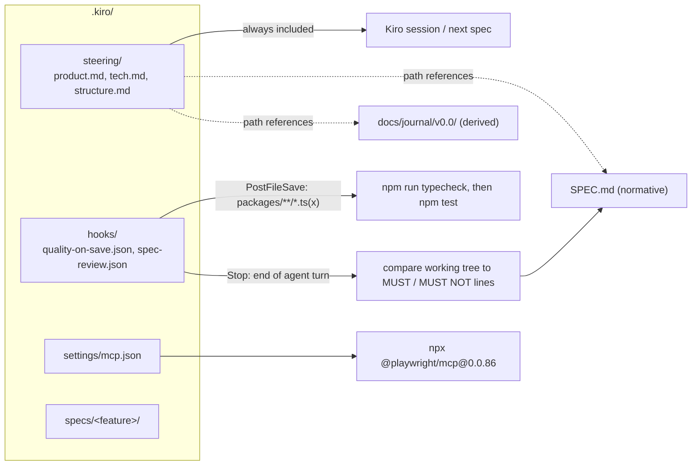

# Design Document

## Overview

This feature adds the `.kiro/` workspace configuration for the Continuous Evidence (CE) repository (issue #2, milestone M0). It delivers static files only: three steering documents, two hooks, one MCP configuration, and a root `test` script. No runtime TypeScript code is added to `packages/ce`.

| Deliverable | Path | Requirements |
| --- | --- | --- |
| Product steering | `.kiro/steering/product.md` | 1, 4 |
| Tech steering | `.kiro/steering/tech.md` | 2, 4, 7.6 |
| Structure steering | `.kiro/steering/structure.md` | 3, 4 |
| Quality hook | `.kiro/hooks/quality-on-save.json` | 5 |
| Review hook | `.kiro/hooks/spec-review.json` | 6 |
| MCP configuration | `.kiro/settings/mcp.json` | 7 |
| Root `test` script, vitest setup, Node baseline | `package.json`, `packages/ce/package.json` | 5.3, 5.4, 9.4 |
| Git tracking check | `.gitignore` (verified, no change expected) | 8 |

Design decisions:

1. **Steering content is derived, not invented.** Each statement in a steering file is copied or condensed from `SPEC.md`, `README.md`, or `docs/journal/v0.0/{requirements,design}.md`. `SPEC.md` wins on conflict (Requirement 1.6).
2. **Steering files stay short.** All three use `inclusion: always`, so they cost context in every session. Each links to the long source by relative path using `#[[file:...]]` references where useful, and carries only what a spec author needs.
3. **Hooks use the agent action where the result must reach the session.** Kiro command hooks only forward stdout for a few triggers (for example `SessionStart`, `UserPromptSubmit`), not for `PostFileSave` or `Stop`. Requirements 5.5, 5.6 and 6.x require findings to appear in the session, so both hooks use `agent` actions that instruct the agent what to run and report.
4. **Test script must pass with zero tests.** Today no workspace has tests or vitest. The `test` script uses vitest's `--passWithNoTests` so `npm test` exits 0 (Requirement 5.4).

## Architecture



Responsibility split:

- **Steering** gives static project context to every session.
- **Quality hook** gives fast feedback on type and test regressions during the task loop.
- **Review hook** gives a conformance check against the normative contract.
- **MCP config** lets a developer inspect the demo app in a browser from Kiro. It is separate from the Playwright library that the CE Capability Runtime will use later.

## Components and Interfaces

### 1. Steering documents

All three files start with front matter:

```markdown
---
inclusion: always
---
```

**`product.md`** sections and sources:

| Section | Content | Source |
| --- | --- | --- |
| What CE is | Two principles: evidence is inspectable; CE does not duplicate adequate verification | SPEC 1.1 |
| Problem | Gap between a change that passes existing checks and the runtime evidence for it | SPEC 1.2 |
| Audience | Developers and engineering teams. Compliance is not a v0 target | SPEC 1.3 |
| Core terms | Change, Subject, Claim, Check, Assessment, Evidence, one line each | SPEC 3.2 |
| Execution outcomes | `SKIPPED`, `EVIDENCED`, `UNSUPPORTED`, `ERROR`; `SKIPPED` and `UNSUPPORTED` are distinct | SPEC 7.1 |
| Non-goals for v0 | Audit-grade evidence, non-browser capabilities, keyless or alternative classifier, merge or deploy gate by default, writing to the target app or Git | SPEC 1.3, 4.3, 4.4, 5.5; journal requirements |
| Sources of truth | `SPEC.md` is normative, `docs/journal/v0.0/` is derived, `SPEC.md` wins | Requirement 1.6 |

The authoring step MUST confirm the "writing to the target app or to Git" non-goal against `docs/journal/v0.0/requirements.md` before writing it, because `SPEC.md` states it only indirectly (Git is a context provider, not a managed dependency, SPEC 4.3).

**`tech.md`** sections and sources:

| Section | Content | Source |
| --- | --- | --- |
| Language and runtime | TypeScript, Node.js >= 22.12 (22 or 24 LTS), npm workspaces, no build orchestration framework | `package.json`, journal design 2 |
| Stack | Playwright (Chromium only), Jev via OpenRouter by default, zod, vitest, fast-check | journal design 2 |
| Jev provider and secrets | `jev.provider` selects `openrouter` (`OPENROUTER_API_KEY`) or `typesafe` (`TYPESAFE_API_KEY`). Secrets live in environment variables only | journal design 7 |
| Design rule | Jev chooses among options built from observed facts and never generates text. `outcome/resolve.ts` decides outcomes in deterministic code | journal design 1 |
| Test policy | CI tests use `jev/fake.ts` and need no API key | journal design 11 |
| Commands | `npm install`, `npm run build`, `npm run typecheck`, `npm test` | root `package.json` plus this feature |
| Playwright MCP | Developer inspection inside Kiro, separate from the Playwright library in the Capability Runtime | Requirement 7.6 |

The commands list MUST contain only commands that exist after this feature is applied.

`docs/journal/v0.0/design.md` mentions `action.yml (node20)`. It is a derived document and this spec does not edit it; `SPEC.md` and the steering files win. `tech.md` and `structure.md` each flag (without deciding) that the GitHub Action runtime is expected to move to `node24` when `action.yml` is written.

**`structure.md`** sections and sources:

| Section | Content | Source |
| --- | --- | --- |
| Current layout | `SPEC.md`, `packages/ce/`, `examples/demo-app/`, `docs/journal/`, `.kiro/` | repository tree |
| Planned layout | The tree from journal design section 2, copied verbatim, including `action/` and `schemas/` | journal design 2 |
| Directory responsibilities | One sentence each for `config/`, `context/`, `jev/`, `assessment/`, `runtime/`, `outcome/`, `evidence/` | journal design 2, SPEC 4.2 |
| Placement rules | All Jev question text lives in `jev/catalog.ts`. The outcome is decided only in `outcome/resolve.ts` | journal design 2, 6 |
| Specs | Live in `.kiro/specs/<feature-name>/` and derive from the journal and `SPEC.md` | Requirement 3.6 |

The planned layout is marked as target structure, since most directories do not exist yet.

### 2. Quality hook

File: `.kiro/hooks/quality-on-save.json`.

```json
{
  "version": "v1",
  "hooks": [
    {
      "name": "Typecheck and test on save",
      "trigger": "PostFileSave",
      "matcher": "packages/.*\\.tsx?$",
      "action": {
        "type": "agent",
        "prompt": "A TypeScript file under packages/ was saved. From the repository root run `npm run typecheck`, and if it succeeds run `npm test`. If typecheck fails, report the compiler output (file, line, message). If tests fail, report each failing test name and its message. If both pass, report one line saying so. Do not modify any file and do not ask for a Jev API key."
      }
    }
  ]
}
```

Notes:

- `matcher` is a regex tested against the file path. `packages/.*\.tsx?$` matches `.ts` and `.tsx` under any `packages/` directory, which covers `packages/**/*.ts` and `packages/**/*.tsx` and also matches absolute paths.
- Typecheck runs first and tests run only if it passes, as Requirement 5.2 orders them.
- The 120 second budget (Requirement 5.7) is met by the current repository size: `tsc --noEmit` on two small packages plus a vitest run with no tests.
- No Jev credential is needed because no current test calls Jev, and future CI tests use the fake gateway (Requirement 5.8).
- Fallback if the agent action proves unreliable on `PostFileSave`: switch to a `command` action running `npm run typecheck && npm test` with `timeout: 120`. That variant gives exit-code feedback but may not surface output in the session, which is why it is not the first choice.

### 3. Test script

Root `package.json` gains:

```json
"test": "npm run test --workspaces --if-present"
```

`packages/ce/package.json` gains `"test": "vitest run --passWithNoTests"` and a `vitest` entry in `devDependencies` at `^5.1.1`. vitest 5.x requires Node `^22.12 || ^24 || >=26`, which fits the Node baseline of this feature.

Node baseline: root `package.json` and `packages/ce/package.json` change `engines.node` from `>=20` to `>=22.12` (Requirement 9.4). `examples/demo-app/package.json` has no `engines` field, so it is not changed. `package-lock.json` is regenerated by `npm install`.

Before any dependency is added or changed, its version is verified with the Context7 MCP tools and `npm view <pkg> version engines.node deprecated` (current, not deprecated, compatible with Node >=22.12). `examples/demo-app` gets no test script; `--if-present` skips it. Result: with zero test files, `npm test` exits 0 (Requirement 5.4); once tests exist, vitest runs all of them (Requirement 5.3).

Adding vitest changes `package-lock.json`. The implementation step runs `npm install` and commits the lockfile.

### 4. Review hook

File: `.kiro/hooks/spec-review.json`.

```json
{
  "version": "v1",
  "hooks": [
    {
      "name": "SPEC conformance review",
      "trigger": "Stop",
      "action": {
        "type": "agent",
        "prompt": "<review prompt, see below>"
      }
    }
  ]
}
```

The prompt instructs the agent to, in order:

1. Read `SPEC.md` and extract every line that contains the capitalized keyword `MUST` or `MUST NOT`, keeping each line's section number.
2. Read the changed code in the working tree (`git diff` and untracked files under `packages/`, `examples/`, `action/`).
3. Compare each changed region against each extracted line.
4. For each conflict, report: the `SPEC.md` section number, the quoted requirement, the file path, and the line range.
5. If there is no conflict, report that none was found and list the `SPEC.md` sections that were checked.
6. Treat `SPEC.md` as authoritative when it disagrees with `docs/journal/v0.0/`.
7. Report findings only. Do not edit any file.

Trigger choice: `Stop` (end of agent turn) satisfies Requirement 6.7 and never fires on file save. Kiro v1 hooks have no pure manual trigger, so a manual run is done by prompting the agent with the hook's text. The prompt also tells the agent to do nothing when no code under `packages/`, `examples/`, or `action/` changed, so turns that only edit docs or specs stay quiet.

### 5. MCP configuration

File: `.kiro/settings/mcp.json`.

```json
{
  "mcpServers": {
    "playwright": {
      "command": "npx",
      "args": ["@playwright/mcp@0.0.86"],
      "disabled": false,
      "autoApprove": [
        "browser_snapshot",
        "browser_take_screenshot",
        "browser_console_messages",
        "browser_network_requests"
      ]
    }
  }
}
```

- `autoApprove` lists only read-only tools. `browser_navigate`, `browser_click`, `browser_type`, `browser_evaluate`, and similar tools that change page state are left out and need user approval (Requirement 7.5).
- The file has no `env` block, so it holds no secret (Requirement 7.4).
- Tool names MUST be checked against the `@playwright/mcp` README at implementation time, since the package renames tools between releases. Any name that does not exist is removed from `autoApprove` rather than guessed.
- The package version is pinned to `0.0.86` for reproducibility. Upgrading is a deliberate change that re-checks the tool names.
- `browser_tabs` is excluded from `autoApprove` because it can create, close, and select tabs, so it is not read-only.
- Context7 MCP is configured at user level (`~/.kiro/settings/mcp.json`) with the developer's own API key. It must not be declared in this workspace file, because a workspace entry would override the user-level one and drop the key.

### 6. Git tracking

`.gitignore` currently ignores `.agent/`, `.agents/`, `.claude/`, `agent/`, and `skills-lock.json`, none of which match `.kiro/`. `git check-ignore -v .kiro/steering/product.md` already exits 1 (not ignored). No change is needed. The final task verifies every created file with `git check-ignore` (Requirement 8.2) and stages them.

## Data Models

This feature has no runtime data model. The file schemas are:

```ts
// Steering front matter
interface SteeringFrontMatter { inclusion: 'always' }

// .kiro/hooks/*.json (Kiro hook format v1)
interface HookFile {
  version: 'v1';
  hooks: Array<{
    name: string;
    trigger: 'PostFileSave' | 'Stop';       // the two triggers used here
    matcher?: string;                       // regex on file path for PostFileSave
    action: { type: 'agent'; prompt: string } | { type: 'command'; command: string; timeout?: number };
  }>;
}

// .kiro/settings/mcp.json
interface McpConfig {
  mcpServers: Record<string, { command: string; args: string[]; disabled?: boolean; autoApprove?: string[] }>;
}
```

## Error Handling

| Failure | Handling |
| --- | --- |
| `npm run typecheck` fails | Quality hook reports compiler output; hook never edits files |
| `npm test` fails | Quality hook reports failing test names and messages |
| vitest finds no tests | `--passWithNoTests` makes the script exit 0 |
| Hook JSON is invalid | Caught by the JSON parse check in the Testing Strategy |
| `@playwright/mcp` tool name does not exist | Removed from `autoApprove` during implementation; Kiro would otherwise ignore or prompt for it |
| `npx` cannot download the package (offline) | The MCP server fails to start in Kiro. Developer inspection is unavailable; no repository command depends on it |
| Steering text contradicts `SPEC.md` | Caught by the manual review in the Testing Strategy; `SPEC.md` wins |
| Secret appears in a committed file | Caught by the secret scan in the Testing Strategy |

## Testing Strategy

**Property-based testing does not apply.** This feature produces Markdown, JSON configuration, and a package script. There is no function with input-dependent behavior to quantify over, so the Correctness Properties section is omitted and no fast-check tests are written. Verification uses example-based checks, schema/parse checks, and smoke tests.

Automated checks (shell commands, run in the final task):

| Check | Command | Requirements |
| --- | --- | --- |
| JSON validity | `node -e "JSON.parse(require('fs').readFileSync(p,'utf8'))"` for both hooks and `mcp.json` | 7.3, 5.1, 6.1 |
| Hook shape | Assert `version`, `hooks[0].trigger`, and `action.type`; assert the quality matcher matches `packages/ce/src/index.ts` and `packages/a/b/c.tsx`, and does not match `README.md` or `packages/ce/package.json` | 5.2 |
| Review hook trigger | Assert the trigger is `Stop` and is not `PostFileSave` | 6.7 |
| Review hook prompt content | Assert the prompt contains `MUST NOT`, `SPEC.md`, "section number", "line range", and "Do not edit" | 6.2 to 6.6, 6.8 |
| MCP shape | Assert server `playwright`, `command` is `npx`, and every `autoApprove` entry is one of `browser_snapshot`, `browser_take_screenshot`, `browser_console_messages`, `browser_network_requests`, and no `context7` server is declared | 7.2, 7.5 |
| Steering front matter | Assert each steering file starts with `inclusion: always` | 1.7, 2.8, 3.7 |
| Secret scan | `grep -rEi "(sk-|api[_-]?key\s*[:=]\s*\S{8,}|bearer )" .kiro` finds no value (mentions of the variable names `OPENROUTER_API_KEY` and `TYPESAFE_API_KEY` are allowed) | 4.4, 7.4 |
| Path references | Assert each referenced repository path in steering files exists | 4.2 |
| Node baseline | Assert root `package.json` and `packages/ce/package.json` both have `engines.node` equal to `>=22.12` | 9.4 |
| Typecheck | `npm run typecheck` exits 0 | 9.3 |
| Test script | `npm test` exits 0 with no test files | 5.3, 5.4 |
| Git tracking | `git check-ignore` on each created file exits 1 | 8.1, 8.2 |
| Deliverable set | The six issue deliverables exist (spec files are separate) | 9.1 |

Manual checks:

- **Terminology and consistency (4.3, 4.5).** Read each steering file against `SPEC.md` for contradictions and for use of the six core terms.
- **Content coverage (1.2 to 1.6, 2.2 to 2.7, 3.2 to 3.6).** Walk the requirement list against each file.
- **Quality hook live check (5.2, 5.5, 5.6).** Save a `.ts` file with a deliberate type error and confirm the session shows compiler output. Revert.
- **Review hook live check (6.4, 6.5).** End an agent turn after adding a line that violates a `MUST NOT`, then one clean turn. Confirm the conflict report and the no-conflict report.
- **MCP load check (7.3).** Open the Kiro MCP panel and confirm `playwright` starts.
- **Sufficiency check (4.1, 9.2).** In a fresh session, create a spec for a sample issue (for example "M1: config loader") using only steering as context. Confirm it names TypeScript, vitest and fast-check, `packages/ce/src/config/`, and `SPEC.md`, with no clarifying question.
