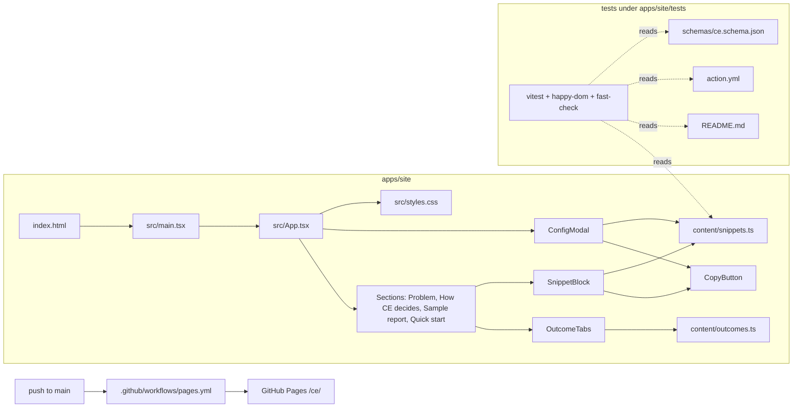

# Design Document

## Overview

This design implements `requirements.md` for issue #17, "[M6] Landing page skeleton (React) at apps/site". It adds a new npm workspace package `@ce/site` at `apps/site/`: a Vite, React 19 and TypeScript single page that is functional and deliberately unstyled. It is the "before" state for issue #19 and the future Subject for CE dogfooding. The Site imports nothing from CE and carries no test hooks.

The design has these parts:

- A static page with one `<h1>`, a navigation list and four Sections (Problem, How CE decides, Sample report, Quick start). All copy is static text in the bundle.
- Three interactive components that CE can later exercise: `OutcomeTabs` (ARIA tabs, roving tabindex), `ConfigModal` (native `<dialog>` opened with `showModal()`), and `CopyButton` (clipboard write with a polite status message).
- One source of truth for each snippet, in `src/content/snippets.ts`. The Quick start block, the modal block and the clipboard write all read the same constant, and the Action snippet is kept byte-identical to the README block by a test.
- A Pages workflow (`.github/workflows/pages.yml`) with a `build` job and a `deploy` job, plus a one-time manual precondition (an administrator enables Pages).
- A vitest suite in `apps/site/tests/` that runs in happy-dom, needs no key or network, and includes fast-check properties for the copy round trip, the tab invariant, the copy status lifecycle and the backdrop click rule.

### Decisions and rationale

| Decision | Alternatives | Reason |
| --- | --- | --- |
| React 19 with `@vitejs/plugin-react` `^5.2.0` | plugin 6.x | Plugin 6.x needs `vite ^8`. The repository uses `vite ^6.0.0` (F10). Plugin 5.2.0 peers on `^4.2 \|\| ^5 \|\| ^6 \|\| ^7 \|\| ^8` (checked with `npm view`). |
| Vite `base` as a function of `command` (`/ce/` on build, `/` on serve) | Always `/ce/` | `npm run dev` then serves at `/` (R1.10, R1.11), and `vite preview` serves the build under `/ce/` (R1.12). |
| One config file `vite.config.ts` that imports `defineConfig` from `vitest/config` and holds the `test` block | Separate `vitest.config.ts` | The function form of `defineConfig` accepts `command`, and one file is checked by `tsc` through `include`. |
| happy-dom as Test_Environment | jsdom | jsdom has no `showModal()` (F11, R13.3). |
| No React state for the dialog open flag | `useState(open)` | The `open` attribute is the only state. The Close button, Escape and backdrop click all end in a native `close` event, so state cannot drift (R8.14). |
| Rely on the native focusing steps of `showModal()` | `autoFocus`, custom focus code | React's `autoFocus` calls `focus()` at mount while the dialog is closed (R8.3). The Close button is the first focusable descendant, so `showModal()` focuses it. |
| Tab and copy logic in small pure helpers | Logic only inside components | Pure helpers (`nextTabIndex`, `shouldCloseOnBackdropClick`) are cheap to test with 100+ fast-check runs. |
| The README block is the reference for the Action snippet | Write a new snippet | R7.9 and R7.12 require equality. The README block already satisfies R7.4 and R7.5, so the README is not edited (R7.13 stays as a fallback). |

### Research summary

- `HTMLDialogElement.showModal()`, native Escape handling, backdrop, focus containment, inertness and focus return are browser behaviors. happy-dom's `showModal()` only sets `open` (F11), so tests stub or skip those and the live check at the Public_URL covers them (R8.13, R12.7). Reference: [MDN `<dialog>`](https://developer.mozilla.org/en-US/docs/Web/HTML/Reference/Elements/dialog).
- React's `autoFocus` prop calls `focus()` when the element mounts, not when the dialog opens. The design therefore relies on the native focusing steps of `showModal()` and uses no focus prop.
- The WAI-ARIA Authoring Practices "Tabs" pattern defines the keyboard model (ArrowLeft/Right with wrap, Home, End, roving tabindex) used by R5. Reference: [APG Tabs pattern](https://www.w3.org/WAI/ARIA/apg/patterns/tabs/).
- Versions checked on npm: `react` and `react-dom` 19.3.1, `@types/react` 19.3.3, `@types/react-dom` 19.3.0, `happy-dom` 21.0.4, `@testing-library/react` 16.3.3, `@testing-library/dom` 10.4.2.

Content was rephrased for compliance with licensing restrictions.

## Architecture



Boundaries:

- `src/` imports only `react`, `react-dom` (including the subpath `react-dom/client`) and relative paths (R1.14). It never reads the repository root. Only tests read `action.yml`, `README.md` and `schemas/ce.schema.json` (R2.5).
- The Site makes no network request after load (R3.9) and loads nothing from a third-party origin (R10.4).
- Nothing in `src/` detects CE, a test runner or an automation driver (R2.3).

### Workspace layout

```
apps/site/
  package.json
  tsconfig.json
  vite.config.ts          base by command; plugin-react; vitest test block (happy-dom)
  index.html              <link rel="icon" href="data:,"> and <div id="root">
  src/
    main.tsx              createRoot(...).render(<App />)
    App.tsx               h1, nav, four Sections, ConfigModal
    styles.css            Basic_Styling, at most 40 lines
    content/
      snippets.ts         CONFIG_SNIPPET, ACTION_SNIPPET, SNIPPET_LABELS
      outcomes.ts         OUTCOMES: three tab definitions
      sections.ts         SECTIONS: id and title for navigation
    components/
      OutcomeTabs.tsx
      ConfigModal.tsx
      CopyButton.tsx
      SnippetBlock.tsx    <pre><code> + CopyButton
      SampleReport.tsx
    lib/
      tabs.ts             nextTabIndex(current, key, count)
      dialog.ts           shouldCloseOnBackdropClick(...)
  tests/
    helpers/              fake clipboard, dialog stubs, repo file readers
    *.test.tsx, *.property.test.tsx
```

Root `package.json` changes: add `"apps/*"` to `workspaces`, and commit the regenerated `package-lock.json` (R1.2, R1.13). The root scripts already use `--workspaces --if-present`, so `build`, `typecheck` and `test` pick up the Site once it defines those scripts.

## Components and Interfaces

### `apps/site/package.json` (R1.1, R1.3 to R1.6, R1.5)

```json
{
  "name": "@ce/site",
  "private": true,
  "version": "0.1.0",
  "type": "module",
  "scripts": {
    "dev": "vite",
    "build": "vite build",
    "preview": "vite preview",
    "typecheck": "tsc --noEmit",
    "test": "vitest run --passWithNoTests"
  },
  "dependencies": { "react": "^19.0.0", "react-dom": "^19.0.0" },
  "devDependencies": {
    "@testing-library/dom": "^10.4.0",
    "@testing-library/react": "^16.3.0",
    "@types/node": "^22.0.0",
    "@types/react": "^19.0.0",
    "@types/react-dom": "^19.0.0",
    "@vitejs/plugin-react": "^5.2.0",
    "ajv": "^8.0.0",
    "fast-check": "^4.0.0",
    "happy-dom": "^21.0.0",
    "typescript": "^5.6.0",
    "vite": "^6.0.0",
    "vitest": "^5.1.1",
    "yaml": "^2.0.0"
  }
}
```

`ajv`, `fast-check`, `typescript`, `vite`, `vitest`, `yaml` and `@types/node` use the same ranges as `packages/ce`, `action` and `examples/demo-app` (R1.5). `yaml` is a devDependency here because only tests use it. `@testing-library/user-event` is not used: tests dispatch events through `fireEvent`, which keeps the dependency list within R1.4.

### `tsconfig.json` (R1.7)

Same compiler options as `examples/demo-app` (`target ES2022`, `module ESNext`, `moduleResolution bundler`, `lib` with DOM, `strict`, `noEmit`, `isolatedModules`, `skipLibCheck`), plus `"jsx": "react-jsx"` and `"include": ["src", "tests", "vite.config.ts"]`. Tests run under Node types and DOM types together, so `types` is not restricted.

### `vite.config.ts` (R1.8, R1.10)

```ts
import { defineConfig } from 'vitest/config';
import react from '@vitejs/plugin-react';

export default defineConfig(({ command }) => ({
  base: command === 'build' ? '/ce/' : '/',
  plugins: [react()],
  test: {
    environment: 'happy-dom',
    include: ['tests/**/*.test.{ts,tsx}'],
  },
}));
```

`tests/**` is relative to `apps/site/` because vitest runs with that package directory as its root (`npm test --workspaces`).

### `index.html` (R12.4)

Contains `<meta charset>`, viewport meta, a `<title>`, `<link rel="icon" href="data:," />`, `<div id="root"></div>` and `<script type="module" src="/src/main.tsx"></script>`. It has no `<style>` block (R10.3) and no third-party URL. The stylesheet is imported from `main.tsx`.

React renders the page `<h1>` on the client, so a raw `GET` returns the built `index.html` with the `<title>`, an empty `#root` and a `<script type="module">` reference to the hashed bundle under `/ce/assets/`. R12.2 is split accordingly: the raw response is checked for status 200, the `<title>`, `#root` and the bundle reference, and the `<h1>` is checked in the rendered document after scripts run, where exactly one must exist. Pre-rendering is out of scope.

### `App` (R3.1 to R3.4, R3.6 to R3.9)

```tsx
export function App(): JSX.Element
```

Renders, in order: `<h1>`, `<nav aria-label="Sections">` with a `<ul>` of in-page links built from `SECTIONS` (`href="#problem"` and so on), then `<main>` with four `<section id aria-labelledby>` elements, each with an `<h2>`, and finally `<ConfigModal />`. Native fragment navigation moves the viewport (R3.3), so no scroll code exists.

`SECTIONS` ids: `problem`, `how-ce-decides`, `sample-report`, `quick-start`. Titles: "Problem", "How CE decides", "Sample report", "Quick start".

### Section copy (R4, R5.8 to R5.13, R3.5)

All copy is literal JSX or constants. Constraints the author follows, and tests enforce where possible:

- Problem: states that a Change can pass builds, tests and other Checks while its behavior when executed stays unproven; that CE produces Evidence from runtime observation that a reader can inspect; that CE does not repeat verification that existing Checks already provide adequately; and one limit from `SPEC.md` 1.4, worded as "CE does not promise that every Change is correct".
- How CE decides: the intro says deterministic code decides the Outcome and a model answer does not decide it directly. A paragraph outside the tab panels says `ERROR` means the CE process failed to complete.
- Forbidden phrases (R3.6, R3.7), case-insensitive, with no negation exception: "AI-powered CI", "coding agent", "testing framework", "merge gate", "deploy gate", "guarantee", "ensures correctness", "bug-free". The copy uses "does not promise" instead.
- Core_Terms are used as defined and one term per concept. This is a reviewer item on the pull request checklist (R3.5), not a test.

### `OutcomeTabs` (R5.1 to R5.7)

```ts
// content/outcomes.ts
export interface OutcomeDef { name: 'SKIPPED' | 'EVIDENCED' | 'UNSUPPORTED'; body: ReactNode }
export const OUTCOMES: readonly [OutcomeDef, OutcomeDef, OutcomeDef];

// lib/tabs.ts
export type TabKey = 'ArrowRight' | 'ArrowLeft' | 'Home' | 'End';
export function nextTabIndex(current: number, key: TabKey, count: number): number;
```

`nextTabIndex` is pure: ArrowRight gives `(current + 1) % count`, ArrowLeft gives `(current - 1 + count) % count`, Home gives `0`, End gives `count - 1`.

Component behavior:

- State: `selected: number`, initial `0` (`SKIPPED`). Tab ids and panel ids come from `useId()`.
- `role="tablist"` container with an `aria-label`. Each `<button type="button" role="tab">` has `id`, `aria-selected`, `aria-controls` (panel id) and `tabIndex` equal to `0` for the selected tab and `-1` for others.
- Each `role="tabpanel"` has `id`, `aria-labelledby` (tab id) and `hidden` when not selected.
- Click, Enter and Space: the native button `click` sets `selected`. Enter and Space on a `<button>` fire `click`, so no extra handler exists.
- `onKeyDown` on a tab: for the four keys, call `preventDefault()`, compute `nextTabIndex`, set `selected` and move focus to that tab through a `ref` array.
- Panel text: `SKIPPED` says the Assessment determined additional Evidence is not required and that this is a valid result. `EVIDENCED` says runtime Evidence was collected and can be inspected. `UNSUPPORTED` says Evidence was required but the available capabilities were insufficient, and that it differs from `SKIPPED` because CE could not produce Evidence that was needed.
- Outcome names appear in upper case only. `ERROR` appears in the paragraph outside the panels.

### `CopyButton` and `SnippetBlock` (R9)

```ts
interface CopyButtonProps { text: string; label: string }   // label: "Copy ce.yml" | "Copy workflow"
export function CopyButton(props: CopyButtonProps): JSX.Element

interface SnippetBlockProps { text: string; label: string }
export function SnippetBlock(props: SnippetBlockProps): JSX.Element
// renders <pre><code>{text}</code></pre> followed by <CopyButton text label />
```

`CopyButton` renders `<button type="button">{label}</button>` and `<span aria-live="polite">{status}</span>`. The `<span>` is in the DOM from the first render and empty until an attempt (R9.4). There is no `aria-label`, so the accessible name equals the visible text (R9.3).

Algorithm on click:

1. Increment an `attempt` ref and clear the pending timer (R9.7).
2. `try { await navigator.clipboard.writeText(text); outcome = 'Copied' } catch { outcome = 'Copy failed' }`. If `navigator.clipboard` is `undefined`, the call throws a `TypeError` that the same `catch` handles (R9.6).
3. If the attempt number is no longer the latest, drop the result (a newer click owns the status).
4. Set the status to `outcome` and start a `setTimeout` of 2000 ms that sets the status to `''` (within the 3 s limit of R9.5 and R9.6). A cleanup effect clears the timer on unmount.

The code block is plain `<pre><code>` text, so it stays selectable (R9.6). The text passed to `writeText` is the same string that renders in `<code>`, so the displayed and copied text are equal (R9.8).

Copy buttons: "Copy ce.yml" and "Copy workflow" in Quick start, and "Copy ce.yml" in the modal (R9.1). The page therefore contains two buttons named "Copy ce.yml"; the one in the closed dialog is outside the accessibility tree (R8.10).

### `ConfigModal` (R8)

```tsx
export function ConfigModal(): JSX.Element
```

Structure:

```tsx
const ref = useRef<HTMLDialogElement>(null);
const titleId = useId();
<>
  <button type="button" onClick={() => ref.current?.showModal()}>View ce.yml</button>
  <dialog ref={ref} aria-labelledby={titleId} onClick={onDialogClick}>
    <h2 id={titleId}>ce.yml</h2>
    <button type="button" onClick={() => ref.current?.close()}>Close</button>
    <SnippetBlock text={CONFIG_SNIPPET} label="Copy ce.yml" />
  </dialog>
</>
```

- The Close button is the first focusable element in tree order, so the native focusing steps of `showModal()` focus it (R8.3). There is no `autoFocus` prop and no `focus()` call.
- The role is the implicit `dialog` role. The name comes from the heading through `aria-labelledby` (R8.4).
- No focus trap, no Escape handler, no `::backdrop` CSS (R8.5). Escape closes through the native `cancel` and `close` behavior (R8.7). Focus returns to "View ce.yml" natively (R8.9).
- No React open state and no `onClose` handler is needed: the `open` attribute is the only state, and every close path (Close button, Escape, backdrop click) calls or triggers native `close()`. Because there is no mirrored state, a second `showModal()` always works (R8.14, R8.15).
- The backdrop rule lives in a pure function:

```ts
// lib/dialog.ts
export interface Rect { left: number; right: number; top: number; bottom: number }
export function shouldCloseOnBackdropClick(
  targetIsDialog: boolean, x: number, y: number, rect: Rect,
): boolean;
// true iff targetIsDialog and (x < rect.left || x > rect.right || y < rect.top || y > rect.bottom)
```

`onDialogClick` calls it with `e.target === e.currentTarget`, `e.clientX`, `e.clientY` and `currentTarget.getBoundingClientRect()`, and calls `close()` on `true`. Clicks whose target is a descendant return `false`, including keyboard-initiated clicks with coordinates 0, 0 on a descendant button (F12). A click that targets the dialog itself with 0, 0 is outside any rectangle that starts right of or below the origin and closes the dialog; that case is a click on the dialog element, which is the stated rule in R8.8.

### `SampleReport` (R6)

A `<section>` content block with a visible statement "This is an illustrative example, not the result of a real CE run." and a `<dl>` with labelled fields: Outcome (`EVIDENCED`), Change, Claim, Subject, Actions performed (an `<ol>`), Observations obtained (a `<ul>`), and Where the Evidence can be inspected (plain text naming the files in the evidence bundle, with no link). It contains no image, no link, no secret-like value and no personal data. The fields follow `SPEC.md` section 7.2.

### Snippets (R7)

```ts
// content/snippets.ts
export const CONFIG_SNIPPET: string;
export const ACTION_SNIPPET: string;
```

`CONFIG_SNIPPET`:

```yaml
version: 0
target:
  start: npm run dev
  url: http://localhost:5173
  ready:
    path: /
    timeout: 60s
```

It sets `target.start`, `target.url` and `target.ready.path` (R7.3). Every key exists in `schemas/ce.schema.json`, `timeout` matches `^[1-9]\d*(ms|s|m)$`, and `version` is the constant `0`.

`ACTION_SNIPPET` is the first `yaml` block under `## GitHub Action` in `README.md`, copied verbatim (checkout with `fetch-depth: 0`, `npm ci`, `rfxlamia/ce@v0`, `OPENROUTER_API_KEY` through `${{ secrets.OPENROUTER_API_KEY }}`, `with: target-start`, `target-ready-path`). The Quick start prose also states that an OpenRouter key is required in v0 and stored as the repository secret `OPENROUTER_API_KEY`, and that the Action posts an evidence comment and uploads the Evidence as a workflow artifact. It does not claim hosted reports and does not mention `publish: branch` (R7.6 to R7.8).

In JSX the snippet strings are rendered as `{CONFIG_SNIPPET}` children, so `${{ ... }}` and braces are text and need no escaping.

### `styles.css` (R10.1, R10.5)

At most 40 lines. It sets only `font-family` on `body`, `max-width` and `margin` on `main` and `body`, and `overflow-x: auto` on `pre`. No color, background, border-radius, box-shadow or animation properties. No `::backdrop` rule. The Site has no inline `style` attribute and no CSS dependency.

### Style_Guard (R10.5, R10.7, R10.8)

A test reads `src/styles.css`. It fails if the file has more than 40 lines or if it matches `/\b(color|background(-[a-z]+)?|border-radius|box-shadow|animation(-[a-z]+)?|transition)\s*:/`. The test file begins with a comment stating: this is a snapshot of the "before" state, and the first pull request of issue #19 removes or relaxes it.

### Pages workflow (R11)

`.github/workflows/pages.yml`:

```yaml
# Precondition: a repository administrator enables Pages with source
# "GitHub Actions" once, before the first deployment, for example:
#   gh api -X POST repos/rfxlamia/ce/pages -f build_type=workflow
# This workflow cannot enable Pages itself (GITHUB_TOKEN lacks the right).
name: Pages
on:
  push:
    branches: [main]
  workflow_dispatch:
concurrency:
  group: pages
  cancel-in-progress: false
jobs:
  build:
    runs-on: ubuntu-latest
    permissions:
      contents: read
      pages: read
    steps:
      - uses: actions/checkout@<sha>                  # pinned, same as ci.yml
        with: { persist-credentials: false }
      - uses: actions/setup-node@<sha>                # pinned, same as ci.yml
        with: { node-version: 22, cache: npm }
      - uses: actions/configure-pages@<sha>
      - run: npm ci
      - run: npm run build --workspace @ce/site
      - uses: actions/upload-pages-artifact@<sha>
        with: { path: apps/site/dist }
  deploy:
    needs: build
    runs-on: ubuntu-latest
    permissions:
      pages: write
      id-token: write
    environment:
      name: github-pages
      url: ${{ steps.deployment.outputs.page_url }}
    steps:
      - id: deployment
        uses: actions/deploy-pages@<sha>
```

- No `pull_request` trigger (R11.4) and no secret (R11.10). `needs: build` makes a failed build skip deploy and leaves the previous deployment unchanged (R11.11).
- `<sha>` placeholders are replaced at implementation time with commit SHAs, using the same SHAs as `ci.yml` for checkout and setup-node (R11.6). Each SHA carries a version comment.
- `build` uses `pages: read` only (R11.5). Whether `configure-pages` accepts `read` is unconfirmed by the official starter workflow, so the first run confirms it. If the step fails on permissions, the fallback is `pages: write` on `build`, recorded as a design change.
- Because `permissions` is set per job, the workflow-level default does not grant extra rights.

### Live verification (R12)

Not code. After the Pages workflow succeeds on `main`, the maintainer opens the Public_URL in a real browser (Playwright MCP is available for this inspection) and records: administrator enabled Pages (R12.1), a raw `GET` returns status 200 with the `<title>`, `#root` and the bundle reference, and the browser-rendered document contains exactly one `<h1>` (R12.2), every asset under `/ce/` returns 200 (R12.3), the favicon request stays inside the prefix (R12.4), no console error or failed request (R12.5), four Sections and working links (R12.6), and tabs, modal (Escape, backdrop, focus return, focus containment) and copy buttons behave as specified (R12.7). The maintainer posts this Verification_Record on issue #17 before closing it (R12.8).

## Data Models

The Site has no persistent data and no server state. Its data are constants and component state.

```ts
// content/sections.ts
export interface SectionDef { id: 'problem' | 'how-ce-decides' | 'sample-report' | 'quick-start'; title: string }
export const SECTIONS: readonly SectionDef[]; // fixed order

// content/outcomes.ts
export type OutcomeName = 'SKIPPED' | 'EVIDENCED' | 'UNSUPPORTED';
export interface OutcomeDef { name: OutcomeName; body: ReactNode }

// component state
OutcomeTabs: { selected: number }                       // 0..2, initial 0
CopyButton:  { status: '' | 'Copied' | 'Copy failed' }  // plus refs: attempt counter, timer id
ConfigModal: no state; open/closed is the `open` attribute of <dialog>
```

Invariants:

- `OutcomeTabs.selected` is always in `[0, OUTCOMES.length)`.
- `CopyButton.status` is `''` except between a copy attempt resolving and 2000 ms later.
- `CONFIG_SNIPPET` is one constant used by the Quick start block, the modal block and both clipboard writes.
- `ACTION_SNIPPET` equals the README block after normalizing line endings and trailing newlines.

Test-side data (not shipped): a fake clipboard `{ writeText(text): Promise<void> }` that records calls and can be set to resolve, reject or be absent; a `Rect` generator; and readers for `action.yml`, `README.md` and `schemas/ce.schema.json` through paths resolved from the test file location.


## Correctness Properties

*A property is a characteristic or behavior that should hold true across all valid executions of a system-essentially, a formal statement about what the system should do. Properties serve as the bridge between human-readable specifications and machine-verifiable correctness guarantees.*

Four pieces of logic suit fast-check because their input spaces are large: clipboard text, tab navigation sequences, copy status timing, and the backdrop click rule. The rest of the Site is static content, configuration and browser-native behavior, which example tests, scans and the live check cover (see Testing Strategy).

Reflection: the prework produced four properties. They are independent. The tab property covers R5.4 to R5.7 together (activation, keys, wrap, roving tabindex), so no separate wrap or Home/End property is kept. The copy round trip (R9.2, R9.8) and the status lifecycle (R9.5 to R9.7) test different behavior (what is written versus what is announced), so both stay.

### Property 1: Copy writes exactly the displayed text

For any snippet text (including empty strings, Unicode, newlines, braces and `${{ }}` sequences) and any label, rendering `SnippetBlock` and activating its Copy_Button calls `navigator.clipboard.writeText` exactly once with a string equal to the `textContent` of the `<code>` element in the same block.

**Validates: Requirements 9.2, 9.8, 13.6**

### Property 2: Tab selection invariant under any interaction sequence

For any sequence of interactions drawn from {click tab `i`, ArrowRight, ArrowLeft, Home, End} applied to `OutcomeTabs`, after every step exactly one tab has `aria-selected="true"` and `tabindex="0"`, all other tabs have `aria-selected="false"` and `tabindex="-1"`, exactly one tabpanel lacks the `hidden` attribute, and that panel's `aria-labelledby` names the selected tab and the tab's `aria-controls` names that panel. Additionally, the selected index after each key equals `nextTabIndex(previous, key, 3)`: it wraps at both ends, Home gives the first tab and End gives the last.

**Validates: Requirements 5.2, 5.4, 5.5, 5.6, 5.7, 13.7**

### Property 3: Copy status follows the latest attempt and resets

For any non-empty sequence of copy attempts, each with a clipboard result drawn from {resolves, rejects, `navigator.clipboard` absent}, and any gaps between attempts, the Copy_Status shows "Copied" after the latest attempt resolves with success and "Copy failed" after it fails, regardless of earlier attempts. With no further attempt, the Copy_Status is empty again 3000 ms after the latest attempt, and a new attempt made while the status is non-empty restarts that reset time.

**Validates: Requirements 9.5, 9.6, 9.7**

### Property 4: Backdrop click closes only for a dialog-targeted click outside the rectangle

For any rectangle with `left <= right` and `top <= bottom`, any point `(x, y)` and any boolean `targetIsDialog`, `shouldCloseOnBackdropClick(targetIsDialog, x, y, rect)` returns `true` if and only if `targetIsDialog` is true and the point lies strictly outside the rectangle (`x < left`, `x > right`, `y < top` or `y > bottom`). For any `(x, y)`, including `(0, 0)`, it returns `false` when `targetIsDialog` is false.

**Validates: Requirements 8.8**

## Error Handling

| Condition | Handling |
| --- | --- |
| `navigator.clipboard` is `undefined` (non-secure context, old browser) or `writeText` rejects | `CopyButton` catches both paths, shows "Copy failed" for 2 s, leaves the snippet selectable, never throws (R9.6). |
| A newer copy attempt starts while an earlier `writeText` is pending | The attempt counter drops the stale result, so the latest attempt owns the status (R9.7). |
| `CopyButton` unmounts with a pending timer | A cleanup effect clears the timer, so no state update happens after unmount. |
| `showModal()` called on a dialog that is already open | The browser throws `InvalidStateError`. The button is not reachable while the modal is open (the rest of the page is inert), so the design adds no guard. |
| Browser without `<dialog>` support | Out of scope. Current evergreen browsers support it. |
| Pages not enabled | `deploy-pages` fails. The comment at the top of `pages.yml` and the Verification_Record (R12.1) document the one-time administrator step (R11.12, R11.13). |
| `configure-pages` rejects `pages: read` | Detected on the first run (R11.5). Fallback: `pages: write` on `build`, recorded as a design change. |
| `build` job fails | `deploy` is skipped through `needs: build`, and the last deployment stays (R11.11). |
| Snippet drift (README, `action.yml` or the schema changes) | Tests fail with the differing key or text (R7.2, R7.10 to R7.12). |
| CE coupling or forbidden phrase added to the Site | Tests fail naming the file or phrase (R2.4, R3.6, R3.7). |

## Testing Strategy

Property-based testing applies to the pure logic and to the two components whose behavior varies with input (Properties 1 to 4). Static copy, configuration and browser-native behavior use example tests, scans and a live check, because there is no meaningful "for all inputs" statement over fixed content.

### Tooling

- vitest `^5.1.1` through `npm test` (`vitest run --passWithNoTests`), environment happy-dom, tests in `apps/site/tests/` (R13.1, R13.3, R13.4).
- `fast-check` `^4.0.0` for properties. Each property runs at least 100 iterations (`{ numRuns: 100 }` or more). Each property test carries a comment tag of the form `Feature: landing-page-skeleton, Property N: <text>`. Each property is one `fc.assert` test.
- `@testing-library/react` and `@testing-library/dom` for rendering and queries by role and name. Queries use roles and accessible names only, matching the rule that the Site has no test hooks (R2.2).
- `ajv` (constructed as `new Ajv({ strict: false, validateFormats: false, allErrors: true })`, no `ajv-formats`) and `yaml` for snippet validation (R13.8).
- No API key, network or browser beyond happy-dom (R13.2).

### Property tests (`tests/*.property.test.tsx`)

| Property | Generators | Setup |
| --- | --- | --- |
| 1 Copy round trip | `fc.string({ unit: 'binary' })` and `fc.fullUnicodeString()` mix, plus a constant arbitrary of the two real snippets | Fake clipboard recording `writeText` calls. Cleanup (`unmount`) between runs. |
| 2 Tab invariant | `fc.array(fc.oneof(fc.record({ kind: fc.constant('click'), i: fc.nat(2) }), fc.constantFrom('ArrowRight','ArrowLeft','Home','End').map(...)), { maxLength: 30 })` | Render `OutcomeTabs`, apply each step with `fireEvent`, assert the invariant and a model of the expected index after each step. |
| 3 Copy status | `fc.array(fc.record({ result: fc.constantFrom('ok','reject','absent'), gap: fc.integer({ min: 0, max: 4000 }) }), { minLength: 1, maxLength: 8 })` | `vi.useFakeTimers()`, controllable clipboard. Advance timers with `advanceTimersByTimeAsync`. Model: status equals the latest attempt's result until the 2000 ms reset from that attempt. |
| 4 Backdrop rule | `fc.record` of rect (sorted pairs from `fc.double({ noNaN: true })`), point, and boolean | Pure function, no DOM. |

### Example and scan tests

- Structure (R3.1 to R3.3): one `<h1>`, four `<h2>` in order, nav links resolve to Section ids.
- Copy rules (R3.4, R3.6 to R3.8, R5.13): scan the whole `document.body.textContent` including the closed dialog for placeholders and forbidden phrases, case-insensitively, and check that `skipped`, `evidenced` and `unsupported` appear only in upper case.
- No network (R3.9): spy on `fetch`, `XMLHttpRequest` and `WebSocket` during render and interactions.
- Content (R4, R5.8 to R5.12, R6, R7.6 to R7.8): assert required statements and the absence of links, images and secret-like strings in the Sample_Report.
- Snippets (R7.2 to R7.5, R7.9 to R7.12): validate `CONFIG_SNIPPET` against `schemas/ce.schema.json`; parse `ACTION_SNIPPET` as YAML and check triggers, permissions, `fetch-depth`, install step, `uses: rfxlamia/ce@v0` and the secret reference; check every `with` key is in `action.yml` `inputs`; check `action.yml` has `runs.using: node24` (R7.10); extract the first `yaml` block after `## GitHub Action` in `README.md` and compare it after normalizing line endings and trailing newlines.
- Modal (R8.1 to R8.4, R8.6, R8.10 to R8.12, R8.15): stub `HTMLDialogElement.prototype.showModal` and `close` where happy-dom lacks the native behavior (the stub is documented in a comment, R8.13), then check the open call, the heading name, the Close button, the shared snippet, and that after a dispatched `close` event a second activation calls `showModal` again.
- Copy buttons (R9.1, R9.3, R9.4, R9.9): labels, `type="button"`, no `aria-label`, the status element exists and is empty at first render.
- Source scans (R1.14, R2.1 to R2.3, R8.5, R10.2 to R10.4): imports in `src/` are only `react`, `react-dom` or relative; no CE import or path; no `data-testid`, `data-test`, `data-cy`, `data-ce`; no inline `style`; no `autoFocus`, `keydown` focus-trap code or `::backdrop`; no `http(s)://` resource in `index.html` or the stylesheet; `package.json` runtime dependencies are exactly `react` and `react-dom`. Failure messages include the file path (R2.4).
- Style_Guard (R10.5, R10.7, R10.8): at most 40 lines and no forbidden properties, with the "before state" comment in the test file.
- Workspace and workflow (R1.2, R1.6, R11): parse root `package.json` for `apps/*`, the Site scripts, and `pages.yml` for triggers (`push` to `main`, `workflow_dispatch`, no `pull_request`), job permissions, `needs: build`, the concurrency flag, the `github-pages` environment and SHA-pinned `uses`.
- Accessible names (R2.6): every `button` and `tab` in the rendered page has a non-empty accessible name.

### Smoke and manual checks

- Smoke: `npm ci`, `npm run typecheck`, `npm test`, `npm run build` at the repository root with the committed lockfile (R1.8, R1.9, R1.13). `npm run dev --workspace @ce/site` answers `GET /` with 200 (R1.11), and `vite preview` serves under `/ce/` (R1.12). The existing `ci.yml` already runs the first four.
- Manual (R12, and the native parts of R8): after the Pages workflow runs on `main`, check the Public_URL in a real browser: Escape closes the dialog, a backdrop click closes it, focus stays inside while open, focus returns to "View ce.yml" on close, no console error, no failed request, all assets 200. Post the Verification_Record on issue #17.
- Reviewer: the pull request checklist item "Core_Terms used as defined in `SPEC.md` section 3.2, one term per concept" (R3.5).

### Out of scope

CE running on pull requests that touch `apps/site/`, the fork-safety rule, the link to the latest CE report (R13.2 to R13.4 of the journal) and visual design (issue #19). Closing issue #17 does not depend on them (R14.8).

### Requirement coverage

| Requirement | Covered by |
| --- | --- |
| 1 | Workspace layout, `package.json`, `tsconfig.json`, `vite.config.ts`, smoke checks, import scan |
| 2 | Boundaries, source scans, accessible-name test |
| 3 | `App`, Section copy, copy-rule scans, reviewer item |
| 4 | Section copy, content tests |
| 5 | `OutcomeTabs`, Property 2, content tests |
| 6 | `SampleReport`, content tests |
| 7 | Snippets, Quick start prose, snippet tests |
| 8 | `ConfigModal`, Property 4, modal tests, manual check |
| 9 | `CopyButton`, `SnippetBlock`, Properties 1 and 3 |
| 10 | `styles.css`, Style_Guard, source scans |
| 11 | Pages workflow, workflow tests |
| 12 | Live verification (raw `GET` check and rendered `<h1>` check for R12.2), `index.html` favicon, manual checks |
| 13 | Tooling, property and example tests |
| 14 | Mapping unchanged from requirements; each checklist item is covered by the rows above |
