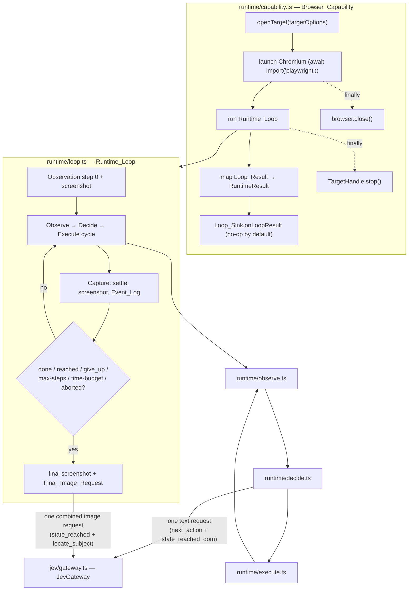

# Design Document

## Overview

This feature builds the bounded Observe → Decide → Execute loop ("Runtime_Loop") and the Browser_Capability that plugs it into the run pipeline, closing GitHub issue #10. The loop drives a Chromium page with Playwright against a ready `TargetHandle` produced by the `runtime-target` spec (#9). Each step observes the page as a ranked list of actionable elements, asks Jev exactly one text-only question for a decision plus a reached-check, executes the chosen action only if it targets something the loop actually observed, and captures a screenshot once the page settles. A single, final, combined image request (`state_reached` + `locate_subject`) is sent through the Jev JSON transport at the very end of the run. The loop never decides the `Outcome`; it returns a `Loop_Result` that the Browser_Capability maps into the `RuntimeResult` that `outcome/resolve.ts` consumes (steering "Design rule").

Five safety properties shape every design decision below:

1. **Never act on what was not observed.** An Action's `ref` must come from the most recent Observation, resolved only through the Stable_Locator stored there — never from text the Decider produced.
2. **Never leave the Target_Origin.** Every navigation, redirect hop and form submission is checked against the Target_Origin before it is allowed to complete.
3. **Never leak a fixture value.** Fixture values reach only the Executor (to fill) and the Capture (to mask); the Observer, Decider, request state, Event_Log, Loop_Result and screenshots see only fixture *keys*, never values.
4. **Never exceed the time or step budget.** `Max_Steps` and `Time_Budget` bound the loop; a `Final_Reserve` is always kept for the last screenshot and the Final_Image_Request.
5. **Never fail the run because an image failed.** A `JevImageError` on the Final_Image_Request degrades to text signals; only a non-image error stops the run.

## Architecture



### Module boundaries (steering "Structure" and "Placement rules")

| Module | Responsibility | Must not |
| --- | --- | --- |
| `runtime/observe.ts` | Page → `Observation` (elements, navigation, digest, screenshot path) | Read field values; write question text |
| `runtime/decide.ts` | `Observation` + Claim → one text-only `Jev_Request` → `Action` | Carry an image; invent a Ref; write question text (uses `CATALOG.runtimeNextAction` etc. from `jev/catalog.ts`) |
| `runtime/execute.ts` | `Action` → Playwright call, with the Ref/origin/fixture guards | Build a locator from Decider-supplied text; accept an unobserved Ref |
| `runtime/capture.ts` | Screenshots, settle wait, dialog/download/popup handling, masking | Observe or screenshot any page but the one the loop started on |
| `runtime/loop.ts` | Runs the bounded cycle, owns the clock/budget, builds the Final_Image_Request | Import `outcome/resolve.ts`; decide the Outcome |
| `runtime/capability.ts` | `CapabilityEntry` named `browser_ui`; owns `openTarget`/browser lifecycle and the `Loop_Result` → `RuntimeResult` mapping | Write `run.json`, `report.html` or any file besides screenshots; import `playwright` statically |

Only `jev/catalog.ts` defines question text (F1); only `jev/` knows two transports exist (F2, steering `jev-gateway-decision`). `runtime/decide.ts` and `runtime/loop.ts` call `CATALOG.runtimeNextAction.built(options)`, `CATALOG.runtimeStateReachedDom.built()` and `finalImageQuestions(claim, pngBytes)` and build no question of their own.

## Components and Interfaces

### `runtime/observe.ts`

```typescript
export interface ObservedElement {
  ref: string;              // "e<N>", unique within the Observation, document order
  role: string;
  name: string;              // Sanitized_Text
  locator: string;           // Stable_Locator
  visible: boolean;
  enabled: boolean;
  href?: string;              // resolved against Target_Origin, link only
  fixtureKeys: string[];      // sorted; empty unless a fill-capable field
}

export interface Observation {
  step: number;
  url: string;                 // Sanitized_Text
  title: string;                // Sanitized_Text
  domDigest: string;
  elements: ObservedElement[];
  navigation: string[];         // absolute, on-origin URLs (Requirement 1.11)
  screenshot: string;           // path relative to Run_Dir
}

export interface ObserveOptions {
  page: PlaywrightPage;
  step: number;
  targetOrigin: string;
  fixtureKeys: readonly string[]; // keys only, never values (Requirement 6.1)
}

export function observe(options: ObserveOptions): Promise<Omit<Observation, 'screenshot'>>;
export function computeDomDigest(elements: readonly ObservedElement[]): string;
export function buildStableLocator(el: ActionableElementSnapshot): string;
export function sanitizeText(raw: string, options: { maxLength?: number; fixtureValues: readonly string[] }): string;
```

`observe()` snapshots every Actionable_Element (link, button, text input, textarea, select, checkbox, radio, or ARIA role `button|link|menuitem|option|tab|combobox|checkbox|radio|switch|textbox`), computes visibility as `playwright-visible AND NOT zero-clipped-by-ancestor`, assigns Refs in document order, and returns `fixtureKeys` per element using the match rule of Requirement 6.1 (case-insensitive, trimmed equality against `name`, `id`, an `autocomplete` token, or the full accessible name). It never reads an element's current value. `computeDomDigest` hashes the tuple list `(ref, role, name, locator, visible, enabled, href, fixtureKeys)` with a stable serialization (sorted keys, no map iteration order dependency) so two observations of an unchanged page hash equal.

### `runtime/decide.ts`

```typescript
export interface Option {
  kind: 'element' | 'fill' | 'navigation';
  description: string;          // Sanitized_Text, e.g. `e12: button "Menu"`
  ref?: string;                  // element | fill
  fixtureKey?: string;           // fill only
  url?: string;                  // navigation only
  proximityScore: number;
}

export type DecidedAction =
  | { kind: 'click'; ref: string }
  | { kind: 'fill'; ref: string; fixtureKey: string }
  | { kind: 'goto'; url: string }
  | { kind: 'done' }
  | { kind: 'give_up'; reason: 'invalid-answer' };

export function buildOptions(input: {
  observation: Observation;
  routes: readonly string[];
  targetOrigin: string;
  fixtures: Readonly<Record<string, string>>;
  changeTerms: ReadonlySet<string>;
}): Option[];

export function changeTermsFrom(files: readonly { path: string; patch?: string }[]): Set<string>;
export function proximityScore(matchText: string, changeTerms: ReadonlySet<string>): number;

export function buildDecisionRequest(input: {
  claim: string;
  observation: Observation;
  options: readonly Option[];
  history: readonly StepHistoryEntry[];
  targetOrigin: string;
  fixtureValues: readonly string[]; // Redactor input only, never embedded in text (Requirement 6.4/6.6)
}): Jev_Request;

export function mapAnswerToAction(input: {
  options: readonly Option[];
  answer: Record<string, { probability: number }>; // from runtime.next_action ChoiceResponse
}): DecidedAction;
```

`buildOptions` builds one `Option` per visible-and-enabled `ObservedElement` (click), one additional `Option` per `(field, matching fixture key)` pair for a fill-capable field, and one per `target.routes` entry whose resolved URL is not an already-observed link `href`. It ranks by descending `proximityScore(matchText, changeTerms)` (ties: Element/fill options in document order, then Navigation_Options in `routes` order) and truncates to `MAX_NEXT_ACTION_OPTIONS` (240, re-exported from `jev/catalog.ts`, F1), keeping the top-ranked. `changeTermsFrom` tokenizes paths and added (`+`) lines: splits camelCase, keeps ASCII-alnum tokens of length ≥ 3, drops pure-digit tokens and the fixed Change_Stopwords set. `mapAnswerToAction` picks the highest-probability key; ties break by lowest Option index, then `give_up`, then `done`; a key absent from the Option indices and not `done`/`give_up` maps to `give_up` with reason `invalid-answer`.

`buildDecisionRequest` builds exactly the two questions `next_action` (via `CATALOG.runtimeNextAction.built(options.map(o => o.description))`) and `state_reached_dom` (via `CATALOG.runtimeStateReachedDom.built()`), with state text built by `buildStateText` (below) — never an `image()` asset, so `jev/gateway.ts#isImageRequest` routes it through the SDK transport (F2).

```typescript
export function buildStateText(input: {
  claim: string;
  path: string;              // Sanitized_Text path, query, fragment only — no scheme/host/port
  title: string;              // Sanitized_Text
  history: readonly { step: number; kind: string; description: string; result: 'changed' | 'unchanged' | 'refused' }[];
}): string;
```

Each history line is `step <N>: <kind> <description> -> <result>`. The function is pure and total; the same input yields byte-identical text on every machine (Requirement 3.9, Requirement 12.16), because the path form never includes the random port that `demo-app.testsupport.ts#pickFreePort()` assigns (F8).

### `runtime/execute.ts`

```typescript
export type GiveUpReason =
  | 'unobserved-ref' | 'ineligible-ref' | 'locator-mismatch'
  | 'unknown-fixture' | 'cross-origin' | 'invalid-answer';

export type ExecuteResult =
  | { status: 'ok'; changed: boolean }
  | { status: 'give_up'; reason: GiveUpReason; refusal: { step: number; kind: 'refusal'; detail: string } };

export function execute(input: {
  action: DecidedAction;
  observation: Observation;      // the most recent Observation — the only source of valid refs/locators
  page: PlaywrightPage;
  targetOrigin: string;
  fixtures: Readonly<Record<string, string>>;
  callTimeoutMs: number;          // min(Playwright default, time remaining) — Requirement 9.12
}): Promise<ExecuteResult>;

export function isSameOrigin(a: string, b: string): boolean; // normalizes default port (Requirement 5.6)
```

`execute` accepts a `ref` only when it names an `ObservedElement` of the given Observation with `visible && enabled` true, resolves it exclusively through that Observation's `locator` (never through text from the Decider), and refuses (no browser call, `Event_Log` `refusal` entry, matching `GiveUpReason`) when: the ref is absent (`unobserved-ref`), present but ineligible (`ineligible-ref`), the locator resolves to zero or more than one element at call time (`locator-mismatch`), a `fill` fixture key is absent from `runtime.fixtures` or from the element's `fixtureKeys` (`unknown-fixture`), or a `goto`/navigation targets an origin other than `targetOrigin` (`cross-origin`). Cross-origin navigation is also aborted mid-flight: `execute` registers a Playwright route/request interceptor before the action and aborts any top-level/frame navigation or form submission whose origin differs from `targetOrigin`, including every hop of a same-origin-initiated redirect chain; sub-resource requests are left alone. A `goto` Action is additionally accepted only when its URL is a member of `observation.navigation`.

### `runtime/capture.ts`

```typescript
export interface EventLogEntry {
  step: number;
  kind: 'dialog' | 'download' | 'popup' | 'settle' | 'refusal';
  detail: string; // Redactor output, truncated to 500 chars for dialog messages
}

export function registerPageHandlers(input: {
  page: PlaywrightPage;
  onEvent: (entry: EventLogEntry) => void;
  redact: (text: string) => string;
}): () => void; // returns an unregister/dispose function

export function waitForSettle(input: {
  page: PlaywrightPage;
  computeDigest: () => Promise<string>;
  settleTimeoutMs: number;    // 3000
  now: () => number;
  sleep: (ms: number) => Promise<void>;
}): Promise<{ settled: boolean }>;

export function takeScreenshot(input: {
  page: PlaywrightPage;
  path: string;                    // absolute, under Run_Dir
  masks: readonly PlaywrightLocator[]; // Filled_Fields + fixture-text elements (or all inputs on locate failure)
}): Promise<void>;

export function maskTargetsFor(input: {
  page: PlaywrightPage;
  filledFieldLocators: readonly string[];
  fixtureValues: readonly string[]; // Capture-only; never forwarded to Observer/Decider/Jev_Gateway
}): Promise<PlaywrightLocator[]>;
```

`registerPageHandlers` is installed before the first Observation and dismisses every `dialog` event, cancels every download, and closes every popup page, logging each with the Redactor applied and the dialog message truncated to 500 characters; it never lets the loop observe, screenshot or send a popup page to the gateway. `waitForSettle` polls until no request has been in flight for 500 ms and the digest is unchanged across two reads 100 ms apart, or until `settleTimeoutMs` elapses (appending a `settle` Event_Log entry on timeout, then continuing). `takeScreenshot` always passes `animations: 'disabled'` and the computed `masks`; `maskTargetsFor` builds the mask list from Filled_Field locators (falling back to every `input`/`textarea`/`select` if a Filled_Field cannot be located) plus every element whose DOM text contains a fixture value as a substring — fixture *values* flow only into this function, never into any other module's inputs.

### `runtime/loop.ts`

```typescript
export type StopReason = 'done' | 'reached' | 'give_up' | 'max-steps' | 'time-budget' | 'aborted';

export interface StepLogEntry {
  observation: Observation;
  action: DecidedAction;
  probabilities: Record<string, number>;
}

export interface LoopResult {
  finalState: 'reached' | 'not_reached';
  observations: Observation[];
  steps: StepLogEntry[];
  eventLog: EventLogEntry[];
  finalScreenshot?: string;
  finalSignals: { stateReachedDom?: number; stateReached?: number };
  subjectBox?: { x: number; y: number; width: number; height: number };
  finalImageModel?: string;
  finalImageError?: JevImageErrorReason | 'time-budget';
  stopReason: StopReason;
}

export interface RunLoopInput {
  page: PlaywrightPage;               // or a page factory
  gateway: JevGateway;
  claim: string;
  changeTerms: ReadonlySet<string>;
  targetOrigin: string;
  routes: readonly string[];
  fixtures: Readonly<Record<string, string>>;
  maxSteps: number;
  timeBudgetMs: number;
  runDir: string;
  signal?: AbortSignal;
  clock?: { now(): number; sleep(ms: number): Promise<void> }; // injectable (Requirement 9.7)
}

export function runLoop(input: RunLoopInput): Promise<LoopResult>;
```

`runLoop` captures the step-0 screenshot before any decision, then repeats Observe → Decide → Execute → Capture until a stop condition holds: `next_action` answers `done`, `state_reached_dom` probability ≥ `REACHED_THRESHOLD` (0.7), `next_action` answers `give_up` or the Executor signals a give-up, `Max_Steps` reached, the `Loop_Deadline` (`timeBudgetMs - min(10000, 0.2 * timeBudgetMs)`) passes, or `signal` aborts. Every Playwright call receives a timeout of `min(Playwright default, time remaining until timeBudgetMs)` (Requirement 9.12), since a Playwright call itself cannot be cancelled via `AbortSignal` (Assumption A2). On stop, `runLoop` takes the final screenshot (if the page is still on `targetOrigin`) and sends exactly one `finalImageQuestions(claim, pngBytes)` request with an `AbortSignal` that fires at `timeBudgetMs`; a `JevImageError` sets `finalImageError` (to `'time-budget'` when the abort reason identifies the loop's own deadline, otherwise to the error's `reason`) and falls back to `Text_Signals` (the last `state_reached_dom` probability and whether any step ended `done`) to decide `finalState`, never failing the run; any other error from the final request is raised as `StageError('runtime', cause)`. `runLoop` never imports `outcome/resolve.ts`.

### `runtime/capability.ts`

```typescript
export class RunDirMissingError extends Error {}

export interface BrowserCapabilityDeps {
  cwd: string;
  env: Record<string, string | undefined>;
  openTarget: typeof openTargetFn;              // from runtime/target.ts
  launchBrowser: (options: { timeoutMs: number }) => Promise<{ page: PlaywrightPage; close(): Promise<void> }>;
  clock?: { now(): number; sleep(ms: number): Promise<void> };
  onLoopResult?: (loopResult: LoopResult, info: { claim: SelectedClaim; runDir: string }) => void; // Loop_Sink, default no-op
}

export function createBrowserCapability(deps: BrowserCapabilityDeps): CapabilityEntry;
export function selectClaim(claims: readonly Claim[], assessment: Assessment): SelectedClaim;
export function mapLoopResultToRuntimeResult(input: {
  loopResult: LoopResult;
  selectedClaim: SelectedClaim;
  change: ChangeContext['change'];
  baseUrl: string;
  runDir: string;
}): RuntimeResult;
```

`createBrowserCapability` returns a `CapabilityEntry` with `name: 'browser_ui'`, `surfaces: ['browser_ui']`. Its `run` (a `RuntimeHook`) throws `RunDirMissingError` before calling `openTarget` or launching a browser when `input.runDir` is absent; otherwise it builds `targetOptionsFromConfig(config, { cwd, env, runDir, signal })`, calls `openTarget`, lazily `await import('playwright')`s inside `launchBrowser` (never a static import — Requirement 13.16), runs `runLoop`, maps the result, invokes the Loop_Sink, and always calls `TargetHandle.stop()` and `browser.close()` in a `finally` block covering success, a thrown error and an aborted signal. `selectClaim` applies the precedence of Requirement 13.6: filter to `perClaim.surface === 'browser_ui'`; among those prefer `needed === true`, highest `runtimeObservable`, first in `claims` order on ties; if none needed, the highest-`runtimeObservable` `browser_ui` one; if none is `browser_ui`, the highest-`runtimeObservable` of all `claims`; if `claims` is empty, use the `subjects` entry of kind `change` and mark the evidence claim `not_identified`. `mapLoopResultToRuntimeResult` is a pure, total function from `LoopResult` + context to `RuntimeResult`, following the field mapping of Requirement 13.8 and guaranteeing `satisfiesMinimumEvidence` (Requirement 13.10) whenever the `LoopResult` carries at least one Observation.

### Run_Pipeline changes (`run/pipeline.ts`)

Per Requirement 13.2/13.13/13.14/13.16: the default `capabilities` registry becomes one containing `createBrowserCapability({ cwd, env, openTarget, launchBrowser })` built with the run's own `cwd`/`env` (callers that need `UNSUPPORTED` now pass `EMPTY_REGISTRY` explicitly — this updates `run/pipeline.test.ts`, `run/command.test.ts`, `run/command.target.test.ts`, `run/resolve.property.test.ts`). `runDir` is always computed when a capability is selected, including when `options.gateway` is supplied (closing the F9 gap), while `run()`'s signature, `RuntimeHookInput` and `RuntimeResult` stay unchanged. The Jev call log (`jev-calls.jsonl`) is still created only for a gateway the pipeline builds itself. `run/pipeline.ts`, `runtime/capability.ts` and `index.ts` import `playwright` nowhere statically.

## Data Models

```typescript
// Change_Terms / Match_Text tokenization
export const CHANGE_STOPWORDS: ReadonlySet<string> = new Set([
  'const','let','var','function','return','import','export','from','default',
  'class','extends','new','this','true','false','null','undefined','void',
  'type','interface','string','number','boolean','async','await','else','for',
  'while','div','span','px','rem','auto','none','flex','block','inline','src',
  'index','test','spec','tsx','jsx','css','html','json','node','modules',
  'packages','diff','git','the','and',
]);

export interface StepHistoryEntry {
  step: number;
  kind: DecidedAction['kind'];
  description: string;             // Sanitized_Text Option description
  result: 'changed' | 'unchanged' | 'refused';
}
```

`Observation`, `ObservedElement`, `Option`, `DecidedAction`, `LoopResult`, `StepLogEntry` and `EventLogEntry` are defined above under Components and Interfaces; they are the full data model this spec introduces or supersedes relative to `docs/journal/v0.0/design.md` section 3 (per the Introduction: `Observation.navigation`, `Observed_Element.fixtureKeys`, and an Action set without `hover`/`focus`/input `value`).

`EvidenceSummary` (`outcome/evidence.ts`) and `RuntimeResult`/`RuntimeHookInput`/`CapabilityEntry` (`run/types.ts`) are **not** redefined here; `mapLoopResultToRuntimeResult` produces values of those existing types without modification, keeping `runtime-target` Requirement 9 criterion 4's signature lock intact.

## Correctness Properties

*A property is a characteristic or behavior that should hold true across all valid executions of a system — essentially, a formal statement about what the system should do. Properties serve as the bridge between human-readable specifications and machine-verifiable correctness guarantees.*

### Property 1: Observation structure is total and complete

For all DOM element snapshots passed to `observe()`, the returned Observation contains exactly one `ObservedElement` per Actionable_Element, each with `role`, `name` (possibly empty string when no accessible name exists), `locator`, `visible` and `enabled` populated, and the Observation itself always carries `url`, `title`, `step`, `domDigest`, `elements` and `navigation`.

**Validates: Requirements 1.1, 1.2, 1.7**

### Property 2: Refs and locators are stable and unique across repeated observation

For all element snapshots, observing the same snapshot twice assigns the same Refs (unique within the Observation, in document order), the same Stable_Locators and the same `domDigest`; a `domDigest` computed from an unchanged `ObservedElement` list is always identical between calls.

**Validates: Requirements 1.3, 1.5, 1.6**

### Property 3: Sanitized_Text is bounded, single-line and fixture-free

For all raw text and fixture value sets, `sanitizeText` never returns a string longer than its limit, never contains a newline or control character, never contains an unescaped `"`, and never contains any configured fixture value verbatim.

**Validates: Requirements 1.9, 6.6**

### Property 4: Option ranking, cap and determinism

For all Observations, Change_Terms sets and `target.routes` lists, the built Option list contains an Element_Option only for elements with `visible && enabled` both true, no Element_Option for a cross-origin link, no Navigation_Option whose resolved URL equals an observed link `href`, is ordered by non-increasing Proximity_Score with ties broken by document order then `routes` order, never exceeds 240 non-terminal Options (keeping the highest-ranked when more exist), and is byte-for-byte identical across repeated calls with the same inputs — including when Change_Terms is empty, which ranks every Option 0 and preserves document order.

**Validates: Requirements 2.1, 2.2, 2.3, 2.4, 2.5, 2.6, 2.7**

### Property 5: Change_Terms and Proximity_Score are pure token functions

For all input text, `changeTermsFrom` drops every token shorter than 3 characters, every all-digit token and every Change_Stopword, and splits camelCase boundaries; for all Match_Text and Change_Terms, `proximityScore` counts only whole-token equality, never a substring match.

**Validates: Requirements 2.8, 12.14**

### Property 6: Decision request is text-only and carries the two fixed questions

For all Observations and claims, `buildDecisionRequest` returns a request containing exactly `next_action` and `state_reached_dom`, with no image asset, and an empty Option list still produces a request (so `done`/`give_up` stay answerable).

**Validates: Requirements 3.1, 3.2, 3.10**

### Property 7: Answer-to-Action mapping is total, correctly typed and safe on invalid keys

For all Option lists and all answer keys — valid indices, `done`, `give_up`, or any key absent from the Option indices and not `done`/`give_up` — `mapAnswerToAction` returns exactly one `DecidedAction`: a fill Option maps to `fill` with that Option's `fixtureKey`, any other valid element/navigation Option maps to `click`/`goto` respectively, `done`/`give_up` map to their own kind, and any invalid key maps to `give_up` with reason `invalid-answer`.

**Validates: Requirements 3.4, 3.5, 3.6**

### Property 8: Tie-break on equal top probability is deterministic

For all probability assignments over Option keys where two or more keys share the maximum probability, `mapAnswerToAction` always chooses the lowest Option index among the tied keys, then `give_up`, then `done`, in that priority.

**Validates: Requirements 3.7**

### Property 9: State text is a deterministic, origin-free round trip

For all claims, Sanitized_Text paths/titles and step histories, `buildStateText` produces byte-identical output for identical input on every call, and the output never contains the scheme, host or port of the Target_Origin.

**Validates: Requirements 3.9, 12.16**

### Property 10: No Action ever carries a ref absent from the most recent Observation

For all generated Observations, Option lists and `next_action` answers (valid indices, invalid keys, `done`, `give_up`, out-of-range indices), every `click` and `fill` Action that `runLoop` hands to `execute` carries a `ref` present in the most recent Observation, and `execute` performs no browser call and returns a `give_up` result with the correct reason (`unobserved-ref`, `ineligible-ref`, or `locator-mismatch` when the Stable_Locator resolves to zero or more than one element) whenever that invariant would otherwise be violated.

**Validates: Requirements 4.1, 4.2, 4.3, 4.4, 4.5, 4.6, 12.1**

### Property 11: Cross-origin navigation is always refused, never completed

For all `goto`, click-triggered-navigation and redirect-hop URLs whose origin differs from the Target_Origin (after default-port normalization), `execute` aborts the navigation before it completes, performs no browser call that reaches that origin, records a `refusal` Event_Log entry, and signals `give_up` with reason `cross-origin`; a `goto` URL is accepted only when it is also a member of the most recent Observation's `navigation` list.

**Validates: Requirements 5.1, 5.2, 5.3, 5.4, 5.5, 5.6**

### Property 12: Fixture matching and fill are total and fixture-value-free in text

For all field attribute combinations (`name`, `id`, `autocomplete`, accessible name) and fixture key sets, `fixtureKeys` matching is case-insensitive and trim-exact per Requirement 6.1; for all fixture maps, every built fill Option description contains the fixture key and never the fixture value; for all `fill` Actions whose `fixtureKey` is absent from `runtime.fixtures` or from the target element's `fixtureKeys`, `execute` performs no fill and signals `give_up` with reason `unknown-fixture`; and an empty fixture map yields no fill Option.

**Validates: Requirements 6.1, 6.2, 6.3, 6.5**

### Property 13: No fixture value ever appears outside the Executor and the Capture mask step

For all generated pages that reflect a configured fixture value in the URL, the title or an accessible name, no fixture value appears as a substring of any request state, Observation field, Event_Log entry or `LoopResult` field produced by the run.

**Validates: Requirements 6.4, 6.6, 6.7, 6.9, 12.14**

### Property 14: Dialog message truncation is bounded

For all dialog message strings of any length, the `Event_Log` `dialog` entry's `detail` never exceeds 500 characters and is a prefix-consistent truncation of the (redacted) message.

**Validates: Requirements 7.5**

### Property 15: Event_Log entries carry the step number of their occurrence

For all step indices at which a dialog, download, popup or settle-timeout event is simulated, the resulting `Event_Log` entry's `step` field equals that index.

**Validates: Requirements 7.4**

### Property 16: Every Observation after the first carries a non-empty screenshot

For all sequences of state-changing and non-state-changing Actions, and for all resulting `domDigest` change/no-change outcomes, every Observation produced during the run has a non-empty `screenshot` field — either a freshly captured PNG path (when the action was state-changing and the digest changed) or the path of the most recently captured screenshot (otherwise).

**Validates: Requirements 8.2, 8.3, 8.4**

### Property 17: Settle wait is bounded and correctly reports timeout

For all simulated in-flight-request and DOM-change timing sequences (driven by the injectable clock), `waitForSettle` returns once no request has been in flight for 500 ms and the digest is unchanged across two 100 ms-apart reads, or returns with `settled: false` at exactly the 3000 ms Settle_Timeout, never later.

**Validates: Requirements 8.9, 8.10**

### Property 18: The loop never exceeds its step or time budget, under any stop trigger

For all combinations of `Max_Steps`, `Time_Budget`, simulated per-step durations, and external stop triggers (`done`/`give_up` answers, a reached-threshold probability, an aborted `AbortSignal`), `runLoop` executes at most `Max_Steps` Actions, never starts a new step once the elapsed time (per the injectable clock) reaches the `Loop_Deadline`, aborts any in-flight gateway request at that deadline, and always proceeds to the final capture within the `Final_Reserve` regardless of which trigger fired.

**Validates: Requirements 9.1, 9.2, 9.3, 9.5, 9.11, 12.5**

### Property 19: A reached or terminal answer stops the loop without a further action

For all sequences of `next_action` answers and `state_reached_dom` probabilities, the loop stops with reason `done` exactly when the answer is `done`, with reason `reached` exactly when a `state_reached_dom` probability first meets the `Reached_Threshold`, and with reason `give_up` exactly when the answer is `give_up` or the Executor signals a give-up — and in every one of these cases no further Action is executed after the triggering step.

**Validates: Requirements 9.4**

### Property 20: The loop always resolves to a Loop_Result when at least one Observation exists

For all run outcomes that produce at least one Observation before stopping — whatever the stop reason — `runLoop` returns a `LoopResult` and never throws solely because the claimed state was not reached.

**Validates: Requirements 9.9**

### Property 21: Per-call timeout is the minimum of the Playwright default and the remaining budget

For all values of time remaining until the `Time_Budget`, the timeout given to a Playwright call equals `min(playwrightDefaultTimeoutMs, timeRemainingMs)`.

**Validates: Requirements 9.12**

### Property 22: Final state resolution is a deterministic function of the image result and the text signals

For all combinations of a Final_Image_Request outcome (success with a given `state_reached` probability, or a `JevImageError` with a given reason and a given abort-signal state) and a given step history of `state_reached_dom` probabilities and `done`/`give_up` answers: on success, `finalState` is `reached` iff the `state_reached` probability is at least the `Reached_Threshold`, and `subjectBox` is present iff the request succeeded; on `JevImageError`, `finalImageError` is `'time-budget'` iff the abort signal fired for the loop's own deadline and otherwise the error's `reason`, `subjectBox` is absent, and `finalState` is `reached` iff any step's `state_reached_dom` probability met the `Reached_Threshold` or ended `done`, and `not_reached` otherwise.

**Validates: Requirements 9.6, 10.5, 10.6, 10.7, 10.11**

### Property 23: Claim selection follows a total, deterministic precedence order

For all generated lists of `claims` and `Assessment.perClaim` entries (varying `surface`, `needed`, `runtimeObservable`, and order), `selectClaim` always returns exactly one result following this precedence: a `browser_ui` claim with `needed === true` and the highest `runtimeObservable` (ties broken by first occurrence); else the highest-`runtimeObservable` `browser_ui` claim; else the highest-`runtimeObservable` claim among all `claims`; else, when `claims` is empty, the `change` subject text marked `not_identified`.

**Validates: Requirements 13.6**

### Property 24: Loop_Result to RuntimeResult mapping is total and loses no required field

For all `LoopResult` values with at least one Observation and a valid `SelectedClaim`, `mapLoopResultToRuntimeResult` produces a `RuntimeResult` whose `evidence.actions`, `evidence.observations`, `evidence.subject.url`, `evidence.claim` and `evidence.artifacts` fields are a direct, non-fabricating function of the input (every executed `click`/`fill`/`goto` appears once in order with the Redactor applied; every Observation appears once with its relative screenshot path), and the resulting `evidence` always satisfies `satisfiesMinimumEvidence`.

**Validates: Requirements 13.8, 13.10**

## Error Handling

| Condition | Handling |
| --- | --- |
| Decision request fails with an error other than `JevImageError` | `runLoop` raises `StageError('runtime', cause)`; the loop stops immediately (Requirement 3.8). |
| Final_Image_Request raises `JevImageError` | Caught; `finalImageError` set (`time-budget` or the error's `reason`); `finalState` derived from `Text_Signals`; the run is **not** failed (steering `jev-gateway-decision`: "never fail a run because the image step failed"; Requirement 10.6, 10.11). |
| Final_Image_Request raises any other error | `runLoop` raises `StageError('runtime', cause)` (Requirement 10.8). |
| Action carries an unobserved, ineligible, or locator-mismatched `ref` | `execute` performs no browser call, logs a `refusal`, loop gives up with the matching reason (Requirements 4.2–4.5). |
| `goto`/navigation targets a different origin, or a redirect hop leaves the Target_Origin | `execute` aborts before completion, logs a `refusal`, loop gives up with reason `cross-origin` (Requirement 5.1, 5.3, 5.7 — the redirect-hop case is covered by an integration test with two local servers, not a generated property, because it needs real HTTP redirect behavior). |
| `fill` targets an unknown or mismatched fixture key | `execute` performs no fill, logs a `refusal`, loop gives up with reason `unknown-fixture` (Requirement 6.3). |
| A Filled_Field cannot be located when a screenshot is taken | `Capture` falls back to masking every `input`/`textarea`/`select` on the page (Requirement 6.8). |
| JavaScript dialog opens | `Capture` dismisses it, logs a `dialog` entry (message truncated to 500 chars) (Requirement 7.1). |
| A download starts | `Capture` cancels it, logs a `download` entry; no file is written (Requirement 7.2). |
| A popup/new tab opens | `Capture` closes it, logs a `popup` entry and a `refusal`; the loop keeps acting on the original page and does not treat this as a reason to give up (Requirement 7.6, 7.7). |
| A screenshot cannot be written | `runLoop` raises `StageError('runtime', cause)` (Requirement 8.6). |
| The page crashes | `runLoop` keeps already-written screenshots and Observations, then raises `StageError('runtime', cause)` (Requirement 8.7). |
| The page settles later than `Settle_Timeout` | `Capture` logs a `settle` entry and continues with the page as-is (Requirement 8.10). |
| The `Loop_Deadline` passes mid-step | The pending gateway request is aborted via `AbortSignal`; the loop stops waiting on the pending Playwright call (bounded by its own timeout) and proceeds to the final capture within `Final_Reserve` (Requirement 9.2, 9.3). |
| The input `AbortSignal` aborts externally | The loop stops with reason `aborted` and still runs the final capture with whatever `Final_Reserve` remains (Requirement 9.11). |
| `RuntimeHookInput.runDir` is absent | `Browser_Capability` throws `RunDirMissingError` before calling `openTarget` or launching a browser; no temporary-directory fallback (Requirement 13.3). |
| `openTarget`, browser launch (including a missing Chromium), or `runLoop` throws | `Browser_Capability` lets the error propagate unchanged; `run/pipeline.ts` wraps it as `StageError('runtime', cause)`, resolving `ERROR` (Requirement 13.7). |
| Any exit path from `Browser_Capability.run` (success, error, abort) | `TargetHandle.stop()` and `browser.close()` are always called in a shared `finally` block (Requirement 13.4, 13.5). |

## Testing Strategy

**Property tests** (fast-check, ≥100 iterations each, per the "Property Test Configuration" rule) implement Properties 1–24 above. Each test file tags its test with `// Feature: observe-decide-execute-loop, Property N: <property text>` and references the corresponding design property. Properties that depend on time use the loop's injectable clock (`{ now, sleep }`) rather than real timers, so they run deterministically and fast.

**Unit / example tests** cover scenarios the workflow classifies as not meaningfully varying with input, or that this spec's requirements explicitly call for as fixed scenarios:

- Visibility computation for a concrete visible / `display: none` / zero-clipped-by-ancestor fixture triple (Requirement 1.4).
- Non-`JevImageError` failure of the decision request propagates `StageError` and stops the loop (Requirement 3.8).
- Off-origin page at Action completion: `refusal` logged, loop stops `cross-origin`, final screenshot reuses the last on-origin one (Requirement 5.8).
- Filled_Field unlocatable at screenshot time falls back to masking all form fields (Requirement 6.8, Requirement 12.15).
- Dialog, download and popup handler dispatch and `Event_Log` entries (Requirement 7.1, 7.2, 7.6, 7.7, Requirement 12.10).
- Handlers registered before the first Observation (Requirement 7.3).
- Step-0 screenshot, final-screenshot-on-stop-reason matrix, screenshot write failure, page crash preserving prior Observations (Requirement 8.1, 8.5, 8.6, 8.7).
- Screenshot call carries `animations: 'disabled'` and the expected mask locators (Requirement 8.8, Requirement 12.15).
- Multipart-400 (`JevImageError`) on the Final_Image_Request yields `finalImageError`, no `subjectBox`, and `finalState` from `Text_Signals` (Requirement 12.6).
- The Final_Image_Request is exactly one request containing both `state_reached` and `locate_subject` (Requirement 12.7).
- No final screenshot exists (page never available) ⇒ no Final_Image_Request sent (Requirement 10.9).
- `Browser_Capability` structural shape, missing-`runDir` guard, `stop()`/`close()` called on each of success/error/abort, `required: false` never calling the capability, Loop_Sink invocation, default-registry wiring and `runDir` always computed (Requirement 13.1, 13.2, 13.3, 13.4, 13.5, 13.9, 13.11, 13.13, 13.14, Requirement 12.12).
- End-to-end demo-app scenario 1: "theme dropdown fully visible in modal" reaches `finalState: reached`, with a geometry assertion from the real page proving containment (Requirement 11.9, 11.10, 11.11).
- End-to-end demo-app scenario 2: "language dropdown fully visible in modal" — geometry assertion proves the list overflows the modal (the real defect); the double's low-probability answer only exercises the probability→`finalState` mapping, already covered by Property 22 (Requirement 11.12).
- Demo-app markup/behavior checks: "Open settings" button, modal role/name, "Choose theme"/"Choose language" triggers and options, "Theme: Dark" text update, "Close" button, unchanged Menu/Increment behavior, no CE-only hooks (Requirement 11.1–11.8).

**Architecture tests** (extending the existing suite) assert: no file under `runtime/` imports `@typesafe-ai/sdk`, calls `fetch` for Jev, imports `outcome/resolve.ts`, or declares question text (Requirement 12.9); no module reachable statically from `index.ts` imports `playwright` (Requirement 12.17, Requirement 13.16).

**Keyless CI policy** (steering "Test policy"): every test uses `jev/fake.ts` or a question-id-matching test double for the Final_Image_Request (never `FakeJevGateway`'s image-byte-hash matching, per Requirement 11.10 — a rendered PNG is not byte-stable across machines); no test reads `OPENROUTER_API_KEY` or `TYPESAFE_API_KEY` (Requirement 12.8). The CI workflow runs `npx playwright install --with-deps chromium` after `npm ci` and before `npm test`; a Chromium-dependent test fails with a message naming `npx playwright install chromium` when the browser is missing (Requirement 12.13). The demo-app build runs into a temporary directory via `demo-app.testsupport.ts`, so `npm run typecheck` and `npm test` pass on a clean checkout with no pre-built `dist` (Requirement 12.12).

**Noted risk carried into the design** (Assumption A1, steering-aligned "known cost, not a blocker"): the settle rule of Requirement 8.9 waits for 500 ms with no request in flight. An application with continuous polling or analytics traffic never reaches that idle window, so every settle wait for such an app ends at the 3 s `Settle_Timeout` — at `Max_Steps` 12 this could spend up to 36 s of the default 90 s `Time_Budget` on settling alone. v0 accepts this cost; each timeout is visible as a `settle` Event_Log entry (tested by Property 17), and refining the settle rule (for example, an app-specific idle heuristic) is left for later work, not this spec.

**Noted risk** (Assumption A2): Playwright calls cannot be cancelled through an `AbortSignal`. The design bounds them with a per-call timeout (`min(Playwright default, time remaining)`, Property 21) instead of cancellation, so a single slow call can still consume up to that timeout even after the `Loop_Deadline` nominally passed; this is accepted as the only available bound given Playwright's API.
