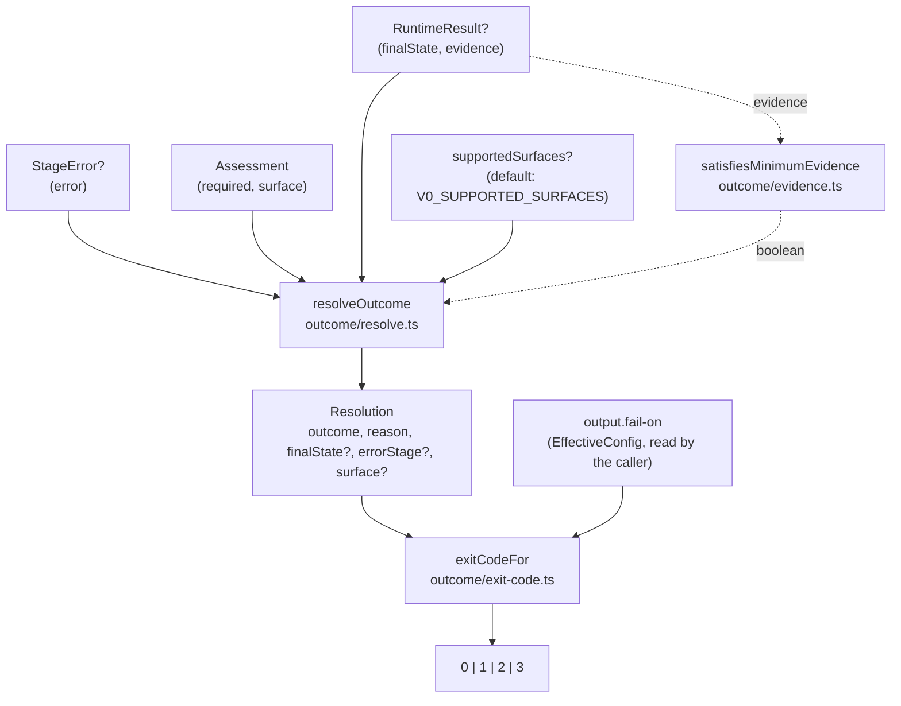
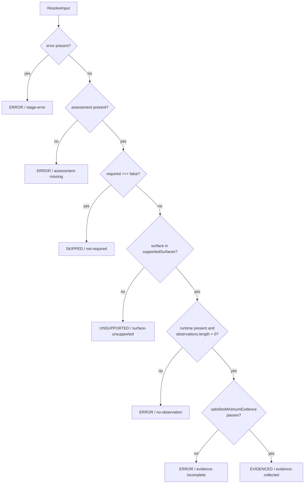

# Design Document

Implements [`requirements.md`](./requirements.md) of this spec (issue #8, "[M1] Outcome resolver + property tests"). Normative source: [`SPEC.md`](../../../SPEC.md); derived journal: [`docs/journal/v0.0/design.md`](../../../docs/journal/v0.0/design.md) section 6 ("Outcome resolution") and section 10 ("Error handling"). `SPEC.md` wins on any conflict.

## Overview

This feature adds the fourth pipeline responsibility named in the journal: the Outcome resolver. It is the only place where CE decides which of the four SPEC §7.1 outcomes (`SKIPPED`, `EVIDENCED`, `UNSUPPORTED`, `ERROR`) a run has reached, and a small, separate function that maps an Outcome to a process exit code using the configured `output.fail-on` list. Both functions are pure: no Jev call, no file, no clock, no environment variable, no browser.

Three new modules are added under `packages/ce/src/outcome/`, matching the planned layout of the journal (steering "structure", section 2) and the module list of requirements.md:

- `types.ts` — the `Outcome` union, `OUTCOMES`, `V0_SUPPORTED_SURFACES`, and the other plain data types of the Data Models section below.
- `resolve.ts` — `resolveOutcome`, the only function that decides an Outcome (Requirement 1).
- `evidence.ts` — `EvidenceSummary` and `satisfiesMinimumEvidence`, the SPEC §7.2 check (Requirement 7).
- `exit-code.ts` — `exitCodeFor`, the exit-code mapping of journal section 6 (Requirement 9).
- `index.ts` — the public surface of the stage (Requirement 11).

One existing file changes: `packages/ce/src/index.ts` re-exports `Outcome` (as `ExecutionOutcome`, unchanged name, and as `Outcome`), `resolveOutcome`, `exitCodeFor` and the `Resolution`/`ResolveInput` types (Decision D1, Requirement 11 criterion 2). The stub `run()` is not touched (Decision D9, Requirement 11 criterion 4).

No other existing file changes. `assessment/`, `errors.ts`, `config/schema.ts` and `config/defaults.ts` are read-only inputs to this design.

### Verified facts used by this design

Read directly from the current source before writing the interfaces below (restates `requirements.md` "Facts verified in the code" with the exact locations used by this design; that section is authoritative for wording):

- `packages/ce/src/index.ts` defines `export type ExecutionOutcome = 'SKIPPED' | 'EVIDENCED' | 'UNSUPPORTED' | 'ERROR'` and a stub `run()` that throws `'CE v0 implementation spike: not implemented yet'`. It already re-exports `StageError` from `./errors.js` and `AskOptions`/`JevGateway`/config/jev symbols; it does not yet import anything from an `outcome/` module.
- `packages/ce/src/errors.ts` defines `type Stage = 'context' | 'assessment' | 'runtime' | 'evidence'` and `class StageError extends Error` with `readonly stage: Stage`, `readonly cause: unknown` and an optional `readonly callError?: unknown`. The constructor message is `Stage "${stage}" failed: ${causeName(cause)}` and never includes the cause's own `message`.
- `packages/ce/src/assessment/types.ts` defines `Surface = 'browser_ui' | 'http_api' | 'cli' | 'backend_internal' | 'native_app' | 'non_runtime'` and `interface Assessment { claimStatus; subjects; perClaim: PerClaimAssessment[]; required: boolean; decidedBy: 'classifier' | 'policy'; surface: Surface; record: AssessmentRecord }`. `PerClaimAssessment` carries `runtimeObservable`, `checksAdequate`, `surfaceConfidence`, `needed`, `uncertain` per subject; none of these fields is read by this design (Decision D4).
- `packages/ce/src/assessment/index.ts` re-exports `Assessment`, `Surface` and the other Assessment-stage types; this is the import path `outcome/` uses with `import type` only (Requirement 11 criterion 3).
- `packages/ce/src/context/types.ts` defines `Provenance = { provider; ref?; location? }` and `ChangedFile`. The Evidence_Summary's `change` field (Requirement 7) is a narrowed, independent shape, not an import of `ChangeContext`, because `outcome/` must not depend on `context/` (no such dependency is named in the requirements, and the SPEC §7.2 check only needs the four identifying values listed in Requirement 7 criterion 3(a)).
- `packages/ce/src/config/schema.ts` defines `output: { dir?: string; 'fail-on'?: Array<'error' | 'unsupported' | 'evidenced-not-reached'> }`, all optional. `packages/ce/src/config/defaults.ts` (`ConfigDefaults.output`) supplies `{ dir: '.ce/runs', 'fail-on': ['error'] }`. `outcome/exit-code.ts` takes a `FailOnEntry[] | undefined` directly, so it does not import `EffectiveConfig`; the caller (a later issue) passes `loaded.config.output['fail-on']`.
- `packages/ce/src/assessment/architecture.test.ts` is the existing architecture-test pattern this design's `outcome/architecture.test.ts` follows: it walks `.ts` files under `src/`, strips comments, excludes `*.test.ts`, and regex-scans import specifiers and disallowed call/return patterns on the comment-stripped text.
- `packages/ce/src/assessment/combine.totality.property.test.ts` is the existing fast-check style this design's property tests follow: `fc.record` arbitraries built per field, a `describe` block titled with the feature and property number, a comment line `// Feature: <name>, Property N: <title>` and `**Validates: Requirements ...**`, `fc.assert(fc.property(...), { numRuns })`.

## Architecture



`resolveOutcome` and `exitCodeFor` are called by the pipeline (`run()` in `index.ts`), which is wired in a later issue (Decision D9). This design only produces the two pure functions and their inputs/outputs; it draws no box for `run()`, the runtime loop, or the evidence bundle writer, because none of them exists yet (F7 of requirements.md) and none is created here.

### Decision precedence inside `resolveOutcome`

The seven rules of Decision D3 of requirements.md are implemented as an ordered sequence of early returns, each producing one `Resolution` literal and nothing else assigning an `Outcome` value (Requirement 1 criterion 7):



This flowchart is the executable form of the table in journal design section 6 and of Decision D3; `resolveOutcome`'s body is a direct transcription of it (no loops, no recursion, no exception path other than a defensive `never`-typed fallthrough that TypeScript proves unreachable). Because every branch terminates in a `return`, the function is total by construction (Requirement 1 criterion 3, Decision D2).

### Module placement (steering compliance)

- `outcome/resolve.ts` is the only file that assigns, returns, or casts an `Outcome` literal value (steering "structure" placement rules; steering "tech" design rule). `outcome/types.ts` holds the four literals only inside the `OUTCOMES` declaration, which Requirement 1 criterion 7 explicitly allows.
- `outcome/` does not import `node:fs`, `node:child_process`, `node:http`, `node:https`, `playwright`, `@typesafe-ai/sdk`, anything from `jev/`, or anything from `runtime/` (none of the latter two exists yet, so this is a forward-looking constraint the architecture test enforces by pattern, not by missing-module error). It does not read `process.env`, `Date`, `Math.random` or `performance` (Requirement 1 criterion 5).
- `outcome/architecture.test.ts` is added, modelled on `assessment/architecture.test.ts`: it walks `outcome/` and the rest of `src/` (excluding `*.test.ts`), strips comments, and checks (a) the import/global restrictions above, scoped to `outcome/`; (b) that no file outside `outcome/resolve.ts` assigns, returns, or casts an `Outcome` literal, scoped to the whole `src/` tree; (c) that a synthetic source snippet comparing `resolution.outcome === 'EVIDENCED'` is not flagged, so a later consumer such as `evidence/summary.ts` (issue #11) is not blocked (Requirement 1 criterion 7, Requirement 10 criterion 4).

## Components and Interfaces

### `outcome/resolve.ts` — `resolveOutcome(input: ResolveInput): Resolution`

The single entry point. Implements the seven-rule precedence above. Reads `input.supportedSurfaces ?? V0_SUPPORTED_SURFACES` once at the top (Requirement 1 criterion 9). Never mutates `input` (it only reads fields); returns a freshly constructed `Resolution` object literal on every branch (Requirement 1 criterion 4, Requirement 6 property 2 below).

### `outcome/evidence.ts` — `satisfiesMinimumEvidence(summary: EvidenceSummary): boolean`

A pure predicate, the executable form of SPEC §7.2's five bullet points, narrowed to the six checkable conditions of Requirement 7 criterion 3:

```ts
export function satisfiesMinimumEvidence(summary: EvidenceSummary): boolean {
  const changeOk =
    nonEmpty(summary.change.title) ||
    nonEmpty(summary.change.description) ||
    nonEmpty(summary.change.base) ||
    nonEmpty(summary.change.head) ||
    summary.change.files.length > 0;

  const claimOk =
    summary.claim.status === 'not_identified'
      ? true // "no text" holds by construction: the not_identified variant carries no text field
      : nonEmpty(summary.claim.id) && nonEmpty(summary.claim.text);

  const subjectOk = nonEmpty(summary.subject.url);
  const actionsOk = Array.isArray(summary.actions);
  const observationsOk =
    summary.observations.length > 0 && summary.observations.every((o) => nonEmpty(o.screenshot));
  const artifactsOk = nonEmpty(summary.artifacts.runDir) && nonEmpty(summary.artifacts.reportPath);

  return changeOk && claimOk && subjectOk && actionsOk && observationsOk && artifactsOk;
}

function nonEmpty(value: string | undefined): boolean {
  return typeof value === 'string' && value.trim().length > 0;
}
```

Requirement 7 criterion 4 ("`not_identified` ⇒ predicate true only if the claim has no text") is satisfied by the `EvidenceSummary['claim']` discriminated union itself: the `not_identified` variant has no `text` field in its type, so a value that claims `status: 'not_identified'` and also carries fabricated claim text cannot be constructed through the type. The anti-fabrication property (Property 18 below) tests this at the value level, for a caller that builds the object without going through the type (for example from a parsed `run.json`), by checking a summary that is deliberately shaped as `{ status: 'not_identified', text: '...' }` through a type cast and asserting the predicate treats it as `not_identified` and ignores the extra field, which is the same as "fails only if some other required condition fails" — see Property 18.

### `outcome/exit-code.ts` — `exitCodeFor(resolution, failOn): 0 | 1 | 2 | 3`

```ts
export function exitCodeFor(
  resolution: Resolution,
  failOn: readonly FailOnEntry[] | undefined,
): 0 | 1 | 2 | 3 {
  const entries = new Set(failOn ?? ['error']);
  if (resolution.outcome === 'ERROR' && entries.has('error')) return 1;
  if (resolution.outcome === 'UNSUPPORTED' && entries.has('unsupported')) return 2;
  if (
    resolution.outcome === 'EVIDENCED' &&
    resolution.finalState === 'not_reached' &&
    entries.has('evidenced-not-reached')
  ) {
    return 3;
  }
  return 0;
}
```

Building a `Set` makes order and duplicates irrelevant by construction (Requirement 9 criterion 8, Property 21).

### `outcome/index.ts`

Re-exports exactly the names of Requirement 11 criterion 1: `resolveOutcome`, `OUTCOMES`, `V0_SUPPORTED_SURFACES`, `satisfiesMinimumEvidence`, `exitCodeFor`, and the types `Outcome`, `FinalState`, `ResolveInput`, `RuntimeResult`, `ResolveReason`, `Resolution`, `EvidenceSummary`, `FailOnEntry`.

### Change to `packages/ce/src/index.ts`

```ts
export { resolveOutcome, exitCodeFor, OUTCOMES } from './outcome/index.js';
export type { Resolution, ResolveInput, Outcome } from './outcome/index.js';
export type { Outcome as ExecutionOutcome } from './outcome/index.js';
```

The existing inline `export type ExecutionOutcome = 'SKIPPED' | ...` literal is deleted and replaced by this re-export (Decision D1); its value set is unchanged, so every existing caller of `ExecutionOutcome` keeps compiling. `run()` and `RunResult` are untouched (Decision D9, Requirement 11 criterion 4).

## Data Models

```ts
// outcome/types.ts
export const OUTCOMES = ['SKIPPED', 'EVIDENCED', 'UNSUPPORTED', 'ERROR'] as const;
export type Outcome = (typeof OUTCOMES)[number];
export type FinalState = 'reached' | 'not_reached';

/** The v0 Capability_Catalog (SPEC §5, journal §4): the only supported Surface. */
export const V0_SUPPORTED_SURFACES = ['browser_ui'] as const satisfies readonly Surface[];

export type ResolveReason =
  | 'stage-error'
  | 'assessment-missing'
  | 'not-required'
  | 'surface-unsupported'
  | 'evidence-collected'
  | 'no-observation'
  | 'evidence-incomplete';

export interface RuntimeResult {
  finalState: FinalState;
  evidence: EvidenceSummary;
}

export interface ResolveInput {
  error?: StageError;
  assessment?: Pick<Assessment, 'required' | 'surface'>;
  runtime?: RuntimeResult;
  supportedSurfaces?: readonly Surface[];
}

export interface Resolution {
  outcome: Outcome;
  reason: ResolveReason;
  finalState?: FinalState;   // present iff outcome === 'EVIDENCED'
  errorStage?: Stage;        // present iff reason === 'stage-error'
  surface?: Surface;         // the Dominant_Surface, when an assessment was present
}
```

```ts
// outcome/evidence.ts
export interface EvidenceSummary {
  change: {
    title?: string;
    description?: string;
    base?: string;
    head?: string;
    files: string[];
  };
  claim:
    | { status: 'identified'; id: string; text: string; provenance: Provenance }
    | { status: 'not_identified' };
  subject: { url: string };
  actions: { kind: string; description: string }[];
  observations: { step: number; screenshot: string }[];
  artifacts: { runDir: string; reportPath: string };
}

export function satisfiesMinimumEvidence(summary: EvidenceSummary): boolean;
```

```ts
// outcome/exit-code.ts
export type FailOnEntry = 'error' | 'unsupported' | 'evidenced-not-reached';
export function exitCodeFor(
  resolution: Resolution,
  failOn: readonly FailOnEntry[] | undefined,
): 0 | 1 | 2 | 3;
```

```ts
// outcome/resolve.ts
export function resolveOutcome(input: ResolveInput): Resolution;
```

`Provenance` is imported with `import type` from `../context/types.js` only for the shape of `claim.provenance`; no value, function or runtime dependency from `context/` is used (Requirement 11 criterion 3 extends the same type-only rule to any such import). `Stage`, `StageError` are imported with `import type` from `../errors.js`. `Surface`, `Assessment` are imported with `import type` from `../assessment/index.js`.

## Correctness Properties

*A property is a characteristic or behavior that should hold true across all valid executions of a system — essentially, a formal statement about what the system should do. Properties serve as the bridge between human-readable specifications and machine-verifiable correctness guarantees.*

`resolveOutcome`, `satisfiesMinimumEvidence` and `exitCodeFor` are pure functions over plain data with a large, structured input space (seven independent dimensions for `resolveOutcome` alone), which is exactly the shape property-based testing targets best: parsers of a decision table, not IO, not UI. The properties below were produced from the acceptance-criteria prework stored for this feature and then reduced by the property-reflection pass described there, from 40-plus individually testable criteria to 21 non-redundant properties.

### Property 1: Resolution is always exactly one Outcome

*For any* `ResolveInput` that satisfies the `ResolveInput` type, `resolveOutcome` SHALL return without throwing, and the returned `outcome` SHALL be a member of `OUTCOMES`, and exactly one of the four equality checks `outcome === 'SKIPPED' | 'EVIDENCED' | 'UNSUPPORTED' | 'ERROR'` SHALL be true.

**Validates: Requirements 1.2, 1.3, 6.2, 6.3**

### Property 2: Determinism and non-mutation

*For any* `ResolveInput`, calling `resolveOutcome` twice on the same input SHALL return deeply equal `Resolution` values, and the input object SHALL be deeply equal, after each call, to a deep copy of itself taken before the call.

**Validates: Requirements 1.4, 6.10**

### Property 3: A Stage_Error always wins (ERROR precedence)

*For any* `ResolveInput` that has an `error`, regardless of the values of `assessment`, `runtime` and `supportedSurfaces`, `resolveOutcome` SHALL return the Outcome `ERROR`, the Resolve_Reason `stage-error`, and `errorStage` equal to `error.stage`; and the returned `Resolution`, serialized to JSON, SHALL NOT contain the cause's own `message` text.

**Validates: Requirements 2.1, 2.3, 2.5**

### Property 4: Missing assessment resolves to ERROR

*For any* `ResolveInput` that has no `error` and no `assessment`, regardless of `runtime` and `supportedSurfaces`, `resolveOutcome` SHALL return the Outcome `ERROR` and the Resolve_Reason `assessment-missing`.

**Validates: Requirements 2.2**

### Property 5: SKIPPED when not required

*For any* `ResolveInput` with no `error` and an `assessment` whose `required` is `false`, regardless of the Dominant_Surface, `supportedSurfaces` and `runtime`, `resolveOutcome` SHALL return the Outcome `SKIPPED`, the Resolve_Reason `not-required`, `surface` equal to the Dominant_Surface, and `finalState` absent.

**Validates: Requirements 3.1, 3.2**

### Property 6: UNSUPPORTED iff required and the surface is outside the effective catalog

*For any* `ResolveInput` with no `error` and an `assessment` whose `required` is `true`, and *for any* `supportedSurfaces` list (including the default, the empty list, and the list of all six Surfaces), `resolveOutcome` SHALL return the Outcome `UNSUPPORTED` with the Resolve_Reason `surface-unsupported` if and only if the Dominant_Surface is not a member of the effective `supportedSurfaces` (`input.supportedSurfaces ?? V0_SUPPORTED_SURFACES`); and when it does, `surface` SHALL equal the Dominant_Surface and `finalState` SHALL be absent.

**Validates: Requirements 1.9, 4.1, 4.3, 4.5, 4.7**

### Property 7: Outcome ignores fields other than `error.stage`, `assessment.required` and `assessment.surface`

*For any* two `ResolveInput` values that have the same `error` presence and `error.stage` (or both absent), the same `assessment.required` and `assessment.surface` (or both absent `assessment`), and the same `runtime`, but differ in any other field reachable from `assessment` (for example `perClaim`, `decidedBy`, `record`, `claimStatus`, carried on the full `Assessment` object before it is narrowed to `Pick<Assessment, 'required' | 'surface'>`), `resolveOutcome` SHALL return deeply equal `Resolution` values for both.

**Validates: Requirements 4.3, 6.8**

### Property 8: `runtime` is irrelevant once the Outcome is SKIPPED or UNSUPPORTED

*For any* `ResolveInput` whose `Resolution` has the Outcome `SKIPPED` or `UNSUPPORTED`, replacing its `runtime` field with any other generated `RuntimeResult` value, or removing it entirely, SHALL yield a deeply equal `Resolution`.

**Validates: Requirements 4.4, 6.11**

### Property 9: EVIDENCED iff required, supported, and the evidence passes the check

*For any* `ResolveInput` with no `error`, an `assessment` whose `required` is `true` and whose Dominant_Surface is a member of the effective `supportedSurfaces`, and a `runtime` whose `evidence.observations` holds at least one entry, `resolveOutcome` SHALL return the Outcome `EVIDENCED` with the Resolve_Reason `evidence-collected` and `finalState` equal to `runtime.finalState`, if and only if `satisfiesMinimumEvidence(runtime.evidence)` is `true`.

**Validates: Requirements 5.1, 5.2, 8.1, 8.2**

### Property 10: Empty observations always give `no-observation`, even over an otherwise-incomplete summary

*For any* `ResolveInput` with no `error`, `required = true`, a supported Dominant_Surface, and either `runtime` absent or `runtime.evidence.observations` an empty list, `resolveOutcome` SHALL return the Outcome `ERROR` with the Resolve_Reason `no-observation`, regardless of whether the rest of `runtime.evidence` (when present) would otherwise pass or fail `satisfiesMinimumEvidence`.

**Validates: Requirements 5.4, 8.3**

### Property 11: A non-empty but incomplete Evidence_Summary gives `evidence-incomplete`

*For any* `ResolveInput` with no `error`, `required = true`, a supported Dominant_Surface, and a `runtime` whose `evidence.observations` holds at least one entry but whose `evidence` fails `satisfiesMinimumEvidence`, `resolveOutcome` SHALL return the Outcome `ERROR` with the Resolve_Reason `evidence-incomplete`.

**Validates: Requirements 5.5, 8.3**

### Property 12: `finalState` and `errorStage` presence are exact iff-conditions

*For any* `ResolveInput`, the returned `Resolution` SHALL carry `finalState` if and only if `outcome === 'EVIDENCED'`, and SHALL carry `errorStage` if and only if `reason === 'stage-error'`.

**Validates: Requirements 2.4, 3.2, 5.3, 6.9**

### Property 13: SKIPPED and UNSUPPORTED are exact converses and never overlap

*For any* `ResolveInput` with no `error`: the Outcome is `SKIPPED` if and only if `assessment.required === false`; the Outcome is `UNSUPPORTED` if and only if `assessment.required === true` and the Dominant_Surface is outside the effective `supportedSurfaces`; and no generated input SHALL produce a `Resolution` where both characterizations would apply (mutual exclusion follows from `required` being a single boolean).

**Validates: Requirements 6.4, 6.5, 6.6**

### Property 14: Adding or removing the Stage_Error is the only thing that toggles `stage-error`

*For any* `assessment` and `runtime` pair, calling `resolveOutcome` once with a generated `error` attached and once with that `error` removed (all other fields equal) SHALL give `ERROR`/`stage-error` for the first call, and SHALL NOT give the Resolve_Reason `stage-error` for the second call.

**Validates: Requirements 6.7**

### Property 15: `satisfiesMinimumEvidence` matches the six-condition specification exactly

*For any* `EvidenceSummary`, `satisfiesMinimumEvidence(summary)` SHALL equal the logical AND of the six conditions of Requirement 7 criterion 3 ((a) change identified, (b) claim shape valid for its status, (c) non-empty subject URL, (d) `actions` is an array, (e) at least one observation each with a non-empty screenshot path, (f) non-empty run directory and report path), computed independently by the test from the same generated summary.

**Validates: Requirements 7.3, 7.4, 7.5**

### Property 16: `satisfiesMinimumEvidence` is total

*For any* value that satisfies the `EvidenceSummary` type, including empty strings and empty lists in every optional or list-typed position, `satisfiesMinimumEvidence` SHALL return a boolean and SHALL NOT throw.

**Validates: Requirements 7.6**

### Property 17: Every one of the five Evidence_Summary items is necessary

*For any* `EvidenceSummary` that passes `satisfiesMinimumEvidence`, independently removing (emptying) any one of the five items — `change`, `claim`, `subject`, `observations`, `artifacts` — SHALL produce a summary that fails `satisfiesMinimumEvidence`; and replacing a passing summary's `claim` with `{ status: 'not_identified' }` SHALL still pass.

**Validates: Requirements 8.4**

### Property 18: No fabricated claim

*For any* `EvidenceSummary` whose `claim` states `status: 'not_identified'` while a non-empty `text` value is attached to it (constructed by widening the type at the test boundary, simulating data that did not originate from the typed constructor), `satisfiesMinimumEvidence` SHALL return `true` only because the `not_identified` branch requires no text and ignores the extra value; it SHALL NOT be possible for a passing `identified` summary to carry empty or whitespace-only claim text.

**Validates: Requirements 7.4, 7.5, 8.5**

### Property 19: Exit code with no `failOn` equals exit code with the default list

*For any* `Resolution`, `exitCodeFor(resolution, undefined)` SHALL equal `exitCodeFor(resolution, ['error'])`.

**Validates: Requirements 9.2**

### Property 20: Exit code matches the outcome/fail-on table exactly

*For any* `Resolution` and *for any* subset of `['error', 'unsupported', 'evidenced-not-reached']` given as `failOn`, `exitCodeFor` SHALL return `1` iff `outcome === 'ERROR'` and `'error'` is in the subset; `2` iff `outcome === 'UNSUPPORTED'` and `'unsupported'` is in the subset; `3` iff `outcome === 'EVIDENCED'` and `finalState === 'not_reached'` and `'evidenced-not-reached'` is in the subset; and `0` in every other case, including `SKIPPED` for every subset and `EVIDENCED` with `finalState: 'reached'` for every subset.

**Validates: Requirements 9.3, 9.4, 9.5, 9.6**

### Property 21: Exit code ignores order and duplicates

*For any* `Resolution` and *for any* `failOn` array, shuffling the array's entries or duplicating any of its entries SHALL NOT change the result of `exitCodeFor`.

**Validates: Requirements 9.7**

## Error Handling

`resolveOutcome` and `exitCodeFor` do not themselves raise; "error handling" in this feature means handling the *representation* of an upstream failure, not catching one.

- An upstream `StageError`, however it was produced (context, assessment, runtime or evidence stage, per `errors.ts`'s `Stage` union), arrives in `ResolveInput.error` already constructed. `resolveOutcome` reads only `error.stage`; it never reads `error.message`, `error.cause`, `error.callError` or the error's stack, so no secret or state text that `StageError`'s own constructor already excluded (per `errors.ts`'s doc comment) can leak a second time through a `Resolution` (Requirement 2 criterion 3, Property 3).
- A `JevImageError` (the recoverable failure named in journal section 10 and the steering decision `jev-gateway-decision`) is not a `StageError` and is never placed in `ResolveInput.error` by its own design; it is out of scope for this feature's code (Requirement 2 criterion 7) and is exercised only through the ordinary "no `error` present" branches of the properties above.
- `ResolveInput` values that do not correspond to any real pipeline run — for example `required: true` with no `assessment.surface` at all is impossible by the `Pick<Assessment, 'required' | 'surface'>` type, but `runtime` present while `required` is `false` is possible and is exactly what Property 8 covers — are handled by Decision D2 (total function): every input maps to a `Resolution`, never to a thrown exception. There is no separate "invalid input" error path; an input shape the earlier stages should not produce still resolves deterministically (most such shapes resolve to `ERROR` per the precedence rules, for example the "no assessment" case of Property 4).
- The caller (the future `run()`) is responsible for turning any thrown value that is not already a `StageError` into one, naming the stage in progress, before calling `resolveOutcome` (Decision D10, Requirement 2 criterion 6). That wrapping is out of scope here; this design's only obligation toward it is that `ResolveInput.error` is typed `StageError`, not `unknown`, so `outcome/` never has to guess a stage.

## Testing Strategy

**Dual testing approach.** Property tests (fast-check) verify the 21 universal properties above across the full `ResolveInput` / `EvidenceSummary` / `(Resolution, failOn)` input spaces. Unit tests verify the small number of named, concrete scenarios that the requirements call out explicitly and that a property's generator would otherwise have to special-case: the issue #31 `backend_internal` example (Requirement 4 criterion 6), and the three-non-zero-codes-are-distinct check (Requirement 9 criterion 11). This mirrors the pattern already used in `assessment/`: `combine.test.ts` for examples, `combine.*.property.test.ts` for properties.

**Library.** `fast-check`, the dependency already used by `assessment/*.property.test.ts`, run under `vitest`. No new testing library is introduced.

**Files.**

- `outcome/resolve.ts` — implementation.
- `outcome/evidence.ts` — implementation.
- `outcome/exit-code.ts` — implementation.
- `outcome/resolve.test.ts` — unit tests: the issue #31 example (Requirement 4.6), one example per `ResolveReason`, the `Resolution` shape for each Outcome.
- `outcome/resolve.outcome-membership.property.test.ts` — Property 1, Property 2.
- `outcome/resolve.error-precedence.property.test.ts` — Property 3, Property 4, Property 14.
- `outcome/resolve.skipped.property.test.ts` — Property 5.
- `outcome/resolve.unsupported.property.test.ts` — Property 6.
- `outcome/resolve.field-independence.property.test.ts` — Property 7, Property 8.
- `outcome/resolve.evidenced.property.test.ts` — Property 9, Property 10, Property 11.
- `outcome/resolve.presence-iff.property.test.ts` — Property 12, Property 13.
- `outcome/evidence.test.ts` — unit tests for `satisfiesMinimumEvidence` on a few hand-built summaries (a minimal passing summary, a `not_identified` summary, an empty summary).
- `outcome/evidence.property.test.ts` — Property 15, Property 16, Property 17, Property 18.
- `outcome/exit-code.test.ts` — unit tests: the three non-zero codes are distinct from each other and from `0` (Requirement 9.11).
- `outcome/exit-code.property.test.ts` — Property 19, Property 20, Property 21.
- `outcome/architecture.test.ts` — the import/global/Outcome-assignment scan described under Module placement (Requirement 1.5, 1.7, 10.4, 11.3).

**Arbitraries.** One shared module, `outcome/arbitraries.ts` (test-only, excluded from the architecture scan the way `assessment/`'s `properties/` directories are, or simply named `*.arb.ts` and covered by the `*.test.ts` exclusion since it is imported only from test files), exports:

- `arbStageError: fc.Arbitrary<StageError>` — built from `fc.constantFrom(...STAGES)` and a plain `Error` cause, via `new StageError(stage, new Error('synthetic'))`.
- `arbSurface: fc.Arbitrary<Surface>` — `fc.constantFrom('browser_ui', 'http_api', 'cli', 'backend_internal', 'native_app', 'non_runtime')`.
- `arbAssessment: fc.Arbitrary<Pick<Assessment, 'required' | 'surface'>>` — `fc.record({ required: fc.boolean(), surface: arbSurface })`.
- `arbEvidenceSummary: fc.Arbitrary<EvidenceSummary>`, built as `fc.oneof({ weight }, arbPassingSummary, arbFailingSummary)` so that both passing and failing summaries occur (the test-infrastructure requirement 8.6 noted in the prework, satisfied here as a generator obligation rather than a standalone property).
- `arbRuntimeResult: fc.Arbitrary<RuntimeResult>` — `fc.record({ finalState: fc.constantFrom('reached', 'not_reached'), evidence: arbEvidenceSummary })`.
- `arbSupportedSurfaces: fc.Arbitrary<readonly Surface[] | undefined>` — `fc.option(fc.subarray(ALL_SURFACES), { nil: undefined })`, including the explicit empty array and the full six-element array as named corpus entries (`fc.constantFrom` mixed in) so that boundary values are not left purely to chance.
- `arbResolveInput: fc.Arbitrary<ResolveInput>` — a weighted `fc.oneof` over the seven branches of the precedence flowchart, each branch built from `arbStageError`, `arbAssessment`, `arbRuntimeResult` and `arbSupportedSurfaces` so that the `EVIDENCED` branch (the one requiring six simultaneous conditions) is weighted to appear in at least 15% of samples and the other three Outcomes each appear in at least 10% (Requirement 6 criterion 1). Property 1's test additionally asserts, after `fc.assert` returns, that a counter filled during the property has observed all four Outcomes at least once, over `numRuns ≥ 1000`.

**Iteration counts (Requirement 10).** Property 1, Property 6, Property 9 combined with Property 10 and Property 11 (the three properties the issue's "Done when" line names — exactly one Outcome, `SKIPPED ⇒ ¬required`, `UNSUPPORTED ⇒ required ∧ ¬supported`, `EVIDENCED ⇒ §7.2 check` — map to Property 1, Property 13, Property 6, and Property 9/15 respectively) run with `numRuns: 1000` or more, set explicitly in each test. Every other property test runs with `numRuns: 200` or more. No test uses a fixed seed except when a specific prior failure is being reproduced locally (never committed as the default).

**No API key, no network, no browser (steering "Test policy").** None of the three modules under test, nor their arbitraries, imports `jev/`, `playwright`, `@typesafe-ai/sdk`, or reads `process.env`; the architecture test enforces this for the non-test source files, and the property/unit test files themselves need no fixture gateway (`jev/fake.ts`) because they never call Jev.

**`npm run typecheck` and `npm test`.** Both commands, run from the repository root per steering "tech" Commands, must pass with the new module added (Requirement 10.6). The `strict()` zod style is not used here, since `outcome/` holds plain TypeScript interfaces, not a config schema; `tsc --noEmit` (or the workspace's existing typecheck script) is the check this design relies on for the type-level guarantees called out in the Data model (e.g., `finalState` only existing on `RuntimeResult`, `claim`'s discriminated union).
