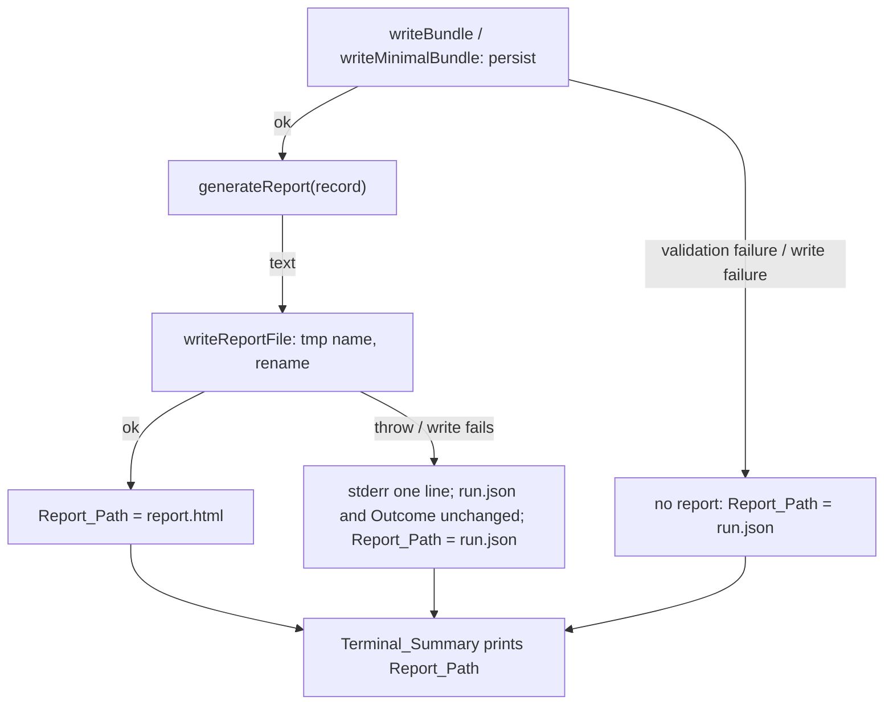
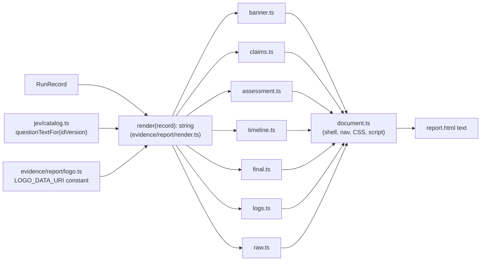

# Design Document

## Overview

This design implements GitHub issue #14, "[M4] report.html — the evidence page", following `requirements.md` in this directory. It follows the workspace `structure` and `tech` steering and `SPEC.md`; `SPEC.md` wins on any conflict. The facts (F1 to F14), decisions (D1 to D9) and implications (I1 to I4) cited below are defined in `requirements.md`.

The feature adds one thing: the **Report_Generator**, a pure module under `packages/ce/src/evidence/report/` that turns one validated, redacted `RunRecord` (`evidence/schema.ts`) into the text of one self-contained `report.html`. A second, small change threads three new facts — `alternatives`, `finalImage.box` and `finalImage.signals` — from the runtime loop through to the `RunRecord`, because today's schema cannot describe what the mockup's Timeline and Final sections show (F4, F5). Everything else the Report_Generator needs already exists on the Run_Record.

The approved visual reference is `.kiro/specs/report-html-evidence-page/mockup/report.sample.html`. It is a reference for layout and look, not a byte-for-byte template: its dark palette, Banner shape, chip/bar/timeline components and logo placement carry over; its data (titles, URLs, probabilities, the embedded logo bytes) is fictional and is replaced by values read from the `RunRecord`.

### Research summary

- Reading `evidence/bundle.ts` confirms F1 to F3: `persist()` already computes `reportPath` by checking whether the Run_Dir listing (taken *before* the `run.json` write) contains `report.html`. Nothing currently creates that file, so today `reportPath` always falls back to `run.json`. This design makes that existing check start returning `true` once the Report_Generator runs after `writeBundle`/`writeMinimalBundle` succeed — no change to `bundle.ts` is needed for the detection logic itself.
- Reading `run/pipeline.ts` confirms where the one call site belongs: `finishRunWithBundle` (and `configFailureWithBundle`, and `recover`) each call `writeBundle` or `writeMinimalBundle` and then `withBundle`. The natural hook is a thin wrapper that, after a successful `persist()`, reads the just-written `run.json` back... but rather than re-reading the file, the design passes the already-built, already-validated `RunRecord` directly from `writeBundle`'s return value through a new optional step, avoiding a redundant read (see "Generation wiring" below).
- Reading `evidence/build.ts`, `evidence/trace.ts` and `runtime/loop.ts` confirms F4 and F5 exactly: `StepLogEntry.probabilities` exists in the loop but is keyed by Option index / `done` / `give_up` with no description, and the loop already computes `LoopResult.subjectBox` and `LoopResult.finalSignals` but `RuntimeTrace` and `FinalImage` carry neither forward. `runtime/decide.ts`'s `Option.description` is exactly the text the Alternative needs; `buildOptions` already builds it with the fixture key only (no fixture value), so redaction is unaffected (Requirement 12 criterion 6).
- Reading `evidence/schema.ts`, `evidence/arbitraries.ts`, `schema.roundtrip.property.test.ts` and `schema.ajv-agreement.property.test.ts` confirms the extension pattern: one `z.discriminatedUnion('outcome', ...)` of four `strictObject` variants, generated to `schemas/run.schema.json` with `z.toJSONSchema(..., { target: 'draft-7', io: 'input', unrepresentable: 'any' })`, with existing property tests that must keep passing once the arbitraries grow the new fields.
- Reading `outcome/architecture.test.ts` confirms the two guard rails the Report_Generator must respect: rule (d) — only `outcome/resolve.ts` may assign, return or cast an Outcome literal, enforced over every non-test file in `src/` — and the existing `evidence/` scope (`evidenceScoped` in that file) that forbids `@typesafe-ai/sdk` imports and `fetch` calls. `evidence/report/` falls under both.
- Reading `jev/catalog.ts` confirms the only legal way to get question text: `CATALOG.<entry>.idVersion` is a stable string (`id@version`), and nothing besides `jev/catalog.ts` may define question text (steering `structure`, and the architecture test's "declare no Jev question text" checks for `jev/` and `runtime/`). The Report_Generator needs read-only access to a `idVersion -> question text` map; `jev/catalog.ts` is extended with one small lookup export rather than duplicating text.
- A small spike with Playwright (same Chromium already used by the test suite) confirmed that `<meta http-equiv="Content-Security-Policy" content="default-src 'none'; style-src 'unsafe-inline'; script-src 'unsafe-inline'; img-src 'self' data:">` lets a `file://`-opened page load a same-directory image, run its one inline `<script>`, and apply its one inline `<style>`, with zero console errors — confirming the mockup's CSP line is sufficient for Requirement 1 criterion 4 and the "one offline file" requirement.
- `sips` (already on the development machine, macOS) and `cwebp` can produce a cropped, downscaled WebP of the existing `docs/img/logo-transparent.png`; the committed `Logo_Asset` is produced once, by hand, as a build-time constant (D7), not regenerated by a script at build or test time — there is no runtime dependency on an image-processing library, keeping `packages/ce`'s dependency list unchanged (`tech` steering: no new stack component without a steering update).
- Reading `scripts/build-action.mjs` confirms how `evidence/report/` reaches `action/dist/`: the Action is built with `esbuild`, bundling from `packages/ce/src/index.ts` (aliased as `continuous-evidence`) into one ESM file. A `data:`-URI string constant inside `evidence/report/logo.ts` is plain source text to esbuild — it needs no asset-copy step, unlike a file read at run time (F14). The npm `build` (`tsc -p tsconfig.build.json`) likewise compiles `evidence/report/*.ts` into `packages/ce/dist/` like any other module; neither build needs a new asset-copy rule.

## Architecture





The Report_Generator sits beside `evidence/bundle.ts` as a sibling stage, not inside it: `bundle.ts` still "writes no `report.html`" as a statement about what the Bundle_Writer itself does (F1, updated per Requirement 14 criterion 8 to describe the Report_Generator as the module that writes it next). `run/pipeline.ts` calls both in sequence.

## Components and Interfaces

### Module layout

Per the `structure` steering target layout, every new file lives under `packages/ce/src/evidence/report/`, replacing the current `.gitkeep`:

```
packages/ce/src/evidence/report/
  render.ts        render(record: RunRecord, deps: RenderDeps): string   — the one public pure function
  document.ts       the page shell: <html>, <head> (CSS, CSP, title), skip link, header, nav, footer <script>
  palette.ts        PALETTE: the CSS custom-property token map (also read by report.palette.test.ts)
  sections/
    banner.ts        renderBanner(record, tones) -> string
    claims.ts         renderClaims(record) -> string
    assessment.ts     renderAssessment(record, questionText) -> string
    timeline.ts        renderTimeline(record) -> string
    final.ts           renderFinal(record, questionText) -> string
    logs.ts            renderLogs(record) -> string
    raw.ts             renderRaw(record) -> string
  escape.ts          escapeHtml, escapeAttr, hrefFor (percent-encoding), rawJsonScriptSafe
  signal.ts           signalBar(...), signalLabel(...) — the shared Probability_Bar + "signal" wording helper
  logo.ts             LOGO_DATA_URI, LOGO_WIDTH, LOGO_HEIGHT (generated once from the Logo_Asset, committed as source)
  logo.webp           the committed, pre-sized Logo_Asset (binary, Requirement 17)
  write.ts            writeReportFile(runDir, text, fs) -> Promise<void> — the only file I/O in this module
  index.ts            re-exports render, writeReportFile and the few types the pipeline needs
```

`jev/catalog.ts` gains one export used only by `sections/assessment.ts` and `sections/final.ts`:

```ts
// jev/catalog.ts, appended
/** idVersion -> question text, for read-only display. The Report_Generator's only lookup into jev/. */
export function questionTextFor(idVersion: string): string | undefined { ... }
```

This keeps "all Jev question text lives in `jev/catalog.ts`" true: the Report_Generator never defines question text, it only asks the catalog for text keyed by `idVersion` (Requirement 5 criterion 4, Requirement 9.9 of this document mirrors the steering `structure` placement rule).

### `render`: the pure function and its inputs

```ts
// evidence/report/render.ts
export interface RenderDeps {
  /** jev/catalog.ts's questionTextFor, injected so this module makes no value import from jev/. */
  questionText: (idVersion: string) => string | undefined;
}

export function render(record: RunRecord, deps: RenderDeps = { questionText: questionTextFor }): string
```

`render` is a total, synchronous, pure function: `string -> string` over the serializable `RunRecord` shape, plus the one injected text lookup and the one committed `Logo_Asset` constant (D1). It:

- reads no environment variable, no clock (`Date`), no `Math.random()`, and calls no I/O — it returns the full document text as a `string`;
- never imports `@typesafe-ai/sdk`, performs no `fetch`, and makes no value import from `runtime/` (satisfying the same `evidence/` architecture-test scope that already covers `evidence/bundle.ts`, `evidence/build.ts`, etc., Requirement 14 criterion 9);
- decides no Outcome: every section reads `record.outcome`, `record.outcomeReason`, `record.finalState` and `record.error` as already-decided data and never assigns, returns, or casts to an Outcome literal — this is enforced by extending `outcome/architecture.test.ts` rule (d)'s scan to include `evidence/report/` (it already scans every non-test file in `src/`, so no change to the test is needed — only to the new files' content).

Injecting `questionText` as a parameter (default-bound to the real catalog lookup) keeps `render` free of a module-level import cycle risk and makes the "catalog entry missing" branch (Requirement 5 criterion 4) trivial to drive from a unit test with a stub lookup.

### Generation wiring: `write.ts` and the pipeline call site

```ts
// evidence/report/write.ts
export interface ReportFs {
  writeFile(file: string, data: string, encoding: 'utf8'): Promise<void>;
  rename(from: string, to: string): Promise<void>;
  rm(file: string, options: { force: true }): Promise<void>;
}

/** Writes report.html.tmp then renames it. Never called when `record` is unvalidated. Throws on failure; the caller decides what that means. */
export async function writeReportFile(runDir: string, text: string, fs: ReportFs): Promise<void>
```

`write.ts` reuses the same tmp-name-then-rename pattern `bundle.ts` already uses for `run.json.tmp` (Requirement 14 criterion 2), so a reader never observes a partial `report.html`. `ReportFs` is a subset of the existing `BundleFs` shape in `evidence/bundle.ts`, so `run/pipeline.ts` can pass its one injected `fs` (`BundleFs` already satisfies `ReportFs` structurally) without adding a second file-system seam.

`bundle.ts`'s `persist()` already returns `reportPath` computed from a Run_Dir listing taken *before* the `run.json` write (`names.includes(REPORT_HTML_FILE)`). This design keeps that function's contract unchanged and instead has the caller — `run/pipeline.ts` — perform one extra step between a successful `persist()` and the final `withBundle(...)` call:

```ts
// run/pipeline.ts, inside finishRunWithBundle / configFailureWithBundle / recover,
// immediately after `written.ok` is true and before `withBundle` is called:
if (written.ok) {
  try {
    const text = render(parsedRecordOf(written) /* the already-validated RunRecord */);
    await writeReportFile(runDir, text, o.fs);
    written.reportPath = path.join(runDir, REPORT_HTML_FILE); // supersedes the run.json fallback
  } catch (cause) {
    try { o.stderr.write(`report.html was not written (${causeNameOf(cause) ?? 'unknown'}).\n`); } catch { /* stderr must never throw */ }
    // written.reportPath stays whatever persist() already computed: run.json (I3, D5).
  }
  return withBundle(o, st, res, runDir, written);
}
```

`writeBundle`/`writeMinimalBundle` are extended to also return the validated `RunRecord` they just persisted (`WriteBundleResult`'s `ok: true` branch gains a `record: RunRecord` field) so the pipeline never re-reads or re-parses `run.json` from disk — the exact bytes that were validated and written are the exact bytes rendered (Requirement 16 criterion 1's "no hidden source of change" extends naturally: the same in-memory object is used for both writes). This is the only change to `bundle.ts`'s public shape; `persist()`'s own logic, including the existing-file detection for the very first bundle write of a run, is untouched.

Three invariants the wiring must hold (Requirement 14):

1. **Order.** The Report_Generator never runs before `run.json` exists on disk (criterion 1): the call site is strictly after `written.ok` is `true`.
2. **Non-fatal failure (criterion 4, D5).** A throw from `render` or from `writeReportFile` is caught at the call site shown above, writes one stderr line naming only the constructor of the cause (never a message, matching the existing `describeFailure`/`causeNameOf` convention in `pipeline.ts`), and does **not** call `resolveOutcome` again, does **not** touch the already-written `run.json`, and leaves `reportPath` as the `run.json` path that `persist()` already supplied. The `Outcome` and exit code of the run are therefore identical whether or not the report step runs.
3. **No bundle, no report (criterion 6).** When `written.ok` is `false` (a Validation_Failure or a write failure for `run.json` itself), the report step is skipped entirely — there is nothing to render from, and `withBundle`'s existing "bundle not written" branch already handles the summary and stderr line.

`evidence/bundle.ts`'s header comment and the `run-vertical-slice` requirement 11 criterion 4 statement (F1) are both updated in the implementation to say the Report_Generator writes `report.html` immediately after the Bundle_Writer, inside `run/pipeline.ts` (criterion 8).

`writeReportFile` writes only inside `runDir` (criterion 7): it is a plain `path.join(runDir, ...)` call with a fixed file name, never a path derived from record content.

### Run_Record schema extension

Three additions, one `schemaVersion` bump, all driven by data the runtime loop already computes but currently drops (F4, F5):

```ts
// evidence/schema.ts
export const SCHEMA_VERSION = '2' as const; // was '1'

export const StepRecord = z.strictObject({
  step: z.number().int().nonnegative(),
  url: z.string(),
  title: z.string(),
  action: z.strictObject({ kind: z.string(), description: z.string() }),
  executed: z.boolean(),
  screenshot: BundleRelativePath,
  probabilities: z.record(z.string(), z.number()),
  alternatives: z.array(                      // NEW
    z.strictObject({
      key: z.string(),                        // Option index as a string, 'done' or 'give_up'
      description: z.string(),
      probability: z.number().min(0).max(1),
    }),
  ),
});

const FractionBox = z.strictObject({           // NEW, reused by FinalImage.box
  x: z.number().min(0).max(1),
  y: z.number().min(0).max(1),
  width: z.number().min(0).max(1),
  height: z.number().min(0).max(1),
});

export const FinalImage = z.strictObject({
  model: z.string().nullable(),
  error: z.string().nullable(),
  screenshot: BundleRelativePath.nullable(),
  box: FractionBox.nullable(),                 // NEW
  signals: z.strictObject({                     // NEW
    stateReachedDom: z.number().min(0).max(1).nullable(),
    stateReached: z.number().min(0).max(1).nullable(),
  }),
});
```

`evidence/trace.ts`'s `RuntimeTraceStep` gains `alternatives: { key: string; description: string; probability: number }[]`, and `RuntimeTrace` gains `finalBox?: { x; y; width; height }` and `finalSignals?: { stateReachedDom?: number; stateReached?: number }` (mirroring the existing optional-field style of that interface). `runtime/capability.ts`'s `mapLoopResultToRuntimeResult` is the one place that already walks `LoopResult.steps` and already has `LoopResult.subjectBox` and `LoopResult.finalSignals` in scope (F5 names this exact gap); it is extended to carry those three values across into `RuntimeTrace`, and `evidence/build.ts`'s `fromTrace` is extended to copy `alternatives`, `box` and `signals` onto the `RunRecord` the same way it already copies every other `StepRecord`/`FinalImage` field.

For a step with no Alternatives (restored from an `EvidenceSummary` or a partial trace, Requirement 12 criterion 2), `fromEvidenceSummary` and `fromPartial` in `evidence/build.ts` set `alternatives: []`, matching how those two builders already default every other new-ish array field. `FinalImage.signals` is always present as an object (never `null` itself) with `stateReachedDom`/`stateReached` individually nullable, so `fromTrace` always has a value to write and no new null-handling branch is needed at the top level.

The `Alternative.description` is the same `Option.description` string `runtime/decide.ts`'s `buildOptions` already produces and that `runtime.next_action`'s request already sends to Jev — it already excludes fixture *values* (only the fixture *key* appears, Requirement 12 criterion 6) and already passes through the same redactor (`createRedactor`) as every other step field, so no new redaction path is introduced.

**Migration / compatibility note.** `schemaVersion` is a `z.literal`, discriminated per variant exactly like the Outcome discriminator — there is no cross-version union and no runtime migration path by design (this mirrors how `evidence-bundle`'s design treated the version as a single current literal, not a compatibility matrix). A `run.json` written by the previous schema version (`"1"`) is not accepted by the bumped `RunRecordSchema`, and nothing in CE reads an old `run.json` back except `action/src/run-dir.ts`'s `RunRecordSchema.safeParse(json)`, which already treats a non-matching record as "no record" (`undefined`) rather than throwing — so an old artifact simply stops being recognized as a parseable Run_Record by the Action's own summary step, with no crash. `schemas/run.schema.json` is regenerated with the existing `npm run generate:run-schema` script (no script change needed, since `generateRunJsonSchema` already derives everything from `RunRecordSchema`); `evidence/json-schema.staleness.test.ts` enforces that the commit includes the regenerated file. `evidence/arbitraries.ts`'s `stepRecordArb`-equivalent and `finalImageArb`-equivalent generators gain the three new fields so `schema.roundtrip.property.test.ts` and `schema.ajv-agreement.property.test.ts` keep exercising the full shape (I1).

### Question-text lookup

```ts
// jev/catalog.ts, appended near CATALOG
const BY_ID_VERSION: ReadonlyMap<string, string> = new Map(
  Object.values(CATALOG).map((entry) => [entry.idVersion, questionTextOf(entry)]),
);

/** Read-only text for one catalog entry, keyed by `idVersion`. undefined when no entry matches
 *  (an unknown or retired version) — callers show a fallback, they never throw (Requirement 5.4). */
export function questionTextFor(idVersion: string): string | undefined {
  return BY_ID_VERSION.get(idVersion);
}
```

`questionTextOf` extracts the `instructions` string from each entry's built `Question` (every `NoulQuestion`, `ChoiceQuestion` and `BoxQuestion` the SDK builds carries an `instructions: string` field, confirmed by inspecting the SDK's `noul`/`choice`/`box` helpers directly). `runtime.next_action`'s entry is special-cased: its `build` takes an `options` argument, but its *instructions* text ("Which action moves the page toward the state described in `claim`?") is fixed and known without any options, so `questionTextOf` calls `build([])` for that one entry only, the same pattern `outcome/architecture.test.ts` already uses (`CATALOG.runtimeNextAction.build([])`) to collect question text for its own scan.

`sections/assessment.ts` and `sections/final.ts` call `deps.questionText(entry.idVersion)` for every `assessment.questions[]` entry and for the two fixed Final_Section signals (`runtime.state_reached@1`, `runtime.state_reached_dom@1`); on `undefined` they render the `idVersion` plus the literal fallback text "question text unavailable for this version" and continue (Requirement 5 criterion 4) — `render` never throws on an unrecognized `idVersion`.

### Escaping and CSP strategy

`escape.ts` is the one place that turns Run_Record strings into safe HTML:

```ts
export function escapeHtml(text: string): string;      // & < > " ' -> entities, for element text and attribute values
export function escapeAttr(text: string): string;       // escapeHtml plus quote-safety for use inside "..."
export function hrefFor(relativePath: string): string;  // BundleRelativePath -> percent-encoded relative URL, segment by segment
export function rawJsonScriptSafe(json: string): string; // see below
```

Every section module runs every `RunRecord` string value through `escapeHtml`/`escapeAttr` before it reaches the template — there is exactly one escaping function per context (text vs. attribute), used uniformly, so no section hand-rolls its own replace. `hrefFor` builds every screenshot and artifact link from `Artifact.path` / `StepRecord.screenshot` (already a `BundleRelativePath`-shaped string — `/`-separated, no leading `/`, no `..` segment, by the existing `BundleRelativePath` zod regex) by percent-encoding each `/`-separated segment independently, and refuses (returns a safe placeholder, never throws) a `javascript:`-looking input, even though `BundleRelativePath`'s regex already excludes a leading `/` and `..` — the design treats that schema guarantee as defense-in-depth, not as the only guard, since `render` must stay total over any value a future schema version might pass through.

**CSP.** The document shell (`document.ts`) emits exactly the mockup's policy:

```html
<meta http-equiv="Content-Security-Policy" content="default-src 'none'; style-src 'unsafe-inline'; script-src 'unsafe-inline'; img-src 'self' data:">
```

`default-src 'none'` blocks every network-origin fetch by default; `img-src 'self' data:` is the only relaxation, and it permits exactly two things: a `file://`-relative screenshot (`'self'`) and the one inline logo (`data:`) — never a third-party origin, since no `https:`/`http:` source is listed anywhere in the directive (Requirement 1 criterion 4). The Playwright spike (see Research summary) confirmed this exact policy string is sufficient for a `file://`-opened report to load a same-directory image and run its one inline script with zero console errors.

**The `</script>`-safe raw JSON.** `sections/raw.ts` builds the Raw_Section's `<pre>` block from `JSON.stringify(record, null, 2)` — the same serialization `bundle.ts` already uses for `run.json` (Requirement 9 criterion 1) — and passes it through `rawJsonScriptSafe` before interpolating it into the `<pre id="rawjson">...</pre>` element (not a `<script>` tag: the raw JSON is plain, escaped element text, read by the "Copy JSON" button via `textContent`, exactly like the mockup). `rawJsonScriptSafe` first HTML-escapes the text with `escapeHtml` (so `<`, `>`, `&` become entities, which already neutralizes `</script>`, `<!--` and `-->` as HTML-parser-significant sequences), then additionally escapes the three-character sequence `</` to `<\/` as a second, defense-in-depth layer specifically because `document.ts`'s own inline `<script>` block (the one and only script the Report_Generator writes) sits in the same document and must never be terminated early if a future change ever interpolated unescaped text into a `<script>` body — the `<pre>` placement makes that scenario unreachable today, but the helper is written to be safe under either placement so the "round trip + escaping" property test (Requirement 9 criterion 3, Requirement 16 criterion 3) can assert both guarantees from one function. `decodeEscapedRawSection` (test-only, in `raw.ts`'s companion test file) reverses exactly this transform to recover the original JSON text for the round-trip assertion.

### Logo asset pipeline

1. **Source of truth.** `docs/img/logo-transparent.png` (2000×2000 RGBA PNG, ~590 KB, F13) stays untouched and is never read by the Report_Generator or committed into `evidence/report/` (D7). A developer produces the committed `Logo_Asset` once, out of band, with ordinary image tools already on the machine (`sips` to crop to the opaque content box and resample, `cwebp` to re-encode as WebP) — no new npm dependency, no script added to `package.json`'s `scripts`, because this is a one-time asset preparation step, not a build step that must reproduce on every `npm run build` (unlike `generate:run-schema`, which must re-run whenever the schema changes).
2. **Committed asset.** `packages/ce/src/evidence/report/logo.webp`: cropped to the logo's non-transparent content box, downscaled to a width of at most 400 CSS pixels (so the `width`/`height` attributes of the `` can equal its real pixel dimensions, Requirement 17 criterion 4), WebP format with an alpha channel kept, encoded size at most 40960 bytes (Requirement 17 criterion 2). The mockup's own embedded logo (360×257, ~18 KB as base64, i.e. under 14 KB raw) already demonstrates this budget is comfortably achievable from the same source image.
3. **Inlining.** `packages/ce/src/evidence/report/logo.ts` is a small, committed **source** file (not generated at build time):

   ```ts
   // Generated once from logo.webp with `node -e "console.log(Buffer.from(require('fs').readFileSync('logo.webp')).toString('base64'))"`.
   // Regenerate and re-run `npm run update:logo-asset`-equivalent step only when logo.webp changes.
   export const LOGO_WIDTH = 360;
   export const LOGO_HEIGHT = 257;
   export const LOGO_ALT = 'CE, continuous evidence';
   export const LOGO_DATA_URI = 'data:image/webp;base64,UklGR...' as const; // full base64 payload
   ```

   `document.ts` emits exactly one `` in the page `<header>`. Because `LOGO_DATA_URI` is a plain string constant baked into committed source — not a file read at run time — `render` has no file-system dependency at all (D1 stays exactly true: the only inputs are the `RunRecord` and the injected `questionText` function), and a missing or unreadable `logo.webp` on disk at run time cannot happen because nothing reads it at run time (Requirement 17 criterion 8's "if the Logo_Asset cannot be loaded" branch is therefore unreachable by construction, which trivially satisfies it: there is no load step to fail).
4. **Reaching `dist/` and `action/dist/`.** Because the logo is committed TypeScript source (not a binary asset read by path at run time), `packages/ce`'s `tsc -p tsconfig.build.json` compiles `evidence/report/logo.ts` into `packages/ce/dist/evidence/report/logo.js` exactly like any other module — no change to `tsconfig.build.json`'s `include`/`exclude` is needed. `scripts/build-action.mjs`'s `esbuild` bundle step resolves `continuous-evidence` to `packages/ce/src/index.ts` and bundles every module `render` statically imports, including `logo.ts`'s string constant, directly into `action/dist/index.js` — again no asset-copy rule, because esbuild treats a `.ts` module as source, not a referenced file. `logo.webp` itself (the pre-sized binary) is committed to the repository for provenance and for regenerating `logo.ts` if the source logo ever changes, but it is never imported by any runtime module and is excluded from both build outputs the same way every other non-`.ts` file under `src/` already is (TypeScript's `rootDir: src` + `outDir: dist` only emits compiled `.ts` output).
5. **Decorative, run-independent.** `LOGO_ALT`, `LOGO_WIDTH` and `LOGO_HEIGHT` are the same string/numbers for every render call, for every `RunRecord`, for every Outcome — `render` never reads any record field into the `` element (Requirement 17 criterion 5), which also makes the Logo_Image trivially pure: it adds a constant string to the output regardless of input, preserving determinism (Requirement 16 criterion 1) and byte-identical renders (Requirement 17 criterion 9).

### Palette tokens and the contrast test

`palette.ts` exports one object, the single source the contrast test reads:

```ts
export const PALETTE = {
  bg: '#0d1117', surface: '#161b22', surface2: '#1c232d', border: '#3d4654',
  text: '#e6edf3', muted: '#a6b0bd', link: '#79b8ff', focus: '#ffd33d',
  outcomeTones: { SKIPPED: '#58a6ff', EVIDENCED: '#3fb950', UNSUPPORTED: '#e3b341', ERROR: '#ff7b72' },
  bar: '#79b8ff', barTrack: '#2a323d', box: '#ff9bce',
  logoDominant: '#7490b8', // declared dominant color of the committed Logo_Asset (Requirement 17.7)
} as const;
```

`document.ts` renders this same object as the `:root { --bg: ...; }` CSS custom-property block (Requirement 10 criterion 2: "colors as CSS custom properties in one palette"), so the declared values and the rendered values can never drift — there is exactly one object, read twice (once by the generator, once, structurally, by the unit test that parses the emitted `<style>` block and asserts it matches `PALETTE`).

A new unit test, `report.palette.test.ts`, computes WCAG 2.1 relative-luminance contrast ratios directly from `PALETTE` (plain arithmetic, no browser, no library — the same four-line sRGB-to-linear formula used in the research spike above) and asserts, for the fixed, finite set of pairs the template actually uses:

- every `(text, background)` pair the template places text on (`text`/`muted`/`link` over `bg`/`surface`/`surface2`, and — per Requirement 3 criterion 16 — `text`/`muted`/explanation text over each of the four *tinted* Banner backgrounds, computed with the same `color-mix`-equivalent linear blend the mockup's CSS uses) is at least 4.5:1;
- every non-text UI pair (`bar` fill vs. its track and vs. the surface it sits on, `box` border vs. the page background, `focus` outline vs. both `bg` and `surface`, each Outcome tone's Banner border and icon stroke vs. its own tinted background) is at least 3:1;
- the four `outcomeTones` pairwise hue distance includes `SKIPPED` vs. `UNSUPPORTED` at ≥30° on the HSL circle (Requirement 3 criterion 11);
- `logoDominant` vs. `bg` is at least 3:1 (Requirement 17 criterion 7).

This is a fixed, finite check over one declared palette (Requirement 10's "FOR ALL pairs... in the palette" quantifies over the palette's own entries, which is a small enumerable set the test lists explicitly), not a property test over generated `RunRecord`s — matching the prework classification that visual-token contrast is a SMOKE/INTEGRATION-shaped check (one fixed artifact, checked once), not a PROPERTY (see Testing Strategy).

### Data model per section

Each section module receives exactly the slice of `RunRecord` (plus, for two of them, the injected `questionText`) it needs — no section reaches into a sibling section's slice, keeping each one independently testable:

| Section | Reads from `RunRecord` | Renders |
| --- | --- | --- |
| Banner | `outcome`, `outcomeReason`, `finalState`, `runtime?.stopReason`, `assessment?.surface`, `error`, `context?.change.{title,base,head}`, `subject`, `timings.{startedAt,durationMs}`, `ceVersion` | Outcome word + icon, one-sentence explanation, `outcomeReason`, Lead_Facts, Meta_Row — all inside one `data-outcome="…"` tinted card |
| Claim_Section | `claims[]`, `assessment?.claimStatus`, `context?.candidates[]`, `context?.change.files[]`, `context?.checks[]`, `context?.truncated`, `context?.redactions`, nullability of `context` | Claim list with Provenance_Chip, "No claim identified" branch, collapsed candidate list, changed-files table, checks table, truncation/redaction counts |
| Assessment_Section | `assessment` (or "did not complete" branch) | `required`/`decidedBy`/`surface`/`claimStatus`, one block per `questions[]` entry (via `questionText`), one Probability_Bar per `probability` or per label of `probabilities`, `perClaimProbabilities[]`, `settings` |
| Timeline_Section | `steps[]` (ascending `step`), `eventLog[]` (for refusal pairing) | One `<li>` per step: screenshot link, action kind/description/executed, "no alternatives recorded" or a descending-probability Alternative list with the taken one marked, collapsed past 12 steps |
| Final_Section | `finalImage` (or last step's screenshot as fallback), `steps[]` (fallback source) | Screenshot, Box_Highlight positioned from `finalImage.box` (clamped) or its absence message, error message from `finalImage.error`, `finalImage.signals.{stateReachedDom,stateReached}` bars via `questionText`, `finalImage.model` |
| Logs_Section | `eventLog[]`, `runtime?.stopReason`, `artifacts[]` (kinds `log`/`jev-calls`), `timings.stages`, `jevModels[]` | Event table, stop-reason sentence, artifact links, per-stage durations with "not started", model id list or "no model" message |
| Raw_Section | the entire `record` | One `<pre>` of pretty-printed, `rawJsonScriptSafe`-escaped JSON inside a closed `<details>`, plus a relative link to `run.json` |

`document.ts` owns everything outside the seven sections: `<meta charset>`, `<title>` (outcome + `timings.startedAt`), the CSP meta tag, the `:root` palette `<style>`, the skip link, `<header>` with the Logo_Image, the seven-item `<nav>`, and the one inline `<script>` that wires the Raw_Section's "Copy JSON" button (the only script in the document, and the only place `rawJsonScriptSafe`'s second escaping layer is a live concern).

## Data Models

The Report_Generator introduces no new persisted data model of its own; it reads the `RunRecord` defined in `evidence/schema.ts` (extended as described above) and the fixed `PALETTE` and `Logo_Asset` constants. The shapes that change are:

```ts
// evidence/schema.ts — new/changed shapes (full context above, under "Run_Record schema extension")
export const SCHEMA_VERSION = '2' as const;

export const StepRecord = z.strictObject({
  step: z.number().int().nonnegative(),
  url: z.string(),
  title: z.string(),
  action: z.strictObject({ kind: z.string(), description: z.string() }),
  executed: z.boolean(),
  screenshot: BundleRelativePath,
  probabilities: z.record(z.string(), z.number()),
  alternatives: z.array(
    z.strictObject({ key: z.string(), description: z.string(), probability: z.number().min(0).max(1) }),
  ),
});

const FractionBox = z.strictObject({
  x: z.number().min(0).max(1),
  y: z.number().min(0).max(1),
  width: z.number().min(0).max(1),
  height: z.number().min(0).max(1),
});

export const FinalImage = z.strictObject({
  model: z.string().nullable(),
  error: z.string().nullable(),
  screenshot: BundleRelativePath.nullable(),
  box: FractionBox.nullable(),
  signals: z.strictObject({
    stateReachedDom: z.number().min(0).max(1).nullable(),
    stateReached: z.number().min(0).max(1).nullable(),
  }),
});
```

```ts
// evidence/trace.ts — carries the two new runtime loop facts through to build.ts
export interface RuntimeTraceStep {
  // ...unchanged fields...
  alternatives: { key: string; description: string; probability: number }[];
}

export interface RuntimeTrace {
  // ...unchanged fields...
  finalBox?: { x: number; y: number; width: number; height: number };
  finalSignals?: { stateReachedDom?: number; stateReached?: number };
}
```

```ts
// evidence/bundle.ts — WriteBundleResult gains the validated record so the pipeline
// never re-reads run.json to render the report from the same bytes it just wrote.
export type WriteBundleResult =
  | { ok: true; reportPath: string; record: RunRecord }
  | { ok: false; error: StageError; validationFailure?: { fields: string[] } };
```

```ts
// evidence/report/palette.ts — the one declared palette, read by both document.ts and the contrast unit test
export const PALETTE = {
  bg: string; surface: string; surface2: string; border: string;
  text: string; muted: string; link: string; focus: string;
  outcomeTones: { SKIPPED: string; EVIDENCED: string; UNSUPPORTED: string; ERROR: string };
  bar: string; barTrack: string; box: string; logoDominant: string;
} as const;
```

```ts
// evidence/report/logo.ts — the one committed, run-independent Logo_Asset constant
export const LOGO_WIDTH: number;
export const LOGO_HEIGHT: number;
export const LOGO_ALT: 'CE, continuous evidence';
export const LOGO_DATA_URI: `data:image/webp;base64,${string}`;
```

Every other shape the Report_Generator reads (`ClaimRecord`, `AssessmentReportRecord`, `ContextRecord`, `EventLogRecord`, `RuntimeRecord`, `Timings`, `ErrorField`) is unchanged from the existing `evidence/schema.ts`; the Report_Generator introduces no new field on any of them.

## Correctness Properties

*A property is a characteristic or behavior that should hold true across all valid executions of a system — essentially, a formal statement about what the system should do. Properties serve as the bridge between human-readable specifications and machine-verifiable correctness guarantees.*

The prework above classified most acceptance criteria of this feature as PROPERTY: `render` is a pure function from a wide, already-arbitrary-equipped input type (`RunRecord`, via `evidence/arbitraries.ts`'s `runRecordArb` and its four per-Outcome variants) to a string, which is exactly the shape PBT is built for. A smaller set of criteria — fixed palette contrast, fixed type-scale ratios, the one committed Logo_Asset, and pipeline wiring/failure-injection — vary over a fixed, small, enumerable space rather than over the Run_Record, and are covered by unit and integration tests instead (see Testing Strategy).

### Property 1: The document never omits a required section

*For any* `RunRecord` accepted by `RunRecordSchema` (drawn from `runRecordArb`, covering all four Outcomes), rendering it produces exactly the seven section ids (`banner`, `claims`, `assessment`, `timeline`, `final`, `logs`, `raw`) in that order, each with a heading element and an entry in the navigation list, and `render` does not throw.

**Validates: Requirements 2.1, 2.2, 2.3, 2.4, 13.5**

### Property 2: No network URL ever appears

*For any* `RunRecord` (including one built from hostile-string generators that include `http:`/`https:`/`//`-prefixed values in title, URL and text fields), the rendered document contains no `http:`, `https:` or protocol-relative URL in a `src`, `href`, `srcset`, `action`, `@import` or `url()` position, no `<link>` loading a stylesheet, font or script, and exactly one `data:` URI (the Logo_Image's `src`).

**Validates: Requirements 1.2, 1.4, 15.2**

### Property 3: Hostile text is always escaped

*For any* `RunRecord` whose strings contain `<script>`, `</script>`, ``, a `javascript:` URL, an attribute-breaking quote, or an HTML comment opener (`<!--`), none of those sequences appears unescaped in the rendered document outside the one inline `<script>` and `<style>` the Report_Generator itself emits.

**Validates: Requirements 15.1, 15.3**

### Property 4: The Raw_Section round-trips the record

*For any* `RunRecord`, extracting the Raw_Section's text from the rendered document, reversing its escaping, and parsing the result as JSON produces a value deep-equal to the original `RunRecord`.

**Validates: Requirements 9.1, 9.3, 9.4**

### Property 5: Rendering is deterministic

*For any* `RunRecord`, calling `render` twice on the same value produces byte-identical text, and the text contains no value that is not derivable from the `RunRecord`, the injected `questionText` function, or the committed `Logo_Asset` constants.

**Validates: Requirements 16.1, 17.9**

### Property 6: Question text is always resolved or safely defaulted

*For any* `idVersion` string (valid catalog entries, retired versions, and arbitrary strings), the Assessment_Section and Final_Section show either the catalog's question text or the literal fallback "question text unavailable for this version" together with the `idVersion`, and `render` never throws regardless of which case applies.

**Validates: Requirements 5.3, 5.4, 7.8**

### Property 7: Probability values are always shown within range

*For any* question or Alternative probability value, including `null`, `0`, `1`, and an out-of-range float, the rendered Probability_Bar's drawn length is clamped to the 0–100 percent range, its `aria-valuenow` (or equivalent accessible value) is likewise clamped, and its text value is shown with two decimals; a `null` probability renders the "no answer" / "no alternatives recorded" text instead of a bar.

**Validates: Requirements 5.6, 5.7, 5.8, 6.4, 6.5**

### Property 8: The Box_Highlight is always clamped but the recorded value is always shown verbatim

*For any* `finalImage.box` value, including one whose `x`, `y`, `width` or `height` lies outside 0 to 1, the Box_Highlight's drawn position and size (as a percentage of the displayed image) are clamped to the 0–1 range, while the Box coordinate text shown beside the screenshot reports the unclamped, recorded value.

**Validates: Requirements 7.10, 7.3**

### Property 9: Claims and candidates are shown without fabrication or leaked patch text

*For any* `claims[]`, `context.candidates[]` and `context.change.files[]` combination (including an empty `claims[]` with `assessment.claimStatus` `not_identified`, and a `null` `context`), the Claim_Section shows every Claim's id, text and Provenance_Chip, states "No claim identified" exactly when no Claim was identified, lists every non-Claim candidate as a candidate (never relabeled as a Claim), and never contains a `context.change.files[].patch`-shaped value or a commit message, because the `ContextRecord` the Report_Generator receives carries neither (I1's earlier redaction already drops them before the Report_Generator ever sees the record).

**Validates: Requirements 4.1, 4.3, 4.4, 4.5, 4.6, 4.8**

### Property 10: The step timeline always orders steps correctly and marks the taken alternative

*For any* `steps[]` array (varying length, `executed` flags, and `alternatives[]` contents, including an empty `alternatives[]`), the Timeline_Section lists the steps in ascending `step` order, shows each step's Alternatives in descending probability order with the one matching the action taken visibly marked, and states "no alternatives recorded" for any step whose `alternatives[]` is empty.

**Validates: Requirements 6.1, 6.2, 6.4, 6.5**

### Property 11: Classifier values are always labelled "signal" and the forbidden words never leak

*For any* `RunRecord` with non-empty `claims[]` probabilities, `assessment.questions[]`, `steps[].alternatives[]` and `finalImage.signals`, every element presenting one of those values carries the word "signal" in its visible text or heading, and none of "verdict", "correct", "incorrect", "pass", "fail", "proves" or "verified" appears anywhere in the rendered document outside the one fixed explanatory note after the Banner.

**Validates: Requirements 11.1, 11.2, 11.3, 11.4**

### Property 12: `render` never throws on any schema-accepted record

*For any* `RunRecord` accepted by `RunRecordSchema`, including a Minimal_Record, a record whose strings are all empty, and a record with the maximum generated number of steps, `render` completes and returns a string without throwing, and that string contains every non-null top-level field's data except `schemaVersion`, `artifacts` (shown in the Logs_Section) and the raw `config` (shown only in the Raw_Section).

**Validates: Requirements 13.1, 13.2, 13.3, 13.4, 13.5, 13.6**

### Property 13: The extended Run_Record shape round-trips and agrees with its JSON Schema

*For any* `RunRecord` generated by the extended `evidence/arbitraries.ts` generators (including `alternatives`, `finalImage.box` and `finalImage.signals`), `RunRecordSchema.parse(RunRecordSchema.parse(JSON.parse(JSON.stringify(record))))` is deep-equal to the normalized input, and a standard JSON Schema validator (`ajv`) given the regenerated `schemas/run.schema.json` accepts every value the zod schema accepts and rejects every value it rejects.

**Validates: Requirements 12.5, 12.8**

### Reflection on redundancy among the properties above

Several criteria were folded into a single property rather than kept separate, because one already implies or subsumes the other:

- Requirement 1 criterion 3 (relative screenshot URLs) and Requirement 15 criterion 2 (percent-encoded, no `javascript:`) are both instances of "no network URL, and every path-shaped value is built safely" — folded into **Property 2**.
- Requirement 1 criterion 1 ("all CSS/JS inline") is implied by Property 2 holding over the whole document (no `<link>` stylesheet means the CSS must be inline to render at all) combined with the fixed CSP check in the palette/document unit test; it is not a separate generated-input property.
- Requirements 9.1/9.4 (exact serialization, escaping that never ends the holding element) and 15.3 (hostile-sequence containment) overlap for the Raw_Section specifically; **Property 3** covers the general escaping guarantee across every section, and **Property 4** covers the Raw_Section's additional round-trip guarantee, so the two stay separate only because one is "nothing unescaped leaks" and the other is "the escaped text, reversed, equals the input" — a strictly stronger, different claim for one section.
- Requirement 6 criterion 3's "refusal pairing by step number" is an EXAMPLE-shaped detail of the more general Property 10 (timeline step ordering and alternative marking); it is covered directly inside that property's implementation rather than as a thirteenth property, since the generator for `eventLog[]` refusal entries is already part of the same `RunRecord` arbitrary.
- Requirement 5 criterion 9 (showing `perClaimProbabilities` and `settings`) and Requirement 13 criteria 2/3 (SKIPPED/UNSUPPORTED must show the thresholds and surface) are the same underlying fact — the Assessment data is always shown in full — so they are validated together by **Property 12**'s "every non-null top-level field's data is present" rather than as a separate property about one Outcome.

## Error Handling

| Failure | Where caught | Effect on Outcome / exit code | Effect on `report.html` / Report_Path |
| --- | --- | --- | --- |
| `render(record)` throws (a defensive bug, since Property 12 claims it never does for a schema-accepted record) | the pipeline call site shown in "Generation wiring" | none — `resolveOutcome` is not called again | one stderr line naming the cause's constructor; `reportPath` stays the `run.json` path `persist()` already computed |
| `writeReportFile` throws (disk full, permission denied, etc.) | same call site | none | same as above |
| `writeBundle`/`writeMinimalBundle` returns `ok: false` (Validation_Failure or `run.json` write failure) | `finishRunWithBundle` / `configFailureWithBundle` / `recover`, unchanged from today | unchanged — already resolved a second time with a `StageError('evidence')` exactly as today | the report step never runs; `withBundle`'s existing "bundle not written" branch is unchanged |
| An unrecognized `idVersion` reaches `questionTextFor` | inside `sections/assessment.ts` / `sections/final.ts` | n/a (no exception) | the section shows the fallback text and the `idVersion`; rendering continues |
| `finalImage.error` is non-null (a recoverable `JevImageError`, per the `jev-gateway-decision` steering) | inside `sections/final.ts` | n/a — this was already decided before the Report_Generator runs; `finalState` on the record already reflects the text-signal resolution | the Final_Section shows the screenshot with no Box_Highlight and states the failure and that the Outcome was resolved from text signals; the rest of the document renders normally |
| `finalImage` or `finalImage.screenshot` is `null` | inside `sections/final.ts` | n/a | falls back to the last step's screenshot when one exists, otherwise states no final screenshot exists |
| `context` is `null` (a `SKIPPED`/`UNSUPPORTED`/`ERROR` record with an incomplete context stage) | inside `sections/claims.ts` | n/a | states the context stage did not complete |
| `assessment` is `null` | inside `sections/assessment.ts` | n/a | states the assessment stage did not complete |

The governing rule across every row is Requirement 14 criterion 4 and decision D5: a report problem is always a *reporting* problem, never a *run* problem. `outcome/resolve.ts` is called at most twice in any run (unchanged from the existing `evidence-bundle` design), and the Report_Generator's own call site is strictly after both of those calls have already happened and `run.json` already reflects their result.

## Testing Strategy

**Dual approach.** Property tests (fast-check, ≥100 runs each, already a dev dependency) cover the thirteen properties above, each driven by `evidence/arbitraries.ts`'s existing `runRecordArb`/`skippedRunRecordArb`/`evidencedRunRecordArb`/`unsupportedRunRecordArb`/`errorRunRecordArb` (extended with the three new fields) plus the hostile-string and secret-value arbitraries the `evidence/` test suite already defines (`redact.no-secrets.property.test.ts`, `comment.hostile-input.property.test.ts` are the direct precedents). Unit and integration tests cover the fixed-space checks the prework classified as SMOKE/INTEGRATION/EXAMPLE rather than PROPERTY:

- `report.palette.test.ts`: computes every contrast ratio and hue distance listed under "Palette tokens and the contrast test" directly from `PALETTE`, and asserts the Type_Scale ratios (Requirement 10 criteria 12, 13) from the same declared constants `document.ts` renders.
- `report.keyboard.test.ts`: renders one representative document (any Outcome) with `happy-dom` (already a workspace dev dependency, used by `apps/site`) and asserts the skip link is the first focusable element, every interactive element is a native `a`/`details`/`summary`/`button` with no `tabindex` greater than `0`, and the landmark elements (`header`, `nav`, `main`) are present.
- `report.banner.test.ts`: for each of the four fixed Outcomes, renders one representative record and asserts the Banner structure of Requirement 3 criteria 10 to 18 (the `data-outcome` attribute, the distinct `aria-hidden` SVG icon, no eyebrow element, the hidden level-2 heading, the fixed content order, no one-sided border anywhere in the document's `<style>` block).
- `report.logo.test.ts`: decodes the committed `logo.webp`, asserts its format, byte size (≤40960), and pixel dimensions equal `LOGO_WIDTH`/`LOGO_HEIGHT`, and asserts `LOGO_DATA_URI` appears exactly once in a rendered document.
- `report.signal-words.test.ts`: a focused unit test (ahead of Property 11) asserting the forbidden-word list appears nowhere except the one fixed note, using one hand-written record with every classifier-bearing field populated.
- `report.write.test.ts`: unit tests for `writeReportFile`'s tmp-name-then-rename behavior and for one injected write failure (Requirement 14 criterion 2, 4).
- `pipeline.report.integration.test.ts` (alongside the existing `pipeline.e2e.test.ts` pattern): uses `FakeJevGateway` and `GatewayTestSupport` (no API key, no network — `jev/fake.ts`) to run `run()` end to end against a temporary Run_Dir and assert:
  - `report.html` exists and the Terminal_Summary's `Report:` line points to it, for an `EVIDENCED` run with a Box answer, asserting the Box_Highlight is present in the file (Requirement 16 criterion 6);
  - a case where the fake gateway raises `JevImageError` for the final image request (the multipart-400 case from the `jev-gateway-decision` steering) keeps the run `EVIDENCED`, sets `finalImage.error`, and the generated report shows the screenshot with no Box_Highlight and states the failure (Requirement 16 criterion 7);
  - a case where the write of `report.html` is made to fail (an injected `fs.rename` rejection) asserts the run's Outcome and `run.json` are unchanged and the summary falls back to the `run.json` path (Requirement 16 criterion 8).
- One committed fixture `report.html` per Outcome (four files, generated by a small script from four representative `RunRecord` values and committed under a `fixtures/` directory next to the tests) so a human reviewer of the implementation pull request can open each in a browser; the PR checklist (mirroring `.ce/pr-checklist-issue-*.md`'s existing format) lists a manual dark-theme and keyboard-navigation check against the `examples/demo-app` run as a required, human-performed step (Requirement 16 criterion 9).

**Architecture test extension.** `outcome/architecture.test.ts`'s existing `evidenceScoped` set (`sources.filter((s) => s.rel.startsWith('evidence/'))`) already includes every file under `evidence/report/` once those files exist, so rule (d) ("never assign, return or cast an Outcome literal") and the `evidence/`-scoped "no `@typesafe-ai/sdk` import, no `fetch` call" rules apply to the new module automatically, with no change to the test file itself — only new source files to pass it (Requirement 16 criterion 2).

**No API key anywhere in this feature's tests.** Every test above either calls `render` directly on a hand-written or generated `RunRecord` (no gateway involved at all) or runs the full pipeline through `FakeJevGateway`/`GatewayTestSupport`, matching the `tech` steering's "CI tests use `jev/fake.ts` and need no API key."
