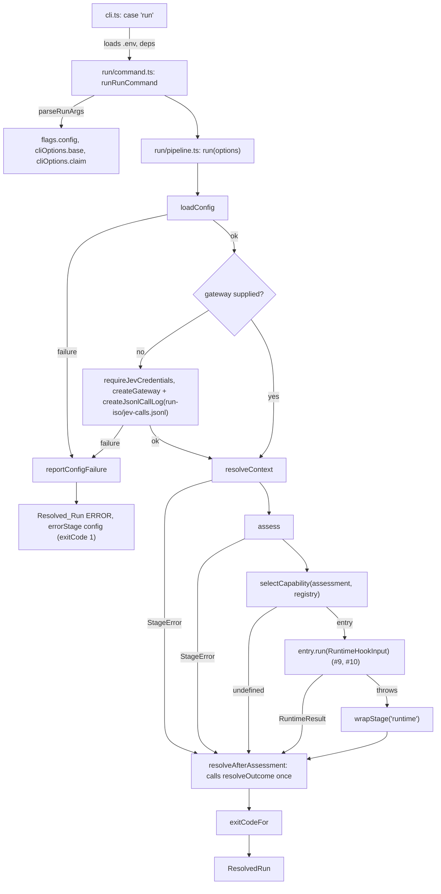
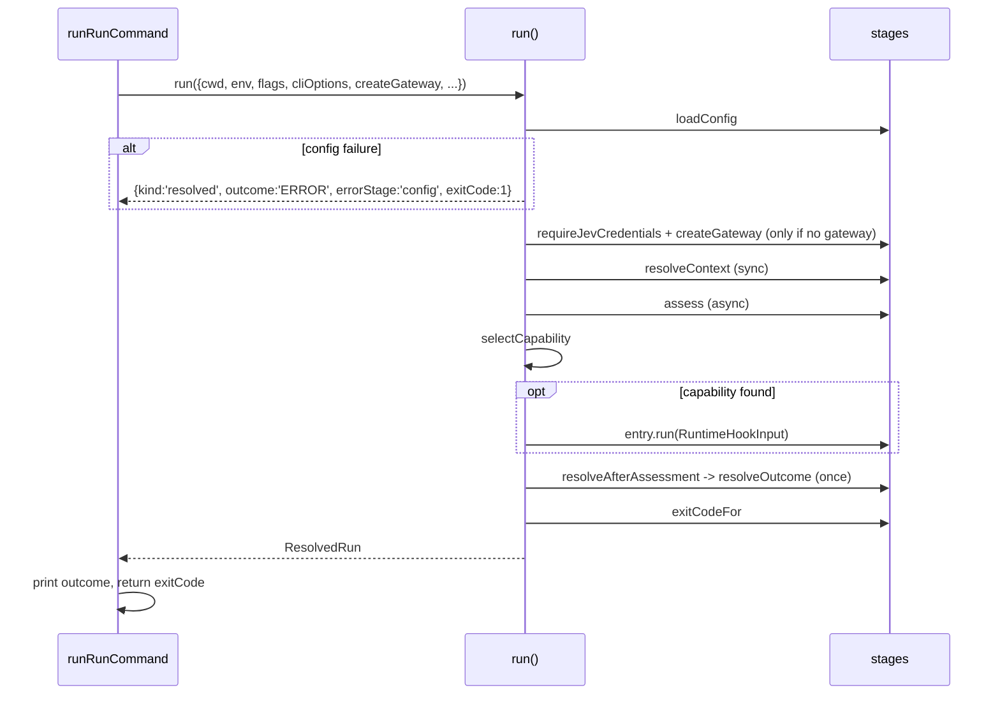

# Design Document

## Overview

This design wires `run()` into a non-browser vertical slice for issue #41 (rfxlamia/ce, "[M2] Wire run(): config → context → assessment → outcome vertical slice"). Today `run()` in `packages/ce/src/index.ts` throws `CE v0 implementation spike: not implemented yet`, and `ce run` always prints `Outcome: ERROR`. Every stage module already exists and is tested. The slice sequences them, adds one named hook where the capability runtime of #9 and #10 will plug in, and extracts the `run` CLI case into a testable `runRunCommand`.

`SPEC.md` (sections 4.2 and 7.1) is normative. `requirements.md` of this spec is the contract for this design.

Behavior of the slice:

- No claim needs runtime evidence: `SKIPPED`.
- Evidence is required and no capability is registered for the dominant Surface: `UNSUPPORTED` with reason `surface-unsupported`. The registry is empty in this slice, so this includes `browser_ui`. The slice never produces `EVIDENCED` by itself.
- A stage throws: `ERROR` with the stage named.
- Configuration or credentials are invalid: `ERROR` with `errorStage` `config`, resolved through `resolveOutcome` (SPEC 7.1, amended after review of PR #43).

### Design decisions

| Decision | Choice | Reason |
| --- | --- | --- |
| Where the Outcome is decided | Only `resolveOutcome` in `outcome/resolve.ts`, called exactly once per resolved run through `resolveAfterAssessment` | Steering rule; architecture rule (d) forbids Outcome literals elsewhere |
| How an empty capability set yields `UNSUPPORTED` | Pass `supportedSurfaces` = union of registered capability Surfaces (empty now) | `resolveOutcome` defaults to `['browser_ui']` and would return `ERROR/no-observation` for a required browser run with no runtime result (I1) |
| Config failure representation | Resolved_Run through `resolveOutcome` with `StageError('config', cause)`; `Stage` gains `'config'` | SPEC 7.1: every run resolves to one outcome. Replaces the earlier `config-failure` variant (I3, amended). The call log schema in `jev/log.ts` accepts `config` too |
| Async hook vs pure resolver | Pipeline calls `selectCapability`, awaits the hook, then calls pure `resolveAfterAssessment` once | The resolver stays pure and testable by fast-check (I6) |
| Capability registry | Branded type returned only by `createCapabilityRegistry` | A raw array cannot bypass duplicate-name and Surface validation |
| Command extraction | `runRunCommand(argv, deps)` in `run/command.ts`, modeled on `runEvalCommand` | `main` in `cli.ts` is not exported and runs at module load (I4) |
| Location of `run` | Implementation in `run/pipeline.ts`, re-exported from `index.ts` under the same name | `run/command.ts` must call `run`, and importing it from `index.ts` would create the cycle `index → command → index`. The public export is unchanged (see Deviation note) |
| Run directory | `run-<iso>` under `output.dir`, created lazily by the existing `createJsonlCallLog` | Distinguishable from `eval-<iso>`. No evidence files are written (#10 owns them) |

Deviation note: requirements glossary says "the `run()` function in `packages/ce/src/index.ts`". The function is defined in `run/pipeline.ts` and exported from `index.ts` as `run`. Requirement 12 and 13.10 constrain the text of `index.ts` and the module's public names, and both hold. Requirement 2.6 and 13.11 scan both `index.ts` and `run/`, so no rule is weakened.

### Research findings that inform the design

All findings come from reading the code in `packages/ce/src`.

- `exitCodeFor(resolution, failOn)` in `outcome/exit-code.ts` is pure. With `failOn` undefined it uses `['error']`. `ERROR` maps to 1 when `error` is listed, `UNSUPPORTED` to 2 when `unsupported` is listed, and `EVIDENCED` with `finalState === 'not_reached'` to 3 when `evidenced-not-reached` is listed. Otherwise 0. `SKIPPED` is always 0.
- Only `cli.ts` calls `run()` (grep over `packages/ce/src`). The `run` case today prints `Outcome: <outcome>`, returns 0, and does not use `exitCodeFor`. Tests that import `../index.js` (`config/index.test.ts`, `jev/index.test.ts`) only read exports, so keeping every existing export keeps them green.
- `createJevGateway(loaded, env, { callLog })` returns `CreateJevGatewayResult = { ok: true; gateway: HybridJevGateway } | { ok: false; errors: ValidationError[] }`. It calls `requireJevCredentials` itself, and its own comment says the run pipeline passes `createJsonlCallLog(<evidence dir>/jev-calls.jsonl)`.
- `assess(context, config, gateway, options?)` returns `Promise<{ claims: Claim[]; assessment: Assessment }>` and wraps every failure as `StageError('assessment', cause)`.
- `resolveContext({ config, cliOptions, env, cwd, providers?, exec? })` is synchronous and wraps every failure as `StageError('context', cause)`. Its git probe and the git provider both use `exec`, so injecting `exec` removes every git process from tests.
- `FakeJevGateway` keys recordings by `(idVersion, stateHash(request.state), question name)`. Command tests therefore derive recordings from the context that results (see Testing Strategy).
- `outcome/architecture.test.ts` scans every non-test `.ts` under `packages/ce/src`. Rules (a) to (c) apply to `outcome/` only. Rule (d) (no Outcome literal assigned, returned or cast) applies everywhere, so code in `run/` must compare with `===` at most, and must not write the literals as values.

## Architecture



Layering rules:

- `run/` imports stage modules through their public `index.ts` files and the `JevGateway` type. It never imports `@typesafe-ai/sdk`, `jev/catalog`, or calls `fetch`. Only `jev/` knows about transports.
- `run/` decides no Outcome. Outcome and exit code come only from `resolveOutcome` and `exitCodeFor`.
- `run/` reads `process.env`, `process.cwd()`, `process.stderr` and the clock only in the default-filling function `withDefaults`. `runRunCommand` reads none of them.

### Sequence of one run



## Components and Interfaces

### File layout

```
packages/ce/src/
  index.ts              module comment, VERSION, re-export run + types, existing exports unchanged
  cli.ts                'run' case calls runRunCommand
  run/
    index.ts            public surface of run/
    types.ts            RunOptions, RunResult, ResolvedRun, RuntimeHook, RuntimeHookInput
    capabilities.ts     createCapabilityRegistry, selectCapability, supportedSurfaces, EMPTY_REGISTRY
    resolve.ts          resolveAfterAssessment, wrapStage
    pipeline.ts         run(), withDefaults, runDirName
    command.ts          runRunCommand, parseRunArgs, formatting
    *.test.ts           tests
```

### Types (`run/types.ts`)

```ts
import type { Assessment, Claim, Surface } from '../assessment/index.js';
import type { EffectiveConfig } from '../config/schema.js';
import type { LoadedConfig } from '../config/load.js';
import type { ValidationError } from '../config/errors.js';
import type { ChangeContext } from '../context/types.js';
import type { ResolveContextOptions } from '../context/resolve.js';
import type { StageError } from '../errors.js';
import type { CallLog } from '../jev/log.js';
import type { JevGateway } from '../jev/gateway.js';
import type { Resolution, RuntimeResult } from '../outcome/index.js';

export interface RuntimeHookInput {
  context: ChangeContext;
  claims: Claim[];
  assessment: Assessment;
  config: EffectiveConfig;
  gateway: JevGateway;
  /** Absent when no run directory was computed (a gateway was supplied). */
  runDir?: string;
  signal?: AbortSignal;
}

export type RuntimeHook = (input: RuntimeHookInput) => Promise<RuntimeResult>;

export interface CapabilityEntry {
  name: string;
  surfaces: readonly Surface[];
  run: RuntimeHook;
}

declare const registryBrand: unique symbol;
/** Only createCapabilityRegistry returns this type. */
export type CapabilityRegistry = readonly CapabilityEntry[] & { readonly [registryBrand]: true };

export type CreateGateway = (
  loaded: LoadedConfig,
  env: Record<string, string | undefined>,
  options: { callLog: CallLog },
) => { ok: true; gateway: JevGateway } | { ok: false; errors: ValidationError[] };

export interface RunOptions {
  cwd?: string;
  env?: Record<string, string | undefined>;
  flags?: Record<string, unknown>;
  cliOptions?: { claim?: string[]; base?: string };
  gateway?: JevGateway;
  createGateway?: CreateGateway;
  capabilities?: CapabilityRegistry;
  contextProviders?: ResolveContextOptions['providers'];
  exec?: ResolveContextOptions['exec'];
  now?: () => Date;
  stderr?: { write(text: string): unknown };
}

export interface ResolvedRun extends Resolution {
  kind: 'resolved';
  exitCode: 0 | 1 | 2 | 3;
  claims?: Claim[];
  assessment?: Assessment;
  error?: StageError;
  /** Name of the capability whose hook was called, when one was. */
  capability?: string;
}

export type RunResult = ResolvedRun;
```

`ResolvedRun extends Resolution`, so it is assignable to `{ outcome: ExecutionOutcome }` after narrowing on `kind` (Requirement 9.5). `RunResult` replaces the old `{ outcome }` interface in `index.ts` (Requirement 9.7). `CreateGateway` has the same shape as `CreateEvalGateway` in `eval/command.ts`, which `createJevGateway` satisfies.

### Capability registry (`run/capabilities.ts`)

```ts
export function createCapabilityRegistry(entries: readonly CapabilityEntry[]): CapabilityRegistry;
export const EMPTY_REGISTRY: CapabilityRegistry;
export function selectCapability(
  assessment: Pick<Assessment, 'required' | 'surface'>,
  registry: CapabilityRegistry,
): CapabilityEntry | undefined;
export function supportedSurfaces(registry: CapabilityRegistry): Surface[];
```

- `createCapabilityRegistry` throws `Error('Duplicate capability name: <name>')` for the first repeated name, and `Error('Unsupported capability surface: <surface>')` for the first Surface that is not in `V0_SUPPORTED_SURFACES`. It copies and freezes the list and preserves registration order. Both messages name only the offending value, which is a developer-supplied constant, never a secret.
- `selectCapability` returns `registry.find((e) => assessment.required && e.surfaces.includes(assessment.surface))`, that is, the first entry in registration order that supports the Surface, and `undefined` when `required` is false.
- `supportedSurfaces` returns the de-duplicated union of entry Surfaces in first-seen order. It is passed as `ResolveInput.supportedSurfaces`.

### Post-assessment resolution (`run/resolve.ts`)

```ts
export interface ResolveAfterAssessmentInput {
  assessment?: Assessment;
  registry: CapabilityRegistry;
  runtime?: RuntimeResult;
  error?: StageError;
}

export function resolveAfterAssessment(input: ResolveAfterAssessmentInput): Resolution;

export function wrapStage(stage: Stage, thrown: unknown): StageError;
```

`resolveAfterAssessment` builds `ResolveInput` and calls `resolveOutcome` exactly once. It adds `assessment`, `runtime` and `error` only when defined, and always sets `supportedSurfaces: supportedSurfaces(input.registry)`. It reads no gateway, no clock and no capability hook.

`wrapStage` returns `thrown` unchanged when it is a `StageError`, and `new StageError(stage, thrown)` otherwise. It never copies the cause's message (Requirement 6.6).

### Pipeline (`run/pipeline.ts`)

```ts
export async function run(options: RunOptions = {}): Promise<RunResult>;
export function runDirName(date: Date): string;       // `run-<iso with ':' and '.' replaced by '-'>`
```

`withDefaults(options)` is the only function that touches `process.env`, `process.cwd()`, `process.stderr` and `new Date()`. It fills `cwd`, `env`, `flags: {}`, `cliOptions: {}`, `createGateway: createJevGateway`, `capabilities: EMPTY_REGISTRY`, `now: () => new Date()` and `stderr: process.stderr`. `contextProviders` and `exec` stay `undefined` so `resolveContext` applies its own defaults (Requirement 2.2).

Algorithm of `run(options)`:

1. `const o = withDefaults(options)`.
2. `loaded = loadConfig({ cwd: o.cwd, flags: o.flags, env: o.env })`. On failure: report through `reportConfigFailure`, then return the Resolved_Run for `StageError('config', loaded)` (amended).
3. Gateway:
   - If `o.gateway` is set, use it, set no `runDir`, create no call log (Requirement 11.3).
   - Otherwise `credentials = requireJevCredentials(loaded, o.env)`. On failure, report and return the `config` Resolved_Run. Then `runDir = path.resolve(o.cwd, loaded.config.output?.dir ?? '.ce/runs', runDirName(o.now()))`, and `created = o.createGateway(loaded, o.env, { callLog: createJsonlCallLog(path.join(runDir, 'jev-calls.jsonl')) })`. On failure, report `{ ok: false, errors: created.errors }` and return the config-failure result.
4. Context: `try { context = resolveContext({ config, cliOptions, env, cwd, providers: o.contextProviders, exec: o.exec }) } catch (e) { return finish({ error: wrapStage('context', e) }) }`. Optional fields are spread only when defined, because the repository uses exact optional property types.
5. Assessment: `try { ({ claims, assessment } = await assess(context, config, gateway)) } catch (e) { return finish({ error: wrapStage('assessment', e) }) }`.
6. `entry = selectCapability(assessment, o.capabilities)`.
7. If `entry` is defined: `// Runtime_Hook call site: capability runtime of issues #9 and #10 plugs in here.` then `try { runtime = await entry.run({ context, claims, assessment, config, gateway, runDir? }) } catch (e) { error = wrapStage('runtime', e) }`.
8. `finish` calls `resolveAfterAssessment({ assessment, registry, runtime, error })`, then `exitCode = exitCodeFor(resolution, config.output?.['fail-on'])`, and returns `{ kind: 'resolved', ...resolution, exitCode, claims?, assessment?, error?, capability? }`.

No step throws out of `run()` except a defect in `withDefaults` or the final resolver. Stage failures become `ResolvedRun` values (Requirement 6.5). The config is known at `finish` time for stages after step 2, so `failOn` is always read from the loaded config. When `output.fail-on` is absent, `exitCodeFor` applies `['error']` (Requirement 9.3). `finish` is the only caller of `resolveAfterAssessment`, and `resolveAfterAssessment` is the only caller of `resolveOutcome`, so Requirement 5.4 holds by construction.

For a runtime failure the Assessment is still present, so `resolveOutcome` returns `ERROR/stage-error` with `errorStage: 'runtime'` and the Surface.

### Run command (`run/command.ts`)

```ts
export interface RunCommandDeps {
  env: Record<string, string | undefined>;
  cwd: string;
  stdout: { write(text: string): unknown };
  stderr: { write(text: string): unknown };
  createGateway: CreateGateway;
  now: () => Date;
  contextProviders?: ResolveContextOptions['providers'];
  exec?: ResolveContextOptions['exec'];
}

export function parseRunArgs(argv: readonly string[]): ParsedRunArgs | null;
export async function runRunCommand(argv: readonly string[], deps: RunCommandDeps): Promise<number>;
```

`parseRunArgs` follows `parseArgs` of `eval/command.ts`: `--name value` and `--name=value`, `null` for an unknown flag, a positional argument, a missing value, an empty value, a value that starts with `--`, and a repeated `--config` or `--base`. Differences: names are `config`, `base`, `claim`, and `claim` accumulates into an array in the order given. `ParsedRunArgs = { config?: string; base?: string; claim?: string[] }`.

`runRunCommand`:

1. `parseRunArgs(argv)`; on `null`, write `USAGE` to `deps.stderr`, return 1, never call `run()`.
2. Build `flags` (`config`) and `cliOptions` (`base`, `claim`) only from present values.
3. `try { result = await run({ cwd, env, flags, cliOptions, createGateway, now, stderr, contextProviders, exec }) }`. On a thrown error, write `Outcome: ERROR` to stdout and the constructor name of the error to stderr, return 1 (Requirement 10.10). The constructor name only, because the message could carry a secret.
4. Config failure: handled like any `ERROR` (`Outcome: ERROR`, then the Stage_Error message on stderr).
5. `resolved`: write `Outcome: ${result.outcome}\n` to stdout, then:
   - reason `surface-unsupported`: `Reason: surface-unsupported (surface: <surface>)`. If the Surface is in `V0_SUPPORTED_SURFACES`, add `No capability is registered for <surface> yet.` (Requirement 10.4, 10.5).
   - `error` present: write `error.message` to stderr (Requirement 10.6).
   - outcome is `ERROR` with no `error`: write `Reason: <reason>` and `Surface: <surface>` when present to stderr (Requirement 10.7). The check is `result.outcome === 'ERROR'`, a comparison that architecture rule (d) allows.
   - return `result.exitCode`.

The command decides no Outcome and no exit code (Requirement 10.9).

### CLI change (`cli.ts`)

The `run` case keeps `loadEnvFileIfPresent`, then returns `runRunCommand(rest, { env: process.env, cwd: process.cwd(), stdout: process.stdout, stderr: process.stderr, createGateway: createJevGateway, now: () => new Date() })`. The help text lists the new options. The unused `run` import is replaced by `runRunCommand`.

### `index.ts` change

The module comment describes the implemented slice and names the Runtime_Hook as the open part (Requirement 12.3). The stub, its `TODO(Milestone 1)` text and the old `RunResult` interface are removed. Exports are added: `run`, `RunResult`, `ResolvedRun`, `ConfigFailureRun`, `RunOptions`, `createCapabilityRegistry`, `EMPTY_REGISTRY`, `selectCapability` and the hook types. Every existing export keeps its name (Requirement 12.4). `run` is re-exported from `./run/index.js`.

### Interaction with steering rules

- Outcome: `run/` contains no `outcome: '<LITERAL>'`, `return '<LITERAL>'`, `=> '<LITERAL>'` or `as '<LITERAL>'`. Rule (d) already enforces this and needs no duplicate.
- Jev text: `run/` builds no question and imports no `jev/catalog`.
- Transports: `run/` sees only `JevGateway`, `createJevGateway` (through `index.ts` of `jev` or `jev/gateway.js`) and `createJsonlCallLog`.
- Secrets: `reportConfigFailure` redacts with `collectSecretValues(env)`. `run()` never writes an env value. Command tests use a dummy non-empty key set in the test's own `env` object, not in a file.

## Data Models

`ResolvedRun` examples (fields not shown are absent):

| Situation | outcome | reason | other fields |
| --- | --- | --- | --- |
| No claim needs evidence | `SKIPPED` | `not-required` | `surface`, `claims`, `assessment`, `exitCode: 0` |
| Evidence required, empty registry | `UNSUPPORTED` | `surface-unsupported` | `surface`, `claims`, `assessment`, `exitCode: 0` (2 with `unsupported` in `fail-on`) |
| Context stage threw | `ERROR` | `stage-error` | `errorStage: 'context'`, `error`, `exitCode: 1` |
| Assessor threw | `ERROR` | `stage-error` | `errorStage: 'assessment'`, `error`, `exitCode: 1` |
| Hook threw | `ERROR` | `stage-error` | `errorStage: 'runtime'`, `error`, `surface`, `capability`, `exitCode: 1` |
| Fake capability, no observation | `ERROR` | `no-observation` | `surface`, `capability`, `exitCode: 1` |
| Fake capability, valid evidence | `EVIDENCED` | `evidence-collected` | `finalState`, `surface`, `capability`, `exitCode: 0` |
| Config or credential failure | none | none | `ERROR`, `errorStage` `config`, `exitCode: 1` |

Run directory: `<cwd>/<output.dir ?? '.ce/runs'>/run-<iso>/jev-calls.jsonl`, where `<iso>` is `now().toISOString()` with every `:` and `.` replaced by `-`. The slice itself writes this one file through `createJsonlCallLog`. `run.json` is written by the Bundle_Writer, and `report.html` is written through the Report_Generator after `run.json` (Requirement 11.4; see spec `report-html-evidence-page`).

## Correctness Properties

*A property is a characteristic or behavior that should hold true across all valid executions of a system-essentially, a formal statement about what the system should do. Properties serve as the bridge between human-readable specifications and machine-verifiable correctness guarantees.*

The properties target the pure functions of `run/`. Pipeline wiring, printing and I/O are covered by example tests.

### Property 1: Resolution without a runtime result

For any Assessment (any `Surface`, any `claimStatus`, any `decidedBy`) and the empty Capability_Registry, `resolveAfterAssessment` returns `SKIPPED` with reason `not-required` when `required` is false, and `UNSUPPORTED` with reason `surface-unsupported` and the Assessment's Surface when `required` is true. In neither case does it return `EVIDENCED`.

**Validates: Requirements 3.1, 4.1, 4.2, 4.4, 13.14**

### Property 2: Capability selection

For any Assessment and any valid Capability_Registry, `selectCapability` returns `undefined` when `required` is false or no entry supports the Surface, and otherwise returns the first entry in registration order whose Surfaces include the Assessment's Surface. For the empty registry it returns `undefined` for every Assessment.

**Validates: Requirements 3.2, 8.11, 13.13, 13.14**

### Property 3: Registry validation

For any list of entries, `createCapabilityRegistry` throws when two entries share a name or an entry has a Surface outside `V0_SUPPORTED_SURFACES`, and otherwise returns a registry with the same entries in the same order, in which every Surface is a member of `V0_SUPPORTED_SURFACES`.

**Validates: Requirements 8.3, 8.4, 13.12**

### Property 4: Supported surfaces are the union of registered surfaces

For any valid Capability_Registry, `supportedSurfaces(registry)` contains exactly the Surfaces that appear in at least one entry, with no duplicates, and, with no runtime result, `resolveAfterAssessment` resolves a required Assessment to `UNSUPPORTED` if and only if its Surface is absent from that set.

**Validates: Requirements 4.2, 8.9**

### Property 5: Stage error precedence

For any `StageError` of any stage, any optional Assessment and any optional `RuntimeResult`, `resolveAfterAssessment` returns outcome `ERROR`, reason `stage-error` and `errorStage` equal to the error's stage.

**Validates: Requirements 6.1, 6.2, 6.4, 8.6**

### Property 6: Stage wrapping preserves stage and hides the cause message

For any thrown value (an `Error` with a marker message, a string, a number, `null`, `undefined`, an object) and any stage, `wrapStage(stage, value)` returns a `StageError` with that stage, and its `message` does not contain the cause's message marker. For any `StageError` input, `wrapStage` returns the same instance.

**Validates: Requirements 6.3, 6.6, 8.6**

### Property 7: Exit code comes from exitCodeFor

For any Resolution and any `fail-on` list (or `undefined`), the `exitCode` that `finish` attaches equals `exitCodeFor(resolution, failOn)`, and equals `exitCodeFor(resolution, ['error'])` when `failOn` is `undefined`.

**Validates: Requirements 3.4, 4.5, 6.7, 9.2, 9.3, 9.6**

### Property 8: Argument parsing round trip and rejection

For any set of options with `config` and `base` at most once and `claim` repeated, where every value is non-empty and does not start with `--`, formatting them in any mix of the `--name value` and `--name=value` forms and parsing the result returns the same options, with `claim` in the order given. For any argument list that contains an unknown flag, a positional argument, a missing value, an empty value, a value starting with `--`, or a repeated `--config` or `--base`, `parseRunArgs` returns `null`.

**Validates: Requirements 10.11, 10.12, 10.13, 10.14, 10.15, 13.7**

### Property 9: Run directory names

For any valid `Date`, `runDirName(date)` starts with `run-`, contains no `:` and no `.`, and is never equal to an `eval-<iso>` name. For any two dates with different timestamps the names differ.

**Validates: Requirements 11.2**

## Error Handling

| Failure | Where caught | Result |
| --- | --- | --- |
| Invalid config, unreadable config file | `loadConfig` returns `{ ok: false }` | `reportConfigFailure` writes to `stderr`, then `ERROR` with `errorStage` `config`, exit 1. No context or Jev call |
| Missing API key for the selected provider | `requireJevCredentials` (skipped when `gateway` is supplied) | Same as above |
| Invalid model for the provider | `createGateway` returns `{ ok: false, errors }` | Same as above |
| `resolveContext` throws | `try/catch` in `run()` | `wrapStage('context', e)`, `ResolvedRun` `ERROR`, exit 1 (default `fail-on`) |
| `assess` throws (including `FakeRecordingMissingError`, rate limit, `StageError`) | `try/catch` in `run()` | `wrapStage('assessment', e)`. `assess` already wraps, so the instance passes through |
| Runtime hook throws | `try/catch` around the hook call | `wrapStage('runtime', e)`, `ERROR` with `errorStage: 'runtime'`, `resolveOutcome` still called once |
| `JevImageError` | Not reachable in this slice (no image request) | The #10 runtime handles it per the jev-gateway decision |
| `run()` throws unexpectedly (defect) | `runRunCommand` | `Outcome: ERROR` on stdout, constructor name on stderr, exit 1 |
| Bad CLI arguments | `parseRunArgs` returns `null` | Usage on stderr, exit 1, `run()` not called |
| Invalid capability registry | `createCapabilityRegistry` throws before any stage runs | Developer error, thrown from the caller's setup code |

Secrets: `StageError.message` holds the stage and the cause's constructor name only. `run()` and `runRunCommand` print `error.message`, never `error.cause`. The config failure report goes through the existing redacting `reportConfigFailure`.

## Testing Strategy

Property-based testing applies to the pure logic of this feature: `resolveAfterAssessment`, `selectCapability`, `createCapabilityRegistry`, `supportedSurfaces`, `wrapStage`, `parseRunArgs`, `runDirName` and the exit-code attachment. It does not apply to the pipeline wiring, process printing, `cli.ts` and the I/O of the call log, which use example tests with injected dependencies.

### Test environment (Requirement 13.9)

Tests need no API key in `process.env`, no network, no browser, no live git repository and no git process.

- Gateway: `FakeJevGateway`, or a scripted `JevGateway` object in the style of `assessment/assess.test.ts` for pipeline tests that do not care about recorded keys.
- Context: `contextProviders` whose `cli`, `github`, `git` and `junit` entries return fixed provider results, plus an `exec` stub that answers the `commitExists` probe without running git.
- Env: a test-local object with a dummy non-empty key for the selected provider (`requireJevCredentials` runs before `createGateway`). The value is a throwaway literal and is never a real credential.
- Clock: fixed `now`. Filesystem: a temporary `cwd`.
- Recordings for command tests: the state hash depends on the resulting `ChangeContext`, so a test helper in `command.test.ts` first runs `assess` once with a capturing wrapper gateway around a scripted answerer, records `(idVersion, stateHash(request.state), question name, answer)` for each question, and builds the `FakeJevGateway` from those recordings. The helper lives in the test file because the architecture scan covers every non-test file in `run/`.

### Property tests (fast-check, in `packages/ce/src/run/*.property.test.ts`)

- Library: `fast-check` (already a devDependency, `^4.0.0`). Each property is one `fc.assert` with `{ numRuns: 100 }` or more.
- Generators: `Surface` from the six literals; a minimal `Assessment` picked with `Pick<Assessment, 'required' | 'surface'>` for Properties 1, 2 and 4 (only these fields are read by the code under test, and `Assessment` is built by a helper that fills the remaining fields with valid constants); `CapabilityEntry` lists with unique names for valid registries; lists with a forced duplicate or a forced non-v0 Surface for Property 3; `fc.date()` filtered to valid dates for Property 9; argv builders for Property 8.
- Each test carries a tag comment in this format: `// Feature: run-vertical-slice, Property <n>: <title>`.

| Property | Test file |
| --- | --- |
| 1, 4, 5, 7 | `resolve.property.test.ts` |
| 2, 3 | `capabilities.property.test.ts` |
| 6 | `wrap-stage.property.test.ts` |
| 8 | `command.args.property.test.ts` |
| 9 | `pipeline.rundir.property.test.ts` |

### Example and integration tests

- `pipeline.test.ts`: `SKIPPED` (Requirement 13.1); `UNSUPPORTED` with reason `surface-unsupported` and Surface `browser_ui` on an empty registry (13.2); context failure and assessor failure resolve to `ERROR` with the matching `errorStage` and do not throw (13.3, 6.5); fake `browser_ui` capability whose result resolves to `EVIDENCED` and one that resolves to `ERROR/no-observation` (13.4); hook not called for `SKIPPED` and `UNSUPPORTED` (13.5); two capabilities on one Surface call only the first, and the hook receives the gateway in use (13.13); call order of stages (1.1); `exitCode` is 2 for `UNSUPPORTED` with `fail-on: ['unsupported']`; no run directory when `gateway` is supplied (11.3); `run()` writes only `jev-calls.jsonl` and no evidence file (11.4); config failures (bad config, missing key, `createGateway` failure) return `config-failure`, call neither the Context_Resolver nor the Assessor, and leak no key (7.1 to 7.6).
- `command.test.ts`: `SKIPPED` and `UNSUPPORTED` through `runRunCommand` with the fixed context, recorded answers, hint line and exit code (13.6); the argument rules including `--claim=x`, repeated `--claim`, unknown flag and empty value (13.7); config failure returns 1 with a report on stderr and no context call (13.8); unexpected throw prints `Outcome: ERROR` and the constructor name (10.10); `ERROR` without a `StageError` prints reason and Surface on stderr (10.7).
- `architecture.test.ts` (existing, extended with an import rule only): the scanned set contains `index.ts` and the files of `run/`, none imports `@typesafe-ai/sdk` or `jev/catalog`, none calls `fetch`. Rules (a) to (c) stay scoped to `outcome/`, and rule (d) covers Outcome literals (Requirement 13.11).
- `index.test.ts` stub check: the text `TODO(Milestone 1)` is absent from `index.ts` (Requirement 13.10), and every export that existed before still exists.
- `cli.env.test.ts` (existing) is re-run to confirm the `.env` loading path is unchanged.

### Manual verification (Requirement 13.15)

Not automated. With a real API key set in the shell, run `ce run` in `examples/demo-app` and confirm the printed outcome is `SKIPPED` or `UNSUPPORTED`, not `ERROR`. The pull request description records the result.

### Traceability to issue #41

| Checklist item | Design element |
| --- | --- |
| 1. Sequence loadConfig → context → assessment → resolveOutcome | `run()` algorithm, Requirements 1, 2, 5 |
| 2. Non-browser path, never fake `EVIDENCED` | `supportedSurfaces`, Properties 1 and 4 |
| 3. Stage failures as `ERROR`, exit via `exitCodeFor` | `wrapStage`, Properties 5, 6 and 7, `finish` |
| 4. Hook point for the capability runtime | `RuntimeHook`, `CapabilityRegistry`, `selectCapability`, Properties 2 and 3 |
| 5. Remove the `TODO(Milestone 1)` stub | `index.ts` change |
| Done when: `ce run` on `examples/demo-app` gives `SKIPPED` or `UNSUPPORTED` | Command tests plus the manual step |

### Open points

- If the team prefers `run` to be defined literally inside `index.ts`, `command.ts` must receive `run` through its deps instead of importing it. The requirements do not list a `run` dep, so this design chose the re-export.
- `RuntimeHookInput.signal` is never set in this slice because `RunOptions` has no signal field. #10 may add one.
