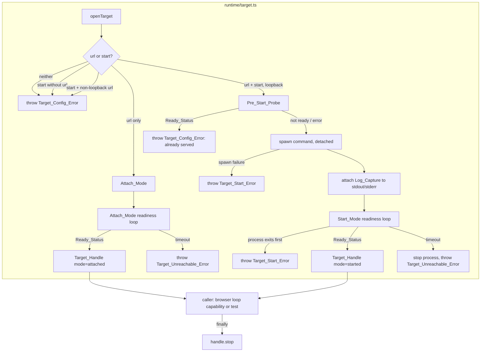
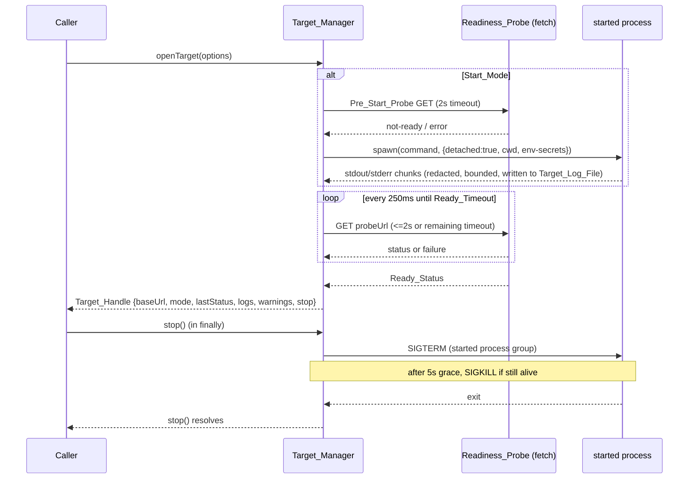

# Design Document

## Overview

Issue #9, "[M2] Runtime target: attach, start, readiness, logs", adds `packages/ce/src/runtime/target.ts`. It implements requirement R6 "Runtime access" of `docs/journal/v0.0/requirements.md`, which derives from `SPEC.md` section 5.4: CE MUST be able to use a runtime that is already available, and starting/stopping it is a SHOULD. `SPEC.md` is normative and wins over this document and the journal on any conflict.

The Target_Manager has exactly one entry point, `openTarget(options)`, which resolves to a `Target_Handle`: a ready `baseUrl`, the `mode` it used (`attached` or `started`), the last readiness status, a bounded and redacted log capture, a list of warnings, and an idempotent `stop()`. It supports two modes:

- **Attach_Mode**: `target.url` is set and `target.start` is not. The Target_Manager probes the URL until it is ready. It never spawns, signals or otherwise touches a process.
- **Start_Mode**: `target.start` is set together with `target.url`. The Target_Manager runs a Pre_Start_Probe, spawns the command as the leader of its own process group, waits for readiness, captures and redacts its stdout/stderr, and stops the process group on `stop()`.

The Target_Manager does not drive a browser, does not observe pages, and does not decide an Outcome (steering "Placement rules": the outcome is decided only in `outcome/resolve.ts`). It is consumed by the browser loop capability of issue #10 through a `RuntimeHook`, exactly as `run/pipeline.ts` already calls `entry.run(...)` (`packages/ce/src/run/pipeline.ts:150-163`). This feature does not touch `run/pipeline.ts`, `run/types.ts` or `RuntimeHookInput`/`RuntimeResult` (Requirement 9.4); it only prepares the module that a future `RuntimeHook` implementation will call.

Everything the Target_Manager needs from the outside world — `fetch`, `spawn`, the clock, `sleep` and the `process` object — is an injectable parameter with a production default, in the manner of `run()` and `runEvalCommand` (`packages/ce/src/run/pipeline.ts:46-57`). This makes every readiness, timing and signal scenario unit-testable without a network connection or a real process, while the two integration tests of Requirement 11 exercise the real defaults against `examples/demo-app`.

## Architecture





## Components and Interfaces

### Module layout

Everything lives in `packages/ce/src/runtime/target.ts`, matching the planned layout of `docs/journal/v0.0/design.md` section 2 and the structure steering ("Placement rules": one file owns this capability's behavior; it imports no Jev text and no `outcome/`). A thin internal split within the one file keeps the readiness math, the log redaction and the process lifecycle independently testable without adding files the structure steering does not plan:

- `openTarget(options): Promise<TargetHandle>` — the single export the browser loop calls.
- `targetOptionsFromConfig(config, extras): TargetOptions` — maps `EffectiveConfig['target']` plus caller-supplied `cwd`/`env`/`runDir`/`signal` into `TargetOptions`.
- `buildProbeUrl(baseUrl, readyPath): string`, `classifyStatus(status): 'ready' | 'not-ready'`, `redactUrl(url): string` — pure, exported, independently tested (Requirement 8.5–8.7).
- `TargetUnreachableError`, `TargetStartError`, `TargetConfigError` — exported error classes.
- Internal (not exported): the readiness loop, the log capture/redaction pipeline, the stop/signal state machine, and `isLoopbackHost`.

### `TargetOptions` (input to `openTarget`)

```ts
interface TargetOptions {
  url?: string;
  start?: string;
  ready?: { path?: string; timeout?: string };
  cwd: string;
  env: Record<string, string | undefined>;
  secrets?: string[];
  runDir?: string;
  signal?: AbortSignal;
  stopOnSignals?: boolean;
  fetch?: typeof fetch;
  spawn?: typeof import('node:child_process').spawn;
  now?: () => number;              // ms epoch, for the Ready_Timeout clock (Requirement 3.9)
  sleep?: (ms: number) => Promise<void>;
  process?: NodeJS.Process;        // for signal listeners and kill(); defaults to the global process
}
```

`ready.path`, `ready.timeout`, `fetch`, `spawn`, `now`, `sleep` and `process` all default inside `openTarget` (Requirement 3.1, Requirement 8.1). `targetOptionsFromConfig` does not set these; it only maps the four `target.*` config keys and passes through the caller's `cwd`, `env`, `runDir`, `signal`.

### `TargetHandle` (output of `openTarget`)

```ts
interface TargetHandle {
  baseUrl: string;
  mode: 'attached' | 'started';
  lastStatus: number | 'connection-refused' | 'timeout' | 'dns' | 'network' | 'none';
  logs: string;          // bounded, redacted, in arrival order (Requirement 5.2, 5.3)
  warnings: string[];    // empty at first; e.g. unkillable-process warning (Requirement 2.12)
  stop(): Promise<void>; // idempotent (Requirement 6.7)
}
```

### Error shapes

```ts
class TargetUnreachableError extends Error {
  readonly url: string;        // redacted (Requirement 4.7)
  readonly lastStatus: TargetHandle['lastStatus'];
  readonly timeoutMs: number;
  readonly mode: 'attached' | 'started';
  readonly logTail?: string;   // last 4 KiB, Start_Mode only (Requirement 5.6)
}

class TargetStartError extends Error {
  readonly command: string;
  readonly exitCode: number | null;
  readonly signal: string | null;
  readonly logTail?: string;
}

class TargetConfigError extends Error {
  readonly key?: string;       // e.g. "target.url", "target.ready.timeout"
}
```

No error's `message` contains the Log_Capture (Requirement 5.7); `logTail` is the only carrier, following the pattern `StageError` already uses to keep messages free of secret-bearing detail (`packages/ce/src/errors.ts:1-20`, steering "Fact F4").

### Readiness loop

The loop is one pure state transition driven by injected time: given the current elapsed time, the Ready_Timeout and the outcome of a probe, it decides `ready`, `retry-after-250ms`, or `timed-out`. `classifyStatus` and the per-probe timeout (`min(2000, remainingMs)`, Requirement 3.6) are the two pure helpers this state machine calls. Keeping the decision pure (take elapsed time and a probe outcome, return the next action) is what lets Requirement 11.7's fake-clock unit tests and the property test of Requirement 11.13 drive thousands of scripted sequences without real waiting.

### Log capture and redaction pipeline

Per stream (`stdout`, `stderr`), each chunk goes through the five-step pipeline Requirement 5.8 specifies: decode (keep partial UTF-8 sequences) → join with the stream's Held_Tail → redact the whole buffer with `redactSecretValues`-equivalent logic (reusing the longest-first replacement idea already in `packages/ce/src/config/secrets.ts:50-70`, but operating on a fixed effective secret list rather than scanning `env` itself) → take the last `L-1` characters as the new Held_Tail → release the rest to the Log_Capture (bounded, Requirement 5.3) and to the Target_Log_File. End-of-stream and `stop()` flush the Held_Tail (Requirement 5.11).

### Process lifecycle / stop state machine

`stop()` is backed by one promise created on first call; every call (including ones made before the process ever started, or after it exited on its own) returns that same promise, which is how Requirement 6.7's idempotence holds. States: `not-started → running → term-sent → kill-sent → exited`. A natural exit of the started process moves the state directly to `exited` and records it on the handle (Requirement 6.6); a later `stop()` call then resolves immediately with no signal (Requirement 2.6).

## Data Models

### `Last_Status` derivation (Requirement 4.2–4.4)

| Probe outcome | `lastStatus` |
| --- | --- |
| HTTP response received | the numeric status code |
| `fetch` throws, `error.cause.code` or `error.code` is `ECONNREFUSED` | `'connection-refused'` |
| `fetch` throws, code is `ENOTFOUND` or `EAI_AGAIN` | `'dns'` |
| probe aborted by its own timeout (`AbortError`/`TimeoutError`) | `'timeout'` |
| any other thrown error | `'network'` |
| no probe has completed yet | `'none'` |

### Effective secret list (Requirement 2.7)

```ts
effectiveSecretNames = new Set([...options.secrets ?? [], 'OPENROUTER_API_KEY', 'TYPESAFE_API_KEY'])
```

Used twice: to build the `env` passed to `spawn` (those keys removed, every other key unchanged) and to build the redaction list passed into the log pipeline (their non-empty values, read from `options.env`, longest first — matching the ordering already used by `collectSecretValues`/`redactSecretValues` in `packages/ce/src/config/secrets.ts`).

### `Loopback_Host` classification (Requirement 8.4)

```ts
function isLoopbackHost(hostname: string): boolean {
  return (
    hostname === 'localhost' ||
    hostname === '::1' ||
    hostname === '0.0.0.0' ||
    /^127\.(\d{1,3})\.(\d{1,3})\.(\d{1,3})$/.test(hostname)
  );
}
```

### Config mapping (`targetOptionsFromConfig`, Requirement 8.2, 9.2)

| `EffectiveConfig` key | `TargetOptions` field |
| --- | --- |
| `target.url` | `url` |
| `target.start` | `start` |
| `target.ready.path` | `ready.path` |
| `target.ready.timeout` | `ready.timeout` |
| caller-supplied | `cwd`, `env`, `runDir`, `signal` |

No other field is set by `targetOptionsFromConfig`; `openTarget`'s own defaults fill in `fetch`, `spawn`, `now`, `sleep`, `process` (Requirement 8.1, 8.9 — `config/` itself does not change).

## Correctness Properties

*A property is a characteristic or behavior that should hold true across all valid executions of a system—essentially, a formal statement about what the system should do. Properties serve as the bridge between human-readable specifications and machine-verifiable correctness guarantees.*

The prework above found that most of the readiness loop, the log-redaction pipeline, the stop state machine, and the four pure exported helpers (`buildProbeUrl`, `classifyStatus`, `redactUrl`, the loopback classifier, and the per-probe-timeout arithmetic) are pure functions or deterministic state machines over a large input space, which is exactly where property-based testing earns its cost. Process-signal wiring (Requirement 6.2–6.5), filesystem presence/absence (Requirement 5.4–5.5, 5.9–5.10), and the two real-process integration scenarios (Requirement 11.1, 11.2, 11.6, 11.11, 11.16) stay as unit/integration tests because their behavior does not vary meaningfully with generated input, matching Requirement 11's own classification (criteria 7–12 unit, 13 property, 1–6 and 11, 16 integration).

### Property 1: Attach_Mode never spawns or signals a process

*For any* `TargetOptions` with `url` set and `start` absent, calling `openTarget` SHALL NOT call the injected `spawn` function, and calling `stop()` on the resulting handle SHALL NOT call `spawn`, `kill`, or send a signal to the injected `process`.

**Validates: Requirements 1.1, 1.4, 1.5**

### Property 2: Readiness resolution matches the first Ready_Status, in both modes

*For any* finite sequence of scripted probe outcomes (HTTP status codes 100–599, or one of the four no-response failure kinds) fed to a fake `fetch` in order, and *for any* Ready_Timeout large enough to cover the sequence, `openTarget` SHALL resolve with `lastStatus` equal to the status of the first outcome in the sequence that classifies as `ready` (200–399), SHALL have issued exactly as many probes as the index of that outcome plus one, and SHALL NOT call `sleep`/advance the clock beyond what separates those probes by the 250 ms retry interval.

**Validates: Requirements 1.2, 1.3, 2.2, 3.3, 3.4**

### Property 3: Exhausting the Ready_Timeout resolves to Target_Unreachable_Error with the exact last outcome

*For any* finite sequence of scripted probe outcomes that never classifies as `ready`, and *for any* Ready_Timeout, `openTarget` SHALL throw a `TargetUnreachableError` whose `lastStatus` equals the table-derived value (Data Models) of the last outcome in the sequence (or `'none'` when the sequence is empty), whose `timeoutMs` equals the configured Ready_Timeout, and whose `mode` equals the mode `openTarget` was using; and in Start_Mode, the started process SHALL already be stopped before the error is thrown.

**Validates: Requirements 3.4, 3.8, 4.1, 4.2, 4.3, 4.4, 4.5**

### Property 4: `buildProbeUrl` is slash-insensitive and keeps the base path as a prefix

*For any* base URL and *for any* ready path, each independently varied with and without a leading/trailing `/`, `buildProbeUrl(base, path)` SHALL return the same string for all four slash combinations that denote the same logical path, the returned path SHALL start with the path of `base` followed directly by the (slash-normalized) ready path, and the returned URL SHALL carry no query string or fragment from `base`.

**Validates: Requirements 3.2, 8.5**

### Property 5: `classifyStatus` is ready exactly for 200–399

*For all* integers from 100 to 599, `classifyStatus(status)` SHALL return `'ready'` if and only if `200 <= status <= 399`, and SHALL return `'not-ready'` otherwise.

**Validates: Requirements 3.3, 3.5, 8.6**

### Property 6: Per-probe timeout is the minimum of 2000 ms and the remaining Ready_Timeout

*For any* non-negative `remainingMs`, the request timeout computed for the next Readiness_Probe or Pre_Start_Probe SHALL equal `min(2000, remainingMs)`.

**Validates: Requirements 3.6**

### Property 7: `redactUrl` removes userinfo and is a no-op without it

*For any* URL, `redactUrl(url)` SHALL NOT contain the original username or password substring when the URL carries userinfo, SHALL replace it with `***`, and SHALL return the URL unchanged when it carries no userinfo. The same property holds for the `url` field and the message of every error `openTarget` throws for that URL.

**Validates: Requirements 4.7, 8.7**

### Property 8: The Pre_Start_Probe decides spawn-or-reject from its outcome alone

*For any* Pre_Start_Probe outcome, `openTarget` in Start_Mode SHALL throw a `TargetConfigError` with the message `target.url is already served before start` and SHALL NOT call `spawn` if and only if that outcome classifies as `ready` (200–399); for every other outcome (another status, or no response), `openTarget` SHALL call `spawn` exactly once.

**Validates: Requirements 2.11**

### Property 9: Spawn happens before the first Readiness_Probe in Start_Mode

*For any* sequence of scripted probe outcomes and *for any* timing of the started process's readiness, a call recorder attached to the fake `spawn` and the fake `fetch` SHALL record the `spawn` call strictly before every Readiness_Probe call (the Pre_Start_Probe excepted, which precedes the spawn by definition).

**Validates: Requirements 2.2**

### Property 10: Only the configured secret names are removed from the started process's environment

*For any* `env` record and *for any* `secrets` list (absent, empty, or naming extra keys), the `env` object passed to the fake `spawn` SHALL equal the input `env` with exactly the keys in `new Set([...secrets ?? [], 'OPENROUTER_API_KEY', 'TYPESAFE_API_KEY'])` removed, and every other key-value pair SHALL be unchanged.

**Validates: Requirements 2.7**

### Property 11: Loopback classification decides the start-with-remote-url rejection

*For any* `url` with `start` also set, `openTarget` SHALL throw a `TargetConfigError` if and only if the hostname of `url` is not loopback under the Glossary's definition (`localhost`, `127.0.0.0/8`, `::1`, `0.0.0.0`); for a loopback hostname, `openTarget` SHALL proceed to Start_Mode.

**Validates: Requirements 8.4**

### Property 12: Log_Capture never exceeds its byte bound and is always a suffix of the redacted stream

*For any* sequence of already-redacted text chunks appended to the Log_Capture, the UTF-8 byte length of `logs` SHALL never exceed 262144, `logs` SHALL always equal a suffix of the full redacted concatenation of all chunks appended so far, and that suffix SHALL begin at a UTF-8 character boundary (contain no partial multi-byte sequence).

**Validates: Requirements 5.3**

### Property 13: Secret redaction is invariant to how a stream is chunked, including across the end-of-stream flush

*For any* non-empty secret value and *for any* text stream containing it, and *for any* way of splitting that stream into chunks (including a split that falls inside the secret, a split exactly one character before the secret starts, and a split placed anywhere else), after the Target_Manager has processed every chunk in order and then flushed the stream's Held_Tail at end-of-stream, the resulting stored/written text SHALL equal the text produced by redacting the whole unsplit stream in one pass, and SHALL NOT contain the raw secret value anywhere.

**Validates: Requirements 5.8, 5.11**

### Property 14: `stop()` is idempotent under any sequence of calls, including a natural exit

*For any* sequence of one or more `stop()` calls on a `TargetHandle`, interleaved in any order with an optional natural exit of the started process (Attach_Mode: no process; Start_Mode: fake process that may exit on its own before any `stop()` call, between calls, or never), the underlying kill/cleanup logic SHALL run at most once, every `stop()` call's promise SHALL resolve (none SHALL reject), and after all calls have resolved the handle's recorded exit state SHALL be consistent with exactly one stop sequence having occurred.

**Validates: Requirements 2.5, 2.6, 6.6, 6.7**

### Reflection on redundant properties

The prework identified several criteria that reduce to the same underlying behavior and are folded into one property above rather than tested twice:

- Requirement 1.5 ("never start/restart/terminate a process in Attach_Mode") is the conjunction of Property 1's two assertions (no spawn, no stop side effects) and is not a separate property.
- Requirements 3.2 and 8.5 (`buildProbeUrl` export) are the same function; Property 4 covers both. The same merge applies to 3.3/8.6 (Property 5) and 4.7/8.7 (Property 7).
- Requirement 3.5 ("3xx is evaluated as received, not followed") is already inside the 200–399 range Property 5 covers; no separate redirect property is needed, only the example-level check (Testing Strategy) that the probe call itself disables redirect following.
- Requirements 2.5 and 2.6 (double-stop, already-exited) and 6.6 (natural exit) are three input scenarios of one state machine; Property 14's generator covers all three instead of three separate properties.
- Requirement 5.11's end-of-stream flush is not a separate property from Requirement 5.8: any chunking sequence a generator produces ends with a flush, so Property 13 already exercises it on every run.
- Requirement 4.1's "exact last outcome" subsumes 4.2, 4.3 and 4.4 (how that outcome maps to `lastStatus`): Property 3 asserts the mapped value directly, so a standalone mapping-table property would duplicate it.

## Error Handling

All thrown errors are one of `TargetConfigError`, `TargetStartError` or `TargetUnreachableError` (Requirement 9.1). Validation errors (`TargetConfigError`) are thrown before any probe or spawn (Requirement 8.3) except for the Pre_Start_Probe's own "already served" case, which by definition requires running that one probe first (Requirement 2.11).

In the `run()` pipeline, a thrown Target_Manager error reaches `wrapStage('runtime', cause)` exactly as any other runtime-stage exception does today (`packages/ce/src/run/pipeline.ts:155-163`), producing a `StageError` whose own message carries only the stage and the cause's constructor name (steering fact F4; `packages/ce/src/errors.ts:11`). The `url` and `lastStatus` of a `TargetUnreachableError` cause are not duplicated into that message; `run/command.ts` reads them off `result.error.cause` with an `instanceof TargetUnreachableError` check and writes them to stderr in addition to the Stage_Error line (Requirement 4.9), the same pattern `runRunCommand` already uses for `result.error.message` (`packages/ce/src/run/command.ts:97-99, 118-120`). This needs one addition to `RunCommandDeps`: an optional `capabilities` field (defaulting to the production registry) so a test can register a fake capability whose `RuntimeHook` calls `openTarget` against an unreachable URL and drive the error through `runRunCommand` end to end (Requirement 4.9, 11.12).

`logTail` (`TargetUnreachableError`, `TargetStartError`) is the only field that may carry the log capture; no error's `message` does (Requirement 5.7), mirroring why `StageError` itself never repeats a cause's message (steering fact F4, "the journal is not edited" note on secret-bearing detail staying off the message).

## Testing Strategy

**Property-based tests** use `fast-check`, matching the existing property tests in `packages/ce/src/run/*.property.test.ts` and `packages/ce/src/assessment/*.property.test.ts`. Each property above becomes one `fc.assert(fc.property(...))` (or `fc.asyncProperty` where the test awaits `openTarget`) with at least 100 runs, tagged with a comment in the form:

```ts
// Feature: runtime-target, Property N: <title>
// **Validates: Requirements X.Y, ...**
```

Fake `fetch` sequences are built the same way `assess.roundtrip.property.test.ts` scripts a fake gateway (`packages/ce/src/assessment/assess.roundtrip.property.test.ts:29-74`): an array of scripted outcomes consumed call by call. Fake `spawn` is an `EventEmitter`-based stand-in exposing `stdout`/`stderr` emitters, `pid`, and a controllable `exit` event, driven by a fake clock for the grace-period/kill-deadline timing of Property 14 and Requirement 11.8.

**Unit tests** (example-based, per Requirement 11.7–11.12 and 11.16–11.18) cover the specific scenarios that do not vary meaningfully with generated input: the default `ready.path`/`ready.timeout` values (3.1, 3.9); `Target_Config_Error` for `start` without `url`, neither given, a non-loopback host with `start`, and an invalid `ready.timeout` string; a spawn failure and a process that exits before readiness; the `SIGTERM`-then-`SIGKILL` timing and the unkillable-process warning; the `detached: true` spawn option; file-presence checks for `Target_Log_File` with and without a `runDir`; `logTail` size and content; the "no log on CE's own stdout/stderr" assertion; discard-after-stop; the `AbortSignal` scenario of Requirement 6.2; the `stopOnSignals` wiring of Requirement 6.3–6.5 with a fake `process`; and the pipeline-level integration test of Requirement 4.8/4.9 and 11.12 using `FakeJevGateway`, a dummy `OPENROUTER_API_KEY`, and a fake `browser_ui` capability passed through the new `RunCommandDeps.capabilities` field.

**Integration tests** (Requirement 11.1–11.6, 11.11, 11.16) run against a real process and `examples/demo-app`, each with a 90000 ms vitest timeout and an unconditional `beforeAll` that runs `npx --no-install vite build --outDir <tmpdir>` (a fresh `mkdtemp`, never `examples/demo-app/dist`), per Requirement 11.4:

1. Attached: the test itself starts `vite preview` on a free port, calls `openTarget` with that `url` and no `start`, asserts `mode: 'attached'`, a Ready_Status, no spawn call, and the server still running after `stop()`.
2. Started: `openTarget` with `start: 'npx --no-install vite preview --outDir <tmpdir> --port <freePort> --strictPort'`, a matching `url`, and a `runDir`; asserts `mode: 'started'`, a Ready_Status, a non-empty `logs`, a `target.log` file in `runDir`, and the port unreachable after `stop()`.
3. Unreachable: `openTarget` against a free port where nothing listens, with `ready.timeout: '1s'`; asserts `TargetUnreachableError` with `lastStatus: 'connection-refused'`.
4. Non-modification: a content hash of `examples/demo-app` (excluding `node_modules` and Vite cache directories) taken before and after a started run, asserted equal.
5. Pre_Start_Probe refusal: a real server already listening on the free port before `openTarget` is called with a `start` command targeting it; asserts the "already served" `TargetConfigError` and that the fake `spawn` (injected for this one test, to assert it was never called) was not invoked.

Both of these integration tests are the ones the pull request description must record as verifying "Done when" (Requirement 11.15): "attached" and "started" against `examples/demo-app`.

**Architecture test**: `outcome/architecture.test.ts` gains one more scoped check (Requirement 10.1) that `runtime/target.ts` imports no `playwright`, `@typesafe-ai/sdk`, `jev/` or `outcome/`, and calls no `fetch` with Jev-shaped request bodies — following the same `FORBIDDEN_SPECIFIER`/`valueImportSpecifiers` pattern the file already uses for `run/` (`packages/ce/src/outcome/architecture.test.ts:112-180`). The existing Outcome-literal rule (d) continues to cover `runtime/target.ts` automatically, since it already scans every source file except `outcome/resolve.ts` (Requirement 10.2).
