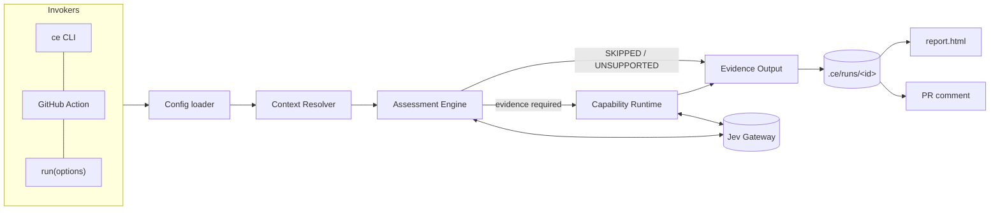

# Design — Continuous Evidence v0

> Journal v0.0 — architecture for the whole v0 scope.

Implements [`requirements.md`](./requirements.md). Normative source:
[`SPEC.md`](../../../SPEC.md).

## 1. Overview

CE is a single pipeline, invoked on demand, with four stages from SPEC §4.2
and one cross-cutting adapter for Jev:



Design rules that follow from Jev being a *classifier* rather than a text
generator:

1. **Jev never writes; it chooses.** Every Jev call answers a question whose
   answer space CE built from observed facts. Claims are extracted text,
   actions are observed elements. This is how CE satisfies "do not fabricate
   claims" (SPEC §7.2) and "bounded decisions" (SPEC §6.2) by construction.
2. **One question, one judgment.** Composite decisions (is evidence needed?)
   are split into small questions and combined in code, so thresholds live in
   `ce.yml`, not in prompts.
3. **Probabilities are signals.** CE stores them as observations with
   provenance. The outcome is decided by deterministic code in
   `outcome/resolve.ts`, never directly by a model answer.

## 2. Package layout

```
packages/ce/src/
  index.ts              run(options) — public API
  cli.ts                ce run | init | eval | report
  config/               schema.ts (zod → JSON Schema), load.ts, defaults.ts
  context/
    providers/          git.ts, github-event.ts, cli-args.ts, junit.ts
    redact.ts           built-in + configured patterns
    budget.ts           prioritise + truncate to state budget
    candidates.ts       split text into claim candidates (no generation)
    resolve.ts          → ChangeContext
  jev/
    gateway.ts          JevGateway interface + TypeSafe implementation
                        (changed: image requests need a raw JSON transport, see below)
    catalog.ts          versioned question catalog (all question text lives here)
    fake.ts             recorded/fixture gateway for tests and eval
    log.ts              jev-calls.jsonl writer (no state contents)
  assessment/
    claims.ts           candidate → Claim[]
    assess.ts           claims × checks → Assessment
  runtime/
    target.ts           attach | start + readiness + log capture
    observe.ts          Playwright page → Observation (actionable elements)
    decide.ts           Observation + claim → Jev choice → Action
    execute.ts          Action → Playwright call
    loop.ts             bounded Observe → Decide → Execute
    capture.ts          screenshots, console, network (optional)
  outcome/resolve.ts    single source of truth for the outcome
  evidence/
    bundle.ts           run.json writer + schema validation
    report/             report.html template (self-contained, offline)
    summary.ts          terminal + markdown (PR comment) summaries
action/                 GitHub Action (action.yml + entry), repo root
schemas/                run.schema.json, ce.schema.json (generated)
```

Dependencies: `playwright` (Chromium only), `@typesafe-ai/sdk` (pointed at
OpenRouter by default via `baseURL: https://openrouter.ai/api`), `zod`,
`yaml`, `fast-check` (dev), `vitest` (dev). No framework, no daemon.

> **Changed by the spike** ([findings](./spike-jev-openrouter.md), sections 1
> and 2). `@typesafe-ai/sdk` 0.7.0 works through OpenRouter for text-only
> `choice`, `noul`, and `score` (confirmed). Any SDK request that contains an
> image is sent as `multipart/form-data` and OpenRouter rejects it with
> `400 invalid content-type`. The same request succeeds as raw JSON with a
> `data_base64` asset. `jev/gateway.ts` therefore uses the SDK for text-only
> requests and a raw JSON transport for image requests, or an SDK version or
> option that avoids multipart. The choice is open and is made in the gateway
> spec.

## 3. Data model

```ts
type Provenance = { provider: 'git' | 'github' | 'cli' | 'junit' | 'config' | 'runtime'; ref?: string; location?: string };

interface ChangeContext {
  change: { title?: string; description?: string; base?: string; head?: string; files: ChangedFile[]; provenance: Provenance[] };
  candidates: { id: string; text: string; provenance: Provenance }[];
  checks: { name: string; status: 'passed' | 'failed' | 'skipped'; covers?: string[]; provenance: Provenance }[];
  truncated: { file: string; reason: string }[];
  providers: { name: string; status: 'used' | 'unavailable'; reason?: string }[];
}

interface Claim { id: string; text: string; probability: number; provenance: Provenance }

interface Assessment {
  claimStatus: 'identified' | 'not_identified';
  perClaim: { claimId: string; runtimeObservable: number; checksAdequate: number; surface: Surface; surfaceConfidence: number }[];
  required: boolean;
  decidedBy: 'classifier' | 'policy';      // R5.5
  surface: Surface;                         // dominant surface
}

type Surface = 'browser_ui' | 'http_api' | 'cli' | 'backend_internal' | 'native_app' | 'non_runtime';

interface Observation { step: number; url: string; title: string; elements: ObservedElement[]; screenshot: string; domDigest: string }
interface ObservedElement { ref: string; role: string; name: string; locator: string; visible: boolean; enabled: boolean }

type Action =
  | { kind: 'click' | 'hover' | 'focus'; ref: string }
  | { kind: 'fill'; ref: string; value: string }       // value only from config fixtures (§5.4)
  | { kind: 'goto'; url: string }
  | { kind: 'done' } | { kind: 'give_up'; reason: string };

type Outcome = 'SKIPPED' | 'EVIDENCED' | 'UNSUPPORTED' | 'ERROR';
```

`run.json` = `{ schemaVersion, ceVersion, jevModel, outcome, outcomeReason,
config, context, claims, assessment, subject, steps[{observation, action,
probabilities}], finalState, artifacts, timings, error? }`.

## 4. Jev question catalog

All questions are defined in `jev/catalog.ts` with an id and version, e.g.
`claim.is_behavior@1`. Backticked paths refer to fields of the state.

| Id | Type | State | Question (abridged) | Used for |
| --- | --- | --- | --- | --- |
| `claim.is_behavior` | Noul, one per candidate | change summary + `candidate` | Does `candidate` describe behaviour the changed software should exhibit when run? | R4 |
| `assess.runtime_observable` | Noul | `claim` + changed files | Would the behaviour in `claim` be observable by running the application? | R5.1 |
| `assess.checks_adequate` | Noul | `claim` + `checks` + test files in diff | Do the passing `checks` already exercise `claim` as it actually renders or executes? | R5.1 |
| `assess.surface` | Choice (6 labels) | `claim` + changed files | Where would this behaviour be observed? | R5.2 |
| `runtime.next_action` | Choice (≤240 options) | `claim` + page metadata + step history (text only) | Which action moves the page toward the state described in `claim`? | R7.2 |
| `runtime.state_reached_dom` | Noul | `claim` + text observation (text only) | Does the observed page state match the state described in `claim`? | fast stop signal |
| `runtime.state_reached` | Noul | final screenshot image + `claim` | Does the screenshot show the state described in `claim`? | final signal, report |
| `runtime.locate_subject` | Box | screenshot image + `claim` subject | Where is the subject of `claim` in the screenshot? | report highlight |

All questions about one state go into a single request. The loop stays
text-only for speed; image questions run once on the final screenshot, since
every request with an image runs in Jev's slower, less accurate long-context
mode. Box requires `typesafe/jev-1.14` (or `~typesafe/jev-latest`).

> **Confirmed / changed by the spike** ([findings](./spike-jev-openrouter.md),
> section 2). Confirmed: Box works on the pinned `typesafe/jev-1.14` (sample
> `014`). Changed: the SDK docs suggest `jev-preview` for Box, but that name is
> rejected on this route (`Model typesafe/jev-preview does not exist`), so all
> question types use the pinned model. Reopened: the single request combining
> `noul` and `box` on one image was not tested on a working transport. Only
> single-question image requests were shown to work.
`runtime.next_action` options are built from the observation: one option per
visible+enabled element (`e12: button "Menu"`), observed same-origin links,
configured routes, plus `done` and `give_up`. If more than 240 candidates
exist, CE ranks by proximity to changed selectors/text and keeps the top 240.

**Decision combination (code, not model):**

```
claimOk      = p(claim.is_behavior) ≥ thresholds.claim
needed(c)    = p(runtime_observable) ≥ t.observable AND p(checks_adequate) < t.adequate
uncertain(c) = any p within ±assessment.uncertainty-band of its threshold
required     = any needed(c) OR (any uncertain(c) AND on-uncertain = evidence)
supported    = surface(c) ∈ capabilityCatalog   // v0: { browser_ui }
```

When no claim is identified, the same assessment questions run against the
change title/diff summary with `claimStatus = not_identified` (SPEC §7.2).

## 5. Runtime loop

```
target = attach(url) | start(cmd) → waitReady
obs = observe(page)                         step 0 screenshot
repeat until steps = maxSteps or time budget spent:
  ask Jev {next_action(options from obs), state_reached_dom(obs)}  (one text request)
  if state_reached_dom ≥ t.reached or action = done → capture final, break
  if action = give_up → capture final, break
  execute(action)   (locator must exist in obs; else record and give_up)
  obs = observe(page)                       screenshot after each action
final: one image request {state_reached, locate_subject (Box)} on final screenshot
```

> **Changed by the spike** ([findings](./spike-jev-openrouter.md), sections 2
> and 3). Only single-question image requests (`noul` alone, `box` alone) were
> shown to work, and only over raw JSON. Until a combined request is tested,
> the final step may be split into one `noul` request and one `box` request.
> Through the SDK the final image request fails with a 400, so the fallback
> "resolve from text signals" is an expected path until the gateway uses the
> raw transport. Final-image latency is not determined (no successful sample).
> The text-only loop step (`next_action` with 100 options) measured p50
> 767 to 785 ms and p95 864 to 957 ms over 20 samples per run, well inside the
> 7.5 s per-step budget (confirmed).

Safety bounds: same-origin navigation only unless `runtime.allow-origins`
lists more; no form submission to non-target origins; `fill` values only from
`runtime.fixtures` in config; download and dialog events auto-dismissed and
logged.

## 6. Outcome resolution

`outcome/resolve.ts` is a pure function of `(stage reached, assessment,
loop result, error)`:

| Condition | Outcome |
| --- | --- |
| Any uncaught error before a bundle could be meaningful | `ERROR` |
| `assessment.required = false` | `SKIPPED` |
| required, surface not in catalog | `UNSUPPORTED` |
| required, supported, ≥1 observation captured | `EVIDENCED` (+ `finalState: reached \| not_reached`) |
| required, supported, target unreachable / no observation | `ERROR` |

Property tests assert: exactly one outcome for every input; `SKIPPED ⇒
¬required`; `UNSUPPORTED ⇒ required ∧ ¬supported`; `EVIDENCED ⇒ bundle passes
§7.2 field check`.

Exit code: `0` unless `outcome ∈ output.fail-on` → `1` for ERROR, `2` for
UNSUPPORTED, `3` for EVIDENCED-not-reached when listed.

## 7. Configuration

```yaml
# ce.yml — every key optional
version: 0
target:
  url: http://localhost:5173
  start: npm run dev --workspace @ce/demo-app
  ready: { path: /, timeout: 60s }
  routes: [/, /settings]
context:
  base: origin/main
  include: ["src/**"]
  exclude: ["**/*.lock", "dist/**"]
  redact: ["(?i)token\\s*[:=]\\s*\\S+"]
  checks: reports/junit.xml
assessment:
  thresholds: { claim: 0.6, observable: 0.6, adequate: 0.7 }
  uncertainty-band: 0.1
  on-uncertain: evidence        # evidence | skip
runtime:
  max-steps: 12
  timeout: 90s
  viewport: { width: 1280, height: 800 }
  fixtures: { email: demo@example.com }
jev:
  provider: openrouter          # openrouter (OPENROUTER_API_KEY) | typesafe (TYPESAFE_API_KEY)
  model: typesafe/jev-1.14      # confirmed; responses return a dated id, e.g. typesafe/jev-1.14-20261014
  # open: whether to send TypeSafe-Danger-Zone-Images: true on image requests
  # (its necessity on the raw JSON path is untested; see spike findings)
output:
  dir: .ce/runs
  fail-on: [error]
```

The zod schema is the single source; `ce.schema.json` is generated from it so
editors autocomplete `ce.yml`.

The spike ([findings](./spike-jev-openrouter.md), sections 3 and 4) confirms
`runtime.max-steps: 12` with `timeout: 90s` (7.5 s per step) for the text loop.
A pinned `jev.model` resolves to a dated Model_Id in the response `model`
field. `run.json` stores that returned id in `jevModel`, not the requested one.

## 8. GitHub Action

```yaml
- uses: rfxlamia/ce@v0
  with:
    url: http://localhost:5173
  env:
    OPENROUTER_API_KEY: ${{ secrets.OPENROUTER_API_KEY }}
```

`action.yml` (node20) runs the bundled CLI, caches the Playwright Chromium
download, reads PR context from `GITHUB_EVENT_PATH`, uploads `.ce/runs/<id>`
with `actions/upload-artifact`, and upserts one PR comment marked
`<!-- ce:report -->`. Screenshots stay in the artifact by default; publishing
images inline (e.g. to an orphan branch) is opt-in (`publish: branch`).

## 9. Report design

`report.html` is one offline file (inline CSS/JS, images referenced
relatively). Order: outcome banner → claims with provenance chips →
assessment as small probability bars with the question asked → step timeline
(screenshot, action taken, alternatives considered with probabilities) → final
screenshot with Box highlight → logs → raw `run.json`. Dark theme by default
for Kiroween, high-contrast and keyboard-navigable. Copy always says
"signal" for classifier output.

## 10. Error handling

Each stage throws a typed `StageError(stage, cause)`. The pipeline catches at
the top, resolves `ERROR`, and still writes `run.json` with completed stages.
Jev `RateLimitError` after SDK retries → `ERROR(stage)`. Browser crash →
`ERROR` with last screenshot kept.

> **Changed by the spike** ([findings](./spike-jev-openrouter.md), section 2).
> A 400 on the final image request is a recoverable Jev failure: the run
> resolves from text signals and records the failure in `run.json`. It is
> handled separately from `RateLimitError` and does not resolve `ERROR`.

## 11. Testing strategy

- **Unit:** providers, redaction, budget, candidates, decision combiner.
- **Property (fast-check):** outcome invariants (§6); redaction removes every
  generated secret and is idempotent; candidates are always substrings of the
  context; `next_action` never yields a ref absent from the observation.
- **Fake Jev:** `jev/fake.ts` replays recorded answers keyed by question id +
  state hash; all CI tests run keyless. Fixtures can be taken from the spike
  samples (`choice`, `noul`, `score`, `next_action`, raw-JSON `box`; see
  [findings](./spike-jev-openrouter.md)). Add a case that simulates the
  multipart 400 so the "final image request fails" path is tested.
- **E2E:** demo-app scenarios — logic change covered by tests → `SKIPPED`;
  "fix dropdown clipping in modal" → `EVIDENCED`; backend-only change with no
  check → `UNSUPPORTED`.
- **Eval:** `fixtures/eval/*.json` (15–20 labelled changes) + `ce eval` against
  live Jev, reporting agreement per question.

## 12. Open questions

Resolved:
- Image input and Box are early features in Jev, so they are kept out of the
  loop and off the critical path: if the final image request fails, the run
  still resolves from text signals. (Confirmed as the right approach by the
  spike; the earlier item "Image + text state in one request, supported via
  `image_url` parts" is reopened, see Open item 2.)
- ~~Judge access to Jev~~ — OpenRouter needs no TypeSafe signup; judges use
  their own OpenRouter key or the demo key in the private Devpost field.

- ~~R7.4 mapping~~ — decided: `EVIDENCED` with `finalState: not_reached`,
  keeping SPEC's four outcomes untouched.

Resolved by the spike ([findings](./spike-jev-openrouter.md)):
- ~~OpenRouter response shape matches the SDK types for `choice`/`noul`~~ —
  confirmed; `score` also conforms. `box` returned a usable answer over raw
  JSON (sample `014`).
- ~~Latency per loop step~~ — confirmed for the text-only `next_action`
  request: p95 864 to 957 ms against a 7.5 s budget.

Open:
1. Transport for image requests: the SDK 0.7.0 sends multipart and OpenRouter
   rejects it. Choose raw JSON (`data_base64` asset) or an SDK change in the
   gateway spec.
2. Image + text state in one request: the `image_url` array form is untested,
   as is a single request combining `noul` and `box`.
3. Final-image latency (p50, p95) has no successful sample. Rerun on the raw
   JSON transport. Also untested: the `typesafe` provider, and whether the
   `TypeSafe-Danger-Zone-Images` header is required on the raw path.
